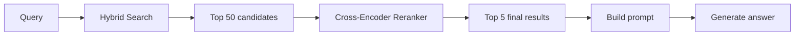
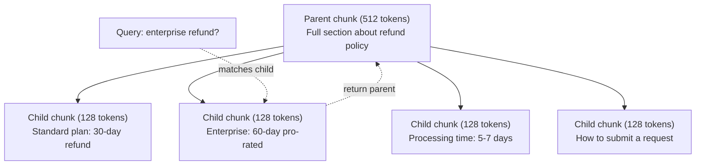
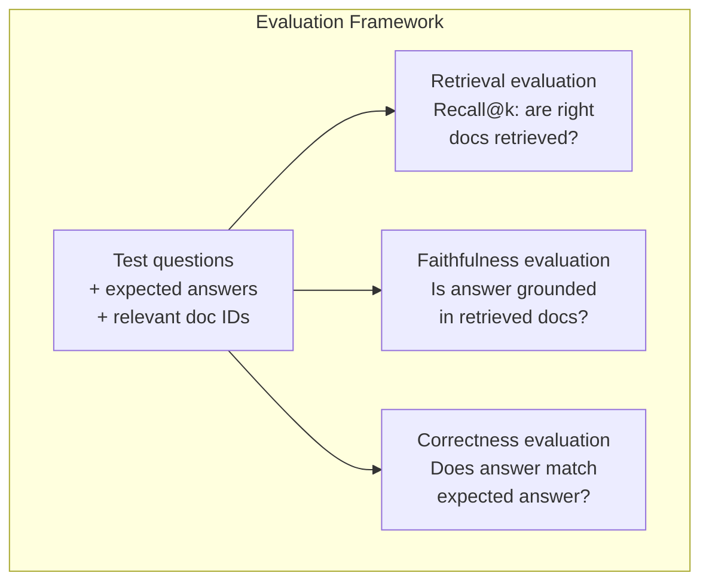

<!-- local-zh-machine-draft: English source is canonical; prose translated automatically, code/math preserved. -->

<a id="advanced-rag-chunking-reranking-hybrid-search"></a>

# Advanced RAG（Chunking、重排序、混合检索）

> Basic RAG 获取最相似的顶端块。 这对简单的问题有效。 它因多跳推理、 模糊查询和大公司而分解。 RAG 是10个文档的演示 和1千万个系统的区别。

**类型：** 构建
**语言:** Python
**先修要求:** 第11阶段,第06课(RAG)
**时间:** ~90分钟
**相关内容:** 第5阶段 23(b)Chunking 战略 RAG) 涵盖所有六种情况 chunking 算法 - 递归、语义、句子、父文档、迟到 chunking,背景检索——与Vectara/Anthropic 基准。 这个教训建立在上面:混合搜索、重新排序、查询转换。

<a id="learning-objectives"></a>

## 学习目标

- 实施高级 chunking 保护文件结构和环境的战略(语义、递归、亲子)
- 建立混合搜索管道 BM25 关键字匹配语义矢量搜索和交叉encoder reranker
- 应用查询转换技术( HyDE、 多查询、 后退) 改进对模糊或复杂问题的检索
- 诊断和修正普通 RAG 失败: 错误的块回收, 不在上下文中回答, 多跳推理解析

<a id="the-problem"></a>

## 问题

你造了一个基础 RAG 6课的管道。它的工作 直截了当的问题 在一小堆。现在尝试这些:

**模糊的查询**"上季度的收入是什么?" Semantic search 返回关于收入战略、收入预测和CFO对收入增长的看法的块块。所有词义都类似于“收入”。没有包含实际数字。正确的块号是“2025年Q3中472万美元”,但使用了“收入”一词,而不是“收入”。 embedding 模型认为“收入策略”比“Q3收入47.2M”更接近于查询。

**多跳问题**:“哪个团队的客户满意度提高得分最高?”这要求找到每个团队的满意度,比较它们,并找出最大。没有一块包含答案。信息分散在团队报告中。

**大规模物质问题**: 您有200万块。 正确的答案在块1, 847, 293中。 您的顶层5号检索拉出块14, #89, 201, #1, 200,000, #44, 和# 901, 333。 关闭 embedding 空间,但没有包含答案。在这个比例上, approximate nearest neighbor 查找引入了足够错误, 相关结果会被从顶部推出 。

Basic RAG 失败, 因为矢量相似性与关联性不同。 一个块在语义上可以与查询相似, 却无法用于回答它 。 RAG 使用四种技术解决这一问题:混合搜索(添加关键词匹配)、重新排序(更仔细地排列候选人)、查询转换(在搜索前先固定查询)以及更好 chunking (在右边的颗粒处检索)

<a id="the-concept"></a>

## 概念

<a id="hybrid-search-semantic--keyword"></a>

### 混合搜索:语义 + 关键字

Semantic search (矢量相似性)很明白意思。“我该如何取消我的订阅?” 与“停止计划”匹配,即使它们没有共同的话。但是它忽略了。 exact matches。“错误代码E-4021”可能与包含“E-4021”的块不符,如果 embedding 模型把它当作噪音。

关键字搜索(BM25正好相反,它很擅长 exact matches。 “ E-4021” 匹配得非常完美。 但是“ 取消我的订阅” 如果文件写着“ 结束你的计划” 则返回零结果 。

混合搜索同时运行, 然后合并结果 。

**BM25** (最佳匹配 25) 是标准关键字搜索算法。 它自1990年代以来一直是搜索引擎的主干。 公式 :

```
BM25(q, d) = sum over terms t in q:
    IDF(t) * (tf(t,d) * (k1 + 1)) / (tf(t,d) + k1 * (1 - b + b * |d| / avgdl))
```

如果 tf(t,d) 是文件d中的 t 的频度,则以国防军(t) 为反向文档频度, |d| 是文档长度, avgdl 是平均文档长度, k1 控件术语频率 saturation (默认1.2)和 b 控件长度 normalization (默认值 0.75)。

简言之: BM25 含有查询条件(尤其是罕见条件)的评分文档中,得分值更高,但重复条件的回报则减少。一个带有“收入”一词的文档,50倍与它一次的相关性不大于50倍。

<a id="reciprocal-rank-fusion-rrf"></a>

### Reciprocal Rank Fusion (RRF) 国家

您有两个排名列表: 一个来自矢量搜索, 一个来自 BM25如何结合他们? Reciprocal Rank Fusion 是标准的方法。

```
RRF_score(d) = sum over rankings R:
    1 / (k + rank_R(d))
```

K 是常数( 通常为60) , 防止顶级控制的结果 。

在矢量搜索中,文档排名为# 1, 排名为# 5 BM25 = 0.0164 + 0.0154 = 0.0318

在矢量搜索中,文档排在第3位,第二位在 BM25 =0.0159 + 0.0161 = 0.0320

RRF 自然平衡了这两个信号。 在两个列表中排名高的文档得分最高。 在一个列表中排名第1但从另一个列表中没有排名的第1号文档得分中等。 这是稳健的,因为它使用排名而不是原始分数,因此两个系统之间的分数分布差异并不重要。

<a id="reranking"></a>

### Reranking

检索( 无论是向量、 关键字还是混合) 快速但不精确 。 它使用双encoders:查询和每个文档独立嵌入,然后比较。 embeddings 将一次计算并缓存。此比例为百万个文档。

排队使用交叉encoders:查询和候选文件被一起输入一个输出相关性得分的模型。该模型同时看到两个文本,并可以捕捉到它们之间的细微互动。encoder 可以理解“Q3收入是什么?” 与含有“Q3中47.2亿美元”的块有很大关系,即使双-encoder 错过连接 。

权衡:encoders 速度比双倍慢100 -1000encoders 因为他们共同处理查询文档配对。您无法预先计算交叉encoder 为百万文档评分。 解决方案: 从混合搜索中获取更大的候选集( 上到下) , 然后重新排序encoder 来得到最后的上5。



常见的重新排序模式(2026年排队):
- Cohere Rerank 3. 5: 管理 API,多语种, 最佳回忆收益 混合公司
- 车辆重排2.5:管理 API,托管选项的最低延迟度
- Jina-Reranker-v2 多语种:开放-weight100+ 语言
- bge-reranker- V2-m3: 打开-weight,强基线
- cross-encoder/ms-marco-MiniLM-L-6-v2: 打开weight,运行 CPU 用于原型设计
- ColBERTv2 / Jina-ColBERT- v2: 延迟互动多矢量器 rerankers - O( 时间)tokens评分时不是O(docs)

<a id="query-transformation"></a>

### 查询转换

有时问题不在于检索,而在于查询本身。“新政策变化是什么?”是一个可怕的搜索查询。它没有包含具体术语。 embedding 模糊。 无法从中找到正确的文档 。

**查询重写**:将用户的查询改写成更好的查询。 LLM 能够做到这一点:

```
User: "What was that thing about the new policy change?"
Rewritten: "Recent policy changes and updates"
```

**HYDE(假体文档) Embeddings)**: 而不是用查询来搜索, 生成一个假想的答案, 嵌入这个答案, 并搜索类似的真实文件 。

```
Query: "What is the refund policy for enterprise?"
Hypothetical answer: "Enterprise customers are eligible for a full refund
within 60 days of purchase. Refunds are pro-rated based on the remaining
subscription period and processed within 5-7 business days."
```

嵌入假想的答案 并寻找与此相似的真实文件。直觉:假设答案更接近 embedding 与最初的问题相比, 真实答案的空间。 问答有不同的语言结构。 通过生成一个假设的答案, 您可以弥合“ 问题空间” 和“ 回答空间” 之间的鸿沟 。 embedding.

HYDE 添加一个 LLM 在检索前先拨打。 这会使潜伏时间增加500- 2000米。 当原始查询的检索质量差时值得使用 。

<a id="parent-child-chunking"></a>

### Parent-Child Chunking

Standard chunking 强制进行权衡:小块用于精确检索,大块用于足够上下文。 chunking 消除了这种权衡。

指数小块(128) tokens) 用于检索。当回收一个小块时,返回其母块(512) tokens) 用于 prompt。小块与查询完全吻合。父块为该选项提供了足够的上下文 LLM 来产生一个好答案。



"企业退款"的查询 与孩子的C2部分完全吻合 prompt 接收整个父块P,其中包括处理时间和提交过程的周围环境。

<a id="metadata-filtering"></a>

### 元数据过滤

在运行矢量搜索之前, 以元数据来过滤星体 : 日期、 来源、 类别、 作者、 语言 。 这样会缩小搜索空间, 防止不相干的结果 。

“上个月安全政策有什么变化? ”应该只搜索过去30天的安全类别文件。不过滤元数据,你就会搜索整个系统,并可能检索出一个2年期的安全文件,这些文件在语义上是相似的。

Production RAG 系统将元数据保存在每个块上:源文档、创建日期、类别、作者、版本。 Vector databases 支持在相似性搜索之前通过元数据预先过滤,这对规模性能至关重要。

<a id="evaluation"></a>

### Evaluation

你造了一个 RAG 系统。 你怎么知道它是否有效?

**检索相关性(Recall@k)**: 对于一组具有已知相关文档的测试问题,在上千位结果中显示的相关文档的百分比是多少?如果问题的答案是块 # 47,则第47块是否出现在顶层5?

**Faithfulness**: 生成的答案是否基于检索到的文档 ? 如果回收的块上写着“ 60天退款窗口 ” , 而模型上写着“ 90天退款窗口 ” , 则表示忠诚失败。 模型虽然有正确的上下文,但仍被幻觉所迷惑 。

**答对了**: 生成的答案是否匹配预期的答案? 这是端对端的度量。 它将检索质量和生成质量结合起来 。

简单的忠诚度检查: 在生成的回答中接受每项要求, 并校验在回收块中显示的( 实质) 。 如果答案包含一个事实, 不包含在任何回收块中, 它很可能被致幻 。



```figure
agentic-rag-loop
```

<a id="build-it"></a>

## 动手实现

<a id="step-1-bm25-implementation"></a>

### 步骤1: BM25 Implementation

```python
import math
from collections import Counter

class BM25:
    def __init__(self, k1=1.2, b=0.75):
        self.k1 = k1
        self.b = b
        self.docs = []
        self.doc_lengths = []
        self.avg_dl = 0
        self.doc_freqs = {}
        self.n_docs = 0

    def index(self, documents):
        self.docs = documents
        self.n_docs = len(documents)
        self.doc_lengths = []
        self.doc_freqs = {}

        for doc in documents:
            words = doc.lower().split()
            self.doc_lengths.append(len(words))
            unique_words = set(words)
            for word in unique_words:
                self.doc_freqs[word] = self.doc_freqs.get(word, 0) + 1

        self.avg_dl = sum(self.doc_lengths) / self.n_docs if self.n_docs else 1

    def score(self, query, doc_idx):
        query_words = query.lower().split()
        doc_words = self.docs[doc_idx].lower().split()
        doc_len = self.doc_lengths[doc_idx]
        word_counts = Counter(doc_words)
        score = 0.0

        for term in query_words:
            if term not in word_counts:
                continue
            tf = word_counts[term]
            df = self.doc_freqs.get(term, 0)
            idf = math.log((self.n_docs - df + 0.5) / (df + 0.5) + 1)
            numerator = tf * (self.k1 + 1)
            denominator = tf + self.k1 * (1 - self.b + self.b * doc_len / self.avg_dl)
            score += idf * numerator / denominator

        return score

    def search(self, query, top_k=10):
        scores = [(i, self.score(query, i)) for i in range(self.n_docs)]
        scores.sort(key=lambda x: x[1], reverse=True)
        return scores[:top_k]
```

<a id="step-2-reciprocal-rank-fusion"></a>

### 步骤2: Reciprocal Rank Fusion

```python
def reciprocal_rank_fusion(ranked_lists, k=60):
    scores = {}
    for ranked_list in ranked_lists:
        for rank, (doc_id, _) in enumerate(ranked_list):
            if doc_id not in scores:
                scores[doc_id] = 0.0
            scores[doc_id] += 1.0 / (k + rank + 1)
    fused = sorted(scores.items(), key=lambda x: x[1], reverse=True)
    return fused
```

<a id="step-3-hybrid-search-pipeline"></a>

### 步骤3:混合搜索管道

```python
def hybrid_search(query, chunks, vector_embeddings, vocab, idf, bm25_index, top_k=5, fusion_k=60):
    query_emb = tfidf_embed(query, vocab, idf)
    vector_results = search(query_emb, vector_embeddings, top_k=top_k * 3)
    bm25_results = bm25_index.search(query, top_k=top_k * 3)
    fused = reciprocal_rank_fusion([vector_results, bm25_results], k=fusion_k)
    return fused[:top_k]
```

<a id="step-4-simple-reranker"></a>

### 步骤4:简单 Reranker

在生产过程中,你会用一个十字架...encoder 模型。 在这里,我们建立一个 reranker 使用单词重叠、术语重要性和短语匹配的评分查询文档相关性。

```python
def rerank(query, candidates, chunks):
    query_words = set(query.lower().split())
    stop_words = {"the", "a", "an", "is", "are", "was", "were", "what", "how",
                  "why", "when", "where", "do", "does", "for", "of", "in", "to",
                  "and", "or", "on", "at", "by", "it", "its", "this", "that",
                  "with", "from", "be", "has", "have", "had", "not", "but"}
    query_terms = query_words - stop_words

    scored = []
    for doc_id, initial_score in candidates:
        chunk = chunks[doc_id].lower()
        chunk_words = set(chunk.split())

        term_overlap = len(query_terms & chunk_words)

        query_bigrams = set()
        q_list = [w for w in query.lower().split() if w not in stop_words]
        for i in range(len(q_list) - 1):
            query_bigrams.add(q_list[i] + " " + q_list[i + 1])
        bigram_matches = sum(1 for bg in query_bigrams if bg in chunk)

        position_boost = 0
        for term in query_terms:
            pos = chunk.find(term)
            if pos != -1 and pos < len(chunk) // 3:
                position_boost += 0.5

        rerank_score = (
            term_overlap * 1.0
            + bigram_matches * 2.0
            + position_boost
            + initial_score * 5.0
        )
        scored.append((doc_id, rerank_score))

    scored.sort(key=lambda x: x[1], reverse=True)
    return scored
```

<a id="step-5-hyde-hypothetical-document-embeddings"></a>

### 步骤5: HYDE(假体文档) Embeddings)

```python
def hyde_generate_hypothesis(query):
    templates = {
        "what": "The answer to '{query}' is as follows: Based on our documentation, {topic} involves specific policies and procedures that define how the process works.",
        "how": "To address '{query}': The process involves several steps. First, you need to initiate the request. Then, the system processes it according to the defined rules.",
        "default": "Regarding '{query}': Our records indicate specific details and policies related to this topic that provide a comprehensive answer."
    }
    query_lower = query.lower()
    if query_lower.startswith("what"):
        template = templates["what"]
    elif query_lower.startswith("how"):
        template = templates["how"]
    else:
        template = templates["default"]

    topic_words = [w for w in query.lower().split()
                   if w not in {"what", "is", "the", "how", "do", "does", "a", "an",
                                "for", "of", "to", "in", "on", "at", "by", "and", "or"}]
    topic = " ".join(topic_words) if topic_words else "this topic"

    return template.format(query=query, topic=topic)


def hyde_search(query, chunks, vector_embeddings, vocab, idf, top_k=5):
    hypothesis = hyde_generate_hypothesis(query)
    hypothesis_emb = tfidf_embed(hypothesis, vocab, idf)
    results = search(hypothesis_emb, vector_embeddings, top_k)
    return results, hypothesis
```

<a id="step-6-parent-child-chunking"></a>

### 步骤6:父母子女 Chunking

```python
def create_parent_child_chunks(text, parent_size=200, child_size=50):
    words = text.split()
    parents = []
    children = []
    child_to_parent = {}

    parent_idx = 0
    start = 0
    while start < len(words):
        parent_end = min(start + parent_size, len(words))
        parent_text = " ".join(words[start:parent_end])
        parents.append(parent_text)

        child_start = start
        while child_start < parent_end:
            child_end = min(child_start + child_size, parent_end)
            child_text = " ".join(words[child_start:child_end])
            child_idx = len(children)
            children.append(child_text)
            child_to_parent[child_idx] = parent_idx
            child_start += child_size

        parent_idx += 1
        start += parent_size

    return parents, children, child_to_parent
```

<a id="step-7-faithfulness-evaluation"></a>

### 步骤7:信教 Evaluation

```python
def evaluate_faithfulness(answer, retrieved_chunks):
    answer_sentences = [s.strip() for s in answer.split(".") if len(s.strip()) > 10]
    if not answer_sentences:
        return 1.0, []

    grounded = 0
    ungrounded = []
    context = " ".join(retrieved_chunks).lower()

    for sentence in answer_sentences:
        words = set(sentence.lower().split())
        stop_words = {"the", "a", "an", "is", "are", "was", "were", "and", "or",
                      "to", "of", "in", "for", "on", "at", "by", "it", "this", "that"}
        content_words = words - stop_words
        if not content_words:
            grounded += 1
            continue

        matched = sum(1 for w in content_words if w in context)
        ratio = matched / len(content_words) if content_words else 0

        if ratio >= 0.5:
            grounded += 1
        else:
            ungrounded.append(sentence)

    score = grounded / len(answer_sentences) if answer_sentences else 1.0
    return score, ungrounded


def evaluate_retrieval_recall(queries_with_relevant, retrieval_fn, k=5):
    total_recall = 0.0
    results = []

    for query, relevant_indices in queries_with_relevant:
        retrieved = retrieval_fn(query, k)
        retrieved_indices = set(idx for idx, _ in retrieved)
        relevant_set = set(relevant_indices)
        hits = len(retrieved_indices & relevant_set)
        recall = hits / len(relevant_set) if relevant_set else 1.0
        total_recall += recall
        results.append({
            "query": query,
            "recall": recall,
            "hits": hits,
            "total_relevant": len(relevant_set)
        })

    avg_recall = total_recall / len(queries_with_relevant) if queries_with_relevant else 0
    return avg_recall, results
```

<a id="use-it"></a>

## 实际应用

用真正的十字架... ...encoder 用于重新排序:

```python
from sentence_transformers import CrossEncoder

reranker = CrossEncoder("cross-encoder/ms-marco-MiniLM-L-6-v2")

def rerank_with_cross_encoder(query, candidates, chunks, top_k=5):
    pairs = [(query, chunks[doc_id]) for doc_id, _ in candidates]
    scores = reranker.predict(pairs)
    scored = list(zip([doc_id for doc_id, _ in candidates], scores))
    scored.sort(key=lambda x: x[1], reverse=True)
    return scored[:top_k]
```

有了Cohere的管理 reranker:

```python
import cohere

co = cohere.Client()

def rerank_with_cohere(query, candidates, chunks, top_k=5):
    docs = [chunks[doc_id] for doc_id, _ in candidates]
    response = co.rerank(
        model="rerank-english-v3.0",
        query=query,
        documents=docs,
        top_n=top_k
    )
    return [(candidates[r.index][0], r.relevance_score) for r in response.results]
```

给有真品的HyDE LLM:

```python
import anthropic

client = anthropic.Anthropic()

def hyde_with_llm(query):
    response = client.messages.create(
        model="claude-sonnet-5",
        max_tokens=256,
        messages=[{
            "role": "user",
            "content": f"Write a short paragraph that would be a good answer to this question. Do not say you don't know. Just write what the answer would look like.\n\nQuestion: {query}"
        }]
    )
    return response.content[0].text
```

与Weaviate进行混合搜索,用于生产:

```python
import weaviate

client = weaviate.connect_to_local()

collection = client.collections.get("Documents")
response = collection.query.hybrid(
    query="enterprise refund policy",
    alpha=0.5,
    limit=10
)
```

阿尔法 parameter 控制平衡: 0.0 = 纯关键词(BM25,1.0 = 纯矢量,0.5 = 等 weight大多数生产系统使用0.3至0.7之间的阿尔法。

<a id="ship-it"></a>

## 交付成果

本课产生：
- `outputs/prompt-advanced-rag-debugger.md` -- 一个 prompt 用于诊断和修补 RAG 质量问题
- `outputs/skill-advanced-rag.md` - 培养生产等级的技能 RAG 进行混合搜索和重新排序

<a id="exercises"></a>

## 练习

1. Compare BM25 vs 矢量搜索与样本文档的混合搜索。 对于五个测试查询中的每一个, 记录哪个接近返回位置 # 1 中最相关的块 。 混合搜索应该至少赢得 3 个 。

2. 执行元数据过滤器。 在每个文档中添加一个“ 分类” 字段( 安全、 计费、 api在运行矢量搜索之前, 过滤块到相关的类别。 测试“ 使用什么加密 ” 并验证它只搜索安全类别块 。

3. 使用 06 课中的简单生成函数构建一个完整的 HYDE 管道。 将直接查询搜索和 HYDE 搜索在所有5 个测试查询中之间的检索质量( 顶部 3 相关) 比较 。 HYDE 应改进模糊查询的结果 。

4. 落实父母子女 chunking 样本文档的策略。使用子_大小=30和父_大小= 100。 用子块搜索, 但返回父块 prompt。将生成的答案与标准比较 chunking 与块_尺寸=50。

5. 创建 evaluation 数据集: 10个问题, 有已知的回答块。 测量回溯@ 3, 回溯@ 5 和回溯@ 10 用于 (a) 只搜索矢量, (b) BM25 (c) 混合搜索,(d) 混合+重新排序。绘制结果并确定重新排序对哪些地方最有帮助。

<a id="key-terms"></a>

## 关键术语

| 术语 | 人们怎么说 | 它实际上意味着什么 |
|------|----------------|----------------------|
| BM25 | "关键词搜索" | 概率排序算法,按术语频率、反向文档频率和文档长度对文档进行分级 normalization |
| 混合搜索 | "两个世界的顶峰" | 运行语义( 矢量) 和关键字 (BM25平行搜索, 然后将结果与等级合并合并 |
| Reciprocal Rank Fusion | "名列清单" | 对所有列表中的每个文档按 mumming 1/(k) + stage) 组合多个排名列表 |
| Reranking | "第二球得分" | 用更贵的十字架...encoder 从初始检索中重新定位候选人的模型 |
| Cross-encoder | “联合查询文件模型” | 将查询和文档作为单一输入的模型,产生关联性评分;比双encoders 但太慢 无法完整搜索 |
| Bi-encoder | "独立 embedding 模型" | 独立嵌入查询和文件的模式; 快速是因为 embeddings 是预先计算,但准确度低于交叉encoders |
| HyDE | "寻找假答案" | 生成对查询的假想答案, 嵌入它, 并搜索类似的真实文件 |
| Parent-child chunking | "小搜索,大背景" | 用于精确检索的索引小块, 但返回较大的父块以提供足够的上下文 |
| 元数据过滤 | "在搜索前的狭小" | 在运行矢量搜索以缩小搜索空间之前,按属性(日期、源、类别)过滤文档 |
| 忠诚 | "它是否一直被禁足" | 生成的答案是否由检索到的文档支持, 而不是从模型的训练数据中实现幻觉 |

<a id="further-reading"></a>

## 进一步阅读

- Robertson & Zaragoza, “概率相关性框架: BM25 和以后"(2009年) -- -- 明确提及 BM25,解释公式背后的概率基础
- Cormack等人, "Reciprocal Rank Fusion 优于Condorcet 和个人级学习方法(2009年),
- Gao等人, " 解释 Zero-Shot Dense Retrieval 无相关性标签”(2022年) -- -- HYDE文件,证明这一假设文件 embeddings 在没有任何训练数据的情况下改进检索
- Nogueira & Cho, “ 选票重新排到 BERT" (2019年) -- -- 显示交叉encoder 重新排队 BM25 大大提高检索质量
- [Khattab等人,“DSPy:将声明语言模式呼吁汇编为改善自来水管”(2023年)。](https://arxiv.org/abs/2310.03714) -- 治疗 prompt 建筑和 weight 选择为回收管道的优化问题; 读取此“ 程序” LLMs" 而非 "prompt LLMs."
- [Edge等人,“从本地到全球:图表” RAG 问答式总结方法”(微软研究2024)](https://arxiv.org/abs/2404.16130) -- GraphRAG论文:实体关系提取 + Leiden社区探测,以查询为焦点总结;全球与本地检索的区别。
- [Asai等人, " 自己-RAG学习通过自我反省获取、生成和刻度”(ICLR 2024)](https://arxiv.org/abs/2310.11511) - 自我评价 RAG 反射 tokens; 该 agentic 边界经过静态回收,然后生成。
- [LangChain 查询建设博客](https://blog.langchain.dev/query-construction/) - 如何将自然语言查询转换为结构化数据库查询(从文本到SQL以追踪前的一步
