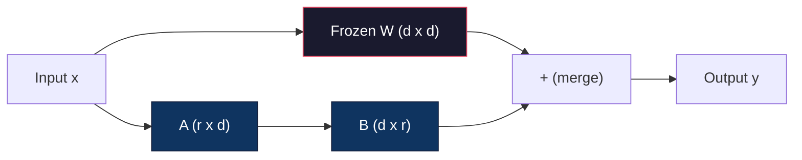
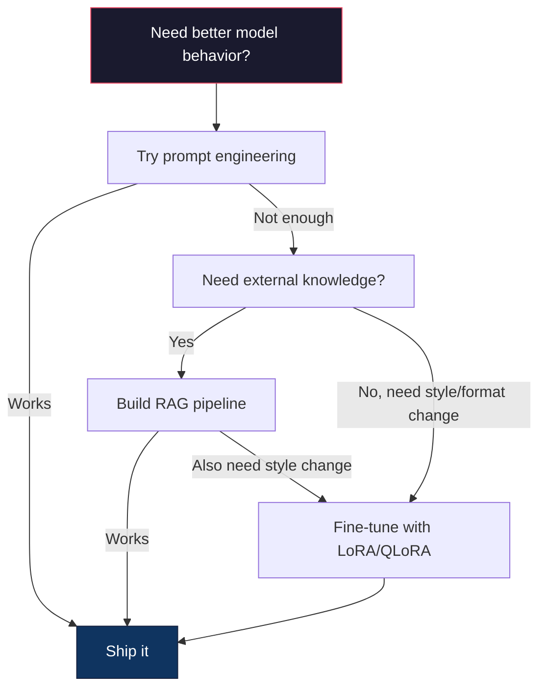

<!-- local-zh-machine-draft: English source is canonical; prose translated automatically, code/math preserved. -->

<a id="fine-tuning-with-lora--qlora"></a>

# Fine-Tuning 与 LoRA & QLoRA

> Full fine-tuning 7B模型需要56GBVRAM 你没有,大部分公司也没有 LoRA 使您在 6GB 中微调同一模型, 培训时间小于 parameters。这不是一个折中-- 它完全匹配 fine-tuning 大多数任务的质量。 整个开放源代码 fine-tuning 生态系统就靠这个把戏运作

**类型:** Build
**语言:** Python
**先修要求:** 第10阶段,第06课(教学图理/ SFT)
**时间:** ~75分钟
**相关内容:** 第10阶段包括: SFT/DPO 从零开始循环。 此课将连接到 2026 PEFT 工具包( PEFT、 TRL、 Unsloth、 Axolotl、 Axolotl、 LLaMA- 脚步声

<a id="learning-objectives"></a>

## 学习目标

- Implement LoRA 将低级适配器矩阵(A和B)注入预培训模型 attention layers
- 计算 parameter 节余 LoRA 对满 fine-tuning: R 级与 d_模型尺寸列车 2*r*d parameters 而不是 d^2
- 精细调制模型使用 QLoRA (4位数基数+) LoRA 适应消费者 GPU memory
- Merge LoRA weights 返回用于部署和比较的基准模式 inference 具有和没有适配器的速度

<a id="the-problem"></a>

## 问题

你有一个基本模型。 Llama 38B,你要用你公司的声音回答客户支持票 SFT 是答案,但是... SFT 有成本问题。

Full fine-tuning 更新间隔 parameter 在模型中。 Llama 3 8B有80亿 parameters在 FP16 中,每个 parameter 需要2字节,这是16GB weights。在训练期间,您也需要 gradients (16英镑) optimizer 国家 Adam 总计: 大约56GB VRAM 用于单 8B 模式 。

A100 80GB 几乎无法适应这个条件。 两个 A100 每小时3 -4美元 用于云源提供商。 3个世纪的5万例培训需要6 - 10小时。 每个实验需要30 - 40美元。 运行 10 个实验来获取 hyperparameters 对,你花了400美元才布置任何东西

缩放到 Llama 370B和数字变得荒谬。 weights 单枪匹马,每个实验需要100美元以上

还有更深的问题 满的 fine-tuning 修改 weight 在模型中。 如果你对客户支持数据进行微调, 你可能会降低模型的一般能力。 这被称为灾难性的遗忘。 该模型在你的任务上会变得更好, 在其它方面会更糟 。

你需要一种训练少一点的方法 parameters,使用较少的内存, 不破坏模型的现有知识。

<a id="the-concept"></a>

## 概念

<a id="lora-low-rank-adaptation"></a>

### LoRA:低射线适应

Edward Hu和微软公司的同事出版 LoRA 2021年6月 论文的见解: weight 更新 fine-tuning 你不需要更新所有1670万 parameters 在4096x4096中 weight 矩阵:更新中的有用信息可通过第16级或32级的矩阵获取。

这是数学,一个标准的线性层计算:

```
y = Wx
```

W在那个地方_调出 x d_在矩阵中。 4096x4096 attention 投影 16 777 216 parameters.

LoRA 冻结W, 并添加低级分解 :

```
y = Wx + BAx
```

B区(d)_输出 x r 和 A 是 (r x d)_r级比d级小得多 -- -- 通常为8、16或32级。

4096x4096层的r=16:
- Original parameters= 16 777 216
- LoRA parameters: (4096 x 16) + (16 x 4096) = 65,536 + 65,536 = 131,072
- 减少数:131 072 / 16 777 216 = 0.78%

你训练了0.78%的 parameters 并获得95-100%的质量。



A 以随机高斯初始化。 B 初始化为零。 这意味着 LoRA 贡献从零开始 -- 这个模型从最初的行为开始训练, 逐渐学会适应。

<a id="the-scaling-factor-alpha"></a>

### 缩放系数: 阿尔法

LoRA 引入一个缩放因数 alpha, 控制低级别更新对输出的影响 :

```
y = Wx + (alpha / r) * BAx
```

当 Alpha = r 时,缩放为 1x。当 Alpha = 2r (常见默认) 时,缩放为 2x 。 hyperparameter 控制 learning rate 的 LoRA 独立于基点的路径 learning rate.

实用指南:
- 阿尔法=2 * 等级是共同的共同体公约(在大多数试验中使用的原始纸张为Apha=等级)
- Alpha = 级给 1x 缩放, 稳妥但稳定
- 高阿尔法意味着每个步骤的更新量更大,这可以加速趋同或造成不稳定

<a id="where-to-apply-lora"></a>

### 在哪里应用 LoRA

一个 transformer 有很多线性层。 您不需要添加 LoRA 原纸测试了不同的组合:

| 目标图层 | 可训练参数(7B) | 品质 |
|--------------|----------------------|---------|
| q_仅 proj | 4.7亿 | 好 |
| q_第2类+五_proj | 9.4亿 | 更好 |
| q_专业+k_第2类+五_专业+o_proj | 18.9亿 | 最佳选择 attention |
| 全部线性( E)attention + MLP) (单位:千美元) | 37.7亿 | 边际收益, 2x参数 |

大部分任务的甜点:q_第2类+五_proj. 这是针对 查询和数值预测的 self-attention,该选项控制模型所关注的内容和它提取的信息。添加 MLP 层有助于生成代码等复杂任务,但将 parameter 计算简单任务的回报减少 。

<a id="rank-selection"></a>

### 排名选择

等级 r 控制着适应的表达性:

| 排名 | 可训练参数( 每层) | 最适合 |
|------|---------------------------|----------|
| 4 | 32,768 | 简单分类,情绪 |
| 8 | 65,536 | 单域 Q&A, 汇总 |
| 16 | 131,072 | 多域任务, instruction following |
| 32 | 262,144 | 复杂的推理、代码生成 |
| 64 | 524,288 | 大多数任务的返回正在缩小 |
| 128 | 1,048,576 | 理由很少 |

Hu等人显示,r=4已经记录了大部分简单任务适应情况。 r=8和r=16是实践中最常见的选择。 LoRA记忆优势

<a id="qlora-4-bit-quantization--lora"></a>

### QLoRA页:1 Quantization + LoRA

出版《Tim Dettmers和华盛顿大学同事》 QLoRA 2023年5月。这个想法: 将冻结的基模量化为 4 位精确度, 然后附加 LoRA 顶部有FP16的适配器

这极大地改变了记忆方程式:

| 方法 | Weight 内存( 7B) | 训练记忆(7B) | GPU 必需 |
|--------|-------------------|---------------------|-------------|
| 完全微调(fp16) | 14GB( 14GB) 国家 | ~56GB | 1x A100 80GB |
| LoRA (fp16基数) | 14GB( 14GB) 国家 | ~ 18GB | 1辆A100 40GB |
| QLoRA (4位数基) | 3.5英镑 | ~ 6GB 键 | 1xRTX 3090 24GB |

QLoRA 作出了三项技术贡献:

**NF4( 正常浮点 4 位)**:专门为神经网络设计的新数据类型 weights神经网络 weights NF4 设置为16。 quantization 在标准正态分布的数级中进行水平。对于通常分布的数据来说,这是信息理论上的最佳选择。它丢失的信息少于统一的 4 位数 quantization (INT4)或标准浮点4。

**Double quantization**: 该 quantization 常数本身要用内存。 每个区块为 64 weights 需要 fp32 比例系数( 4 字节)。 对于 7B 模式, 额外值为 0.4GB 。 quantization 将这些常数量化为 fp8, 将管理费降低到 0.1GB。 虽然小, 但加起来 。

**Paged optimizers**培训期间 optimizer 国家(Adam势头和差异)可超过 GPU 长序列中的内存。 optimizers 自动使用 NVIDIA 的统一内存 optimizer 国家 CPU 内存时 GPU 内存已经耗尽, 需要时会把它们调回。 这可以防止 OOM 撞车, 以一些工作量为代价 。

<a id="the-quality-question"></a>

### 质量问题

正在减少 parameters 或对基本伤害质量进行量化?

| 方法 | MMLU(5发子弹) | MT-Bench | HumanEval |
|--------|--------------|----------|-----------|
| 完全微调( )Llama 2 7B) (第2条) | 48.3 | 6.72 | 14.6 |
| LoRA r=16 | 47.9 | 6.68 | 14.0 |
| QLoRA r=16 (NF4) | 47.5 | 6.61 | 13.4 |
| QLoRA r=64 (NF4) | 48.1 | 6.70 | 14.2 |

LoRA R=16时为满分的1% fine-tuning 多数基准。 QLoRA 在r=16时,会损失一个百分比的一小部分。 QLoRA 在 R=64 时基本上匹配齐全 fine-tuning 使用90%的内存。

<a id="real-world-costs"></a>

### 真实世界成本

Fine-tuning Llama 3,8B,5万个例子(3个世纪):

| 方法 | GPU | 时间 | 成本 |
|--------|-----|------|------|
| 完全微调 | 2x A100 80GB | 8小时 | ~$32 |
| LoRA r=16 | 1辆A100 40GB | 4小时 | ~$8 |
| QLoRA r=16 | 1xRTX 4090 24GB | 6小时 | ~$5 |
| QLoRA r=16(脱落) | 1xRTX 4090 24GB | 2.5小时 | ~$2 |
| QLoRA r=16 | 1辆T4 16GB | 12小时 | ~$4 |

QLoRA 单一消费者 GPU 费用比午餐还低 所以才开放...weight fine-tuning 2023年社区爆炸,为什么每条船下方的训练框架 QLoRA 默认在2026年。

<a id="the-2026-peft-stack"></a>

### 2026 PEFT 堆叠

| 框架 | 这是什么? | 选择时间 |
|-----------|-----------|-----------|
| **拥抱脸 PEFT** | 明信片 LoRA/QLoRA图书馆/图书馆/图书馆/图书馆 | 你要原始控制,训练循环已经启动 `transformers.Trainer` |
| **TRL** | 高频后援训练员SFT, DPO, GRPO, PPO,ORPO) | 你需要的 DPO/GRPO 之后 SFT; 建在 PEFT 顶部 |
| **Unsloth** | Triton- 转发的内核重写 。backward pass | 您想要2 - 5x 加速 + 一半 VRAM 没有准确性损失 ; Llama/Mistral/Qwen family |
| **Axolotl** | YAML- PEFT + TRL + 深层擦拭 + Unsloth 上的配置包装 | 您想要复制, 版本控制训练运行 |
| **LLaMA- 脚步声** | 图形用户界面/ CLI/API 超过PEFT+TRL | 你想要零代码 fine-tuning; 支持100+个模范家庭 |
| **torchtune** | Native PyTorch 食谱,没有 `transformers` dep | 你要最小的底盘和你的兽已经标准化了 PyTorch |

缩略语规则:研究用法或一次性实验  P PEFT. 可重复生产管管 x Axolotl 与 Unsloth 内核启用。 LLaMA- 感觉

<a id="merging-adapters"></a>

### 合并适应器

训练后,你有两样东西: 冷冻的基地模型和一个小的 LoRA 适配器( 通常为 10 - 100MB) 。 您也可以 :

1. **分开吧**:装入基准模型,在顶部装载适配器。为不同任务交换适配器。这是您如何从一个基准模型中为多个经微调的变体服务的方式。

2. **永久合并**:计算 W = W + (阿尔法/r) * BA 并保存结果为新的完整模型。 合并模式与原始模式的大小相同 。 inference 上面没有适配器可用

对于服务于多项任务( 客户支持适配器、 代码适配器、 翻译适配器) , 请将其分开 。 对于部署单一的专门模型, 请合并 。

组合多个适配器的高级合并技术:

- **TIES-Merging** (Yadav等人,2023年):微放大度 parameters,解决冲突,然后合并。减少适应者之间的干扰。
- **DARE** (Yu等人,2023年):随机下降适配器 parameters 在合并和重新缩放前 rest令人惊讶的是,在综合能力方面是有效的。
- **任务算术**: 简单地添加或减用适配器 weights。添加“代码”适配器和“数学”适配器通常能产生一种两种功能的模型。

<a id="when-not-to-fine-tune"></a>

### 当不精细时

Fine-tuning 是第三个选项,而不是第一个选项。

**第一: prompt engineering.** 写一个更好的 system prompt添加 few-shot 示例。 chain-of-thought。这不需要花费多少时间,需要几分钟。如果提示能让你到达那里80%的路程,你可能不需要微调。

**第二张: RAG.** 如果模型需要了解你的具体数据(文件、知识库、产品目录),检索比烘烤更便宜、更便于维护。 weights见06课。

**第三个: fine-tuning.** 当您需要模型来采用无法通过提示实现的特定样式、格式或推理模式时, 使用此选项。 如果您需要一致性 structured output。当您需要将一个更大的模型蒸馏成一个较小的模型时。当潜伏很重要,而您负担不起额外的 tokens 来自 few-shot 发号施令



```figure
lora-params
```

<a id="build-it"></a>

## 动手实现

我们执行 LoRA 纯净地从零开始 PyTorch没有图书馆,没有魔法,你会建造 LoRA 将它注入一个模型,训练它,并合并 weights 回来

<a id="step-1-the-lora-layer"></a>

### 步骤1: LoRA Layer

```python
import torch
import torch.nn as nn
import math

class LoRALayer(nn.Module):
    def __init__(self, in_features, out_features, rank=8, alpha=16):
        super().__init__()
        self.rank = rank
        self.alpha = alpha
        self.scaling = alpha / rank

        self.A = nn.Parameter(torch.randn(in_features, rank) * (1 / math.sqrt(rank)))
        self.B = nn.Parameter(torch.zeros(rank, out_features))

    def forward(self, x):
        return (x @ self.A @ self.B) * self.scaling
```

A 以随机缩放值初始化为零。 B 初始化为零。 产品 BA 开始为零, 因此模型从原始行为开始 。

<a id="step-2-lora-wrapped-linear-layer"></a>

### 步骤2: LoRA- 编织的线性图层

```python
class LinearWithLoRA(nn.Module):
    def __init__(self, linear, rank=8, alpha=16):
        super().__init__()
        self.linear = linear
        self.lora = LoRALayer(
            linear.in_features, linear.out_features, rank, alpha
        )

        for param in self.linear.parameters():
            param.requires_grad = False

    def forward(self, x):
        return self.linear(x) + self.lora(x)
```

原线性层被冻结。 LoRA parameters (A和B)是可以训练的。

<a id="step-3-inject-lora-into-a-model"></a>

### 步骤3:注射 LoRA 变成一个模型

```python
def inject_lora(model, target_modules, rank=8, alpha=16):
    for param in model.parameters():
        param.requires_grad = False

    lora_layers = {}
    for name, module in model.named_modules():
        if isinstance(module, nn.Linear):
            if any(t in name for t in target_modules):
                parent_name = ".".join(name.split(".")[:-1])
                child_name = name.split(".")[-1]
                parent = dict(model.named_modules())[parent_name]
                lora_linear = LinearWithLoRA(module, rank, alpha)
                setattr(parent, child_name, lora_linear)
                lora_layers[name] = lora_linear
    return lora_layers
```

第一,冻结每个 parameter 在模型中。然后走在模型树上, 找到匹配目标名称的线性层, 并替换为 LoRA- 包装版本。 LoRA A和B矩阵是唯一可受训的 parameters 整个模型。

<a id="step-4-count-parameters"></a>

### 步骤4:计数 Parameters

```python
def count_parameters(model):
    total = sum(p.numel() for p in model.parameters())
    trainable = sum(p.numel() for p in model.parameters() if p.requires_grad)
    frozen = total - trainable
    return {
        "total": total,
        "trainable": trainable,
        "frozen": frozen,
        "trainable_pct": 100 * trainable / total if total > 0 else 0
    }
```

<a id="step-5-merge-weights-back"></a>

### 步骤5:合并 Weights Back

```python
def merge_lora_weights(model):
    for name, module in model.named_modules():
        if isinstance(module, LinearWithLoRA):
            with torch.no_grad():
                merged = (
                    module.lora.A @ module.lora.B
                ) * module.lora.scaling
                module.linear.weight.data += merged.T
            parent_name = ".".join(name.split(".")[:-1])
            child_name = name.split(".")[-1]
            if parent_name:
                parent = dict(model.named_modules())[parent_name]
            else:
                parent = model
            setattr(parent, child_name, module.linear)
```

合并后 LoRA 该模型的大小与原版相同,并被烤制成 weights. 否 inference 顶部。

<a id="step-6-simulated-qlora-quantization"></a>

### 步骤6:模拟 QLoRA Quantization

```python
def quantize_to_nf4(tensor, block_size=64):
    blocks = tensor.reshape(-1, block_size)
    scales = blocks.abs().max(dim=1, keepdim=True).values / 7.0
    scales = torch.clamp(scales, min=1e-8)
    quantized = torch.round(blocks / scales).clamp(-8, 7).to(torch.int8)
    return quantized, scales

def dequantize_from_nf4(quantized, scales, original_shape):
    dequantized = quantized.float() * scales
    return dequantized.reshape(original_shape)
```

模拟 4 位元 quantization 通过绘图 weights 至64区块内的16个离散水平。 QLoRA 使用比特和字节库用于真正的 NF4 操作 GPU.

<a id="step-7-training-loop"></a>

### 步骤7:训练循环

```python
def train_lora(model, data, epochs=5, lr=1e-3, batch_size=4):
    optimizer = torch.optim.AdamW(
        [p for p in model.parameters() if p.requires_grad], lr=lr
    )
    criterion = nn.MSELoss()

    losses = []
    for epoch in range(epochs):
        epoch_loss = 0.0
        n_batches = 0
        indices = torch.randperm(len(data["inputs"]))

        for i in range(0, len(indices), batch_size):
            batch_idx = indices[i:i + batch_size]
            x = data["inputs"][batch_idx]
            y = data["targets"][batch_idx]

            output = model(x)
            loss = criterion(output, y)

            optimizer.zero_grad()
            loss.backward()
            optimizer.step()

            epoch_loss += loss.item()
            n_batches += 1

        avg_loss = epoch_loss / n_batches
        losses.append(avg_loss)

    return losses
```

<a id="step-8-full-demo"></a>

### 步骤8:全面演示

```python
def demo():
    torch.manual_seed(42)
    d_model = 256
    n_classes = 10

    model = nn.Sequential(
        nn.Linear(d_model, 512),
        nn.ReLU(),
        nn.Linear(512, 512),
        nn.ReLU(),
        nn.Linear(512, n_classes),
    )

    n_samples = 500
    x = torch.randn(n_samples, d_model)
    y = torch.randint(0, n_classes, (n_samples,))
    y_onehot = torch.zeros(n_samples, n_classes).scatter_(1, y.unsqueeze(1), 1.0)

    data = {"inputs": x, "targets": y_onehot}

    params_before = count_parameters(model)

    lora_layers = inject_lora(
        model, target_modules=["0", "2"], rank=8, alpha=16
    )

    params_after = count_parameters(model)

    losses = train_lora(model, data, epochs=20, lr=1e-3)

    merge_lora_weights(model)
    params_merged = count_parameters(model)

    return {
        "params_before": params_before,
        "params_after": params_after,
        "params_merged": params_merged,
        "losses": losses,
    }
```

演示产生一个小模型,注射 LoRA 分为两层,训练它,并合并 weights 后退 。 parameter 计数从全程可训练到~1% 可训练期间 LoRA 训练,然后在合并后返回原始建筑。

<a id="use-it"></a>

## 实际应用

有了"拥抱面"生态系统 LoRA 在真正的模型上 需要大约20行:

```python
from transformers import AutoModelForCausalLM, AutoTokenizer
from peft import LoraConfig, get_peft_model, TaskType

model = AutoModelForCausalLM.from_pretrained("meta-llama/Llama-3.1-8B")
tokenizer = AutoTokenizer.from_pretrained("meta-llama/Llama-3.1-8B")

lora_config = LoraConfig(
    task_type=TaskType.CAUSAL_LM,
    r=16,
    lora_alpha=32,
    lora_dropout=0.05,
    target_modules=["q_proj", "v_proj"],
)

model = get_peft_model(model, lora_config)
model.print_trainable_parameters()
```

用于 QLoRA,添加比特和字节 quantization:

```python
from transformers import BitsAndBytesConfig

bnb_config = BitsAndBytesConfig(
    load_in_4bit=True,
    bnb_4bit_quant_type="nf4",
    bnb_4bit_compute_dtype=torch.bfloat16,
    bnb_4bit_use_double_quant=True,
)

model = AutoModelForCausalLM.from_pretrained(
    "meta-llama/Llama-3.1-8B",
    quantization_config=bnb_config,
    device_map="auto",
)

model = get_peft_model(model, lora_config)
```

同样的训练循环 相同的数据管道 基模现在4比特 LoRA Fp16的适应器列车 和整个事情符合6GB。

与抱住脸训练员培训时:

```python
from transformers import TrainingArguments, Trainer
from datasets import load_dataset

dataset = load_dataset("tatsu-lab/alpaca", split="train[:5000]")

training_args = TrainingArguments(
    output_dir="./lora-llama",
    num_train_epochs=3,
    per_device_train_batch_size=4,
    gradient_accumulation_steps=4,
    learning_rate=2e-4,
    fp16=True,
    logging_steps=10,
    save_strategy="epoch",
    optim="paged_adamw_8bit",
)

trainer = Trainer(
    model=model,
    args=training_args,
    train_dataset=dataset,
)

trainer.train()

model.save_pretrained("./lora-adapter")
```

保存的适配器为 10 100MB 。 基建模型不会被移动。 您可以在 Hugging Face Chub 上共享适配器, 而不将全套模型重新分发 。

<a id="ship-it"></a>

## 交付成果

本课产生：
- `outputs/prompt-lora-advisor.md` -- 一个 prompt 帮助你决定 LoRA 级别、目标模块和 hyperparameters 用于您的具体任务
- `outputs/skill-fine-tuning-guide.md` - 教书的技巧 agents 何时以及如何微调决策树

<a id="exercises"></a>

## 练习

1. **降级研究。** 以 2 、 4 、 8、 16、 32 和 64 级来运行演示。 找到一个降低收益的点, 即将排名翻一番后不再将损失减半。 简单分类任务为 256 dimm features,这应该是R=8-16左右。

2. **目标模块比较。** 修改注射_仅瞄准层0, 只瞄准层2, 只有层4, 以及所有三个。 将每个变量训练为 20 个epoch 。 比较趋同速度和最终损失 。 这反映了目标 q 的真实决定 。_Proj vs v 类_Proj 相对于所有线性层。

3. **Quantization 错误分析。** 选个训练型号 weight 量化前后的矩阵_以_nf4 / 量化_来自_nf4. 计算平均平方错误、最大绝对错误以及原始和重新构建的关联 weights。用块进行实验_体积值为32、64、128和256。

4. **多适应服务。** 二号火车 LoRA 数据不同子集上的适配者( 即使是指数还是奇数指数) 。 保存两个适配者 。 一次装入基数模型, 然后交换适配者, 并核实每个基数输入的结果都不同。 这就是生产系统如何从一个基数上为多个微调模型服务的方式 。

5. **合并对未合并 inference.** 比较 LoRA 合并前后的模型_lora_校验输出( 在1e-5的浮点容度内) 。 inference 两者的速率 -- 合并速度应该稍快一点, 因为是一个单矩阵乘以两个。

<a id="key-terms"></a>

## 关键术语

| 术语 | 人们怎么说 | 它实际上意味着什么 |
|------|----------------|----------------------|
| LoRA | "高效 fine-tuning" | 低朗适应:冻结基数 weights,培训产品接近全数的两个小矩阵A和B weight update |
| QLoRA | "笔记本电脑的好调子" | Quantized LoRA:以 4 位NF4 列车装载基准模型 LoRA Fp16 上方的适配器, 启用 7B fine-tuning 在 6GB VRAM 中 |
| 级别(r) | "模型能学到多少" | A 和 B 矩阵的内部维度; 控制表达性与 : parameter count |
| 阿尔法 | "LoRA learning rate" | 适用于 LoRA 输出; alpha/r 比例适应对最终输出的贡献 |
| NF4 | "4 位数 quantization" | 普通浮点 4 : 一个 4 位数据类型 quantization 正常分布区数水平, 最适合神经网络 weights |
| 适配器 | "训练的一小部分" | 该 LoRA A 和 B 矩阵作为单独文件保存( 10- 100MB), 可在任何基本模型副本上加载 |
| 目标模块 | "哪一层到 LoRA" | 特定的线性层(q)_第2条, v_(b) 将 LoRA 调适器被注射 |
| Merging | "把它装进去" | W+(阿尔法/r) * BA和替换原版 weight,在 inference |
| Paged optimizers | "训练时不要用OOM" | Offloading optimizer 国家(Adam 动向, 变化) CPU 当 GPU 内存已耗尽 |
| 灾难性遗忘 | "Fine-tuning 打破了所有东西" | 全部更新时 weights 导致模型丧失先前所学能力 |

<a id="further-reading"></a>

## 进一步阅读

- 胡等人, "LoRA(2021年) - 介绍低级分解法的原始论文,在 GPT-3 175B,级别低至4
- Dettmers等人, " 。QLoRA:对量化语言模型“(2023年)进行高效的微调,引入NF4,双倍 quantization页面 optimizers,启用 65B fine-tuning 单人48GB GPU
- PEFT 图书馆文件(huggingface.co/docs/peft) -- -- 用于 LoRA, QLoRA,等等 parameter- 采取有效方法,在 " 拥抱面 " 生态系统中
- Yadav等人,“DYS-Merging:在合并模型时解决干扰”(2023年) -- -- 组合多种技术 LoRA 不发生质量降解的适应器
- [Rafailov等人,“最优化直接偏好:你的语言模式是秘密的” Reward Model" (NeurIPS 2023)](https://arxiv.org/abs/2305.18290) -- DPO 衍生;之后的优惠调整阶段 SFT, 否 reward model 需要的。
- [TRL 文档](https://huggingface.co/docs/trl/) -- 正式参考 `SFTTrainer`, `DPOTrainer`, `KTOTrainer`,以及与 PEFT/bitsandbytes/Unsloth的集成面。
- [撤消文档](https://docs.unsloth.ai/) - 双倍的导火线内核 fine-tuning 吞吐量和内存减半;TRL下的性能层。
- [Axolotl 文档](https://axolotl-ai-cloud.github.io/axolotl/) -- YAML- 组合的多...GPU SFT/DPO/QLoRA 训练员; 手写脚本的配置为代码选项 。
