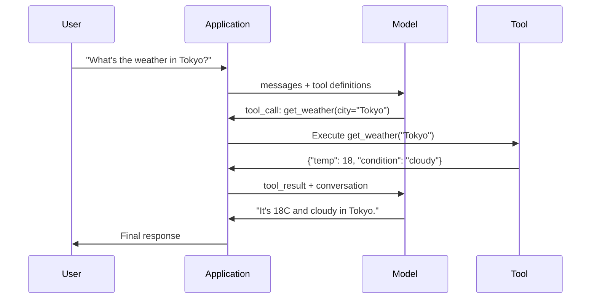

<!-- local-zh-machine-draft: English source is canonical; prose translated automatically, code/math preserved. -->

<a id="function-calling--tool-use"></a>

# Function Calling 与工具使用

> LLMs 无法做任何事情。 它们生成文本。 这是整个功能。 它们不能检查天气、 查询数据库、 发送电子邮件、 运行代码或读取文件 。 agent"你见过 LLM generating JSON 表示要调用哪个函数, 然后你的代码实际上调用它。 模型是大脑。 工具是手。 Function calling 是神经系统连接他们。

**类型:** Build
**语言:** Python
**先修要求:** 第11阶段 03课程Structured Outputs)
**时间:** ~75分钟
**相关内容:** 阶段11 · 14 (Model Context Protocol)——当一个工具在东道方之间共享时,从内联函数呼叫转变为 MCP 服务器。 此课涵盖内嵌大小写 ; MCP 涵盖协议案件。

<a id="learning-objectives"></a>

## 学习目标

- 执行a function calling 循环: 定义工具图案, 分析模型的工具调用 JSON,执行函数和返回结果
- 设计工具图,清楚说明并打字 parameters 模型可以可靠地引用
- 构建一个多方向 agent loop 链条多个函数调用以解答复杂查询
- Handle function calling 边框: 平行 tool calls,错误传播,防止无限的工具循环

<a id="the-problem"></a>

## 问题

你造了一个聊天室,一个用户问:“现在东京天气如何?”

模型回答道:"我无法获取实时气象数据, 但根据季节,东京可能大约是15摄氏度..."

这是... hallucination 身着免责声明。 模型不知道天气, 永远也不会。 天气每小时都会变化。 模型的训练数据是几个月前的 。

正确的答案需要调用 OpenWeatherMap 。 API,获取当前 temperature,然后返回真实数字。模型无法调用 APIs。你的代码可以。缺少的一块:一个结构化的协议,让模型说“我需要调用天气” API 并让代码执行它 并反馈结果。

这是 function calling2. 模式产出的结构 JSON 描述用什么参数来引用的函数。您的应用程序执行该函数。结果可以追溯到对话中。模型使用结果来生成其最终答案。

不使用 function calling, LLMs 百科全书 有了它,它们就会变成 agents.

<a id="the-concept"></a>

## 概念

<a id="the-function-calling-loop"></a>

### 该 Function Calling Loop

每个工具使用互动都遵循同样的5步循环。



第1步:用户发送信息。第2步:模式接收信息,同时提供工具定义(JSON 第3步:示范产出a tool call - 结构化 JSON 。步骤 4: 您的代码执行函数并捕捉结果。步骤 5: 结果可以追溯到模型, 它现在有真实的数据来生成其最终答案 。

模型不会执行任何东西。 它只决定什么叫什么和用什么参数。 您的代码是执行者 。

<a id="tool-definitions-the-json-schema-contract"></a>

### 工具定义: JSON 计划合同

每个工具的定义是 JSON Schema 告诉模型函数的作用,它需要哪些论点,以及这些论点必须是什么类型。

```json
{
  "type": "function",
  "function": {
    "name": "get_weather",
    "description": "Get current weather for a city. Returns temperature in Celsius and conditions.",
    "parameters": {
      "type": "object",
      "properties": {
        "city": {
          "type": "string",
          "description": "City name, e.g. 'Tokyo' or 'San Francisco'"
        },
        "units": {
          "type": "string",
          "enum": ["celsius", "fahrenheit"],
          "description": "Temperature units"
        }
      },
      "required": ["city"]
    }
  }
}
```

该 `description` 字段是关键。模型读取它们以决定工具使用的时间和方式。“获取天气”这样的模糊描述比“获得城市当前天气”更差的工具选择。返回 temperature 以摄氏度和条件计算。” prompt 用于选择工具。

<a id="provider-comparison"></a>

### 供应商比较

每个主要提供者都支持 function calling,但 API 表面不同。

| 提供商 | API Parameter | Tool Call Format | 平行调用 | 强制呼叫 |
|----------|--------------|-----------------|---------------|----------------|
| OpenAI (GPT5个,O4) | `tools` | `tool_calls[].function` | 是( 翻倍) | `tool_choice="required"` |
| Anthropic (Claude 4.6/4.7) | `tools` | `content[].type="tool_use"` | 是(多个区块) | `tool_choice={"type":"any"}` |
| Google( 谷歌)Gemini 3) | `function_declarations` | `functionCall` | 是的 | `function_calling_config` |
| Open-weight (Llama 4, Qwen3, 4, Quen3, 4, Quen3, 4, Quen3, 4, Quen3, 4, Quen3, DeepSeek-V3 级 | Native `tools` 在 Llama 4; Hermes 或 ChatML 对其他人 | Mixed | Model-dependent | Prompt- 基于或 `tool_choice` 如果支持的话 |

到2026年,三个封闭的供应商已接近相同 JSON- 化学模式。 Llama 4艘本地船舶 `tools` 符合字段 OpenAI形状,打开...weight 微调仍然不尽相同——Hermes格式(NusResearch)是第三方微调最常见的。 MCP (第11阶段 □ 14) 内线功能调用——所有服务器都一样。

<a id="tool-choice-auto-required-specific"></a>

### 工具选择: 自动、 需要、 特定

当模型使用工具时,您可以控制 。

**Auto** (默认): 模型决定是调用工具还是直接响应。 “ 什么是 2+2 ? ” — 直接响应 。 “ 天气是什么 ” — 调用工具 。

**必需**:模型必须调用至少一个工具。当您知道用户的意图需要一个工具时,请使用这个工具。防止模型进行猜想,而不是查找真实数据。

**具体职能**:强制模型调用特定函数。 `tool_choice={"type":"function", "function": {"name": "get_weather"}}` 保证不管查询,都会调用气象工具。使用此选项作为路由 -- -- 当上游逻辑已经确定了需要哪个工具时。

<a id="parallel-function-calling"></a>

### Parallel Function Calling

GPT- 4个和 Claude 一个用户问道:“东京和纽约的天气如何?” 模型输出 2 tool calls 同时 :

```json
[
  {"name": "get_weather", "arguments": {"city": "Tokyo"}},
  {"name": "get_weather", "arguments": {"city": "New York"}}
]
```

您的代码执行两个( 理想地是同时) , 返回结果, 模型合成一个单一响应。 这将双向飞行从 2 切换到 1 。 agents 5-10岁 tool calls 每个查询, 平行调用会将潜伏率降低60- 80% 。

<a id="structured-outputs-vs-function-calling"></a>

### Structured Outputs 与 Function Calling

课程03涵盖 structured outputs. Function calling 使用相同的 JSON 系统机械,但目的不同

**Structured outputs**:强制模型以特定形状生成数据。输出为最终产品。例如:从文本中提取产品信息 `{name, price, in_stock}`.

**Function calling**:模型声明执行动作的意图。输出是一个中间步骤。例如: `get_weather(city="Tokyo")` - 该模式要求采取行动,而不是提出最后答案。

使用 structured outputs 想要提取数据时使用 function calling 当您想要模型与外部系统互动时。

<a id="security-the-non-negotiable-rules"></a>

### 担保:不可谈判规则

Function calling 是最危险的功能 你可以给一个 LLM。模式选择执行什么。如果工具集包含数据库查询,则模型构建查询。如果包括 shell 命令,则模型写入这些命令。

**规则1:永远不要通过模型生成 SQL 直接进入数据库。** 该模型可以而且将会生成 DROP Table、 UNION 注入或查询, 返回每行。 总是参数化。 总是验证。 总是使用允许操作列表 。

**第2条:允许列表功能。** 模式只能调用您明确定义的函数。 永远不要创建通用的“ 按名称执行任何函数” 工具。 如果您有50个内部功能, 则只披露用户需要的 5 个 。

**第3条:论证论点。** 模特儿可能会通过城市名称 `"; DROP TABLE users; --"`执行前,根据预期类型、范围和格式对每一参数进行校验。

**第4条:使工具成果具有针对性。** 如果工具返回敏感数据(API 键, PII, 内部错误) , 在将其发送回模型之前过滤它。 该模型将包含工具结果的逐字响应 。

**第5条: Rate limit tool calls.** 循环中的模型可以调用工具数百次。 设定最大( 每段对话10-20个电话是合理的) 。 打破无限循环 。

<a id="error-handling"></a>

### 处理错误

工具失败 。 APIs 暂停。数据库会下降。文件不存在。模型需要知道工具何时失败,为什么失败。

返回错误为结构化工具结果, 而非例外 :

```json
{
  "error": true,
  "message": "City 'Toky' not found. Did you mean 'Tokyo'?",
  "code": "CITY_NOT_FOUND"
}
```

模型读取了这个, 调整了参数, 并重试了。 模型在结构错误信息中擅长自我纠正。 它们无法从空响应或通用的“ 出错” 错误中恢复 。

<a id="mcp-model-context-protocol"></a>

### MCP: Model Context Protocol

MCP 是 Anthropic工具互操作性的开放标准。 而不是每个应用程序定义自己的工具, MCP 提供一项普遍议定书: MCP 服务器,由 MCP 客户端( 如 Claude 代码、 光标或您的应用程序) 。

One MCP 服务器可以将工具暴露给任何兼容的客户端。 Postgres MCP 服务器给出任何 MCP-compatible agent 数据库访问。 A GitHub MCP 服务器给出任何 agent 存储库访问。 工具定义一次, 到处使用 。

MCP 是要 function calling what HTTP 。它使运输层标准化,使工具成为可移动的。

```figure
mx-tool-call-loop
```

<a id="build-it"></a>

## 动手实现

<a id="step-1-define-the-tool-registry"></a>

### 步骤1:界定工具登记

建立一个存储工具定义及其执行的登记册。 JSON 方略定义(模型所见)和 Python 函数(代码执行的内容)。

```python
import ast
import json
import math
import time
import hashlib


TOOL_REGISTRY = {}


def register_tool(name, description, parameters, function):
    TOOL_REGISTRY[name] = {
        "definition": {
            "type": "function",
            "function": {
                "name": name,
                "description": description,
                "parameters": parameters,
            },
        },
        "function": function,
    }
```

<a id="step-2-implement-5-tools"></a>

### 步骤2:实施5项工具

建立计算器、天气调查、网络搜索模拟器、文件阅读器和代码运行器。

```python
def calculator(expression, precision=2):
    allowed = set("0123456789+-*/.() ")
    if not all(c in allowed for c in expression):
        return {"error": True, "message": f"Invalid characters in expression: {expression}"}
    try:
        result = eval(expression, {"__builtins__": {}}, {"math": math})
        return {"result": round(float(result), precision), "expression": expression}
    except Exception as e:
        return {"error": True, "message": str(e)}


WEATHER_DB = {
    "tokyo": {"temp_c": 18, "condition": "cloudy", "humidity": 72, "wind_kph": 14},
    "new york": {"temp_c": 22, "condition": "sunny", "humidity": 45, "wind_kph": 8},
    "london": {"temp_c": 12, "condition": "rainy", "humidity": 88, "wind_kph": 22},
    "san francisco": {"temp_c": 16, "condition": "foggy", "humidity": 80, "wind_kph": 18},
    "sydney": {"temp_c": 25, "condition": "sunny", "humidity": 55, "wind_kph": 10},
}


def get_weather(city, units="celsius"):
    key = city.lower().strip()
    if key not in WEATHER_DB:
        suggestions = [c for c in WEATHER_DB if c.startswith(key[:3])]
        return {
            "error": True,
            "message": f"City '{city}' not found.",
            "suggestions": suggestions,
            "code": "CITY_NOT_FOUND",
        }
    data = WEATHER_DB[key].copy()
    if units == "fahrenheit":
        data["temp_f"] = round(data["temp_c"] * 9 / 5 + 32, 1)
        del data["temp_c"]
    data["city"] = city
    return data


SEARCH_DB = {
    "python function calling": [
        {"title": "OpenAI Function Calling Guide", "url": "https://platform.openai.com/docs/guides/function-calling", "snippet": "Learn how to connect LLMs to external tools."},
        {"title": "Anthropic Tool Use", "url": "https://docs.anthropic.com/en/docs/tool-use", "snippet": "Claude can interact with external tools and APIs."},
    ],
    "MCP protocol": [
        {"title": "Model Context Protocol", "url": "https://modelcontextprotocol.io", "snippet": "An open standard for connecting AI models to data sources."},
    ],
    "weather API": [
        {"title": "OpenWeatherMap API", "url": "https://openweathermap.org/api", "snippet": "Free weather API with current, forecast, and historical data."},
    ],
}


def web_search(query, max_results=3):
    key = query.lower().strip()
    for db_key, results in SEARCH_DB.items():
        if db_key in key or key in db_key:
            return {"query": query, "results": results[:max_results], "total": len(results)}
    return {"query": query, "results": [], "total": 0}


FILE_SYSTEM = {
    "data/config.json": '{"model": "gpt-4o", "temperature": 0.7, "max_tokens": 4096}',
    "data/users.csv": "name,email,role\nAlice,alice@example.com,admin\nBob,bob@example.com,user",
    "README.md": "# My Project\nA tool-use agent built from scratch.",
}


def read_file(path):
    if ".." in path or path.startswith("/"):
        return {"error": True, "message": "Path traversal not allowed.", "code": "FORBIDDEN"}
    if path not in FILE_SYSTEM:
        available = list(FILE_SYSTEM.keys())
        return {"error": True, "message": f"File '{path}' not found.", "available_files": available, "code": "NOT_FOUND"}
    content = FILE_SYSTEM[path]
    return {"path": path, "content": content, "size_bytes": len(content), "lines": content.count("\n") + 1}


def run_code(code, language="python"):
    if language != "python":
        return {"error": True, "message": f"Language '{language}' not supported. Only 'python' is available."}
    try:
        tree = ast.parse(code)
    except SyntaxError as e:
        return {"error": True, "message": f"SyntaxError: {e}", "code": "SYNTAX_ERROR"}
    unsafe_names = {"exec", "eval", "compile", "__import__", "open", "globals", "locals", "vars", "getattr", "setattr", "delattr"}
    for node in ast.walk(tree):
        if isinstance(node, (ast.Import, ast.ImportFrom)):
            return {"error": True, "message": "Forbidden operation: import is not allowed", "code": "SECURITY_VIOLATION"}
        if isinstance(node, ast.Attribute) and node.attr.startswith("__") and node.attr.endswith("__"):
            return {"error": True, "message": "Forbidden operation: dunder attribute access is not allowed", "code": "SECURITY_VIOLATION"}
        if isinstance(node, ast.Name) and node.id in unsafe_names:
            return {"error": True, "message": f"Forbidden operation: {node.id} is not allowed", "code": "SECURITY_VIOLATION"}
    try:
        local_vars = {}
        exec(code, {"__builtins__": {"print": print, "range": range, "len": len, "str": str, "int": int, "float": float, "list": list, "dict": dict, "sum": sum, "min": min, "max": max, "abs": abs, "round": round, "sorted": sorted, "enumerate": enumerate, "zip": zip, "map": map, "filter": filter, "math": math}}, local_vars)
        result = local_vars.get("result", None)
        return {"success": True, "result": result, "variables": {k: str(v) for k, v in local_vars.items() if not k.startswith("_")}}
    except Exception as e:
        return {"error": True, "message": f"{type(e).__name__}: {e}"}
```

子字符串块列表将代码读作文本, 因此它忽略了字符串匹配中任何字面上不会拼写的东西。 将代码划入语法树中, 并让守护者拒绝它 `import` 语句, 哑巴属性访问 `__class__` 和 `__globals__` 连接到真正的翻译的链条, 以及不安全的内建名称结构而不是拼写。 即使如此, 也可以把它当作教学过滤器, 而不是真正的边界。 任何在轨的守卫都使用它运行的代码来共享口译员, 而一个确定的呼叫者仍然可以找到可到达的物体。 生产系统在一个单独的过程或容器中运行不受信任的代码( 一个带有被丢弃权限的子进程 、 gvisor 、 Firecracker 或主机的代码管理员 ) , 在那里, 逃生者将攻击者置于一个弃置的盒子里, 而不是你的服务 。

<a id="step-3-register-all-tools"></a>

### 步骤3:登记所有工具

```python
def register_all_tools():
    register_tool(
        "calculator", "Evaluate a mathematical expression. Supports +, -, *, /, parentheses, and decimals. Returns the numeric result.",
        {"type": "object", "properties": {"expression": {"type": "string", "description": "Math expression, e.g. '(10 + 5) * 3'"}, "precision": {"type": "integer", "description": "Decimal places in result", "default": 2}}, "required": ["expression"]},
        calculator,
    )
    register_tool(
        "get_weather", "Get current weather for a city. Returns temperature, condition, humidity, and wind speed.",
        {"type": "object", "properties": {"city": {"type": "string", "description": "City name, e.g. 'Tokyo' or 'San Francisco'"}, "units": {"type": "string", "enum": ["celsius", "fahrenheit"], "description": "Temperature units, defaults to celsius"}}, "required": ["city"]},
        get_weather,
    )
    register_tool(
        "web_search", "Search the web for information. Returns a list of results with title, URL, and snippet.",
        {"type": "object", "properties": {"query": {"type": "string", "description": "Search query"}, "max_results": {"type": "integer", "description": "Maximum results to return", "default": 3}}, "required": ["query"]},
        web_search,
    )
    register_tool(
        "read_file", "Read the contents of a file. Returns the file content, size, and line count.",
        {"type": "object", "properties": {"path": {"type": "string", "description": "Relative file path, e.g. 'data/config.json'"}}, "required": ["path"]},
        read_file,
    )
    register_tool(
        "run_code", "Run a small Python snippet behind a static-analysis guard and a restricted interpreter. This is a teaching filter, not real isolation. Set a 'result' variable to return output.",
        {"type": "object", "properties": {"code": {"type": "string", "description": "Python code to execute"}, "language": {"type": "string", "enum": ["python"], "description": "Programming language"}}, "required": ["code"]},
        run_code,
    )
```

<a id="step-4-build-the-function-calling-loop"></a>

### 步骤4:构建 Function Calling Loop

这是核心引擎。 它模拟模型决定要调用、 执行工具并反馈结果 。

```python
def simulate_model_decision(user_message, tools, conversation_history):
    msg = user_message.lower()

    if any(word in msg for word in ["weather", "temperature", "forecast"]):
        cities = []
        for city in WEATHER_DB:
            if city in msg:
                cities.append(city)
        if not cities:
            for word in msg.split():
                if word.capitalize() in [c.title() for c in WEATHER_DB]:
                    cities.append(word)
        if not cities:
            cities = ["tokyo"]
        calls = []
        for city in cities:
            calls.append({"name": "get_weather", "arguments": {"city": city.title()}})
        return calls

    if any(word in msg for word in ["calculate", "compute", "math", "what is", "how much"]):
        for token in msg.split():
            if any(c in token for c in "+-*/"):
                return [{"name": "calculator", "arguments": {"expression": token}}]
        if "+" in msg or "-" in msg or "*" in msg or "/" in msg:
            expr = "".join(c for c in msg if c in "0123456789+-*/.() ")
            if expr.strip():
                return [{"name": "calculator", "arguments": {"expression": expr.strip()}}]
        return [{"name": "calculator", "arguments": {"expression": "0"}}]

    if any(word in msg for word in ["search", "find", "look up", "google"]):
        query = msg.replace("search for", "").replace("look up", "").replace("find", "").strip()
        return [{"name": "web_search", "arguments": {"query": query}}]

    if any(word in msg for word in ["read", "file", "open", "cat", "show"]):
        for path in FILE_SYSTEM:
            if path.split("/")[-1].split(".")[0] in msg:
                return [{"name": "read_file", "arguments": {"path": path}}]
        return [{"name": "read_file", "arguments": {"path": "README.md"}}]

    if any(word in msg for word in ["run", "execute", "code", "python"]):
        return [{"name": "run_code", "arguments": {"code": "result = 'Hello from the sandbox!'", "language": "python"}}]

    return []


def execute_tool_call(tool_call):
    name = tool_call["name"]
    args = tool_call["arguments"]

    if name not in TOOL_REGISTRY:
        return {"error": True, "message": f"Unknown tool: {name}", "code": "UNKNOWN_TOOL"}

    tool = TOOL_REGISTRY[name]
    func = tool["function"]
    start = time.time()

    try:
        result = func(**args)
    except TypeError as e:
        result = {"error": True, "message": f"Invalid arguments: {e}"}

    elapsed_ms = round((time.time() - start) * 1000, 2)
    return {"tool": name, "result": result, "execution_time_ms": elapsed_ms}


def run_function_calling_loop(user_message, max_iterations=5):
    conversation = [{"role": "user", "content": user_message}]
    tool_definitions = [t["definition"] for t in TOOL_REGISTRY.values()]
    all_tool_results = []

    for iteration in range(max_iterations):
        tool_calls = simulate_model_decision(user_message, tool_definitions, conversation)

        if not tool_calls:
            break

        results = []
        for call in tool_calls:
            result = execute_tool_call(call)
            results.append(result)

        conversation.append({"role": "assistant", "content": None, "tool_calls": tool_calls})

        for result in results:
            conversation.append({"role": "tool", "content": json.dumps(result["result"]), "tool_name": result["tool"]})

        all_tool_results.extend(results)
        break

    return {"conversation": conversation, "tool_results": all_tool_results, "iterations": iteration + 1 if tool_calls else 0}
```

<a id="step-5-argument-validation"></a>

### 步骤5:论证参数

建立一个检查的验证符 tool call 反对《公约》的论点 JSON 执行前的血压

```python
def validate_tool_arguments(tool_name, arguments):
    if tool_name not in TOOL_REGISTRY:
        return [f"Unknown tool: {tool_name}"]

    schema = TOOL_REGISTRY[tool_name]["definition"]["function"]["parameters"]
    errors = []

    if not isinstance(arguments, dict):
        return [f"Arguments must be an object, got {type(arguments).__name__}"]

    for required_field in schema.get("required", []):
        if required_field not in arguments:
            errors.append(f"Missing required argument: {required_field}")

    properties = schema.get("properties", {})
    for arg_name, arg_value in arguments.items():
        if arg_name not in properties:
            errors.append(f"Unknown argument: {arg_name}")
            continue

        prop_schema = properties[arg_name]
        expected_type = prop_schema.get("type")

        type_checks = {"string": str, "integer": int, "number": (int, float), "boolean": bool, "array": list, "object": dict}
        if expected_type in type_checks:
            if not isinstance(arg_value, type_checks[expected_type]):
                errors.append(f"Argument '{arg_name}': expected {expected_type}, got {type(arg_value).__name__}")

        if "enum" in prop_schema and arg_value not in prop_schema["enum"]:
            errors.append(f"Argument '{arg_name}': '{arg_value}' not in {prop_schema['enum']}")

    return errors
```

<a id="step-6-run-the-demo"></a>

### 步骤6:运行演示

```python
def run_demo():
    register_all_tools()

    print("=" * 60)
    print("  Function Calling & Tool Use Demo")
    print("=" * 60)

    print("\n--- Registered Tools ---")
    for name, tool in TOOL_REGISTRY.items():
        desc = tool["definition"]["function"]["description"][:60]
        params = list(tool["definition"]["function"]["parameters"].get("properties", {}).keys())
        print(f"  {name}: {desc}...")
        print(f"    params: {params}")

    print(f"\n--- Argument Validation ---")
    validation_tests = [
        ("get_weather", {"city": "Tokyo"}, "Valid call"),
        ("get_weather", {}, "Missing required arg"),
        ("get_weather", {"city": "Tokyo", "units": "kelvin"}, "Invalid enum value"),
        ("calculator", {"expression": 123}, "Wrong type (int for string)"),
        ("unknown_tool", {"x": 1}, "Unknown tool"),
    ]
    for tool_name, args, label in validation_tests:
        errors = validate_tool_arguments(tool_name, args)
        status = "VALID" if not errors else f"ERRORS: {errors}"
        print(f"  {label}: {status}")

    print(f"\n--- Tool Execution ---")
    direct_tests = [
        {"name": "calculator", "arguments": {"expression": "(10 + 5) * 3 / 2"}},
        {"name": "get_weather", "arguments": {"city": "Tokyo"}},
        {"name": "get_weather", "arguments": {"city": "Mars"}},
        {"name": "web_search", "arguments": {"query": "python function calling"}},
        {"name": "read_file", "arguments": {"path": "data/config.json"}},
        {"name": "read_file", "arguments": {"path": "../etc/passwd"}},
        {"name": "run_code", "arguments": {"code": "result = sum(range(1, 101))"}},
        {"name": "run_code", "arguments": {"code": "import os; os.system('rm -rf /')"}},
    ]
    for call in direct_tests:
        result = execute_tool_call(call)
        print(f"\n  {call['name']}({json.dumps(call['arguments'])})")
        print(f"    -> {json.dumps(result['result'], indent=None)[:100]}")
        print(f"    time: {result['execution_time_ms']}ms")

    print(f"\n--- Full Function Calling Loop ---")
    test_queries = [
        "What's the weather in Tokyo?",
        "Calculate (100 + 250) * 0.15",
        "Search for MCP protocol",
        "Read the config file",
        "Run some Python code",
        "Tell me a joke",
    ]
    for query in test_queries:
        print(f"\n  User: {query}")
        result = run_function_calling_loop(query)
        if result["tool_results"]:
            for tr in result["tool_results"]:
                print(f"    Tool: {tr['tool']} ({tr['execution_time_ms']}ms)")
                print(f"    Result: {json.dumps(tr['result'], indent=None)[:90]}")
        else:
            print(f"    [No tool called -- direct response]")
        print(f"    Iterations: {result['iterations']}")

    print(f"\n--- Parallel Tool Calls ---")
    multi_city_query = "What's the weather in tokyo and london?"
    print(f"  User: {multi_city_query}")
    result = run_function_calling_loop(multi_city_query)
    print(f"  Tool calls made: {len(result['tool_results'])}")
    for tr in result["tool_results"]:
        city = tr["result"].get("city", "unknown")
        temp = tr["result"].get("temp_c", "N/A")
        print(f"    {city}: {temp}C, {tr['result'].get('condition', 'N/A')}")

    print(f"\n--- Security Checks ---")
    security_tests = [
        ("read_file", {"path": "../../etc/passwd"}),
        ("run_code", {"code": "import subprocess; subprocess.run(['ls'])"}),
        ("calculator", {"expression": "__import__('os').system('ls')"}),
    ]
    for tool_name, args in security_tests:
        result = execute_tool_call({"name": tool_name, "arguments": args})
        blocked = result["result"].get("error", False)
        print(f"  {tool_name}({list(args.values())[0][:40]}): {'BLOCKED' if blocked else 'ALLOWED'}")
```

<a id="use-it"></a>

## 实际应用

<a id="openai-function-calling"></a>

### OpenAI Function Calling

```python
# from openai import OpenAI
#
# client = OpenAI()
#
# tools = [{
#     "type": "function",
#     "function": {
#         "name": "get_weather",
#         "description": "Get current weather for a city",
#         "parameters": {
#             "type": "object",
#             "properties": {
#                 "city": {"type": "string"},
#                 "units": {"type": "string", "enum": ["celsius", "fahrenheit"]}
#             },
#             "required": ["city"]
#         }
#     }
# }]
#
# response = client.chat.completions.create(
#     model="gpt-4o",
#     messages=[{"role": "user", "content": "Weather in Tokyo?"}],
#     tools=tools,
#     tool_choice="auto",
# )
#
# tool_call = response.choices[0].message.tool_calls[0]
# args = json.loads(tool_call.function.arguments)
# result = get_weather(**args)
#
# final = client.chat.completions.create(
#     model="gpt-4o",
#     messages=[
#         {"role": "user", "content": "Weather in Tokyo?"},
#         response.choices[0].message,
#         {"role": "tool", "tool_call_id": tool_call.id, "content": json.dumps(result)},
#     ],
# )
# print(final.choices[0].message.content)
```

OpenAI 返回 tool calls 作为 `response.choices[0].message.tool_calls`。每个电话都有 `id` 返回结果时必须包含。模型使用此 ID 来匹配调用结果。 GPT-4o 可以返回多个 tool calls 在一个单一的答复中,反复地执行它们。

<a id="anthropic-tool-use"></a>

### Anthropic 工具使用

```python
# import anthropic
#
# client = anthropic.Anthropic()
#
# response = client.messages.create(
#     model="claude-sonnet-5",
#     max_tokens=1024,
#     tools=[{
#         "name": "get_weather",
#         "description": "Get current weather for a city",
#         "input_schema": {
#             "type": "object",
#             "properties": {
#                 "city": {"type": "string"},
#                 "units": {"type": "string", "enum": ["celsius", "fahrenheit"]}
#             },
#             "required": ["city"]
#         }
#     }],
#     messages=[{"role": "user", "content": "Weather in Tokyo?"}],
# )
#
# tool_block = next(b for b in response.content if b.type == "tool_use")
# result = get_weather(**tool_block.input)
#
# final = client.messages.create(
#     model="claude-sonnet-5",
#     max_tokens=1024,
#     tools=[...],
#     messages=[
#         {"role": "user", "content": "Weather in Tokyo?"},
#         {"role": "assistant", "content": response.content},
#         {"role": "user", "content": [{"type": "tool_result", "tool_use_id": tool_block.id, "content": json.dumps(result)}]},
#     ],
# )
```

Anthropic 返回 tool calls 内容块 `type: "tool_use"`工具结果 user message 与 `type: "tool_result"`。注意关键区别: Anthropic 使用 `input_schema` 工具 parameter 定义,而 OpenAI 使用 `parameters`.

<a id="mcp-integration"></a>

### MCP Integration

```python
# MCP servers expose tools over a standardized protocol.
# Any MCP-compatible client can discover and call these tools.
#
# Example: connecting to a Postgres MCP server
#
# from mcp import ClientSession, StdioServerParameters
# from mcp.client.stdio import stdio_client
#
# server_params = StdioServerParameters(
#     command="npx",
#     args=["-y", "@modelcontextprotocol/server-postgres", "postgresql://localhost/mydb"],
# )
#
# async with stdio_client(server_params) as (read, write):
#     async with ClientSession(read, write) as session:
#         await session.initialize()
#         tools = await session.list_tools()
#         result = await session.call_tool("query", {"sql": "SELECT count(*) FROM users"})
```

MCP 将工具的安装与工具的消耗脱钩。 Postgres 服务器知道 SQL. 该 GitHub 服务器知道 API. 你的 agent 仅仅发现和调用工具, 它不需要为每个整合工作 提供特定供应商的代码。

<a id="ship-it"></a>

## 交付成果

课程产生 `outputs/prompt-tool-designer.md` - 重复使用 prompt 设计工具定义的模板。 给它描述您想要的工具, 它会生成完整的 JSON 包含说明、类型和制约因素的 " 方案 " 定义。

也会产生 `outputs/skill-function-calling-patterns.md` - 执行决定框架 function calling 包括工具设计、错误处理、安全和具体供应商模式。

<a id="exercises"></a>

## 练习

1. **添加第6个工具:数据库查询。** 执行模拟 SQL 工具, 带有一个模拟表格。 此工具接受表格名称和过滤条件( 非原始) SQL)验证表格名称是否在允许列表中,过滤操作员是否仅限于 `=`, `>`, `<`, `>=`, `<=`返回匹配行为 JSON.

2. **执行错误反馈重试 。** 什么时候 tool call 失败( 例如, 找不到城市) , 将错误信息反馈到模型决定函数, 并让它纠正其参数。 跟踪每个调用中要多少次重试 。 设定每次最多3次重试 tool call.

3. **构建一个多步 agent.** 有些查询需要链条 tool calls: “ 读取配置文件, 告诉我设置了何种模型, 然后搜索网络来查看该模型的定价 。 ” 执行一个循环, 运行到模型决定不需要更多工具为止, 将累积的结果传送到每个决定步骤中。 限制为 10 个循环, 以防止无限循环 。

4. **测量工具选择的准确性。** 创建30个带有预期工具名称的测试查询。运行您对所有30个工具的决定功能,并测量它选择正确工具的时间的百分比。确定哪个查询导致工具之间最大的混乱。

5. **Implement tool call caching.** 如果在60秒内同一工具被调用相同参数,请返回缓存结果,而不是重新生效。使用由 `(tool_name, frozenset(args.items()))`。测量缓存率,在有20个查询的谈话中进行。

<a id="key-terms"></a>

## 关键术语

| 术语 | 人们怎么说 | 它实际上意味着什么 |
|------|----------------|----------------------|
| Function calling | "工具的使用" | 模式产出的结构 JSON 描述要引用特定参数的函数 - 您的代码执行它, 而不是模型 |
| 工具定义 | "功能计划" | 一个 JSON 描述工具名称、目的的Schema对象, parameters,然后类型 -- 模型读取此功能,以决定何时和如何使用工具 |
| 工具选择 | 呼叫模式 | 控制模式是否必须调用工具( 需要) , 是否可以调用工具( 自动) , 或是否必须调用特定工具( 命名) |
| 平行调用 | "Multi-tool" | 模型输出多重 tool calls 转一圈,就减少了往返的旅程。 GPT- 4个和 Claude 两者都支持这一点 |
| 工具结果 | "功能输出" | 执行工具后返回值, 将它作为信件发送到模型, 以便它能使用真实数据进行响应 |
| 参数验证 | "输入检查" | 执行工具前验证模型生成的参数符合预期类型、范围及限制 |
| MCP | "工具协议" | Model Context Protocol -- Anthropic用于通过服务器曝光工具的开放标准, 任何兼容的客户端都可以发现并调用 |
| Agent loop | "ReAct loop" | 模型- DEDES- 工具、 代码- 执行工具、 结果- 反馈的迭代循环, 直到模型有足够的信息来响应 |
| 工具中毒 | "Prompt injection 透过工具 | 工具结果包含操作模型行为的指示的突袭 -- 清理所有工具输出 |
| 限 率 | 来,来,来 | 设定最大数 tool calls 每次对话,防止无穷循环和逃跑 API costs |

<a id="further-reading"></a>

## 进一步阅读

- [OpenAI Function Calling Guide](https://platform.openai.com/docs/guides/function-calling) - 工具使用的确切参考 GPT-4o,包括平行通话、强迫通话和结构化辩论
- [Anthropic 工具使用指南](https://docs.anthropic.com/en/docs/tool-use) -- Claude工具使用带有输入的操作_系统、多工具反应和工具_选择配置
- [Model Context Protocol Specification](https://modelcontextprotocol.io) - 使用服务器/客户结构的全局性应用工具互操作性的开放标准
- [Schick等人,2023年 -- -- "工具:语言模型可以教自己使用工具 "](https://arxiv.org/abs/2302.04761) - 培训问题基础文件 LLMs 决定何时以及如何调用外部工具
- [Patil等人,2023年 -- -- " 哥里拉:与大面积连接的大语言模型 " APIs"](https://arxiv.org/abs/2305.15334) -- fine-tuning LLMs 准确 API 1 645人次的电话 APIs 与 hallucination reduction
- [Berkeley Function Calling Leaderboard](https://gorilla.cs.berkeley.edu/leaderboard.html) - 实时基准比较 function calling 准确度横过 GPT-4o, Claude, Gemini,以及开放模式
- [姚等人, "ReAct:在语言模型中使理由和行为同步化”(ICLR 2023)](https://arxiv.org/abs/2210.03629) - 思想-行动-观察循环是外表 agent loop 围绕每个 tool call;在课程结束时,第14阶段开始。
- [Anthropic - 建设有效 agents (第2024号决定)](https://www.anthropic.com/research/building-effective-agents) - 五个可作曲模式(prompt 链条、路线、平行、管弦乐手、评价员optimizer) 以原始工具为基础。
