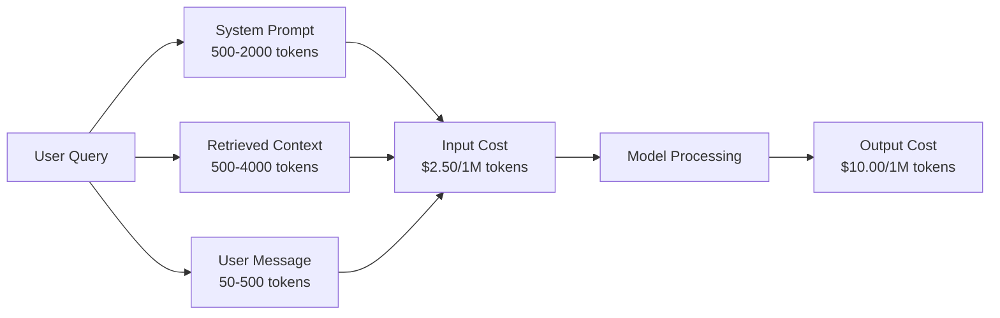
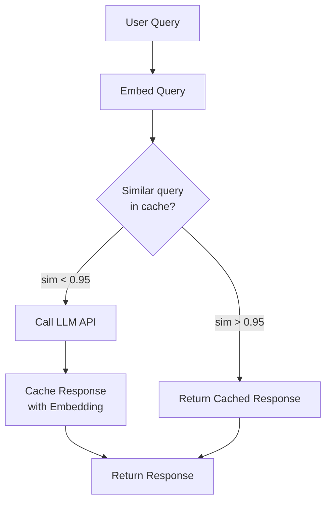
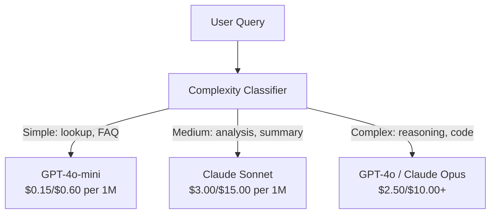

<!-- local-zh-machine-draft: English source is canonical; prose translated automatically, code/math preserved. -->

<a id="caching-rate-limiting--cost-optimization"></a>

# 缓存、请求速率限制与成本优化

> 大部分AI新开办企业不会死于坏模型,他们死于坏单位经济学。 GPT-4o 呼叫成本的分数为1个百分点。一万个用户每天拨打10个电话,投入费用为250美元 tokens 单是,在你收一美元之前。幸存的公司是那些对待每一个 API 以金融交易而不是函数电话来拨打。

**类型：** 构建
**语言:** Python
**先修要求:** 阶段11 课程09(Function Calling)
**时间:** ~45分钟
**相关内容:** 阶段11 · 15 (Prompt 缓冲)- 本课包括应用程序层缓冲 (E)semantic cache,准确的散列缓存,模式路径。 prompt 缓存( C)Anthropic cache_control, OpenAI automatic, Gemini 将两者结合起来,降低50%至95%的成本。

<a id="learning-objectives"></a>

## 学习目标

- 执行语义缓存, 用于从缓存中重复或类似查询, 而不是制作新的 API call
- 计算各供应商的每项要求费用并付诸实施 token- 限制利率和预算警告
- 建立一个成本优化层 prompt 压缩、模型路径(昂贵还是便宜)和响应缓存
- 使用 exact match,语义相似性,以及 prefix caching 用于不同查询类型

<a id="the-problem"></a>

## 问题

你造一个 RAG 聊天机,工作很好,用户喜欢

然后发票就来了

GPT- 5 费用每百万美元投入5美元 tokens 和每百万产出15美元。 Claude 业务4.7 费用为15美元/75美元产出。 Gemini 3 方案费用 1.25美元投入/5美元产出。 GPT5微米为0.25美元。以下价格是说明性;总是检查供应商目前的定价页。

最让人伤心的是:

- 每日1万个活跃用户
- 每天每个用户10次查询
- 1 000个输入 tokens 每个查询(system prompt +上下文+ user message)
- 500项产出 tokens 答复

**每日投入费用:** 10 000 x 10 000 x 1 000 000 x 2.50= **$250/day**
**每日产出费用:** 10 000 x 10 500 / 100 000 x $100 = **$500/day**
**月度总计 :** **$22,500/month**

刚才那只是 LLM添加 embeddings, vector database 办公地点 基础设施 每月30000美元

残酷的部分: 40-60%的询问是近乎重复的。 用户用稍有不同的措辞提出同样的问题。 您的查询是直接的。 system prompt 每一个请求都一样,每次都会得到帐单。 RAG 重复在用户中询问同一主题。

你为多余的计算支付全额费用。

<a id="the-concept"></a>

## 概念

<a id="the-cost-anatomy-of-an-llm-call"></a>

### 成本解剖 LLM Call

每个 API 电话有五个成本组件



System prompts 是个沉默的杀手token system prompt 每百万次请求费用为3.75美元,每天100K次,即每月11 250美元,用于从未改动的文本。

<a id="provider-caching-built-in-discounts"></a>

### 提供者卡辛:内建折扣

所有三个主要提供者都提供供应商 prompt 2026年的缓冲,但机械学不同。深潜时请看第11阶段 15

| 提供商 | Mechanism | Discount | 最低 | 缓存持续时间 |
|----------|-----------|----------|---------|----------------|
| Anthropic | 明确缓存_控制标记 | 90%的缓存点击率(在写时额外支付25%) | 1,024 tokens (松内特/奥普斯),2 048人(海库) | 5分钟默认; 1小时延长(2x写溢价) |
| OpenAI | 自动的前缀匹配 | 50%的缓存点击率 | 1,024 tokens | 最佳努力,最多1小时 |
| Google Gemini | 明确快取内容 API | ~75% 减少(加上储存) | 4 096(鞭打)/ 32 768(鞭打) | 可用户配置 TTL |

**Anthropic方法** 清晰。 您标记您在 prompt 与 `cache_control: {"type": "ephemeral"}`。第一个请求支付25%的写价溢价。随后以相同的前缀提出的请求得到90%的折扣。token system prompt 通常需要0.05美元 超过100K的要求,这可以节省437.50美元

**OpenAI方法** 自动。 prompt 符合先前请求的前缀可获得50%的折扣。 不需要标记。 折价减低、 控制减低, 但执行努力为零 。

<a id="semantic-caching-your-custom-layer"></a>

### 语义缓冲: 您的自定义图层

提供者只对相同的前缀使用缓存。 语义缓存处理较难的大小写: 不同查询具有相同的含义 。

"什么是回报政策?"和"我如何返回一个项目?" 两者是不同的字符串,但意图相同。 semantic cache 嵌入两个查询,计算 cosine similarity,如果相似性超过阈值(通常为 0.92-0.95),则返回缓存响应。



该 embedding 费用微不足道。 OpenAI文本为embedding- 3-小费用:每百万2美元 tokens。检查缓存成本几乎没有与全部相比 LLM call.

<a id="exact-caching-hash-and-match"></a>

### 精确的缓存: 散列和匹配

用于确定性电话(temperature=0,同一型号,相同 prompt,准确的缓冲更简单更快。 prompt,检查缓存,如果找到的话返回。

这对以下人士来说是完美的:
- System prompt +固定上下文+相同的用户查询
- Function calling 具有相同的工具定义
- 同一文档被多次处理的批处理

<a id="rate-limiting-protecting-your-budget"></a>

### 节率限制: 保护您的预算

限制利率不仅仅是公平,而是生存。

**Token 桶算法 :** 每个用户都拿一桶N tokens 要求以R/秒的速度进行再充填。 tokens 如果桶是空的,则拒绝请求。这样可以连发(同时使用整桶),同时执行平均费率。

**用户配额:** 每日/每月 token 每个用户级别的限制。

| Tier | Daily Token Limit | 最大请求/ min | 模式访问 |
|------|------------------|------------------|-------------|
| 免费 | 50,000 | 10 | GPT- 仅4个迷你 |
| Pro | 500,000 | 60 | GPT-4o, Claude Sonnet |
| Enterprise | 5,000,000 | 300 | 所有型号 |

<a id="model-routing-right-model-for-the-right-job"></a>

### 示范路由:正确工作的正确模式

不是每个查询都需要 GPT-4o.

商店什么时候关门? 不需要10美元/M产出模型 GPT- 0.60M输出时,四微米的输出处理得非常完美 Claude 海库以1.25M输出处理它。一个简单的分类者将廉价查询引入廉价模型,而复杂的查询则将昂贵模型。



一台接通良好的路由器仅节省模型成本40-70%。

<a id="cost-tracking-know-where-the-money-goes"></a>

### 成本跟踪:知道钱流向何处

您无法优化您不测量的东西。 请记录每一页 API 拨打:

- Timestamp
- 型号
- 输入 tokens
- 输出 tokens
- 长期任用(月)
- 计算费用(美元)
- 用户编号
- 缓存中弹/失灵
- 请求类别

这些数据揭示了 features 其价格昂贵,用户是沉重的消费者,而缓冲的影响最大。

<a id="batching-bulk-discounts"></a>

### 条纹: 批量折扣

OpenAI批量 API 程序要求不同步地以50%的折扣。您提交最多50,000份申请,结果在24小时内回来。

使用批量处理:
- 夜间文件处理
- 散装分类
- Evaluation runs
- 数据浓缩管道

不是用于:实时用户查询(延迟事项)。

<a id="budget-alerts-and-circuit-breakers"></a>

### 预算提醒和 Circuit Breakers

一个 circuit breaker 遇到限制时停止支出。没有限制,错误或滥用可以燃烧在您的月预算中, 小时。

设定三个阈值 :
1. **Warning** (预算的70%):发出警报
2. **Throttle** (占预算的85%):仅转换为更廉价的模式
3. **Stop** (预算的95%):拒绝新请求,仅回复缓存

<a id="the-optimization-stack"></a>

### 优化堆叠

应用这些技术。 之前的每种层的化合物。

| 图层 | 技术 | 典型节余 | 执行努力 |
|-------|-----------|----------------|----------------------|
| 1 | Provider prompt caching | 30-50% | 低( 添加缓存标记) |
| 2 | 精确的缓存 | 10-20% | 低( 带+单字) |
| 3 | 语义缓冲 | 15-30% | 中度 (单位:embeddings + 相似性) |
| 4 | 模式路线 | 40-70% | 中( 分类) |
| 5 | 限 率 | 预算保护 | 低 (token bucket) |
| 6 | Prompt compression | 10-30% | 中( 重写) prompts) |
| 7 | 配料 | 合格者50% | 低 (批次) API) |

一个 RAG 应用第1至5层软件通常会把费用从每月22 500美元减少到每月4 000-6 000美元,这就是焚烧跑道和建造企业之间的差额。

<a id="real-savings-before-and-after"></a>

### 实际储蓄:前后

真正的崩溃 RAG 聊天机为1万DAU服务

| 公制 | 优化前 | 优化后 | Savings |
|--------|--------------------|--------------------|---------|
| Monthly LLM 成本 | $22,500 | $5,200 | 77% |
| 每个查询的AVG费用 | $0.0075 | $0.0017 | 77% |
| 缓存点击率 | 0% | 52% | -- |
| 查询已发送到迷你 | 0% | 65% | -- |
| P95 延迟 | 2,800ms | 900米(缓冲点击:50米) | 68% |
| Monthly embedding 成本 | $0 | $180 | (新费用) |
| 每月费用共计 | $22,500 | $5,380 | 76% |

该 embedding 语义刻录费(180美元/月)在缓存点击的第一个小时之内支付。

```figure
semantic-cache
```

<a id="build-it"></a>

## 动手实现

<a id="step-1-cost-calculator"></a>

### 步骤1:成本计算

构建 token 成本计算器,能了解主要模型的当前定价。

```python
import hashlib
import time
import json
import math
from dataclasses import dataclass, field


MODEL_PRICING = {
    "gpt-4o": {"input": 2.50, "output": 10.00, "cached_input": 1.25},
    "gpt-4o-mini": {"input": 0.15, "output": 0.60, "cached_input": 0.075},
    "gpt-4.1": {"input": 2.00, "output": 8.00, "cached_input": 0.50},
    "gpt-4.1-mini": {"input": 0.40, "output": 1.60, "cached_input": 0.10},
    "gpt-4.1-nano": {"input": 0.10, "output": 0.40, "cached_input": 0.025},
    "o3": {"input": 2.00, "output": 8.00, "cached_input": 0.50},
    "o3-mini": {"input": 1.10, "output": 4.40, "cached_input": 0.55},
    "o4-mini": {"input": 1.10, "output": 4.40, "cached_input": 0.275},
    "claude-opus-4": {"input": 15.00, "output": 75.00, "cached_input": 1.50},
    "claude-sonnet-4": {"input": 3.00, "output": 15.00, "cached_input": 0.30},
    "claude-haiku-3.5": {"input": 0.80, "output": 4.00, "cached_input": 0.08},
    "gemini-2.5-pro": {"input": 1.25, "output": 10.00, "cached_input": 0.3125},
    "gemini-2.5-flash": {"input": 0.15, "output": 0.60, "cached_input": 0.0375},
}


def calculate_cost(model, input_tokens, output_tokens, cached_input_tokens=0):
    if model not in MODEL_PRICING:
        return {"error": f"Unknown model: {model}"}
    pricing = MODEL_PRICING[model]
    non_cached = input_tokens - cached_input_tokens
    input_cost = (non_cached / 1_000_000) * pricing["input"]
    cached_cost = (cached_input_tokens / 1_000_000) * pricing["cached_input"]
    output_cost = (output_tokens / 1_000_000) * pricing["output"]
    total = input_cost + cached_cost + output_cost
    return {
        "model": model,
        "input_tokens": input_tokens,
        "output_tokens": output_tokens,
        "cached_input_tokens": cached_input_tokens,
        "input_cost": round(input_cost, 6),
        "cached_input_cost": round(cached_cost, 6),
        "output_cost": round(output_cost, 6),
        "total_cost": round(total, 6),
    }
```

<a id="step-2-exact-cache"></a>

### 步骤2:精确缓存

满满的 prompt 并返回相同请求的缓存回复 。

```python
class ExactCache:
    def __init__(self, max_size=1000, ttl_seconds=3600):
        self.cache = {}
        self.max_size = max_size
        self.ttl = ttl_seconds
        self.hits = 0
        self.misses = 0

    def _hash(self, model, messages, temperature):
        key_data = json.dumps({"model": model, "messages": messages, "temperature": temperature}, sort_keys=True)
        return hashlib.sha256(key_data.encode()).hexdigest()

    def get(self, model, messages, temperature=0.0):
        if temperature > 0:
            self.misses += 1
            return None
        key = self._hash(model, messages, temperature)
        if key in self.cache:
            entry = self.cache[key]
            if time.time() - entry["timestamp"] < self.ttl:
                self.hits += 1
                entry["access_count"] += 1
                return entry["response"]
            del self.cache[key]
        self.misses += 1
        return None

    def put(self, model, messages, temperature, response):
        if temperature > 0:
            return
        if len(self.cache) >= self.max_size:
            oldest_key = min(self.cache, key=lambda k: self.cache[k]["timestamp"])
            del self.cache[oldest_key]
        key = self._hash(model, messages, temperature)
        self.cache[key] = {
            "response": response,
            "timestamp": time.time(),
            "access_count": 1,
        }

    def stats(self):
        total = self.hits + self.misses
        return {
            "hits": self.hits,
            "misses": self.misses,
            "hit_rate": round(self.hits / total, 4) if total > 0 else 0,
            "cache_size": len(self.cache),
        }
```

<a id="step-3-semantic-cache"></a>

### 步骤3: Semantic Cache

嵌入查询, 当相似性超过阈值时返回缓存回复 。

```python
def simple_embed(text):
    words = text.lower().split()
    vocab = {}
    for w in words:
        vocab[w] = vocab.get(w, 0) + 1
    norm = math.sqrt(sum(v * v for v in vocab.values()))
    if norm == 0:
        return {}
    return {k: v / norm for k, v in vocab.items()}


def cosine_similarity(a, b):
    if not a or not b:
        return 0.0
    all_keys = set(a) | set(b)
    dot = sum(a.get(k, 0) * b.get(k, 0) for k in all_keys)
    return dot


class SemanticCache:
    def __init__(self, similarity_threshold=0.85, max_size=500, ttl_seconds=3600):
        self.entries = []
        self.threshold = similarity_threshold
        self.max_size = max_size
        self.ttl = ttl_seconds
        self.hits = 0
        self.misses = 0

    def get(self, query):
        query_embedding = simple_embed(query)
        now = time.time()
        best_match = None
        best_sim = 0.0
        for entry in self.entries:
            if now - entry["timestamp"] > self.ttl:
                continue
            sim = cosine_similarity(query_embedding, entry["embedding"])
            if sim > best_sim:
                best_sim = sim
                best_match = entry
        if best_match and best_sim >= self.threshold:
            self.hits += 1
            best_match["access_count"] += 1
            return {"response": best_match["response"], "similarity": round(best_sim, 4), "original_query": best_match["query"]}
        self.misses += 1
        return None

    def put(self, query, response):
        if len(self.entries) >= self.max_size:
            self.entries.sort(key=lambda e: e["timestamp"])
            self.entries.pop(0)
        self.entries.append({
            "query": query,
            "embedding": simple_embed(query),
            "response": response,
            "timestamp": time.time(),
            "access_count": 1,
        })

    def stats(self):
        total = self.hits + self.misses
        return {
            "hits": self.hits,
            "misses": self.misses,
            "hit_rate": round(self.hits / total, 4) if total > 0 else 0,
            "cache_size": len(self.entries),
        }
```

<a id="step-4-rate-limiter"></a>

### 第4步:限速

Token 使用人均配额的水桶费率限额。

```python
class TokenBucketRateLimiter:
    def __init__(self):
        self.buckets = {}
        self.tiers = {
            "free": {"capacity": 50_000, "refill_rate": 500, "max_requests_per_min": 10},
            "pro": {"capacity": 500_000, "refill_rate": 5_000, "max_requests_per_min": 60},
            "enterprise": {"capacity": 5_000_000, "refill_rate": 50_000, "max_requests_per_min": 300},
        }

    def _get_bucket(self, user_id, tier="free"):
        if user_id not in self.buckets:
            tier_config = self.tiers.get(tier, self.tiers["free"])
            self.buckets[user_id] = {
                "tokens": tier_config["capacity"],
                "capacity": tier_config["capacity"],
                "refill_rate": tier_config["refill_rate"],
                "last_refill": time.time(),
                "request_timestamps": [],
                "max_rpm": tier_config["max_requests_per_min"],
                "tier": tier,
                "total_tokens_used": 0,
            }
        return self.buckets[user_id]

    def _refill(self, bucket):
        now = time.time()
        elapsed = now - bucket["last_refill"]
        refill = int(elapsed * bucket["refill_rate"])
        if refill > 0:
            bucket["tokens"] = min(bucket["capacity"], bucket["tokens"] + refill)
            bucket["last_refill"] = now

    def check(self, user_id, tokens_needed, tier="free"):
        bucket = self._get_bucket(user_id, tier)
        self._refill(bucket)
        now = time.time()
        bucket["request_timestamps"] = [t for t in bucket["request_timestamps"] if now - t < 60]
        if len(bucket["request_timestamps"]) >= bucket["max_rpm"]:
            return {"allowed": False, "reason": "rate_limit", "retry_after_seconds": 60 - (now - bucket["request_timestamps"][0])}
        if bucket["tokens"] < tokens_needed:
            deficit = tokens_needed - bucket["tokens"]
            wait = deficit / bucket["refill_rate"]
            return {"allowed": False, "reason": "token_limit", "tokens_available": bucket["tokens"], "retry_after_seconds": round(wait, 1)}
        return {"allowed": True, "tokens_available": bucket["tokens"]}

    def consume(self, user_id, tokens_used, tier="free"):
        bucket = self._get_bucket(user_id, tier)
        bucket["tokens"] -= tokens_used
        bucket["request_timestamps"].append(time.time())
        bucket["total_tokens_used"] += tokens_used

    def get_usage(self, user_id):
        if user_id not in self.buckets:
            return {"error": "User not found"}
        b = self.buckets[user_id]
        return {
            "user_id": user_id,
            "tier": b["tier"],
            "tokens_remaining": b["tokens"],
            "capacity": b["capacity"],
            "total_tokens_used": b["total_tokens_used"],
            "utilization": round(b["total_tokens_used"] / b["capacity"], 4) if b["capacity"] else 0,
        }
```

<a id="step-5-cost-tracker"></a>

### 步骤5:成本跟踪器

记录每个通话并计算运行的总数。

```python
class CostTracker:
    def __init__(self, monthly_budget=1000.0):
        self.logs = []
        self.monthly_budget = monthly_budget
        self.alerts = []

    def log_call(self, model, input_tokens, output_tokens, cached_input_tokens=0, latency_ms=0, user_id="anonymous", cache_status="miss"):
        cost = calculate_cost(model, input_tokens, output_tokens, cached_input_tokens)
        entry = {
            "timestamp": time.time(),
            "model": model,
            "input_tokens": input_tokens,
            "output_tokens": output_tokens,
            "cached_input_tokens": cached_input_tokens,
            "latency_ms": latency_ms,
            "cost": cost["total_cost"],
            "user_id": user_id,
            "cache_status": cache_status,
        }
        self.logs.append(entry)
        self._check_budget()
        return entry

    def _check_budget(self):
        total = self.total_cost()
        pct = total / self.monthly_budget if self.monthly_budget > 0 else 0
        if pct >= 0.95 and not any(a["level"] == "stop" for a in self.alerts):
            self.alerts.append({"level": "stop", "message": f"Budget 95% consumed: ${total:.2f}/${self.monthly_budget:.2f}", "timestamp": time.time()})
        elif pct >= 0.85 and not any(a["level"] == "throttle" for a in self.alerts):
            self.alerts.append({"level": "throttle", "message": f"Budget 85% consumed: ${total:.2f}/${self.monthly_budget:.2f}", "timestamp": time.time()})
        elif pct >= 0.70 and not any(a["level"] == "warning" for a in self.alerts):
            self.alerts.append({"level": "warning", "message": f"Budget 70% consumed: ${total:.2f}/${self.monthly_budget:.2f}", "timestamp": time.time()})

    def total_cost(self):
        return round(sum(e["cost"] for e in self.logs), 6)

    def cost_by_model(self):
        by_model = {}
        for e in self.logs:
            m = e["model"]
            if m not in by_model:
                by_model[m] = {"calls": 0, "cost": 0, "input_tokens": 0, "output_tokens": 0}
            by_model[m]["calls"] += 1
            by_model[m]["cost"] = round(by_model[m]["cost"] + e["cost"], 6)
            by_model[m]["input_tokens"] += e["input_tokens"]
            by_model[m]["output_tokens"] += e["output_tokens"]
        return by_model

    def cache_savings(self):
        cache_hits = [e for e in self.logs if e["cache_status"] == "hit"]
        if not cache_hits:
            return {"saved": 0, "cache_hits": 0}
        saved = 0
        for e in cache_hits:
            full_cost = calculate_cost(e["model"], e["input_tokens"], e["output_tokens"])
            saved += full_cost["total_cost"]
        return {"saved": round(saved, 4), "cache_hits": len(cache_hits)}

    def summary(self):
        if not self.logs:
            return {"total_calls": 0, "total_cost": 0}
        total_latency = sum(e["latency_ms"] for e in self.logs)
        cache_hits = sum(1 for e in self.logs if e["cache_status"] == "hit")
        return {
            "total_calls": len(self.logs),
            "total_cost": self.total_cost(),
            "avg_cost_per_call": round(self.total_cost() / len(self.logs), 6),
            "avg_latency_ms": round(total_latency / len(self.logs), 1),
            "cache_hit_rate": round(cache_hits / len(self.logs), 4),
            "cost_by_model": self.cost_by_model(),
            "cache_savings": self.cache_savings(),
            "budget_remaining": round(self.monthly_budget - self.total_cost(), 2),
            "budget_utilization": round(self.total_cost() / self.monthly_budget, 4) if self.monthly_budget > 0 else 0,
            "alerts": self.alerts,
        }
```

<a id="step-6-model-router"></a>

### 步骤6: Model Router

路线查询最便宜的模型 能够处理它们。

```python
SIMPLE_KEYWORDS = ["what time", "hours", "address", "phone", "price", "return policy", "hello", "hi", "thanks", "yes", "no"]
COMPLEX_KEYWORDS = ["analyze", "compare", "explain why", "write code", "debug", "architect", "design", "trade-off", "evaluate"]


def classify_complexity(query):
    q = query.lower()
    if len(q.split()) <= 5 or any(kw in q for kw in SIMPLE_KEYWORDS):
        return "simple"
    if any(kw in q for kw in COMPLEX_KEYWORDS):
        return "complex"
    return "medium"


def route_model(query, tier="pro"):
    complexity = classify_complexity(query)
    routing_table = {
        "simple": {"free": "gpt-4.1-nano", "pro": "gpt-4o-mini", "enterprise": "gpt-4o-mini"},
        "medium": {"free": "gpt-4o-mini", "pro": "claude-sonnet-4", "enterprise": "claude-sonnet-4"},
        "complex": {"free": "gpt-4o-mini", "pro": "gpt-4o", "enterprise": "claude-opus-4"},
    }
    model = routing_table[complexity].get(tier, "gpt-4o-mini")
    return {"query": query, "complexity": complexity, "model": model, "tier": tier}
```

<a id="step-7-run-the-demo"></a>

### 步骤7:运行演示

```python
def simulate_llm_call(model, query):
    input_tokens = len(query.split()) * 4 + 500
    output_tokens = 150 + (len(query.split()) * 2)
    latency = 200 + (output_tokens * 2)
    return {
        "model": model,
        "response": f"[Simulated {model} response to: {query[:50]}...]",
        "input_tokens": input_tokens,
        "output_tokens": output_tokens,
        "latency_ms": latency,
    }


def run_demo():
    print("=" * 60)
    print("  Caching, Rate Limiting & Cost Optimization Demo")
    print("=" * 60)

    print("\n--- Model Pricing ---")
    for model, pricing in list(MODEL_PRICING.items())[:6]:
        cost_1k = calculate_cost(model, 1000, 500)
        print(f"  {model}: ${cost_1k['total_cost']:.6f} per 1K in + 500 out")

    print("\n--- Cost Comparison: 100K Requests ---")
    for model in ["gpt-4o", "gpt-4o-mini", "claude-sonnet-4", "claude-haiku-3.5"]:
        cost = calculate_cost(model, 1000 * 100_000, 500 * 100_000)
        print(f"  {model}: ${cost['total_cost']:.2f}")

    print("\n--- Anthropic Cache Savings ---")
    no_cache = calculate_cost("claude-sonnet-4", 2000, 500, 0)
    with_cache = calculate_cost("claude-sonnet-4", 2000, 500, 1500)
    saving = no_cache["total_cost"] - with_cache["total_cost"]
    print(f"  Without cache: ${no_cache['total_cost']:.6f}")
    print(f"  With 1500 cached tokens: ${with_cache['total_cost']:.6f}")
    print(f"  Savings per call: ${saving:.6f} ({saving/no_cache['total_cost']*100:.1f}%)")

    exact_cache = ExactCache(max_size=100, ttl_seconds=300)
    semantic_cache = SemanticCache(similarity_threshold=0.75, max_size=100)
    rate_limiter = TokenBucketRateLimiter()
    tracker = CostTracker(monthly_budget=100.0)

    print("\n--- Exact Cache ---")
    messages_1 = [{"role": "user", "content": "What is the return policy?"}]
    result = exact_cache.get("gpt-4o-mini", messages_1, 0.0)
    print(f"  First lookup: {'HIT' if result else 'MISS'}")
    exact_cache.put("gpt-4o-mini", messages_1, 0.0, "You can return items within 30 days.")
    result = exact_cache.get("gpt-4o-mini", messages_1, 0.0)
    print(f"  Second lookup: {'HIT' if result else 'MISS'} -> {result}")
    result = exact_cache.get("gpt-4o-mini", messages_1, 0.7)
    print(f"  With temp=0.7: {'HIT' if result else 'MISS (non-deterministic, skip cache)'}")
    print(f"  Stats: {exact_cache.stats()}")

    print("\n--- Semantic Cache ---")
    test_queries = [
        ("What is the return policy?", "Items can be returned within 30 days with receipt."),
        ("How do I return an item?", None),
        ("What are your store hours?", "We are open 9am-9pm Monday through Saturday."),
        ("When does the store open?", None),
        ("Tell me about quantum computing", "Quantum computers use qubits..."),
        ("Explain quantum mechanics", None),
    ]
    for query, response in test_queries:
        cached = semantic_cache.get(query)
        if cached:
            print(f"  '{query[:40]}' -> CACHE HIT (sim={cached['similarity']}, original='{cached['original_query'][:40]}')")
        elif response:
            semantic_cache.put(query, response)
            print(f"  '{query[:40]}' -> MISS (stored)")
        else:
            print(f"  '{query[:40]}' -> MISS (no match)")
    print(f"  Stats: {semantic_cache.stats()}")

    print("\n--- Rate Limiting ---")
    for i in range(12):
        check = rate_limiter.check("user_1", 1000, "free")
        if check["allowed"]:
            rate_limiter.consume("user_1", 1000, "free")
        status = "OK" if check["allowed"] else f"BLOCKED ({check['reason']})"
        if i < 5 or not check["allowed"]:
            print(f"  Request {i+1}: {status}")
    print(f"  Usage: {rate_limiter.get_usage('user_1')}")

    print("\n--- Model Routing ---")
    routing_queries = [
        "What time do you close?",
        "Summarize this quarterly earnings report",
        "Analyze the trade-offs between microservices and monoliths",
        "Hello",
        "Write code for a binary search tree with deletion",
    ]
    for q in routing_queries:
        route = route_model(q, "pro")
        print(f"  '{q[:50]}' -> {route['model']} ({route['complexity']})")

    print("\n--- Full Pipeline: Before vs After Optimization ---")
    queries = [
        "What is the return policy?",
        "How do I return something?",
        "What are your hours?",
        "When do you open?",
        "Explain the difference between TCP and UDP",
        "Compare TCP vs UDP protocols",
        "Hello",
        "What is your phone number?",
        "Write a Python function to sort a list",
        "Analyze the pros and cons of serverless architecture",
    ]

    print("\n  [Before: no caching, single model (gpt-4o)]")
    tracker_before = CostTracker(monthly_budget=1000.0)
    for q in queries:
        result = simulate_llm_call("gpt-4o", q)
        tracker_before.log_call("gpt-4o", result["input_tokens"], result["output_tokens"], latency_ms=result["latency_ms"], cache_status="miss")
    before = tracker_before.summary()
    print(f"  Total cost: ${before['total_cost']:.6f}")
    print(f"  Avg cost/call: ${before['avg_cost_per_call']:.6f}")
    print(f"  Avg latency: {before['avg_latency_ms']}ms")

    print("\n  [After: caching + routing + rate limiting]")
    exact_c = ExactCache()
    semantic_c = SemanticCache(similarity_threshold=0.75)
    tracker_after = CostTracker(monthly_budget=1000.0)

    for q in queries:
        messages = [{"role": "user", "content": q}]
        cached = exact_c.get("gpt-4o", messages, 0.0)
        if cached:
            tracker_after.log_call("gpt-4o-mini", 0, 0, latency_ms=5, cache_status="hit")
            continue
        sem_cached = semantic_c.get(q)
        if sem_cached:
            tracker_after.log_call("gpt-4o-mini", 0, 0, latency_ms=15, cache_status="hit")
            continue
        route = route_model(q)
        result = simulate_llm_call(route["model"], q)
        tracker_after.log_call(route["model"], result["input_tokens"], result["output_tokens"], latency_ms=result["latency_ms"], cache_status="miss")
        exact_c.put(route["model"], messages, 0.0, result["response"])
        semantic_c.put(q, result["response"])

    after = tracker_after.summary()
    print(f"  Total cost: ${after['total_cost']:.6f}")
    print(f"  Avg cost/call: ${after['avg_cost_per_call']:.6f}")
    print(f"  Avg latency: {after['avg_latency_ms']}ms")
    print(f"  Cache hit rate: {after['cache_hit_rate']:.0%}")

    if before["total_cost"] > 0:
        savings_pct = (1 - after["total_cost"] / before["total_cost"]) * 100
        print(f"\n  SAVINGS: {savings_pct:.1f}% cost reduction")
        print(f"  Latency improvement: {(1 - after['avg_latency_ms'] / before['avg_latency_ms']) * 100:.1f}% faster")

    print("\n--- Budget Alerts Demo ---")
    alert_tracker = CostTracker(monthly_budget=0.01)
    for i in range(5):
        alert_tracker.log_call("gpt-4o", 5000, 2000, latency_ms=500)
    print(f"  Total spent: ${alert_tracker.total_cost():.6f} / ${alert_tracker.monthly_budget}")
    for alert in alert_tracker.alerts:
        print(f"  ALERT [{alert['level'].upper()}]: {alert['message']}")

    print("\n--- Cost Breakdown by Model ---")
    multi_tracker = CostTracker(monthly_budget=500.0)
    for _ in range(50):
        multi_tracker.log_call("gpt-4o-mini", 800, 200, latency_ms=150)
    for _ in range(30):
        multi_tracker.log_call("claude-sonnet-4", 1500, 500, latency_ms=400)
    for _ in range(10):
        multi_tracker.log_call("gpt-4o", 2000, 800, latency_ms=600)
    for _ in range(10):
        multi_tracker.log_call("claude-opus-4", 3000, 1000, latency_ms=1200)
    breakdown = multi_tracker.cost_by_model()
    for model, data in sorted(breakdown.items(), key=lambda x: x[1]["cost"], reverse=True):
        print(f"  {model}: {data['calls']} calls, ${data['cost']:.6f}, {data['input_tokens']:,} in / {data['output_tokens']:,} out")
    print(f"  Total: ${multi_tracker.total_cost():.6f}")

    print("\n" + "=" * 60)
    print("  Demo complete.")
    print("=" * 60)


if __name__ == "__main__":
    run_demo()
```

<a id="use-it"></a>

## 实际应用

<a id="anthropic-prompt-caching"></a>

### Anthropic Prompt Caching

```python
# import anthropic
#
# client = anthropic.Anthropic()
#
# response = client.messages.create(
#     model="claude-sonnet-5",
#     max_tokens=1024,
#     system=[
#         {
#             "type": "text",
#             "text": "You are a helpful customer support agent for Acme Corp...",
#             "cache_control": {"type": "ephemeral"},
#         }
#     ],
#     messages=[{"role": "user", "content": "What is the return policy?"}],
# )
#
# print(f"Input tokens: {response.usage.input_tokens}")
# print(f"Cache creation tokens: {response.usage.cache_creation_input_tokens}")
# print(f"Cache read tokens: {response.usage.cache_read_input_tokens}")
```

第一个电话写到缓存 (25% 溢价) 。 以后每次通话都用同样的 system prompt 前缀读取缓存( 90% 的折扣) 。 缓存持续5分钟, 并重新设定每次点击的计时器 。

<a id="openai-automatic-caching"></a>

### OpenAI 自动抓取

```python
# from openai import OpenAI
#
# client = OpenAI()
#
# response = client.chat.completions.create(
#     model="gpt-4o",
#     messages=[
#         {"role": "system", "content": "You are a helpful customer support agent..."},
#         {"role": "user", "content": "What is the return policy?"},
#     ],
# )
#
# print(f"Prompt tokens: {response.usage.prompt_tokens}")
# print(f"Cached tokens: {response.usage.prompt_tokens_details.cached_tokens}")
# print(f"Completion tokens: {response.usage.completion_tokens}")
```

OpenAI 自动缓存。 prompt 1024+的前缀 tokens 符合最近请求的, 可获得50%的折扣。 不需要更改代码 - 只检查 `prompt_tokens_details.cached_tokens` 来确认它的工作原理

<a id="openai-batch-api"></a>

### OpenAI Batch API

```python
# import json
# from openai import OpenAI
#
# client = OpenAI()
#
# requests = []
# for i, query in enumerate(queries):
#     requests.append({
#         "custom_id": f"request-{i}",
#         "method": "POST",
#         "url": "/v1/chat/completions",
#         "body": {
#             "model": "gpt-4o-mini",
#             "messages": [{"role": "user", "content": query}],
#         },
#     })
#
# with open("batch_input.jsonl", "w") as f:
#     for r in requests:
#         f.write(json.dumps(r) + "\n")
#
# batch_file = client.files.create(file=open("batch_input.jsonl", "rb"), purpose="batch")
# batch = client.batches.create(input_file_id=batch_file.id, endpoint="/v1/chat/completions", completion_window="24h")
# print(f"Batch ID: {batch.id}, Status: {batch.status}")
```

Batch API 给予所有50%的平价折扣 tokens24小时内得出结果,适合非实时工作量: evaluations数据标签,批量汇总。

<a id="production-semantic-cache-with-redis"></a>

### Production Semantic Cache 与 Redis 连接

```python
# import redis
# import numpy as np
# from openai import OpenAI
#
# r = redis.Redis()
# client = OpenAI()
#
# def get_embedding(text):
#     response = client.embeddings.create(model="text-embedding-3-small", input=text)
#     return response.data[0].embedding
#
# def semantic_cache_lookup(query, threshold=0.95):
#     query_emb = np.array(get_embedding(query))
#     keys = r.keys("cache:emb:*")
#     best_sim, best_key = 0, None
#     for key in keys:
#         stored_emb = np.frombuffer(r.get(key), dtype=np.float32)
#         sim = np.dot(query_emb, stored_emb) / (np.linalg.norm(query_emb) * np.linalg.norm(stored_emb))
#         if sim > best_sim:
#             best_sim, best_key = sim, key
#     if best_sim >= threshold and best_key:
#         response_key = best_key.decode().replace("cache:emb:", "cache:resp:")
#         return r.get(response_key).decode()
#     return None
```

制作时,用矢量指数(Redic矢量搜索、松骨或pgvictor)取代线性扫描。线性扫描工作为 < 1 000 个条目。除此之外,使用 ANN (Rid 矢量搜索、松骨或 pgvictor)。approximate nearest neighborO(log n) 的查询。

<a id="ship-it"></a>

## 交付成果

课程产生 `outputs/prompt-cost-optimizer.md` - 重复使用 prompt 分析你的 LLM 采用,并建议以预计节省的费用优化具体成本。

也会产生 `outputs/skill-cost-patterns.md` - 选择正确缓冲策略、限制费率配置和模式使用规则的决策框架。

<a id="exercises"></a>

## 练习

1. **实施LRU驱逐 semantic cache.** 将最古老的第一次驱逐替换为最近使用最少的。 跟踪每个条目的最后访问时间, 并用最老的访问时间将条目删除, 当缓存满后。 比较两个策略之间的点击率超过 100 个查询 。

2. **建立一个成本预测工具。** 给出了一张日志 API 调用(成本跟踪日志),根据7天的跟踪平均时间来预测月成本。 计算周日/ 周末模式。 如果预计月成本超过预算20%, 启动提醒 。

3. **执行分层语义刻录** 使用两个相似的阈值: 0.98 用于高可信度点击( 立即返回) , 0.90 用于中等信心点击( 以免责声明返回 : “ 基于类似的前一个问题 ” )。 跟踪每个点击的级别并测量用户满意度差异 。

4. **建立一个模式路径分类器 。** 将基于关键词的分类器替换为 embedding输入50个标签查询(简单/中/复杂),然后通过找到最近的标签示例对新的查询进行分类。根据一组20个查询的测试测量分类准确性。

5. **执行a circuit breaker 具有降解水平。** 以 70% 预算, 记录警告。 以 85% 的 自动切换所有路径到最便宜的模式( )gpt95%的数值只能提供缓存回复,拒绝新的查询。根据1美元的预算模拟1,000项请求,并正确验证每个阈值触发器。

<a id="key-terms"></a>

## 关键术语

| 术语 | 人们怎么说 | 它实际上意味着什么 |
|------|----------------|----------------------|
| Prompt caching | "缓冲 system prompt" | 重复提供方一级缓存 prompt 前缀获得折扣( 90%) Anthropic, 50% OpenAI) --不修改代码 OpenAI,用于 Anthropic |
| 语义缓冲 | "聪明的卡辛" | Embedding 查询,计算与过去查询相似,如果相似性超过阈值,则返回缓存回复 -- 抓取精确匹配错位的参数 |
| 精确的缓存 | "哈什" | 全力以赴 prompt (模式+消息+ temperature),并返回相同输入的缓存响应 -- -- 只有对 temperature=0 确定性电话 |
| Token bucket | "限值器" | 一种算法,每个用户都有一桶N tokens 以R/秒的速度再填充- 允许在使用R/秒平均速度时连续充填到N |
| 模式路线 | 夏普斯卡特路线 | 使用分类器将简单的查询发送到廉价模型( A)GPT- 4o-mini, Haiku)和复杂查询昂贵模型(GPT-4o,Opus) -- -- 节省模型成本40-70% |
| 费用跟踪 | "Metering" | 正在记录 API 找模特儿来 tokens, 潜伏, 成本和用户身份, 这样你就能知道钱去到哪里, 以及哪个 features 贵了 |
| Circuit breaker | "杀人开关" | 自动降低服务(便宜型、只存缓存型)或完全停止支出时的要求 |
| Batch API | "粉碎折扣" | OpenAI以50%的折扣进行非同步处理 -- 最多提交50,000份申请, 在24小时内获得结果 |
| Prompt compression | "Token diet" | Rewriting system prompts 和背景使用较少 tokens 保留含义的同时 -- -- 较短 prompts 成本较低,而且往往表现更好 |
| 缓存点击率 | 缓冲效率 | 请求来自缓存而不是拨打 LLM - 生产聊天室通常使用40-60%,按比例节省成本 |

<a id="further-reading"></a>

## 进一步阅读

- [Anthropic Prompt 缓存指南](https://docs.anthropic.com/en/docs/build-with-claude/prompt-caching) - 官方文件 Anthropic明确的缓存_控制标记、定价和缓存寿命行为
- [OpenAI Prompt Caching](https://platform.openai.com/docs/guides/prompt-caching) -- OpenAI自动缓存, 如何通过使用字段验证缓存点击数, 以及最小的前缀长度
- [OpenAI Batch API](https://platform.openai.com/docs/guides/batch) - 零星处理的50%折扣, JSONL 格式、24小时完成窗口和50K请求限制
- [GPTCache](https://github.com/zilliztech/GPTCache) -- -- 支持多个开源语义缓冲库 embedding 后端、病媒仓库和驱逐政策
- [Martian Model Router](https://docs.withmartian.com) - 生产模式路径,自动选择能够处理每个查询的最廉价模式
- [不是钻石](https://www.notdiamond.ai) -- -- 以ML为基础的 model router 以优化各供应商之间的成本/质量权衡
- [Helicone](https://www.helicone.ai)——一个 LLM observability 平台，作为代理层提供成本追踪、缓存、速率限制和预算告警
- [Dean & Barroso, “刻度尾巴”(CACM,2013年)](https://research.google/pubs/the-tail-at-scale/) 潜伏,输送,TTFT/TPOT百分位数 和套期申请; 成本模型背后的“选择最便宜的模式, 仍然符合P95。”
- [Kwon等人,“大型语言的高效内存管理” Model Serving 用户使用方位](https://arxiv.org/abs/2309.06180) -- 该 vLLM 纸张; 为什么按KV-cache + continuous batching 24x 的天真的服务器, 以“ 焦土和成本” 的下层。
- [Dao等人, " 。FlashAttention- 2: 快点 Attention 更好地平行和工作分割”(ICLR 2024)](https://arxiv.org/abs/2307.08691) - 内部一级成本的整数减到 prompt 缓冲; 读取并列 speculative decoding 以及GQA, 用于全成本曲线图。
