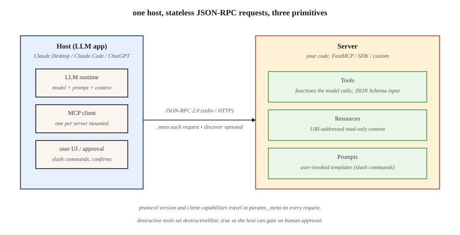

<!-- local-zh-machine-draft: English source is canonical; prose translated automatically, code/math preserved. -->

<a id="model-context-protocol-mcp"></a>

# Model Context Protocol (MCP)

> MCP 给AI 主机提供一项协议,用于发现和引用工具、资源,以及 prompts2026-07-28号修订案使议定书成为无国籍:能力和版本随每项请求而变化,而不是在有关联的握手中。

**类型:** Build
**语言:** Python
**先修要求:** 阶段11 · 0 9 (Function Calling阶段11. 2003年(第3段)Structured Outputs)
**时间:** ~75分钟

<a id="learning-objectives"></a>

## 学习目标

- 区别于 MCP 主机、客户端、服务器、运输和服务器原始化。
- 构建 JSON-RPC 请求中包含所需的元数据 MCP 2026-07-28.
- 使用 `server/discover` 检查版本、身份和能力。
- 返回打字和缓存记录来自工具、资源,以及 prompts.
- 解释一下,如何现代 stateless MCP 使用握手时代服务器进行互操作。
- 为服务器选择安全状态、 运输和批准边界 。

<a id="the-problem"></a>

## 问题

您的应用程序需要一个数据库查询、一个日历操作和一个文件阅读器。 没有共享的协议, 每个 AI 主机都需要自定义的发现、 引用、 错误、 运输和授权粘合来获取这些功能 。

MCP 减少整合矩阵。服务器发布标准 JSON-RPC 符合要求的客户端可以发现表面, 向模型或用户展示, 引用它, 并解释结果, 而不使用服务器特定的适配器 。

重要的边界很容易被忽略。 MCP 将通信标准化。 它不决定模型应该调用哪个工具, 使不信任的内容安全, 或者将无国籍请求变成持久的应用程序状态。 您的主机和服务器仍然拥有这些决定 。

<a id="the-concept"></a>

## 概念



<a id="the-three-server-primitives"></a>

### 三个服务器原始

1. **Tools** 是一个可调用动作。每个工具都有名称、描述、 JSON 计划输入, 和处理器。
2. **Resources** 被命名为客户端可以阅读的 URI 地址内容。
3. **Prompts** 是一个主机可以暴露给用户的可重复使用的模板。

主机是 AI 应用程序。 A MCP 主机内的客户端对一个服务器说话。 JSON-RPC 他们的讯息。

<a id="stateless-requests-replace-the-handshake"></a>

### 以无国籍请求取代握手

MCP 2026-07-28删除 `initialize` 和 `notifications/initialized`。它也删除了协议级会议。 `params._meta`:

```json
{
  "jsonrpc": "2.0",
  "id": 1,
  "method": "tools/list",
  "params": {
    "_meta": {
      "io.modelcontextprotocol/protocolVersion": "2026-07-28",
      "io.modelcontextprotocol/clientCapabilities": {},
      "io.modelcontextprotocol/clientInfo": {
        "name": "lesson-client",
        "version": "1.0.0"
      }
    }
  }
}
```

需要协议版本和客户能力。 建议客户身份。 `_meta`,缺少所需的字段,或者错误类型所需的字段格式错误,返回无效参数(Param)。`-32602`返回。一个服务器不支持的完善版本字符串 `UnsupportedProtocolVersionError` (`-32022`服务器可处理有效请求,而不恢复先前的谈判记录。

无国籍并不意味着申请永远不能维持状态。 MCP 连接或 `Mcp-Session-Id`。如果工作流程需要连续性,服务器薄荷处理器将不透明,客户端将处理器作为普通工具参数通过,以后的调用时,仍须检查每项请求的授权。

<a id="discovery-and-version-selection"></a>

### 发现和版本选择

每个现代服务器都安装 `server/discover`。结果公布支持版本、能力和服务器身份:

```json
{
  "jsonrpc": "2.0",
  "id": 1,
  "result": {
    "resultType": "complete",
    "supportedVersions": ["2026-07-28"],
    "capabilities": {
      "tools": {},
      "resources": {},
      "prompts": {}
    },
    "ttlMs": 3600000,
    "cacheScope": "public",
    "_meta": {
      "io.modelcontextprotocol/serverInfo": {
        "name": "demo-server",
        "version": "1.0.0"
      }
    }
  }
}
```

客户端可直接调用另一种方法处理版本错误, 但发现后会明确显示能力和版本选择。 一种不支持的版本返回 `UnsupportedProtocolVersionError` 有代码 `-32022`。其数据包含 `supported`,一系列服务器修改, `requested`,拒绝的订正。

在Stdio上,一个双时代客户与 `server/discover`。发现结果或公认的现代错误,例如 `UnsupportedProtocolVersionError` 识别一个现代服务器。 任何错误或超时, 不被确认为现代允许返回到 2025- 11- 25 。 `initialize` 传说中,遗产行为是兼容代码,而不是现代默认。

<a id="results-are-explicit"></a>

### 成果明确

2026-07-28号核心结果 `resultType`:

- `complete` 表示操作已完成 。
- `input_required` 表示服务器需要再经过一次 Multi Round-Trip Requests 模式。核心服务器只能从 `tools/call`, `resources/read`, 或 `prompts/get`.

客户必须处理遗漏的结果 `resultType` 完全没有问题

服务器应该包含 `io.modelcontextprotocol/serverInfo` 每一个结果 `_meta`。该身份是自报的,用于显示、记录和调试,而不是用于安全决策。

列表和阅读结果也包含 `ttlMs` 和 `cacheScope`。 `tools/list` 命令加上新提示,使客户能够安全地隐藏发现并改进 prompt- 缓冲稳定。 `cacheScope: public` 允许共享缓存; `private` 仅限于调用环境。

<a id="the-wire-format-and-transport"></a>

### 电线格式和运输

MCP 使用 JSON-RPC 2.0 超过标准或可流 HTTP.

- 有个请求 `jsonrpc`, `id`, `method`, 和 `params`.
- 响应有匹配 `id` 以及两个 `result` 或 `error`.
- 通知没有 `id` 并且期待没有回应。

现代流 HTTP 暴露一个接受 PST 的终点。 JSON-RPC 信件获得自己的 PST 。 请求 PST 接收其中之一 JSON 对象或请求范围服务器-事件流,以最后回复结束。 HTTP 202 没有回复机构; 此核心修订版定义了客户端对服务器的通知不比可流 HTTP.

没有什么是独立的 MCP 获取流,DELETE会话的终点, `Mcp-Session-Id`, 或 `Last-Event-ID` 重播 2026-07-28。 `subscriptions/listen` 邮政管理处,其答复仍然作为SSE流开放。

<a id="client-input-without-server-initiated-requests"></a>

### 客户输入, 无需服务器启动请求

旧的修改让服务器发送请求, 如 `sampling/createMessage`, `roots/list`, 或 `elicitation/create` 。 当前协议使用 Multi Round-Trip Requests 而不是。 符合条件的 tool call,资源读取,或 prompt 获取返回 `resultType: input_required` 至少有一个 `inputRequests` 或 `requestState`。客户端会收集任何请求输入,用新 JSON-RPC 身份证和相应的 `inputResponses`,并回响准确 `requestState` 提供时,如果没有 `inputRequests` 存在, 重试省略 `inputResponses`.

Roots, Sampling,并且记录仍然有效,但已经折旧,因此新的实施不应采用。 Roots 或 Sampling 申请内出差旅费 MRTR `inputRequests`,从不作为独立的服务器到客户 JSON-RPC 请求。 更可取的是明确的文件或目录 parameters,资源 URIs,服务器配置和直接模型提供者整合。使用标准输出器进行标准诊断,并使用开放遥测法进行生产遥测。

```figure
mcp-nxm-collapse
```

<a id="build-it"></a>

## 动手实现

<a id="step-1-register-a-server-surface"></a>

### 步骤1: 注册服务器表面

登记手续简便,即使申请合同有下列变更:

```python
server = MCPServer("demo-server")

@server.tool(
    "add",
    "Add two integers.",
    {
        "type": "object",
        "properties": {
            "a": {"type": "integer"},
            "b": {"type": "integer"}
        },
        "required": ["a", "b"]
    }
)
def add(a: int, b: int) -> dict:
    return {"sum": a + b}
```

运到的履约情况 `code/main.py` 登记资源 prompt。它故意使用标准库,以便您看到每个信封,而不是将协议委托给一个 SDK.

<a id="step-2-attach-metadata-to-every-request"></a>

### 步骤2:将元数据附加到每一项请求中

```python
def request(method, params=None):
    body_params = dict(params or {})
    body_params["_meta"] = {
        "io.modelcontextprotocol/protocolVersion": "2026-07-28",
        "io.modelcontextprotocol/clientCapabilities": {},
        "io.modelcontextprotocol/clientInfo": {
            "name": "demo-client",
            "version": "1.0.0"
        }
    }
    return {
        "jsonrpc": "2.0",
        "id": 1,
        "method": method,
        "params": body_params
    }
```

不只在连接对象中缓存此元数据。 服务器对每个请求进行验证 。

<a id="step-3-optionally-discover-before-listing"></a>

### 步骤3:在列名前可选发现

Call `server/discover`,选择一个支持版本,然后调用 `tools/list`直接 `tools/list` 如果您已经知道版本, 并且可以处理此版本, 也有效 `-32022`.

演示返回工具列表, 按名称顺序和附件排列 `ttlMs`, `cacheScope`, `resultType`,以及服务器身份。 tool call 返回完整、不可取舍的结果,因为其输出取决于当前状态。

<a id="step-4-map-the-same-request-to-http"></a>

### 步骤4:绘制相同的请求 HTTP

远程 `tools/call` POST 包括反映 JSON-RPC body:

```http
POST /mcp HTTP/1.1
Content-Type: application/json
Accept: application/json, text/event-stream
MCP-Protocol-Version: 2026-07-28
Mcp-Method: tools/call
Mcp-Name: add
```

该 `MCP-Protocol-Version` 标题必须匹配版本 `_meta`. `Mcp-Method` 要求的每张 JSON-RPC 请求并必须匹配 `method`. `Mcp-Name` 仅需 `tools/call`, `resources/read`, 和 `prompts/get`,其中必须匹配工具名、资源 URI,或 prompt 名称。 缺少所需的信头或不匹配返回 HTTP 4 000 计 `HeaderMismatch` code `-32020`.

<a id="step-5-enforce-safety-outside-protocol-state"></a>

### 步骤5:在协议状态之外加强安全

- 验证授权和观众 HTTP request.
- 将本地服务器绑到本地主机并验证 `Origin` 流动 HTTP.
- 标记突变工具 `destructiveHint: true` 并需要东道国的批准。
- 明确指定通行证目录和文件范围,而不是取决于已折旧的 Roots.
- 将资源和工具产出作为不可信的数据处理。
- 保留备忘 JSON-RPC 在标准版下; 将诊断书写到标准版 。

<a id="use-it"></a>

## 实际应用

从目录中运行课程 :

```bash
python3 code/main.py
cd code
python3 -m unittest discover tests -v
```

第一行应该报告发现 `demo-server` 协议中 `2026-07-28`。然后检查 `MCPClient.request`:它重建了 `_meta` 每一个呼叫。 从一个请求中删除元数据, 并观察服务器拒绝它 。

<a id="ship-it"></a>

## 交付成果

`outputs/skill-mcp-server-designer.md` 将一个域变成 stateless MCP 其接受大门需要发现结果、每个请求的元数据政策、确定性缓存清单、明确的国家控件、运输信头、授权和批准规则。

<a id="continue-the-mcp-deep-dive"></a>

## 继续 MCP 深潜

此课为您提供协议模式。 13 阶段将四个生产边框变成独立的构建和验证课程 :

1. [MCP Tool Contracts 内容](../../../13-tools-and-protocols/28-mcp-tool-contracts-and-content/docs/zh.md) 包括封闭输入图、结构化内容、路径元数据、不透明的页码、完成授权以及协议与工具域错误的区别。
2. [MCP 可靠性、取消和流程控制](../../../13-tools-and-protocols/29-mcp-reliability-cancellation-and-flow-control/docs/zh.md) 包括请求取消、持久任务取消、最后期限, idempotency, backpressure代理缓冲,并重新连接行为。
3. [MCP 登记供应链、录用、漂流和 Rollback](../../../13-tools-and-protocols/30-mcp-registry-supply-chain-and-drift/docs/zh.md) 包括命名空间证明、人工制品来源、固定的针、实时漂移、登记状况、接收证据和 rollback.
4. [MCP 合规工程](../../../13-tools-and-protocols/31-mcp-conformance-versioning-and-operations/docs/zh.md) 包括金线和负线记录 严格版本的时代 SDK 差异、代理证据、编辑、卫生门和释放 rollback.

跟随他们, 当服务器跨过团队时, 或者 trust boundary合同从“方法的工程”改为“合同仍然安全,通过部署可以诊断”。

<a id="exercises"></a>

## 练习

1. 添加a `subtract` 工具并确认 `tools/list` 依字母顺序排列。
2. 删除协议转换密钥并校验无效的参数( R)`-32602`)然后发送格式完善但无支持的版本 `2025-11-25`,确认 `-32022`,确认 `requested` 重复了这一修订,并选择 `supported`.
3. 添加服务器提示 `draftId` 来更新。 请解释为什么这是应用状态而不是协议会话 。
4. 返回 `input_required` 使用需要用户确认的工具。 `inputResponses` 条目, 以及准确的 `requestState` 而不是发明服务器到客户端 JSON-RPC request.
5. 绘制双时代的平板客户端。 将结果或公认的现代错误视为现代错误, 并允许返回 `initialize` 仅用于未经承认的错误或超时。

<a id="key-terms"></a>

## 关键术语

| 术语 | 人们怎么说 | 它实际上意味着什么 |
|------|-----------------|------------------------|
| MCP | "工具协议 LLMs" | JSON-RPC 服务器发现、工具、资源、 prompts,并延长 |
| 宿主 | "AI应用程序" | 拥有模型和UI,并挂载一个或多个 MCP clients |
| Client | 连接器 | Speaks MCP 代表主机到一个服务器 |
| Stateless MCP | "没有会" | 每个请求都带有版本和能力;没有协议状态被连接键入 |
| `server/discover` | "能力探测" | 所需服务器方法广告版本、能力和身份 |
| `resultType` | "后遗症" | 标记结果为 `complete` 或 `input_required` |
| 国家处理 | "工作流id" | 服务器点名应用程序标识符作为普通参数被传递 |
| Streamable HTTP | 远程运输 | POST 端点为 JSON 或请求范围 SSE 响应 |
| MRTR | 问和重试 | 输入请求嵌入结果, 然后再重试原始操作 |

<a id="further-reading"></a>

## 进一步阅读

- [MCP 2026-07-28关键变动](https://modelcontextprotocol.io/specification/2026-07-28/changelog)
- [MCP 服务器发现](https://modelcontextprotocol.io/specification/2026-07-28/server/discover)
- [MCP Streamable HTTP](https://modelcontextprotocol.io/specification/2026-07-28/basic/transports/streamable-http)
- [MCP Multi Round-Trip Requests](https://modelcontextprotocol.io/specification/2026-07-28/basic/patterns/mrtr)
- [MCP deprecated features](https://modelcontextprotocol.io/specification/2026-07-28/deprecated)
