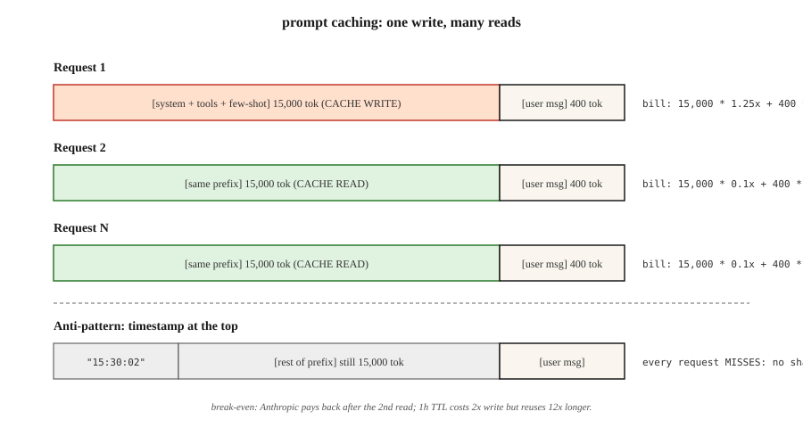

<!-- local-zh-machine-draft: English source is canonical; prose translated automatically, code/math preserved. -->

<a id="prompt-caching-and-context-caching"></a>

# Prompt 缓存与上下文缓存

> 你的 system prompt 4000 个 tokens. 你的 RAG 上下文是20,000 tokens你每次都给两个,你也要为这两个付钱 Prompt 缓冲让供应商将前缀放在一边,然后在重复使用时将正常费率的10%记在帐上。 使用正确, 它会切开 inference 成本为50-90%,第一位token 潜伏率上升40-85%。

**类型：** 构建
**语言:** Python
**先修要求:** 阶段11 · 01 (Prompt Engineering阶段11 05 (Context Engineering11阶段(入门和成本)
**时间:** ~60分钟

<a id="the-problem"></a>

## 问题

一个 coding agent 发同样的15000 -token system prompt 以 Claude 20个转机,输入3美元/M tokens 以每天10 000次对话为乘数,每天9 000美元的帐单点击,而文本从未改变。

你不能缩小 prompt 而不是伤害质量。 您无法避免发送它—— 模型需要它每转一圈。 唯一的选择是停止支付供应商已经看到的前缀的全部价格 。

那一招是 prompt caching. Anthropic 2024年8月发运(2025年有1小时的延长-TTL变体), OpenAI 谷歌在当年晚些时候自动运出 明显的环境缓冲 Gemini 1.5,现在所有三个都作为头等舱 feature 他们的边境模型。

<a id="the-concept"></a>

## 概念



**机械师** 当请求的前缀与最近的请求匹配时, 服务商从上一个运行中为 KV 缓存服务, 而不是重新编码 tokens。你第一次支付小额的写作费,每次每次支付大额的折扣。

**2026年有三种供应商的口味**

| 提供商 | API style | 贴现 | 写入溢价 | 默认 TTL | 可缓存的最小值 |
|---------|-----------|--------------|---------------|-------------|---------------|
| Anthropic | Explicit `cache_control` 内容区块上的标记 | 90%不输入 | 25%附加费 | 5分钟(可延长至1小时) | 1,024 tokens (松内特/奥普斯),2 048人(海库) |
| OpenAI | 自动前缀检测 | 50%不输入 | 无 | 最多1小时(最佳努力) | 1,024 tokens |
| 谷歌( 谷歌)Gemini) | Explicit `CachedContent` API | 存储票;读取为占正常值的25% | 储存费 token·hour | 用户集( 默认 1小时) | 4,096 tokens (鞭打)32 768(Pro) |

**贪婪者** 全部三个缓存前缀。 如果有的话 token 要求之间有差异,所有要求之间都有差异 token 是个失手,放 *stable* 顶部的部件, *variable* 部件在底部。 。 。

<a id="the-cache-friendly-layout"></a>

### 方便缓存的布局

```
[system prompt]          <-- cache this
[tool definitions]       <-- cache this
[few-shot examples]      <-- cache this
[retrieved documents]    <-- cache if reused, else don't
[conversation history]   <-- cache up to last turn
[current user message]   <-- never cache (different every time)
```

违反命令, user message 以上 system prompt,在 few-shots - 暗藏箱从不碰

<a id="the-break-even-calculation"></a>

### 平衡计算

Anthropic25%的写溢价是指缓存区块必须至少读取两次到净保存款。 1 写+ 1 读取平均费用为每份要求0. 675x(储蓄32%); 1 写+ 10 读取平均费用为0. 205x(储蓄80%)。 拇指规则: 缓存任何您希望在TTL内重新使用至少3次的东西。

```figure
prompt-cache-hit
```

<a id="build-it"></a>

## 动手实现

<a id="step-1-anthropic-prompt-caching-with-explicit-markers"></a>

### 步骤1: Anthropic prompt 以清晰标记缓存

```python
import anthropic

client = anthropic.Anthropic()

SYSTEM = [
    {
        "type": "text",
        "text": "You are a senior Python reviewer. Follow the rubric exactly.\n\n" + RUBRIC_15K_TOKENS,
        "cache_control": {"type": "ephemeral"},
    }
]

def review(code: str):
    return client.messages.create(
        model="claude-opus-4-7",
        max_tokens=1024,
        system=SYSTEM,
        messages=[{"role": "user", "content": code}],
    )
```

该 `cache_control` 标记显示 Anthropic 将区块存储5分钟。 在窗口点击中重新使用; 过期后再使用, 并再次写入 。

**响应使用字段 :**

```python
response = review(code_a)
response.usage
# InputTokensUsage(
#     input_tokens=120,
#     cache_creation_input_tokens=15023,   # paid at 1.25x
#     cache_read_input_tokens=0,
#     output_tokens=340,
# )

response_b = review(code_b)
response_b.usage
# cache_creation_input_tokens=0
# cache_read_input_tokens=15023           # paid at 0.1x
```

检查 CI 中的两个字段 `cache_read_input_tokens` 请求时保持零位,你的缓存键在漂移。

<a id="step-2-one-hour-extended-ttl"></a>

### 步骤2:延长一小时的TTL

对于长期批量工作, 5分钟的默认值在任务间过期 。 `ttl`:

```python
{"type": "text", "text": RUBRIC, "cache_control": {"type": "ephemeral", "ttl": "1h"}}
```

1小时TTL费用为2x写价溢价(比基线高出50%,而不是25%),但任何批次重用前缀的费用都超过5倍。

<a id="step-3-openai-automatic-caching"></a>

### 步骤3: OpenAI 自动缓存

OpenAI 给您任何可配置的。 任何前缀 1024 tokens 符合最近请求的, 自动获得50%的折扣 。

```python
from openai import OpenAI
client = OpenAI()

resp = client.chat.completions.create(
    model="gpt-5",
    messages=[
        {"role": "system", "content": SYSTEM_PROMPT},   # long and stable
        {"role": "user", "content": user_msg},
    ],
)
resp.usage.prompt_tokens_details.cached_tokens  # the discounted portion
```

使用相同的缓存友好版式规则。 两件事情会杀死 OpenAI暗藏不杀人 Anthropic's: 改变 `user` 字段(用作缓存密钥组件)和重新排序工具。

<a id="step-4-gemini-explicit-context-caching"></a>

### 步骤4: Gemini 明确上下文缓存

Gemini 将缓存作为您创建和命名的头等天体 :

```python
from google import genai
from google.genai import types

client = genai.Client()

cache = client.caches.create(
    model="gemini-3.8-flash",
    config=types.CreateCachedContentConfig(
        display_name="rubric-v3",
        system_instruction=RUBRIC,
        contents=[FEW_SHOT_EXAMPLES],
        ttl="3600s",
    ),
)

resp = client.models.generate_content(
    model="gemini-3.8-flash",
    contents=["Review this code:\n" + code],
    config=types.GenerateContentConfig(cached_content=cache.name),
)
```

Gemini 收费储存量 token· 只要缓存有效, 且读取率为正常输入率的~ 25%。 这是您再利用同一个巨人时的正确形状 prompt 几天来,我常在很多会议里

<a id="step-5-measuring-hit-rate-in-production"></a>

### 步骤5:衡量生产中的冲击率

See `code/main.py` 模拟的三名提供会计,跟踪写/读/错记数,计算每1K项请求的混合费用。 Anthropic 设置后应看到 > 80% 读取分数 warmup.

<a id="pitfalls-that-still-ship-in-2026"></a>

## 2026 年仍然存在的陷阱

- **顶部的动态时间戳 。** `"Current time: 2026-04-22 15:30:02"` 的顶部 system prompt。每个请求都丢失。将时间戳移到缓存断点下方。
- **工具重订顺序。** 将工具按稳定顺序排列——部署之间的调整使每一次打击都中断。
- **自由文本几乎是重复的。** "你很有帮助", 与"你很有帮助"。 一个字节差异=完全失手。
- **过于小的街区。** Anthropic 执行1 024 -token 海库楼(2.048),小块不暗藏。
- **盲目的成本仪表板。** 分割“ 输入” tokens"在缓存和未切割的之间 否则交通会下降,就像缓存赢一样"

<a id="use-it"></a>

## 实际应用

2026年的缓存堆:

| 情况 | 挑选 |
|-----------|------|
| Agent 稳定在10公里以上 system prompt,许多转弯 | Anthropic `cache_control` 5分钟TTL |
| 批处理工作, 使用前缀30分钟 | Anthropic 与 `ttl: "1h"` |
| 无服务器端点打开 GPT5, 无习惯的次 | OpenAI 自动( 使前缀稳定且长) |
| 大型代码/软件库的多日再利用 | Gemini explicit `CachedContent` |
| 跨供应商的退缩 | 使各提供者的可缓存前缀布局保持相同, 以便任何点击都工作 |

与用户信息层的语义缓冲( 11 级 = 11) 组合: prompt 缓存控点 *token-identical* 语义缓冲柄 *meaning-identical* reuse.

<a id="ship-it"></a>

## 交付成果

Save `outputs/skill-prompt-caching-planner.md`:

```markdown
---
name: prompt-caching-planner
description: Design a cache-friendly prompt layout and pick the right provider caching mode.
version: 1.0.0
phase: 11
lesson: 15
tags: [llm-engineering, caching, cost]
---

Given a prompt (system + tools + few-shot + retrieval + history + user) and a usage profile (requests per hour, TTL needed, provider), output:

1. Layout. Reordered sections with a single cache breakpoint marked; explain which sections are stable, which are volatile.
2. Provider mode. Anthropic cache_control, OpenAI automatic, or Gemini CachedContent. Justify from TTL and reuse pattern.
3. Break-even. Expected reads per write within TTL; net cost vs no-cache with math.
4. Verification plan. CI assertion that cache_read_input_tokens > 0 on the second identical request; dashboard split by cached vs uncached tokens.
5. Failure modes. List the three most likely reasons the cache will miss in this setup (dynamic timestamp, tool reorder, near-duplicate text) and how you will prevent each.

Refuse to ship a cache plan that places a dynamic field above the breakpoint. Refuse to enable 1h TTL without a reuse count that makes the 2x write premium pay back.
```

<a id="exercises"></a>

## 练习

1. **Easy.** 和5000人进行十轮对话token system prompt against Claude运行时没有 `cache_control` 并用。 报告输入 -token 每人的账单。
2. **Medium.** 写一个测试 harness 给 prompt 模板和请求日志,计算每个供应商的预期点击率和美元节余(Anthropic 5m, Anthropic 1h, OpenAI automatic, Gemini explicit).
3. **Hard.** 构建布局 optimizer:给定一个 prompt 和已标记字段列表 `stable=True/False`,重写 prompt 以在最大缓存友好位置上设置一个单个缓存断点,不丢失信息。 Anthropic endpoint.

<a id="key-terms"></a>

## 关键术语

| 术语 | 人们怎么说 | 它实际上意味着什么 |
|------|-----------------|-----------------------|
| Prompt caching | 长 prompts cheap" | 重新使用供应商端 KV 缓存来匹配前缀; 重复输入的折现率为 50- 90% tokens. |
| `cache_control` | "该 Anthropic marker" | 宣布“这里的一切是可隐藏的”的内容区块属性; `{"type": "ephemeral"}`. |
| 缓存写入 | 买单 | 包含缓存的第一个请求; 以~ 1. 25x 输入速率计费 Anthropic,免费 OpenAI. |
| 缓存读取 | 折扣 | 与前缀匹配的随后请求;以10%计价(Anthropic), 50% (OpenAI), ~25% (Gemini). |
| TTL | "它能活多久" | 缓存保持热度; Anthropic 默认 5 m (可扩展 1 h) , OpenAI 最好的努力到1小时, Gemini user-set. |
| 扩展 TTL | "1-hour Anthropic cache" | `{"type": "ephemeral", "ttl": "1h"}`; 2x 写价,但值得批量再利用。 |
| 前缀匹配 | "为什么我的缓冲漏掉了" | 只有在每次弹奏时才弹出 token 从开始到断点都是字节相同的。 |
| 上下文缓存( N)Gemini) | "明亮的" | 谷歌的名字是存储卡缓存器 最好能多天地重新使用大型公司 |

<a id="further-reading"></a>

## 进一步阅读

- [Anthropic — Prompt caching](https://docs.anthropic.com/en/docs/build-with-claude/prompt-caching) — `cache_control`,1小时TTL,平衡表。
- [OpenAI — Prompt caching](https://platform.openai.com/docs/guides/prompt-caching) 自动的前缀匹配 。
- [谷歌-背景缓存](https://ai.google.dev/gemini-api/docs/caching) — `CachedContent` API 和储存定价。
- [Anthropic 工程学- Prompt 等待长文本工作量](https://www.anthropic.com/news/prompt-caching) - 原始发射站有潜伏编号。
- 阶段11 · 05 (Context Engineering——切开 prompt 以便缓存可以降落。
- 阶段11 11(发货和成本)-对 prompt 与 a 的缓冲 semantic cache 在 user messages.
- [Pope等人,“有效扩大” Transformer Inference" (2022)](https://arxiv.org/abs/2211.05102) - KV -cache 记忆模型 prompt 缓存会暴露给用户; 解释为什么缓存前缀重读比重新计算更便宜 ~ 10x 。
- [Agrawal等人,“SARATHI:效率 LLM Inference 使用 Chunked Prefills" (2023)](https://arxiv.org/abs/2308.16369) — prefill 是阶段 prompt 缓冲快捷键; 本文解释了为什么TTFT在TPOT不受冲击的情况下会急剧下降。
- [利维坦等人,“迅速” Inference 来自 Transformers 通过 Speculative Decoding" (2023)](https://arxiv.org/abs/2211.17192) — prompt 缓冲坐在一起 speculative decoding, Flash 闪光 Attention,而MQA/GQA作为弯曲 inference 成本曲线;读取此选项用于其他三个。
