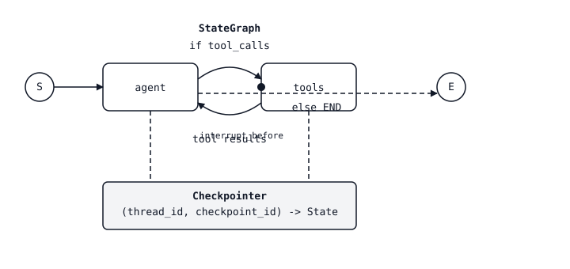

<!-- local-zh-machine-draft: English source is canonical; prose translated automatically, code/math preserved. -->

<a id="agent-state-machines--graphs-nodes-checkpoints"></a>

# Agent State Machines——图、节点与 Checkpoints

> 一个 ReAct 手写环 `while True`。与清晰的图形一样的循环是您可以做的 checkpoint打断一下 branch时间穿梭。 agent 一点都没变 harness 周围有。

**类型:** Build
**语言:** Python
**先修要求:** 阶段11 · 0 9 (Function Calling阶段11 14 ()Model Context Protocol)
**时间:** ~75分钟

<a id="the-problem"></a>

## 问题

你发了个调试电话 agent。它有三个转折,然后出错:模型尝试一个返回500的工具,用户改变心智,或者 agent 决定不签人名就退还订单 `while True:` 循环没有钩子,不能暂停,不能倒带,不能 branch 换成"如果模型选了另一个工具" agent 变成一个黑盒,要么起作用,要么失败。

下一步你一看到就很明显了 agent 已经是一台国家机器了 system prompt 加信息历史加待处理 tool calls 加上下一个动作。让国家机器清晰化: “ 模型思考” 的节点, “ 工具运行” , “ 人类同意 ” , 以及它们之间有条件转换的边框。 一旦图表清晰化, 则会显示 harness 免费获得四件东西:检查站(两步之间保持安全状态)、中断(人行暂停), streaming (stream tokens 和时间旅行(倒带到先前状态,尝试不同的 branch).

参考执行这一抽象概念 LangGraph。它不是一个 agent 框架内 LangChain 感官( “ 这是代理执行者, 祝你好运 ” ) 。 这是一个图表运行时间, 上面有头等状态, 一等持久性, 头等中断 。 agent loop 画的东西,不是手写的东西

<a id="the-concept"></a>

## 概念



一个 `StateGraph` 有三个问题

1. **State.** 打印式的编辑器( TypedDict 或 Pydantic 模型) , 可以通过图形流过。 每个节点都接收完整状态并返回部分更新, 其中 LangGraph 使用 *reducer* 每一字段 - `operator.add` 以显示应该累积的列表,默认覆盖。
2. **Nodes.** Python functions `state -> partial_state`每个步骤都是分解的:叫模型,"运行工具","总结"
3. **Edges.** 节点之间的切换。 静态边缘会进入一个地方。 条件边缘会包含路由函数 `state -> next_node_name` 使图表能够 branch 模型输出。

您正在编译图表。 编译将图像绑定, 附加一个检查器( 选项但对于制作来说必不可少) , 然后返回可运行的 。 您会以初始状态和初始状态引用它 。 `thread_id`执行的每个步骤 checkpoint 键入 `(thread_id, checkpoint_id)`.

<a id="the-four-superpowers"></a>

### 四个超级大国

**Checkpointing.** 每个节点转换都将新状态写入商店( 测试的模拟, Postgres/ Redis/ SQLite 用于测试) 。 恢复时用相同的图形调用此图 `thread_id`。图中会看到它停放的地方。

**Interrupts.** 标记节点 `interrupt_before=["human_review"]` 并且执行在节点运行前停止。 国家仍然维持着。 您的 Name API 用户会收到“等待批准”的回复。 `thread_id` 与 `Command(resume=...)` 继续执行

**Streaming.** `graph.stream(state, mode="updates")` 显示发生时的状态三角洲。 `mode="messages"` 流出 LLM tokens 模型节点内 `mode="values"` 显示完整的快照。 您选择在 UI 中要浮出什么 。

**Time-travel.** `graph.get_state_history(thread_id)` 返回完整 checkpoint 日志。 通过任何前一页 `checkpoint_id` 以 `graph.invoke` 并且从那个角度来叉叉。很好地调试 (“如果模型选择了工具B呢? ”) 和用于调试(如果模型选择了工具B呢? ) regression tests 重播制作 traces.

<a id="reducers-are-the-point"></a>

### 减少是关键

每个州域都有一个缩放符。 大多数默认值都很好, 新的值会覆盖旧的字段。 但是信件列表需要 `operator.add` 。如果两个节点都更新 `messages` 你却忘了 `Annotated[list, add_messages]`,第二个人默默地赢,你就会失去一半的转折。 rest composes.

<a id="the-react-graph-in-four-nodes"></a>

### 该 ReAct 四个节点中的图形

生产 ReAct agent 四个节点和两个边缘:

1. `agent` - 打电话给 LLM 返回助手消息(其中可能包含工具)_calls).
2. `tools` - 执行任何工具_在最后一个助手消息中, 将工具结果作为工具消息附加 。
3. 条件边缘 `agent` 通往 `tools` 如果上一条消息有工具_打电话,其他 `END`.
4. 静态边缘 `tools` 返回到 `agent`.

就这样,你得到全部 ReAct 环形(试图用检查、中断和观察来观察) streaming大约40行的代码

<a id="stategraph-vs-send-fanout"></a>

### 国家格言对发送( 发件人)

`Send(node_name, state)` 设置一个节点发送平行子图。示例: agent 决定同时询问三个检索器。 `Send` 生成目标节点的平行执行; 其输出通过州级降压器合并。 这是如何实现的 。 LangGraph 表示管弦工的风格,没有线条原始。

<a id="subgraphs"></a>

### Subgraphs

编译的图形可以是另一个图形中的节点。 外部图形看到一个单一节点; 内部图形有其自身的状态和位置 checkpoints团队如何建立主管- 工作人员 agents:主管图表将用户意图引向每个主页工人的子集。

```figure
l5-state-graph-ledger
```

<a id="build-it"></a>

## 动手实现

<a id="step-1-state-and-nodes"></a>

### 步骤1:状态和节点

```python
from typing import Annotated, TypedDict
from langchain_core.messages import AnyMessage, HumanMessage, AIMessage
from langgraph.graph import StateGraph, END
from langgraph.graph.message import add_messages
from langgraph.prebuilt import ToolNode
from langgraph.checkpoint.memory import MemorySaver

class State(TypedDict):
    messages: Annotated[list[AnyMessage], add_messages]

def agent_node(state: State) -> dict:
    response = llm.invoke(state["messages"])
    return {"messages": [response]}

def should_continue(state: State) -> str:
    last = state["messages"][-1]
    return "tools" if getattr(last, "tool_calls", None) else END

tool_node = ToolNode(tools=[search_web, read_file])

graph = StateGraph(State)
graph.add_node("agent", agent_node)
graph.add_node("tools", tool_node)
graph.set_entry_point("agent")
graph.add_conditional_edges("agent", should_continue, {"tools": "tools", END: END})
graph.add_edge("tools", "agent")

app = graph.compile(checkpointer=MemorySaver())
```

`add_messages` 使信件列表累积而不是覆盖的缩写器。忘记它是最常见的 LangGraph bug.

<a id="step-2-run-with-a-thread"></a>

### 步骤2:用线索运行

```python
config = {"configurable": {"thread_id": "user-42"}}
for event in app.stream(
    {"messages": [HumanMessage("find the Anthropic headquarters address")]},
    config,
    stream_mode="updates",
):
    print(event)
```

每一个更新都是一个单调 `{node_name: state_delta}`。您的前端可以将这些数据传送到 UI, 用户可以查看 "agent 正在想... 找寻_网络... 得到了结果... 回答。

<a id="step-3-add-a-human-in-the-loop-interrupt"></a>

### 步骤3:增加 human-in-the-loop interrupt

标记一个节点, 执行暂停后它才能运行 。

```python
app = graph.compile(
    checkpointer=MemorySaver(),
    interrupt_before=["tools"],  # pause before every tool call
)

state = app.invoke({"messages": [HumanMessage("delete the production database")]}, config)
# state["__interrupt__"] is set. Inspect proposed tool calls.
# If approved:
from langgraph.types import Command
app.invoke(Command(resume=True), config)
# If denied: write a rejection message and resume
app.update_state(config, {"messages": [AIMessage("Blocked by human reviewer.")]})
```

国家, checkpoint,而线条在中断的中间始终存在。除了执行期间,没有什么是记忆中的。

<a id="step-4-time-travel-for-debugging"></a>

### 步骤4:调试时间旅行

```python
history = list(app.get_state_history(config))
for snapshot in history:
    print(snapshot.values["messages"][-1].content[:80], snapshot.config)

# Fork from a prior checkpoint
target = history[3].config  # three steps back
for event in app.stream(None, target, stream_mode="values"):
    pass  # replay from that point forward
```

Passing `None` 作为给定的输入重放 checkpoint; 通过一个值附加此值作为更新 checkpoint恢复之前的状态。 这就是你如何复制坏 agent 跑步时不重复整个对话

<a id="step-5-swap-the-checkpointer-for-production"></a>

### 步骤5:将检查站换成生产

```python
from langgraph.checkpoint.postgres import PostgresSaver

with PostgresSaver.from_conn_string("postgresql://...") as checkpointer:
    checkpointer.setup()
    app = graph.compile(checkpointer=checkpointer)
```

斯奎特、雷迪斯和邮差都运来了 `MemorySaver` 测试。任何在重新开始时持续的东西 都想要一个真正的商店。

<a id="the-skill"></a>

## 技能

> 你造一个 agents 以图形形式,而不是以 `while True` loops.

在你找到之前 LangGraph,做一个60秒的设计:

1. **点名** 每一个独立的决定或副作用都是一个节点。 "Agent 思考,"工具运行,"评审批准," "反应流。"如果你不能列出它们,任务不是 agent- 形状还不错
2. **宣布国家。** 最小类型化数据, 并给每个列表字段减少一个。 不要将全部内容塞进 `messages`; 锁定任务特定领域(一个工作领域) `plan`, 一个 `budget` 反面, a `retrieved_docs` 列表)到顶层。
3. **画出边缘** 除非下一步取决于模型输出,否则要静态。 branches.
4. **前面选一个检查站** `MemorySaver` 检查,Postgres/Redis/SQLite 进行其他试验。没有检查器,就不准进行检查,不能进行检查,不能进行时间旅行。
5. **工具运行前决定中断,而不是之后。** 批准会进入一个副作用节点, 这样您就可以在伤害发生前取消; 验证会从模型的边缘开始, 这样您就可以廉价地拒绝坏电话 。
6. **默认流。** `mode="updates"` 用来做UI的 `mode="messages"` 用于 token-level streaming 模型节点内 `mode="values"` 来做完整快照

拒绝运送 LangGraph agent 拒绝运送中断的 *之后* 拒绝运载 `messages` 字段中没有 `add_messages` 成为它减少。

<a id="exercises"></a>

## 练习

1. **Easy.** 执行四节 ReAct 上面的图中带有计算工具和网络搜索工具。 `list(app.get_state_history(config))` 返回至少四个 checkpoints 来做两轮谈话
2. **Medium.** 添加a `planner` 之前运行的节点 `agent` 并写出一个结构化的 `plan: list[str]` 进入州际。 `agent` 标记计划步骤。 如果 `plan` 丢失 checkpoint 恢复(错误的减少)
3. **Hard.** 构建一个导师图, 显示三个子集之间的路径( NAME OF TRANSLATORS)`researcher`, `writer`, `reviewer`) 使用 `Send`。每个子集都有自己的状态和检查器。 `interrupt_before=["writer"]` 外图上显示的时空飞行 checkpoint 只重新运行前方 branch.

<a id="key-terms"></a>

## 关键术语

| 术语 | 人们怎么说 | 它实际上意味着什么 |
|------|-----------------|-----------------------|
| StateGraph | "该 LangGraph graph" | 在编译前添加节点和边框的构建器对象。 |
| Reducer | "如何将字段合并" | 函数 `(old, new) -> merged` 当节点返回该字段的更新时应用;默认为覆盖, `add_messages` appends. |
| Thread | 谈话身份 | 一个 `thread_id` 全部范围字符串 checkpoints 一次。 |
| Checkpoint | "一个停顿状态" | 结点转换后完整图形状态的持续快照, 键入 `(thread_id, checkpoint_id)`. |
| Interrupt | 人停车 | `interrupt_before` / `interrupt_after` 在节点边界停止执行; 恢复 `Command(resume=...)`. |
| Time-travel | 前面的叉子 | `graph.invoke(None, config_with_old_checkpoint_id)` 重播从 checkpoint forward. |
| Send | "帕拉列尔子电报发送" | 建造者可以返回到 N 平行执行目标节点。 |
| Subgraph | “ 编译的图表作为节点” | 用于另一图中节点的编译状态格;保留其自己的状态范围。 |

<a id="further-reading"></a>

## 进一步阅读

- [LangGraph documentation](https://langchain-ai.github.io/langgraph/) 国家格言、消音器、检查站和中断的金字塔参考。
- [LangGraph 概念: 状态、降压器、检查站](https://langchain-ai.github.io/langgraph/concepts/low_level/) 直接从源头学的心理模型
- [LangGraph 持久性和 Checkpoints](https://langchain-ai.github.io/langgraph/concepts/persistence/) - Postgres/SQLite/Redis商店的细节, checkpoint 命名空间, 以及线索 ID 。
- [LangGraph Human-in-the-loop](https://langchain-ai.github.io/langgraph/concepts/human_in_the_loop/) — `interrupt_before`, `interrupt_after`, `Command(resume=...)`,以及编辑状态模式。
- [姚等人, "ReAct:在语言模型中使理由和行为同步化”(ICLR 2023)](https://arxiv.org/abs/2210.03629) 模式 LangGraph agent 执行; 读取用于推理 trace rationale.
- [Anthropic - 建设有效 agents (第2024号决定)](https://www.anthropic.com/research/building-effective-agents) 图形形状(链、路由器、管弦工、评价员)optimizer选择何时
- 阶段11 · 0 9 (Function Calling)——工具呼叫原始 LangGraph agent 节点再利用。
- 阶段11 · 14 (Model Context Protocol)——外部工具发现,插在 LangGraph `ToolNode` 通过 MCP adapter.
- 阶段11 · 17 (Agent 选择框架的取舍) LangGraph over CrewAI自动枪,或阿格诺
