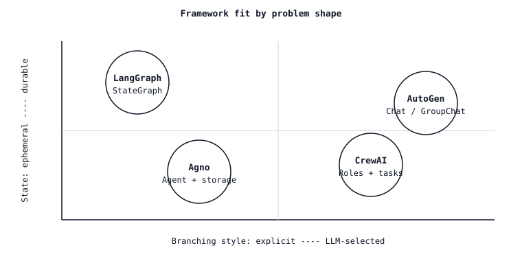

<!-- local-zh-machine-draft: English source is canonical; prose translated automatically, code/math preserved. -->

<a id="agent-framework-tradeoffs--graph-role-and-actor-orchestration"></a>

# Agent 框架权衡——图、角色与 Actor Orchestration

> 每个框架都销售同样的演示(研究) agent 建立报告),并隐藏相同的错误(国家计划与 orchestration 选择一个框架,其抽象性与问题形状相符;其他的都是胶水,您写了两次。

**类型:** 学习
**语言:** Python
**先修要求:** 阶段11 · 0 9 (Function Calling阶段11 16 ()LangGraph)
**时间:** ~45分钟

<a id="the-problem"></a>

## 问题

你的任务需要不止一个 LLM 电话。也许这是一个研究工作流程(计划、搜索、总结、引用)。也许这是一个代码审查管道(carse diff, richtique, patch。也许是一个多方向助手,负责书籍、电子邮件和文件支出报告。您选择一个框架。

三天后 你发现了框架的抽象元素泄漏 CrewAI 给您角色,但当"研究者"需要向"作家" 提供结构化的计划时,您会打架。 AutoGen给了您在 agents 但没有一流的状态 所以... checkpoint 是一个对话日志的泡菜。 LangGraph 给您一个状态图, 但迫使您在知道什么是 agent 爱格诺给你一个...agent 当你试图向三个同时工作的人 施展出抽象的呼喊

修正不是“ 选择最好的框架 ” 。 而是匹配框架的核心抽象与您问题的形式。 此课可以绘制该地图 。

<a id="the-concept"></a>

## 概念



2026年的景观以四个框架为主,它们的核心抽象性不同。

| 框架 | 核心抽象 | 最合适 | 最差劲 |
|-----------|------------------|----------|-----------|
| **LangGraph** | `StateGraph` - 打字状态、节点、条件边缘、检查站。 | 工作流量明显状况和 human-in-the-loop 中断;生产 agents 需要时间旅行调试 | 松散,角色驱动的集思广益 在那里的地形未知。 |
| **CrewAI** | `Crew` 作用(目标、背书)、任务、过程(顺序或等级)。 | 角色扮演或人驱动的工作流程,其短期线性/等级计划。 | 任何超出船员历史转折的 异常情况 复杂的分支 |
| **AutoGen** | `ConversableAgent` 双对 - 两个或两个以上 agents 转而说话 直到退出的条件。 | Multi-agent *dialogue* (老师 -学生,求婚者-critic, actor- 谈话中思考的地方 | 具有已知的 DAG 的决定性工作流程; 任何需要持续状态的重开 。 |
| **Agno** | `Agent` - 单 LLM +工具+内存,可合成成团队。 | 快速到构建单 agents 和轻量级团队;强力多modality 和内置存储驱动器。 | 深、清晰的图形,带有自定义缩放符。 |

<a id="what-abstraction-actually-means"></a>

### 真正的"禁欲"是什么意思

框架的核心抽象性是您在白板上绘制建筑时所画的。

- **LangGraph** \ \ 您绘制一个图形。 节点是步骤, 边缘是过渡, 并且每个点的状态对象都被输入。 心理模型是一个状态机器 。
- **CrewAI** → 画出组织结构图。每个角色都有岗位职责，由一位管理者分派任务。可以把它理解为一支由不同领域专家组成的小团队。
- **AutoGen** 刚堵DM. agents 相互传递信息; 如果需要主持人, 第三个会加入。 心理模型是聊天 。
- **Agno** ”您画了一个带有挂在它的工具的盒子。将盒子放在一个团队旁边。精神模式是 "agent 里面有电池

<a id="the-state-question"></a>

### 国家问题

国家是生产中大多数框架选择的分化地。

- **LangGraph.** 输入状态 (:`TypedDict` 自动检查器(SQLite/Postgres/Redi),每个场的降压器、一级检查器。 *(见第11阶段 · 16.)*
- **CrewAI.** 国家流动作为任务之间的链条 `context` 字段,或通过 `output_pydantic`。每个船员无法从盒子里找到耐久的商店;如果船员必须重新开业,则自己去。
- **AutoGen.** 状态是聊天历史和任何用户定义 `context`。对话记录仍然有效;任意的工作流程状态不起作用,除非您写入适应器。
- **Agno.** 内建储存驱动器(SQLite、Postgres、Mongo、Redis、DynamoDB),附属于 `Agent` 通过 `storage=` 自动保持对话会话和用户记忆。不是完整的图形检查器;会话存储器。

<a id="the-branching-question"></a>

### 分支问题

每一个非三重奏 agent branches由谁决定 branch matters.

- **LangGraph** 由你决定,通过有条件的边缘。 Python 函数 branches. Branches 是在已编译的图表中的第一等; 检查器记录 branch 被带走了
- **CrewAI** - 管理器以等级模式决定; 以在构建时决定的顺序模式决定。 任务列表中隐含了运行方式; 在管理器外没有一等“ 如果” 。 prompt.
- **AutoGen** — 该 agents 分门别类的,由下一个发言的人决定 `GroupChatManager` 选择下一个扬声器;您可以手写 `speaker_selection_method` 但默认为 LLM-driven.
- **Agno** — 该 agent 选择下一个调用工具。 团队有协调/ 路径/ 协作模式; 超出此选项的分支是开发者的责任 。

<a id="the-observability-question"></a>

### 该 observability question

- **LangGraph** · 通过LangSmith或任何OTel出口商进行开放式遥测。 trace span; checkpoints 可重播的双倍 traces。兰斯密斯是第一党的选择;朗弗斯/彭尼克斯也有适配器。
- **CrewAI** 2025年后期开始的一流开放遥测;与Langfuse、Phoenix、Opik、Opps特工的整合。
- **AutoGen** - 通过开放遥测集成 `autogen-core`; AgentOps 和 Opik 都有连接器。agent- 信息,不是每个节点。
- **Agno** 内置 `monitoring=True` 国旗加上开放遥测输出器;与朗富斯的会话紧密结合 traces.

<a id="cost-and-latency"></a>

### 费用和延迟

所有四个框架都增加了每次呼叫的间接费用(框架逻辑、验证、序列化)。 LangGraph < CrewAI AutoGen 。 差异主要在于多寡 LLM 框架的路线是。 CrewAI上层经理花的钱 tokens 决定下一个谁; AutoGen 的 `GroupChatManager` likewise. LangGraph 仅花 tokens 写作地点 `llm.invoke`. 阿格诺的单身...agent 路径是薄的 。

当每笔费用有问题时,更喜欢明确的路线(LangGraph 边, 自动Gen `speaker_selection_method`结束 LLM- 选择路线

<a id="interoperability"></a>

### Interoperability

- **LangGraph** ↔ **LangChain** 工具,检索器, LLMs。 MCP 适配器( 以 MCP servers).
- **CrewAI** 工具继承 `BaseTool`; LangChain tools, LlamaIndex 工具,以及 MCP 工具都适应。 delegation 通过 `allow_delegation=True`.
- **AutoGen** → `FunctionTool` 折叠任何 Python callable; MCP 可用适配器。 与 AG2 生态系统的紧合连接 agent-以-agent patterns.
- **Agno** → `@tool` 设计师或BaseTool亚类; MCP 适配器; 工具可以共享 agents 和团队。

<a id="the-skill"></a>

## 技能

> 您可以在一句话中解释为什么给定的框架对给定的框架正确 agent problem.

建材前核对表:

1. **画出形状。** 这是图表( 类型状态, 名称的转换)吗? 角色扮演( 专家放弃工作) ? 聊天 (Prime Priots)agents 说到最后? agent 带工具?
2. **决定谁 branches.** 开发者决定的分支 LangGraph经理 -agent- 已经决定了 CrewAI 高级。 聊天器  AutoGen。 工具呼叫决定  Agno 。
3. **检查国家预算。** 你需要履历吗?checkpoint人类会打断中途跑步 如果可以的话 LangGraph 默认值; Agno 会话覆盖对话范围状态。
4. **检查一下成本预算** LLM- 选择路线费用额外 tokens 转弯。如果 agent 每天跑上千次,更喜欢直线路线
5. **框架管理费的预算。** 每个框架都是另一个依赖。如果任务有两个, LLM 电话和工具,写30行平原 Python;没有一个框架比没有框架便宜。

拒绝在绘制图表、 兽形图表、 聊天或 agent 框中选择一个强制您为实际需要的东西而对抗其状态模型的选项。

<a id="the-decision-matrix"></a>

## 决定矩阵

| 问题形状 | 首选框架 | 为什么 |
|---------------|---------------------|-----|
| 工作流量 输入状态、 人类认可、 长期运行的 DAG | LangGraph | 头等状态,检查员,中断,时间旅行。 |
| 具有不同作用的研究/编剧 | CrewAI (顺序)或 LangGraph subgraphs | 角色 -每个任务 表达成本低 CrewAI; 与 LangGraph 当分枝变得复杂时 |
| Proposer-critic 师生对话 | AutoGen | Two-agent 聊天是它本地的形状。 |
| Single agent 工具、会话、记忆 | Agno | 瑟纳斯特装置,内置存储和记忆 |
| 数千次平行的幻象和消化剂 | LangGraph + `Send` | 唯一一个有头等舱平行发货的 API. |
| 快速原型,无框架承诺 | Plain Python + 提供方 SDK | 没有一个框架是最快的框架。 |

```figure
l5-framework-fit
```

<a id="exercises"></a>

## 练习

1. **Easy.** 承担同样的任务,"研究 Anthropic总部,写一个200字的简况,引用资料来源,然后在 LangGraph (四个节点:计划、搜索、写、引用) CrewAI (三个角色:研究员、作家、编辑)。 token 每一运行和代码行的成本。
2. **Medium.** 在 AutoGen 中构建相同的任务( 研究器 {} 写器聊天, 编辑器通过 `GroupChat`和阿格诺(单 agent 与 `search_tools` 和 `write_tools`将四个执行项目排在以下几方面:(a) 每运行一次的费用,(b) 坠机后恢复的能力,(c) 在写作步骤之前注入人批准的能力。
3. **Hard.** 构建一个决定树脚本 `pick_framework.py` 使用简短的问题描述( A)JSON: `{has_typed_state, has_roles, has_dialogue, has_parallel_fanout, needs_resume}`) 返回含有一罪不二审理由的建议。您要对六个案例进行自己设计的验证。

<a id="key-terms"></a>

## 关键术语

| 术语 | 人们怎么说 | 它实际上意味着什么 |
|------|-----------------|-----------------------|
| Orchestration | "怎么样 agents coordinate" | 决定哪个节点/作用/ 是否agent 下一个运行。 |
| 持久性 | 重新开始后恢复 | 临终死亡状态 checkpoint 或会话存储。 |
| LLM- 选择路线 | "让模型决定" | 计划者 LLM 选择下一步, 每一转; 灵活但有报酬 tokens 每一个决定。 |
| 明确路径 | "开发商决定" | 一个 Python 函数或静态边缘选择下一步; 便宜且可审计。 |
| Crew | "一个 CrewAI team" | 角色 + 任务 + 过程(顺序或等级) 被绑在一起,可划为单一的可运行性。 |
| GroupChat | "奥托金的多 -agent chat" | 北韩人之间有节制的对话 agents 和喇叭选手 |
| 团队( 阿格诺) | "Multi-agent Agno" | 路径/ 坐标/ 合作模式 agents. |
| StateGraph | "LangGraph图表 | 输入状态、节点、 有条件的对立、 检查器抽象化。 |

<a id="further-reading"></a>

## 进一步阅读

- [LangGraph documentation](https://langchain-ai.github.io/langgraph/) 国家格言,检查,中断,时间旅行。
- [CrewAI documentation](https://docs.crewai.com/) 船员,流动, Agents,任务,进程。
- [自动 Gen 文档](https://microsoft.github.io/autogen/) 具有对话能力的Agency、GroupChat、团队、工具。
- [Agno 文档](https://docs.agno.com/) — Agent团队,工作流,存储,记忆。
- [Anthropic - 建设有效 agents (第2024号决定)](https://www.anthropic.com/research/building-effective-agents) - 模式库(prompt 链条、路线、平行、管弦乐手、评价员optimizer框架不可知性。
- [姚等人, "ReAct: 协调理性与行动”(ICLR 2023)](https://arxiv.org/abs/2210.03629) - 每一个框架都装饰起来
- [Wu等人,“AutoGen:启用下一位男 LLM 通过多功能应用Agent 对话”(2023年)](https://arxiv.org/abs/2308.08155) - 自动Gen的设计文件
- [朴等人,“古典” Agents:互动的人类行为模拟器”(UIST 2023)](https://arxiv.org/abs/2304.03442) 角色扮演基础 CrewAI- 人形堆叠在上层
- 阶段11 16(b)LangGraph)——这一经验教训基准的框架。
- 阶段11 · 19(反射)——一种清晰地绘制地图的图案 LangGraph 却让人尴尬 CrewAI.
- 阶段11 · 22(生产) observability——如何使用你选择的框架。
