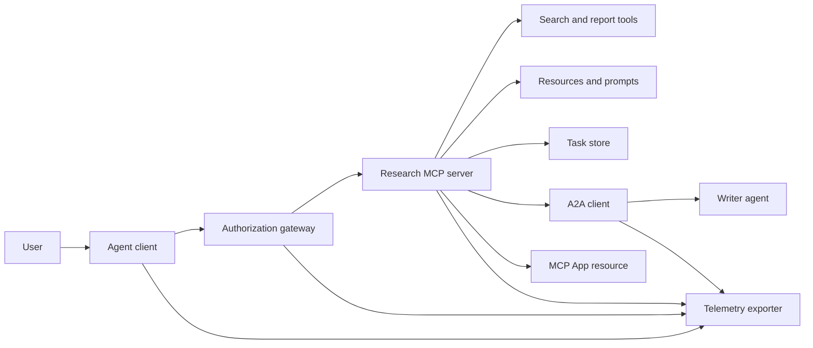
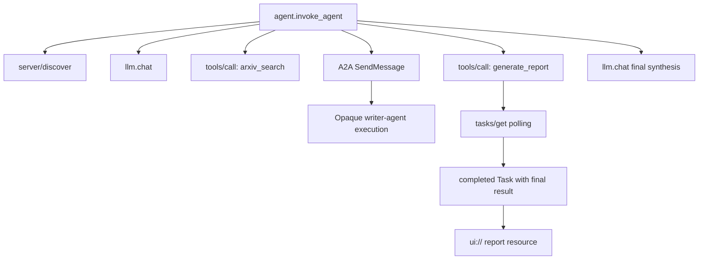
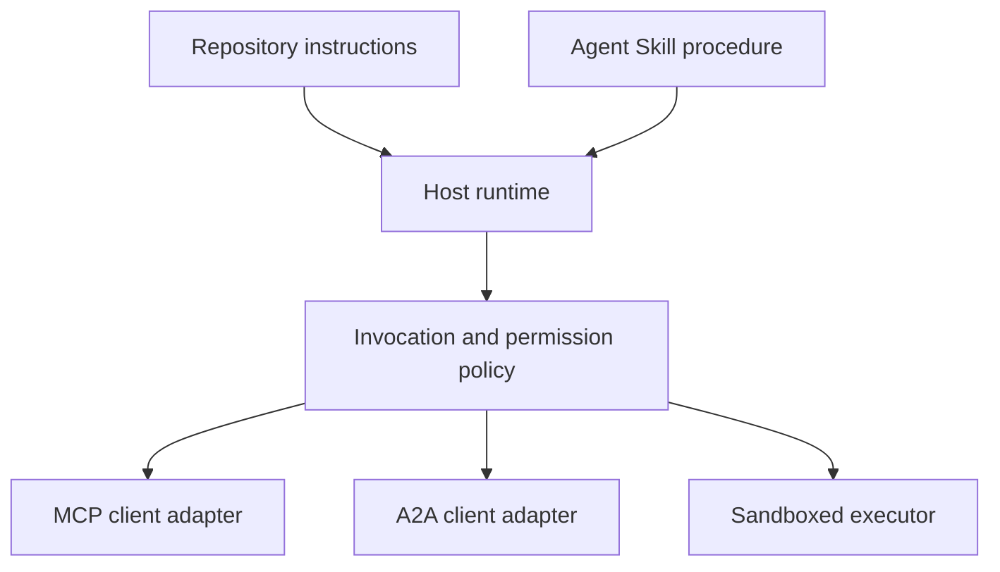

<!-- local-zh-machine-draft: English source is canonical; prose translated automatically, code/math preserved. -->

<a id="capstone-stateless-tool-ecosystem"></a>

# 综合项目：无状态工具生态系统

> 生产 agent 系统是一套边界,而不是一堆 features。此综合项目将一个可读的流程模拟与协议客户端、授权服务器、 sandbox和遥测输出器 仍然需要真正的部署。

**类型:** Build
**语言:** Python (stdlib, 进程模拟)
**先修要求:** 阶段13 01至22,使用 MCP revision `2026-07-28`
**时间:** ~120分钟

<a id="learning-objectives"></a>

## 学习目标

- Compose tool calls任务型成果、授权工作、统一信息服务资源、授权政策 trace 记录成一个流体
- 包含协议版本、客户身份和每个用户的能力 MCP 而不是依赖连接会话 。
- 在使用前发现服务器, 并通过正式任务扩展驱动长的工作 。
- 区分协议形状模拟 MCP, A2A, OAuth,或 OpenTelephater 实施。
- 绘制每个模拟边界到必须替换的生产部件。
- Keep `AGENTS.md`, 一个 Agent Skill,运行时间适应器,工具和安全政策 正确的作用。
- 解释哪些索赔可以由当地产出核实,哪些需要现场整合测试。

<a id="the-problem"></a>

## 问题

设计研究和报告系统。用户要求提供文件 agent 协议。 系统搜索纸质目录、 代表摘要、 生成报告、 返回 UI 资源, 并记录通过系统路径 。

这句话隐藏了几项独立的合同:

- 模型定位工具图;
- 无国籍者要求信封和服务器发现合同;
- 网关决定 actor、范围和工具特性;
- 长期经营合同;
- 一个 delegation protocol;
- 东道方对应用桥;
- trace 宣传和出口;
- 一种可重复使用的操作程序。

`code/main.py` 保持这些边界与普通的可见度 Python 函数和词典。它不打开传输、与 arXiv 联系、执行 OAuth,调用 A2A 服务器, 制成 MCP 应用程序, 或导出遥测。 这样就可以在不提供模拟服务的情况下对控制流程进行检查。

<a id="the-concept"></a>

## 概念

<a id="target-architecture"></a>

### 目标结构



建筑是公共协议模式的概念构成,不是对任何产品的私人内部要求。

<a id="target-trace"></a>

### Target trace



真正执行的每条跳跃都会传播 trace 。 使用所选仪器版本支持的开放遥测语义公约必须遵循该词的语义, 才能使用空格名称和属性。 trace 仅凭标识符并不能证明父系、导出或后端摄入正确。

<a id="current-protocol-surfaces"></a>

### 当前协议表面

使用当前协议定义的方法名称, 而不是从旧的草稿中记住的名称 :

| Boundary | 当前表面 | 综合项目模拟 |
|---|---|---|
| MCP discovery | Mandatory `server/discover` | 直接函数返回版本、能力和服务器身份 |
| MCP 请求上下文 | 版本、能力和客户身份 `params._meta` | 将新请求元数据传送到每次模拟呼叫 |
| MCP tool call | `tools/call` | Direct Python 函数调度 |
| MCP 任务调查 | `io.modelcontextprotocol/tasks` 与 `tasks/get` | 工作处理,然后完成任务,并取得最后结果 |
| A2A delegation | `SendMessage` 国家公共预算委员会以及 JSON-RPC; `POST /message:send` 在 HTTP+JSON | 一个嵌套的横跨,没有远程呼叫或人工延迟 |
| MCP 调用服务器工具 | `app.callServerTool({ name, arguments })` | 一个 HTML 无实时桥线 |
| OAuth authorization | 授权服务器、 保护资源元数据、 受众和范围验证 | Static token 调查成员和范围 |
| OpenTelemetry | SDK、宣传器、出口商和收藏家或后端 | 模拟的词典 |

协议名称只是第一层。 生产测试必须在整个真实线上进行序列化、认证失败、取消、超时、重试和版本兼容性。

<a id="stateless-mcp-changes-the-integration-boundary"></a>

### Stateless MCP 更改整合边界

Revision `2026-07-28` 删除协议会话和 `initialize` / `notifications/initialized` 握手,它也会去除 `Mcp-Session-Id`。每个请求都带有这些名称 `_meta` fields:

```json
{
  "io.modelcontextprotocol/protocolVersion": "2026-07-28",
  "io.modelcontextprotocol/clientCapabilities": {
    "extensions": {
      "io.modelcontextprotocol/tasks": {}
    }
  },
  "io.modelcontextprotocol/clientInfo": {
    "name": "capstone-client",
    "version": "1.0.0"
  }
}
```

服务器必须执行 `server/discover`通常使用结果 `resultType: "complete"`; 任务控件用途 `resultType: "task"`。每个结果应标明 `_meta.io.modelcontextprotocol/serverInfo`.

任务扩展 `tasks/get`, `tasks/update`, 和 `tasks/cancel`工具可以首先返回 `resultType: "task"`; `tasks/get` 返回时自动返回 `resultType: "complete"`,以及完成的 `Task` 包含最终结果。 `tasks/result` 和 `tasks/list` 方法不是当前扩展名的一部分。 客户端必须发布 `io.modelcontextprotocol/tasks` 中,如果服务器返回 `-32021` 与 `requiredCapabilities` 被设计成缺少的客户能力对象,包括 `extensions.io.modelcontextprotocol/tasks`.

<a id="security-posture"></a>

### 安全态势

部署的预期用途 defense in depth:

- OAuth 授权书 PKCE (a) 客户类型需要时;
- 资源和受众对发布访问具有约束力 tokens;
- 区域局网关,检查所要求的工具和范围;
- 持有在模型外的上游证书;
- 固定或审查的工具说明清单;
- a 对不信任的投入、敏感数据以及随之而来的行动进行两次审查的规则;
- 处决 sandbox 其文件系统、处理、网络、证书和资源限制在技能之外被强制实施。

演示只执行静态 tokens范围检查和描述杂交。它对于政策流动而不是安全验证是有用的。

<a id="skills-are-procedure-not-transport"></a>

### 技能是程序,不是运输

一个 Agent Skill 能够告诉运行时间如何执行研究工作流程, tool contracts 等待,什么证据可以保存,什么时候停止。 MCP 服务器已存在, 建立 A2A 兼容性、授予范围或创建 sandbox.



当程序引用了随行文件时, 发运完整的技能目录。 这个旧的综合项目中的平板文物是一个课程蓝图, 而不是证明主机保存了一个便携式包件。 教程 24 到 27 构建并测试整个捆绑生命周期 。

<a id="course-artifact-metadata-is-a-local-adapter"></a>

### 课程文物元数据是本地的适配器

课程目录和安装器识别命名的平面文件 `skill-*.md`,但这是一个存储器公约,而不是便携式 Agent Skills 软件包合同。他们最小的前事项分析器只读取顶级密钥。因此,此课将可移植身份字段和课程目录字段保留在同一级别:

```yaml
---
name: ecosystem-blueprint
description: Produce a full Phase 13 ecosystem architecture for a product need.
version: "1.0.0"
phase: "13"
lesson: "23"
tags: [mcp, capstone, ecosystem, architecture, a2a, otel]
---
```

`name` 和 `description` 是可移动身份字段。 `version`, `phase`, `lesson`, 和 `tags` 课程分类扩展。 `tags` 以内嵌列表方式 `--tag capstone` 能够匹配它。

可选择的可移动目录技能 `metadata` 字符串值扩展数据的地图。 这不代表 `metadata` 与此仓库目录图可互换。 如果这个平坦的文件巢 `version` 或 `tags` below `metadata`,最小解析器跳过缩进键,目录记录一个空白版本,标签过滤无法找到文物。制作主机应该使用安全套 YAML 分析并验证他们自己的有文件记载的策略。

<a id="simulation-versus-production"></a>

### 模拟与生产

| 图层 | `code/main.py` | 生产替换 | 所需证据 |
|---|---|---|---|
| Discovery | `server_discover()` 加上静态 `TOOLS` | `server/discover` 之后是缓存意识 `tools/list` | 电线记录、确定性命令和计划验证 |
| Authentication | Token- 关键字典 | OAuth 授权和资源服务器验证 | 发行者、受众、范围、失效和故障测试 |
| Authorization | 范围 成员 | 网关政策必须 actor工具、目标及租户 | 允许和拒绝审计案件 |
| Search | 静态纸装置 | Search API 或 MCP server | 源出、排位和错误测试 |
| Tasks | 本地控件加即时 `tasks/get` | Durable `io.modelcontextprotocol/tasks` 存储方式 `tasks/get`, `tasks/update`, `tasks/cancel`,以及 TTL | 国家过渡、投入、取消和恢复测试 |
| Delegation | 睡前加巢间 | A2A 客户端和远程 Agent Card | 合同、超时、重试和不透明测试 |
| App | HTML 字符串和 URI | MCP 应用资源 `App` bridge | CSP、权限、工具呼叫和浏览器测试 |
| Telemetry | 模拟列表 | OTel SDK 出口者 | 收集人收据和 trace- 亲生的断言 |
| Sandbox | 无 | 主机强制孤立执行器 | 逃跑、逃逸、秘密和资源限制测试 |

这个表格是 handoff 边界。 绿色本地运行只验证模拟 。

<a id="phase-13-map"></a>

### 13阶段地图

| 教训 | Contribution |
|---|---|
| 01-05 | 工具界面、电话、图案、结构化结果和确定性验证 |
| 06-14 | Stateless MCP 请求信封,发现,运输,资源, prompts、扩展名和应用程序 |
| 15-18 | 毒药防守 OAuth、网关、登记处和生产认证 |
| 19 | A2A 消息和任务 delegation |
| 20 | 开放遥测 GenAI trace design |
| 21 | 示范提供者路线 |
| 22 | 便携式技能合同和运行时间界限 |

```figure
t3-capstone-chain
```

<a id="build-it"></a>

## 动手实现

运行在进程 harness:

```bash
cd phases/13-tools-and-protocols/23-capstone-tool-ecosystem
python3 code/main.py
```

检查五件事:

1. `server/discover` 广告修订 `2026-07-28` 和任务扩展。
2. 爱丽丝可以读和生成一份报告, 而鲍勃的写范围呼叫被拒绝。
3. 每一个地方的管弦乐队都有一个 trace 身份识别符和记录符横跨身份识别符。
4. 报告一开始是一个任务处理。 `tasks/get` 返回一个已完成的任务,其最终结果包含文本和 `ui://` reference.
5. 委托的作者仍然不透明,因为管弦乐队只记录边界。
6. 没有输出要求网络连接, OAuth 交换、收藏器导出、浏览器生成或 sandbox 执行发生。

剧本运行两次, 所以它产生两个根 traces。审计条目是本地处理,并在下一运行中重置。

<a id="use-it"></a>

## 实际应用

一次提升一层:

1. Replace `server_discover()` 和带有 `server/discover` 和 `tools/list` 发送版本,身份和能力
2. 替换静态 tokens 具有授权服务器和受保护的资源验证。
3. 执行 `io.modelcontextprotocol/tasks` 扩展和测试 `tasks/get`, `tasks/update`, `tasks/cancel`,超时,TTL,并重新启动恢复。不添加 `tasks/result` 或 `tasks/list`.
4. 替换 delegation 带一个 A2A 客户端中解决 Agent 发个信
5. 用官方程序构建应用程序 SDK 并拨打服务器工具 `app.callServerTool`.
6. 导出到测试收藏器并在接收器中标出括号 。
7. 在 sandbox 26课的合同。
8. 将程序作为完整的目录包包, 并通过课程27释放门 。

每个升级都需要经过新边界的整合测试。 当电线成为现实时, 不要删除下层的政策测试 。

<a id="ship-it"></a>

## 交付成果

课程产生 `outputs/skill-ecosystem-blueprint.md`,一个遗留的单页课程文物。它要求有一个一页的建筑,覆盖原始、安全、 delegation,遥测、包装和最难操作的风险。它的顶级目录字段由存储器真正的目录和安装者分析员来行使。

因为它不是一个目录包, 它无法包含引用、 脚本、 资产或 eval 固定装置。 在发布此课外的可重复使用的技能时, 请使用课程 22 和 24 至 27 的软件包格式 。

<a id="exercises"></a>

## 练习

1. Run `code/main.py`生产索赔中产出的单独事实证明仍然需要合并证据。
2. 添加第二个静态后端, 并定义两个工具的碰撞规则, 名称相同 。 然后用真实的 `tools/list` calls.
3. 将写作器根替换为 A2A 测试服务器。 Agent 贺卡,信息请求,超时路径, 和返回的文物。
4. 添加一个任务存储, 以在进程重新启动后生存。 证明客户端可以恢复 `tasks/get`,尊重 `pollIntervalMs`,并阅读已完成的任务的最后结果 `tasks/result`.
5. 构建一个最小值 MCP 应用和核实 `app.callServerTool` 在一个浏览器中,带有限制性的 CSP 和明确的权限。
6. 通过 OTel 导出模拟的横跨 SDK 寄给本地收藏家的 trace 标识符、括号、错误状态。
7. Write `AGENTS.md` 和单独的保存规则 skill bundle 解释为什么文件都没有授予工具权限。

<a id="key-terms"></a>

## 关键术语

| 术语 | 人们怎么说 | 它实际上意味着什么 |
|---|---|---|
| Capstone | "所有东西都连接在一起" | 模拟和活边界仍清晰的分阶段整合 |
| 协议形模拟 | "基本上,这是 MCP" | 当地数据和电话类似于协议,但没有执行有线合同 |
| 任务扩展 | "Long tool call" | 任选 `io.modelcontextprotocol/tasks` 具有持久身份、投票、客户投入、最终结果和取消语义的生命周期 |
| 不透明度边界 | "另一个 agent 处理它" | 来电者看到已申报的界面和工艺品, 而不是私人推理或内部状态 |
| 运行时间适配器 | "技能整合" | 绘制可移动程序以发现、引用、工具、政策和上下文的主机代码 |
| 整合证据 | "它通过" | 一份记录、文物或接收器旁的观察证明真正边界被越过 |

<a id="further-reading"></a>

## 进一步阅读

- [MCP 规格 2026-07-28](https://modelcontextprotocol.io/specification/2026-07-28) 申请、发现、工具、授权和运输行为。
- [MCP 2026-07-28关键变动](https://modelcontextprotocol.io/specification/2026-07-28/changelog) 用于删除会话, 要求的元数据, MRTR,扩展,和折旧。
- [MCP 任务扩展](https://tasks.extensions.modelcontextprotocol.io/specification/draft/tasks) 用于 `tasks/get`, `tasks/update`, `tasks/cancel`,以及最终结果由终端任务完成。
- [MCP Apps SDK](https://github.com/modelcontextprotocol/ext-apps/blob/main/docs/overview.md) 用于 `App` 和 `app.callServerTool`.
- [A2A protocol](https://a2a-protocol.org/latest/) 用于 Agent 贺卡、信息传送、任务、艺术品和运输装订。
- [GenAI语义学公约](https://opentelemetry.io/docs/specs/semconv/gen-ai/) 用于 trace 和属性的习惯。
- [Agent Skills specification](https://agentskills.io/specification) 程序层使用的便携式包件合同。
