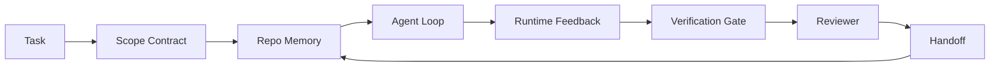

<!-- local-zh-machine-draft: English source is canonical; prose translated automatically, code/math preserved. -->

<a id="agent-workbench-engineering-why-capable-models-still-fail"></a>

# Agent 工作台工程：能力强的模型为什么仍会失败

> 光有能干的模型是不够的。 agents 需要工作环境:指示、状态、范围、反馈、核查、审查以及 handoff将那些船运到国外,甚至一个边境模型,制造出运输不安全的工作。

**类型:** 学习 + 构建
**语言:** Python (stdlib)
**先修要求:** 阶段14 · 01 (Agent Loop阶段14 26(失败模式)
**时间:** ~45分钟

<a id="learning-objectives"></a>

## 学习目标

- 与执行可靠性分开的模型能力。
- 列出决定是否 agent ships.
- 比较 a prompt- 只是在工作台里跑步 做一个小任务
- 制作一个失败模式报告, 将每个遗漏的表面 绘制出它造成的症状。

<a id="the-problem"></a>

## 问题

您将边框模型丢入一个真实的回购中, 并请求它添加输入验证。 它打开了四个文件, 写入了合理的代码, 宣布成功, 并停止了 。 您运行测试 。 两个失败了 。 第三个文件被触动了, 与验证无关 。 没有记录显示什么 。 agent 假设,它尝试了, 或者什么是剩下的做。

模型没有错 Python。 工作是错误的。 它不知道什么算作做了,在哪里允许写,什么测试是权威的, 或下个会话应该如何进行。

这不是模型错误,而是工作台错误。 agent 缺少部分 将一发子弹的一代 变成可靠、可修复的工程

<a id="the-concept"></a>

## 概念

工作台是任务期间覆盖模型的操作环境。 它有七个表面:

| Surface | 随身携带的 | 丢失时失败 |
|---------|-----------------|----------------------|
| Instructions | 启动规则、禁止行动、行为定义 | Agent 猜船运意味着什么 |
| 状态 | 当前任务、 被触动的文件、 阻塞器、 下个动作 | 每会话从零开始 |
| Scope | 允许的文件、 禁止的文件、 接受标准 | 编辑泄漏到不相关的代码 |
| Feedback | 将真实命令输出捕捉到循环 | Agent 宣布400号战车成功 |
| 验证 | 测试, 提示, 烟雾运行, 范围检查 | "看起来不错" 到了主 |
| Review | 第二次通过,角色不同 | 构建者标记自己的作业 |
| Handoff | 改变什么,为什么,剩下的是什么 | 下一场会重新发现一切 |

工作台独立于模型。 您可以将模型换成表面, 您无法将表面换成安全性 。



循环关闭于州文件, 而不是聊天历史。 聊天是不稳定的。 重现是记录系统 。

<a id="workbench-versus-prompt-engineering"></a>

### 工作台对 prompt engineering

提示告诉模型您想要的转折。 一个工作台告诉模型如何跨圈和跨会话工作。 agent 失败的故事是工作台的失败 prompt- 设计衣服

<a id="workbench-versus-framework"></a>

### 工作平台与框架

框架给了您运行时间( )LangGraph自动Gen, Agents SDK工作台提供 agent 运行时间内的工作地点。 您需要两者。 这个迷你轨道是第二轨。

<a id="reasoning-from-primitives-not-from-vendor-taxonomies"></a>

### 原产物原因,不是卖主分类

有很多写作在"harness 工程学",爱迪・奥斯曼尼 OpenAI, Anthropic, LangChain马丁·福勒、蒙戈德布、人类语言、增强规范、思想工作、行尸板绝佳名单和中、黑克新闻的一盘曲子都带着。 harness 范围是什么? vocabulary 使用。 我们不需要选择一面。 七层表面是 UX 层; 每个工作台下都是相同的分布系统, 支撑着任何可靠的后端 。

脱 agent 标签关闭片刻。 A agent 运行就是计算穿越时间、 过程和机器。 要让它可靠, 您需要同样的原始的 任何生产系统 。

| Primitive | 这是什么? | 带什么来 agent |
|-----------|------------|------------------------------|
| 功能 | 输入处理器, 尽可能纯净, 拥有其投入和输出 。 | 一个 tool call,规则检查,验证步骤,示范援引 |
| Worker | 具有一个或多个功能和生命周期的长寿命过程 | 建筑师,审查员,核查员, MCP server |
| Trigger | 援引函数的事件来源 | Agent loop tick, HTTP 请求、 队列消息、 拐角、 文件更改、 钩子 |
| 运行时 | 确定运行地点的边界, 以及时间间隔和资源 | Claude 代码的过程, LangGraph运行时间,工人集装箱 |
| HTTP 区域规划中心 | 打电话的人和工人之间的电线 | 工具呼叫协议, MCP 请求, 型号 API |
| 队列 | 触发器和工人之间的持久缓冲;后压,再试, idempotency | 任务栏、反馈日志、审查收件箱 |
| 届会持久性 | 崩溃、重新开始、模型交换等状态 | `agent_state.json`, checkpoints,KV商店, 折叠式的 |
| 授权政策 | 谁能称其为“什么功能” | 允许/禁止的文件、批准边界 MCP 能力列表 |

现在将七个工作台的表面 绘制到原始的上面

- **Instructions** 政策+函数元数据; 规则为检查(功能)。`AGENTS.md`)是运行时间启动时的政策。
- **State** 运行时间的密钥存储每一步都会读取。 文件、 KV 或 DB; 持久性语义性物质, 存储后端并不重要 。
- **Scope** 允许/禁止的球是ACL, 需要许可是许可的拉特。
- **Feedback** 使用时间日志, 以队列形式写入。 每个空格呼叫都是记录, 耐久, 可重播 。
- **Verification** 一种函数,对输入的确定性。 触发任务关闭, 失败关闭 。
- **Review** 独立工人,只读建筑工的艺术品和审查报告上的只写自译自审。
- **Handoff** 由会议结束的触发器发出的耐久记录,下次会议的启动触发器读取。

该 agent loop 自己是消费活动的工人(第2条)。user message,工具结果,计时器勾选,调用函数(模型,然后模型选取的工具),写记录(状态,反馈),以及发出触发器(核查,审查, handoff无神秘之处,与工作处理器的形状相同。

<a id="patterns-in-circulation-translated-to-primitives"></a>

### 循环模式, 转化为原始

每一个受欢迎的人 harness 模式将缩小为8个原始。翻译表格。

| 供应商或社区模式 | 事实是什么 |
|------------------------------|--------------------|
| 拉尔夫·卢普(Ralph Loop)Claude 代码, 代码, 代理_重新注入原始意图 context window 时 agent 试着早点停止 | 触发因素,使任务重新具有清洁性;会场的持久性将目标推向前进 |
| 计划/执行/核查(PEV) | 三名工人,每个角色一人,通过州和分级沟通 |
| Harness- 计算离职(OpenAI Agents SDK2026年4月——从执行飞机上分离控制飞机 | 重现控制平面/数据平面。 agent 以 几十年计的标签 |
| Open Agent 护照(OAP,2026年3月)——每批签名和审计一次 tool call 声明政策时的豁免 | 由行动前工作人员执行的授权政策,并签名审计队列 |
| 向导和传感器(Birgitta Böckeler/思想工作)——反馈规则+反馈 observability | 授权政策+核查功能+ observability traces |
| 5级渐进压缩(Claude 代码反向工程,2026年4月 | 国家管理者 坚持要将它保持在预算之内 |
| 钩子/中间器械( Hooks/ middroup ware) (Hooks/documents)LangChain, Claude 编号)——拦截型号和 tool calls | 触发运行时的调试路径周围的 + 函数 |
| 技能为 Markdown 与 progressive disclosure (Anthropic, 流线) | 函数元数据被及时装入上下文的功能登记册 |
| Sandbox agents (科德克斯,桑卡斯尔,费尔塞尔) Sandbox) | 计算平面:运行时带有孤立的文件系统、网络和生命周期 |
| MCP servers | 工人暴露在稳定的RPC之上,能力清单作为授权 |

表格中每个条目 agent 社区在分布式系统中已经有一个名字,并给它一个新的名称。 vocabulary.

<a id="what-the-receipts-actually-say"></a>

### 收据上写着什么

该 harness值得知道,因为这些都是唯一反对"等待一个更聪明的模型"的诚实论点

- 副座2.0 - 同一模式, harness 更改已移动 a coding agent 从前30名到第五(LangChain, *解剖学 Agent Harness*).
- Vercel - 80%的电源被删除 agent工具; 成功率从80%跳到100%( 蒙哥马利) 。
- 哈维——法律 agents 超过两倍的精度通过 harness 仅优化(蒙哥维德)。
- 88%的企业独立 agent 失败的组合时间是运行时,而不是推理(prepprints.org, *Harness 语文工程 Agents*2026年3月 纽约
- 一项2025年对三个受欢迎的开放源码框架的基准研究报告说,任务完成率为50%;长文本WebAgency在长文本条件下从40%至50%下降到10%以下,大部分来自无限循环和目标损失(2026年初的写作广泛覆盖)。

外卖不是"harness 永远赢不了,模特儿会吸收 harness 时间的诡计。外卖是今天, 载荷工程是围绕模型,而不是它内部, 而携带这些负荷的原始生物 总是需要所有生产系统。

<a id="where-vendor-writeups-stop-short"></a>

### 供应商的签名数量短

这部分你不用客气

- LangChain的 *解剖学 Agent Harness* 列举了11个组成部分—— prompts工具 钩子 sandboxes, orchestration记忆力,技能 subagents,以及运行时的“弹簧环”。它不命名队列,工人是部署单位,触发语义学,会话持久性作为单独的关注或授权政策。 harness 是一个您配置的对象,而不是一个您部署的系统。
- 爱迪·奥斯曼尼 *Agent Harness Engineering* 绘制框架 `Agent = Model + Harness` 和长柄刀的模式, 但停止说 什么是 harness 是一个姿势,而不是一个标本
- Anthropic 和 OpenAI 深处的表面,但停留在他们自己的运行时间。harness- 计算2026年4月的分居声明 Agents SDK 是一个原始的主意,而不是一个新的想法。
- 代理_使用书本 harness 作为配置对象( Jaymin West 的 *Agentic Engineering*中最强的一行是 harness 是一个主要的安全边界 agentic 系统。"这只是授权政策,重述。
- 黑客新闻线一直在同一地点 *该 agent harness 属于 sandbox* 争论 harness 更像是超常高官,坐在一切之外 授权访问基于上下文和用户。 也就是授权政策作为单独的平面

您不必不同意其中任何一块来注意到空白。 他们正在写入一个系统已经存在的 UX 描述。 我们正在写入系统。 当系统建立正确时, 7 表面会从原始体中掉出来。 当它被建立错误时, 没有数量 。 `AGENTS.md` 抛光修补缺失的队列 。

所以当你听到"harness 工程学"别处, 翻译为原始。 Prompts 游戏规则是政策和功能。脚手架是运行时间。 Guardrails 表示授权+验证。钩子是触发器。内存是会话的持久性。拉尔夫环是回流。 Subagents 工人。 Sandboxes 计算平面。 vocabulary 修改; 工程没有。 工作台是 agent- 向上负载; harness,从下一个供应商重新布局的意义上说, 功能、工人、触发器、运行时间、排队、持久性和策略都正确连接在一起。

```figure
wb-seven-surfaces
```

<a id="build-it"></a>

## 动手实现

`code/main.py` 做一次小重写任务两次。 prompt 仅此, 7个表面被连接。 相同的模型, 同样的任务。 运行失败时缺少的脚本计数, 并打印出一个失败模式报告 。

重写任务目的小: 将输入验证添加到一个文件 FastAPI- 风格的处理者,写一个通过测试。

运行：

```
python3 code/main.py
```

输出: 双运行的单边日志, a `failure_modes.json` 总结 prompt- 只能跑,工作台的单线裁决

该 agent 是一个小的基于规则的根根管; 关键在于表面,而不是模型。横跨此区域 rest 将每一面都重建成 一个真实的可重复使用的文物

<a id="use-it"></a>

## 实际应用

野外已经有三个地方有工作台, 即使没有人叫它们:

- **Claude 代码,代码, 光标。** `AGENTS.md` 和 `CLAUDE.md` 说明表面。斜线命令是范围。钩子是验证。
- **LangGraph, OpenAI Agents SDK.** Checkpoints 和会话仓库是状态表面。 Handoffs 是这些 handoff surface.
- **线人正在进行真正的收割** 测试、 提示和类型检查是验证。 公关模板是 handoffCODEOWNERS正在审查。

工作台工程是使这些表面清晰和可重复使用,而不是让每个小组重新发现这些表面的学科。

<a id="ship-it"></a>

## 交付成果

`outputs/skill-workbench-audit.md` 是一种便携式技能,用于审计现有的七张工作台表面和缺少的、部分且健康的报表。 agent 设置; 它告诉你要先解决什么。

<a id="exercises"></a>

## 练习

1. 选择一个已经运行的回收站 agent。将七层从0(缺失)计为2(健康)。你最薄弱的表面是什么?
2. Extend `main.py` 也因为 prompt- 仅运行还产生假的“成功”索赔。 verification gate 本来会抓住的
3. 添加 8 面作为您自己的产品。 请说明为什么它不崩溃到现有 7 个中 之一 。
4. 用不同的根管重新运行脚本 agent 哪个表面先捕捉到它?
5. 将五个工业- 经常故障模式从 14 阶段 26 到 7 个表面。 每个表面设计为哪个模式来吸收 ?

<a id="key-terms"></a>

## 关键术语

| 术语 | 人们怎么说 | 它实际上意味着什么 |
|------|----------------|------------------------|
| Workbench | 设置 | 围绕模型的工程表面使工作可靠 |
| Surface | "医生"或"剧本" | 一个名为, 机器可读的输入 agent 读或写每一转 |
| 记录系统 | "笔记" | 文件 agent 聊天历史消失时, 将它视为真理 |
| 工作的定义 | "Acceptance" | 目标、文件支持的核对表 agent 无法伪造 |
| 工作站审计 | 准备检查 | 工作开始前 越过七个表面的遗漏 |

<a id="further-reading"></a>

## 进一步阅读

阅读这些数据点, 不是权威。 每个都是局部分类。 把每个概念都转换为原始( 功能、 工作、 触发、 运行时间, ) HTTP/RPC、排队、坚持、政策),然后决定是否通过。

供应商框架:

- [艾迪·奥斯曼尼 Agent Harness Engineering](https://addyosmani.com/blog/agent-harness-engineering/) — `Agent = Model + Harness` 和大鼠图案;基础设施薄
- [LangChain解剖学 Agent Harness](https://blog.langchain.com/the-anatomy-of-an-agent-harness/) - 11个组成部分: prompts工具 钩子 orchestration, sandboxes记忆力,技能 subagents,运行时间;删除队列、部署、认证
- [OpenAI, Harness 工程:在 agent- 材](https://openai.com/index/harness-engineering/) 代码组对运行时间周围表面的观察
- [OpenAI,打开代码 agent loop](https://openai.com/index/unrolling-the-codex-agent-loop/) — 该 agent loop 减为a `while` 函数调用
- [Anthropic有效 harnesses 长长的 agents](https://www.anthropic.com/engineering/effective-harnesses-for-long-running-agents) - 在一个特定运行时间内长视距表面
- [Anthropic, Harness 设计用于长期应用开发](https://www.anthropic.com/engineering/harness-design-long-running-apps) 应用设计说明
- [LangChain Deep Agents harness capabilities](https://docs.langchain.com/oss/python/deepagents/harness) - 运行时间配置表面

可用细节的从业者:

- [马丁·福勒/比尔吉塔·博克勒 Harness 工程学 coding agent users](https://martinfowler.com/articles/harness-engineering.html) 向导(前置)+传感器(后置);最清洁的控制理论框架
- [人类,技能问题: Harness 工程学 Coding Agents](https://www.humanlayer.dev/blog/skill-issue-harness-engineering-for-coding-agents) -"这不是模型问题,是配置问题"
- [蒙戈DB, 缩写 Agent Harness:为什么 LLM 是你的最小的一部分 Agent System](https://www.mongodb.com/company/blog/technical/agent-harness-why-llm-is-smallest-part-of-your-agent-system) 收款: Vercel 80%至100%,Harvey 2x准确度,终局法官30名至前5名
- [增援规则 Harness AI公司工程学 Coding Agents](https://www.augmentcode.com/guides/harness-engineering-ai-coding-agents) 限制- 第一次走过
- [塞科亚播客,哈里森・蔡斯 Context Engineering Long-Horizon Agents](https://sequoiacap.com/podcast/context-engineering-our-way-to-long-horizon-agents-langchains-harrison-chase/) 模式问题引起时间紧迫的关切

书籍、文件和参考执行:

- [贾明·韦斯特 Agentic 工程——第6章: Harnesses](https://www.jayminwest.com/agentic-engineering-book/6-harnesses) 书本长度处理、治疗 harness 将之作为主要安全边界
- [preprints.org, Harness 语文工程 Agents 纽约](https://www.preprints.org/manuscript/202603.1756) 学术框架作为控制/机构/运行时间
- [walkinglabs/awesome-harness-engineering](https://github.com/walkinglabs/awesome-harness-engineering) 逐语境的阅读清单, evaluation, observability, orchestration
- [ai-boost/awesome-harness-engineering](https://github.com/ai-boost/awesome-harness-engineering) 备选版面列表(工具、评估、内存、 MCP,允许)
- [HKUDS/OpenHarness](https://github.com/HKUDS/OpenHarness) - 打开 agent harness 内置个人 agent

而非共识:

- [HN: 有效 harnesses 长长的 agents](https://news.ycombinator.com/item?id=46081704)
- [HN:改进 15 LLMs 在一个下午的编码中。 Harness Changed](https://news.ycombinator.com/item?id=46988596)
- [HN: 与 agent harness 属于 sandbox](https://news.ycombinator.com/item?id=47990675) 要求授权作为单独飞机

本课程中的交叉参照:

- 阶段14 - 23 - 开放遥测GenAI公约: observability 传感器文献点
- 阶段14 · 26 - 故障模式目录
- 阶段14 27 - Prompt injection 原始授权政策中的防御
- 阶段14 - 29 - 生产运行时间(排队、活动、卡龙):本课中的原始人生活在什么地方
