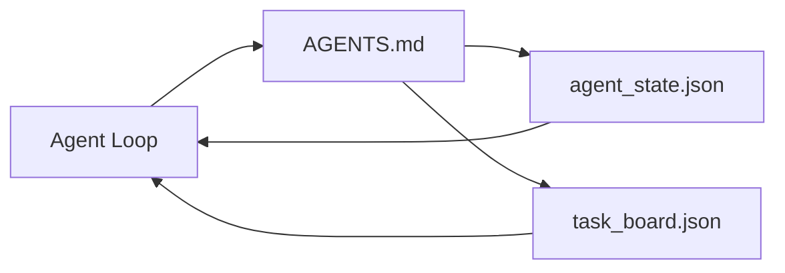

<!-- local-zh-machine-draft: English source is canonical; prose translated automatically, code/math preserved. -->

<a id="the-minimal-agent-workbench"></a>

# 最小 Agent 工作台

> 最小的有用工作台是三个文件:根指示路由器、州文件和任务板。其他所有文件都放在顶部。如果回购无法携带这三个文件,则没有模型保存它。

**类型：** 构建
**语言:** Python (stdlib)
**先修要求:** 阶段14 · 31(为什么有能力的模型仍然失败)
**时间:** ~45分钟

<a id="learning-objectives"></a>

## 学习目标

- 定义构成最小可行工作台的三种文件 。
- 解释为什么短根路由器会打得过一个长长的单曲 `AGENTS.md`.
- 构建状态文件 agent 可以在每一转弯上读取,并在结尾处写作。
- 建立一个任务委员会,在多会场工作期间不与人交谈。

<a id="the-problem"></a>

## 问题

多数团队都通过写三千条线 达到工作台 `AGENTS.md` 并且称它完成了。模型装载它,忽略它无法总结的部分, 并且仍然在相同的表面失败 它总是失败了。

你需要相反的答案 一个小根文件 agent 仅在相关时插入更深的文件。 agent 写作前读。一个任务板,上面写着飞行中的东西,被阻挡的东西,接下来是什么。

三个文件,每个都有工作,每个都足够机器读懂,以后可以发展成一个真正的系统

<a id="the-concept"></a>

## 概念



<a id="agentsmd-is-a-router-not-a-manual"></a>

### AGENTS.md 是路由器, 不是手动的

不错 `AGENTS.md` 短。 它指向 agent 在:

- 国家文件( 您所在位置 )
- 任务栏( 剩下的东西) 。
- 更深层次的规则(根据《公约》第22条) `docs/agent-rules.md`).
- 核查命令(如何知道它有效)。

任何更长的时间都会在更深的医生里, 需要的时候才会加载。 长手册会被忽略。 短路由器会被跟踪 。

<a id="agent_statejson-is-the-system-of-record"></a>

### agent_state.json 是记录系统

状态包含: 活动任务代号、 被触动的文件、 作出的假设、 阻塞器和下一步动作 。 agent 下一场会读而不是重播聊天

状态因聊天历史不可靠而存在文件。 会话会死。 对话会被剪辑, 文件不会 。

<a id="task_boardjson-is-the-queue"></a>

### task_board.json 是队列

任务委员会负责所有具有地位的任务 `todo | in_progress | done | blocked`。它是队列 agent 当状态为空时, 拖动时, 以及当您想知道是否 agent 已经上轨道了

董事会的任务有一个ID,一个目标,一个拥有者(`builder`, `reviewer`, 或 `human`和接受标准。董事会是小的,目的:当它成长过屏幕时,你有一个 planning 问题,不是董事会的问题。

<a id="three-files-is-the-floor-not-the-ceiling"></a>

### 三个文件是地板 不是天花板

以后的教训添加 scope contracts反馈运行器, verification gates,审评员核对表,以及 handoff 三个文件都是他们想出来的

```figure
wb-three-files
```

<a id="build-it"></a>

## 动手实现

`code/main.py` 将最低工作台写成空的回邮并演示单 agent 转动:

1. Reads `agent_state.json`.
2. 调出下一个任务 `task_board.json` 如果状态为空 。
3. 触摸到一个在范围内的文件。
4. 写回更新状态 。

运行：

```
python3 code/main.py
```

脚本创建 `workdir/` 旁边放三个文件, 一个转一个转, 打印 diff 。 再运行它看看第二个转会如何接收第一个左转的位置 。

<a id="use-it"></a>

## 实际应用

内部生产 agent 产品,同样的三个文件 以不同的名称出现:

- **Claude Code:** `AGENTS.md` 或 `CLAUDE.md` 用于路由器, `.claude/state.json`- 州级商店,董事会的钩子
- **代码/ 光标 :** 路由器的工作空间规则, 状态的会话内存, 列队任务在棋盘聊天侧边栏中 。
- **Custom Python agent:** 和你刚写的一样

名字变了,形状没有变

<a id="production-patterns-in-the-wild"></a>

## 野生生物的生产模式

最小的工作台在三个模式被分层时, 与真正的单体接触。 它们独立; 选择您实际需要的 。

**Nested `AGENTS.md` 拥有最近的赢位。** OpenAI 船舶 88 `AGENTS.md` 贯穿文件主副本, 每个子组件一个。 代码、 光标、 Claude 代码, 和副驾驶所有从工作文件 走向折叠根 并连接 `AGENTS.md` 子目录文件扩展根文件。 代码添加 `AGENTS.override.md` 替换而不是扩展; 超文本机制是代码x特定机制, 避免用于跨工具工作。 增强代码的测量是关键线: 最佳 `AGENTS.md` 文件的质量跳跃相当于从海库升级到 Opus; 最差的让输出比没有文件更糟 。

**反模式拒绝,即使它们看起来像覆盖。** 冲突指令悄悄地放下 agent 从互动模式到贪婪模式(ICLR 2026 AMBIG-SWE: 48.8% 28% 解答率); 数字优先级而不是平叠。 无法验证的风格规则 (“ 遵循 Google ” ) Python 样式指南”))没有执行命令 agent 发明遵守; 将每种样式的规则与精确的线条命令配对。 以样式而不是命令领导会掩盖校验路径; 命令先是, 风格最后。 给人类写而不是 agents 废物背景预算; 梯度 feature.

**交叉的凳子交汇** 带符号链接的单一根文件( A)`ln -s AGENTS.md CLAUDE.md`, `ln -s AGENTS.md .github/copilot-instructions.md`, `ln -s AGENTS.md .cursorrules`) 保存每个 coding agent 同一真相来源的Nx `nx ai-setup` 将这个自动连接到整个 Claude 代码,光标,副驾驶, Gemini,编码和打开代码。

<a id="ship-it"></a>

## 交付成果

`outputs/skill-minimal-workbench.md` 为任何新的回收站生成三个文件的工作台: a `AGENTS.md` 路由器,调频到项目 `agent_state.json` 和一对 `task_board.json` 以目前的积压为种子。

<a id="exercises"></a>

## 练习

1. 添加a `last_run` 时间戳 `agent_state.json`。如果文件超过24小时,除非操作员确认,否则拒绝运行。
2. 添加a `priority` 字段中选择任务栏,并更改拉动器以始终选择最高优先级 `todo`.
3. Migrate `task_board.json` 以 JSON 线条,所以每个任务都是一条线, diffs 的版本控制是干净的。
4. 写一个 `lint_workbench.py` 如果失败 `AGENTS.md` 是指一个不存在的文件,其80多行或引用。
5. 三个文件中哪一份会损失最多

<a id="key-terms"></a>

## 关键术语

| 术语 | 人们怎么说 | 它实际上意味着什么 |
|------|----------------|------------------------|
| 路由器 | `AGENTS.md` | 短根文件, 指向 agent 文档和文件 |
| 州级文件 | "笔记" | 机器可读记录 agent 写在每转 |
| 任务委员会 | 积压 | JSON 具有咨商地位、拥有者、接受资格的工作排队 |
| 记录系统 | "真相来源" | 聊天时, 文件被视为权威性文件 |

<a id="further-reading"></a>

## 进一步阅读

- [agents. md - 开放的规格](https://agents.md/) 由Cursor、法典、 Claude 代号,副驾驶 Gemini,打开代码
- [增强代码,很好 AGENTS. md 是模型升级。坏的比没有医生还糟糕](https://www.augmentcode.com/blog/how-to-write-good-agents-dot-md-files) 测量质量跳跃
- [布莱克·克罗斯利 AGENTS.md 模式:实际变化 Agent Behavior](https://blakecrosley.com/blog/agents-md-patterns) - 经验上有效,不起作用
- [数据犬前端, 指导 AI Agents 单调 AGENTS.md](https://dev.to/datadog-frontend-dev/steering-ai-agents-in-monorepos-with-agentsmd-13g0) 在实践中的巢居优先
- [Nx 博客, 教书 Agent 如何在垄断者中工作](https://nx.dev/blog/nx-ai-agent-skills) 六个工具的单一来源生成
- [该 Prompt Shelf, AGENTS最佳做法:结构、范围和实际实例](https://thepromptshelf.dev/blog/agents-md-best-practices/) 保留审查的单条
- [Anthropic, Claude Code subagents](https://code.claude.com/docs/en/sub-agents)
- 阶段14 · 31——最低吸收率的失败模式
- 阶段14 - 34——耐久国家计划这一课程预览
