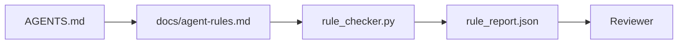

<!-- local-zh-machine-draft: English source is canonical; prose translated automatically, code/math preserved. -->

<a id="agent-instructions-as-executable-constraints"></a>

# 将 Agent 指令作为可执行约束

> 以写作方式写成的指令是愿望。 以限制方式写成的指示是测试。 工作台将每个规则转换为 agent 可在运行时检查,审查者可在事后核实。

**类型：** 构建
**语言:** Python (stdlib)
**先修要求:** 阶段14 - 32(最低工作时间)
**时间:** ~50分钟

<a id="learning-objectives"></a>

## 学习目标

- 将路线和操作规则分开
- 明确的启动规则、禁止的行动、所作行为的定义、不确定性处理和批准界限,作为可机器检查的限制。
- 执行规则检查器, 得分比数规则集。
- 让规则设置方便地使用,这样审查就能看到什么变化。

<a id="the-problem"></a>

## 问题

典型的 `AGENTS.md` 读起来像登机文件。 agent 和"彻底测试"和"怀疑是否不确定。 agent 将更改不做测试, 写入禁书目录, 并且从不问, 因为不知道线路在哪里。

教学在运作时是强有力的,在追求的时候是软弱的。 固定的方法是写出工作台可以解释的规则,而审查者也可以得分。

<a id="the-concept"></a>

## 概念

规则属于 `docs/agent-rules.md`,将选择一个短根路由器。每个规则都有名称、类别和检查。



<a id="five-categories-that-cover-most-rules"></a>

### 涵盖大多数规则的五个类别

| 类别 | 质疑规则的答案 | 示例 |
|----------|---------------------------|---------|
| Startup | 工作开始前必须有什么是真实的? | "状态文件存在且是新鲜的" |
| Forbidden | 永远不能发生什么? | "不编辑 `scripts/release.sh`" |
| 工作的定义 | 是什么证明任务已经完成了? | "pytest 出口0和验收行通行证 |
| 不确定性 | 怎么会这样 agent 不确定的时候做? | "打开一个问题注解,而不是猜测" |
| Approval | 需要人类的认可吗? | "任何新的依赖, 任何专业的写作" |

一条不符合这五个规则之一的规则通常希望成为两个规则。强制分割 。

<a id="rules-are-machine-readable"></a>

### 规则是机器可读的

每条规则都有弹片、类别、一行描述和 `check` 字段中指定函数 `rule_checker.py`。添加规则意味着添加检查;检查器随着工作台的生长而增长。

<a id="rules-are-diff-friendly"></a>

### 规则对 diff 友好

规则每条标题都有一个 markdown 文件。 重命名在 diffs 中可见。 新规则位于其分类的顶端。 删除了 Stale 规则, 而不是评论, 因为工作台是真理的来源, 而不是团队上季度感觉的聊天日志 。

<a id="rules-versus-framework-guardrails"></a>

### 规则与框架 guardrails

Framework guardrails (OpenAI Agents SDK guardrails, LangGraph 中的规则是人可以读、可审查的合同,即 guardrails 执行。 您需要两种方式: 转弯时的运行时间捕获违规, 规则集证明运行时间是正确的 。

<a id="progressive-disclosure-a-map-not-an-encyclopedia"></a>

### Progressive disclosure:地图,不是百科全书

原因 `AGENTS.md` 不断增长的是,每起事件都增加了一条规则,没有一起事件可以消除一条。一年后,文件为两千条线, agent 读取第一个屏幕, 运行用完 attention 预算,并按它被告知的内容的一小部分来操作。一个巨大的指令文件由于同样的原因失败了,一个40页的登机文档失败了:读者一次地略去一次,而从未返回到重要部分。

修正不是一个较短的文件。 它是一个多层文件。 根路由器小到可以读取每段, 只能保留指示器。 主题的深度包含 agent 任务碰到它们时才加载。 agent 地图,不是整个百科全书, 让它走到它需要的页面。

```
AGENTS.md                  # router, < 50 lines: what this repo is, where to look, the 5 hard rules
docs/
  agent-rules.md           # the full rule set (this lesson)
  architecture.md          # loaded when the task touches module boundaries
  testing.md               # loaded when the task writes or runs tests
  deploy.md                # loaded only for release work, gated behind an approval rule
feature_list.json          # the backlog (Phase 14 · 36)
```

| Tier | 生活于 | 读取时间 | 预算规模 |
|------|----------|-----------|-------------|
| 路由器 | `AGENTS.md` | 每一节,总是 | 下线~50 |
| 规则 | `docs/agent-rules.md` | 每一个课,在启动时 | 每类一个屏幕 |
| 专题文件 | `docs/<topic>.md` | 只有当任务触及到这个话题 | 尽情的深 |

两次测试让分层保持诚实。 agent 路径器应该最多用两跳就达到任何规则, 所以路由器必须将每个主题的文档通过路径连接起来, 而不是用流言描述它。 新鲜度测试: 路由器足够短, 使审查者能够重新阅读每张公关, 这是阻止它悄悄地成长到所取代的百科全书的唯一办法 。 不再解决的提示器比缺失的规则更糟糕, 因此路由器中断开的链接本身就是启动检查的违规 。

```figure
wb-rule-checkoff
```

<a id="build-it"></a>

## 动手实现

`code/main.py` ships:

- `agent-rules.md` 将规则装入数据类的解析器。
- `rule_checker.py` 样式检查函数, 1/ `check` reference.
- 演示 agent 跑那违反两个规则 和一张支票卡抓住他们。

运行：

```
python3 code/main.py
```

输出: 解析规则集, 运行 trace,按规则的出入/失败,以及 `rule_report.json` 保存在脚本旁边。

<a id="production-patterns-in-the-wild"></a>

## 野生生物的生产模式

三种模式将一套规则区分开来 这套规则的长度为四分之一 与一周内衰落的规则相区别

**刻度标记在写作时间 。** 每一个规则都包含 `severity`: `block`, `warn`, 或 `info`。核对器报告所有三个;运行时间仅拒绝 `block`。 大多数团队在时间紧迫的情况下, 提前超量地描述严重性,然后悄悄地削弱其能力; 在写作时标记迫使 calibration 前面,对着 verification gate 编号为14 - 38的(第14阶段),代表对a `block` 规则变成 `overrides.jsonl` audit log.

**规则失效作为强制功能。** 每一个规则都包含 `expires_at` 日期( 默认为作者的90天) 。 当未过期规则连续60天没有违反规则时, 检查员发出警告; 下一次季度审查要么证明保留规则是合理的, 要么将它削弱到 `info`云花的《AI 代码审查》数据(2026年4月,131 246次审查在30天内覆盖5 169个回复)显示,每份回购中都有30条规则明确规定过期;未增长到80+,大多数从未发射。

**Markdown-as-source, JSON-as-cache.** `agent-rules.md` 系已撰写的文档; `agent-rules.lock.json` 是一个缓存,检查者在热路径中读取。该锁由预生成-commit hook. Markdown diffs 可审查; JSON 解析不为时而动。 `package.json` / `package-lock.json` 和 `Cargo.toml` / `Cargo.lock`.

<a id="use-it"></a>

## 实际应用

生产:

- Claude 代码、 代码、 库尔索在会话开始时读到规则, 并引用它们拒绝动作时的原话。 检查器在 CI 中重新运行它们以捕捉静静流 。
- OpenAI Agents SDK guardrails 将相同的检查注册为输入和输出 guardrails. 该 markdown 是医生的表面; SDK 是运行时间表面。
- LangGraph 操作员会读出规则,问人,然后恢复。

规则集是便携式的 在所有三个,因为它只是 markdown 加上函数名称。

<a id="ship-it"></a>

## 交付成果

`outputs/skill-rule-set-builder.md` 采访项目所有人,将现有的书信指示分为五类,并发布版本 `agent-rules.md` 加上一个抽屉

<a id="exercises"></a>

## 练习

1. 如果产品真的需要,则添加第六个类别。 捍卫它不倒入五种类别之一的原因。
2. 扩展检查器, 使规则具有一定的严厉性( Q)`block`, `warn`, `info`)和报告的汇总情况。
3. 将检查器连接到 CI: 如果块数规则在最新版本上失败, 则无法完成构建 agent run.
4. 添加“ expire” 字段。 在90天后没有支票失败, 规则将受到审查 。
5. 找一个真实的 `AGENTS.md` 并重写为五类规则。有多少条线可以运行?有多少条是渴望的?

<a id="key-terms"></a>

## 关键术语

| 术语 | 人们怎么说 | 它实际上意味着什么 |
|------|----------------|------------------------|
| 操作规则 | 真正的教导 | 工作台在运行时检查的规则 |
| 期望规则 | 小心点 | 无检查的规则; 删除或升级 |
| 工作的定义 | "Acceptance" | 任务完成时, 以文件支持的客观证明 |
| 块宽度 | 规则 | 违规停止运行; 没有操作员不能停止运行 |
| 第 21 条 失效 | 扫荡规则 | 规定在N天不失败,退休就结束了 |

<a id="further-reading"></a>

## 进一步阅读

- [OpenAI Agents SDK guardrails](https://openai.github.io/openai-agents-python/guardrails/)
- [LangGraph interrupts](https://langchain-ai.github.io/langgraph/how-tos/human_in_the_loop/breakpoints/)
- [Anthropic建设有效 Agents](https://www.anthropic.com/research/building-effective-agents)
- [瑞克海托华 Agent 规则Z:决定性政策引擎](https://medium.com/@richardhightower/agent-rulez-a-deterministic-policy-engine-for-ai-coding-agents-9489e0561edf) 生产中的区块/警告/信息严重程度
- [云花, 按比例操作 AI 代码审查](https://blog.cloudflare.com/ai-code-review/) - 131k次审查,规则构成经验
- [微型服务.io,GenAI发展平台——第1部分: guardrails](https://microservices.io/post/architecture/2026/03/09/genai-development-platform-part-1-development-guardrails.html) — defense in depth 规则与CI之间的
- [检查类型合规性:确定性 Guardrails (arXiv 2604.01483)](https://arxiv.org/pdf/2604.01483) 以4号为上限,检查规则
- [logi-cmd/agent-guardrails](https://github.com/logi-cmd/agent-guardrails) 合并后实施:范围、变异测试、违规预算
- 阶段14 - 32——这一规则设定的最低工作台
- 阶段14 - 38 - verification gate 使用规则报告
- 阶段14 - 39 - reviewer agent 规则的遵守
