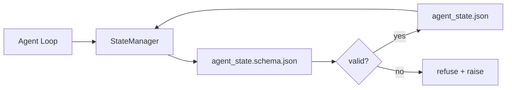

<!-- local-zh-machine-draft: English source is canonical; prose translated automatically, code/math preserved. -->

<a id="repo-memory-and-durable-state"></a>

# 代码仓库记忆与持久状态

> 聊天历史不稳定,回购是耐久的。工作站商店 agent state 版本文件, 以便下一个会话, 下一个会话 agent,下一个审查者都从同一个真理来源阅读。

**类型：** 构建
**语言:** Python (stdlib + 组合键) `jsonschema` 可选)
**先修要求:** 阶段14 - 32(最低工作时间)
**时间:** ~60分钟

<a id="learning-objectives"></a>

## 学习目标

- 定义什么属于回调记忆和什么属于聊天历史。
- Author JSON 方案表 `agent_state.json` 和 `task_board.json`.
- 建立一个能装载、验证、变异和持续状态的州级管理者。
- 趁他们还没腐蚀工作台前 用这个计划拒绝写坏文章

<a id="the-problem"></a>

## 问题

该 agent 结束一个会话。 聊天结束。 下一会会开始并询问从何开始。 模式写着“ 让我检查文件” , 读的是老旧的便条, 重做已经完成的工作 。 或者更糟的是, 它重写已完成的文件, 因为没有人告诉它文件已经完成 。

工作台的固定是回写记忆:状态生活 JSON 复制稿中的文件, 在一个方案下写成, 以原子方式持续, 在代码审查中保持对 diff 友好。 聊天是一种瞬时种子; 复制稿是记录系统 。

<a id="the-concept"></a>

## 概念



<a id="what-belongs-in-repo-memory"></a>

### 属于回存的

| Belongs | 不属于 |
|---------|-----------------|
| 活动任务id | 原始聊天记录 |
| 此会话触摸过的文件 | Token- 级推理 traces |
| 假设 agent made | 使用者似乎很沮丧 |
| 打开阻塞器 | 抽样完成 |
| 下一个行动 | 具体供应商的型号 |

测试是耐久性的: 三个月后在CI重播时有用吗? 如果有, 重播。 如果没有, 遥测 。

<a id="schema-first-state"></a>

### 方案一状态

JSON 斯赫马是合同,没有它,每个 agent 发明新的字段, 每个审查者都学习新的形状, 而每一个 CI 脚本都得使用特殊版本。 有了它, 错误的写法就是拒绝写入 。

方案包括:

- 需要的密钥 。
- Allowed `status` 值.
- 禁止值(例如: `null` ),请您将之作为“数组”的参考。
- 模式限制(任务代号匹配) `T-\d{3,}`).
- 用于迁移的版本字段 。

<a id="atomic-writes"></a>

### 原子写作

国家写道需要避免部分失败: 写入临时文件、 fsync 和 目标重命名 。 国家文件是真相的来源; 半封文件比没有文件更糟糕 。

<a id="migrations"></a>

### Migrations

当计划改变时, 将迁移脚本寄到计划跳跃旁边。 州文件包含一个 `schema_version` 字段;管理者拒绝从无法迁移的版本装入文件。

```figure
wb-state-persist
```

<a id="build-it"></a>

## 动手实现

`code/main.py` implements:

- `agent_state.schema.json` 和 `task_board.schema.json`.
- 标准lib 验证符( 子集) JSON 方案:需要、类型、内容、模式、项目)。
- `StateManager.load`, `StateManager.update`, `StateManager.commit` 以原子临时和改名方式写。
- 一种变异状态的演示 持续着 重新装填 并证明圆行。

运行：

```
python3 code/main.py
```

脚本写着 `workdir/agent_state.json` 和 `workdir/task_board.json`,在两个回合之间转换它们,并打印每个步骤的验证状态。

<a id="production-patterns-in-the-wild"></a>

## 野生生物的生产模式

四种模式把课程的最低限度 变成一个多重的...agent 单簧素可以生存

**原子临时和改名不是可选的。** 2026年3月的 蜂窝工程错误报告 将失败模式记录在纸上: `state.json` 是通过 `write_text()` 部分写下左会话, 恢复反对腐败状态, 没有信号。 总是这样: `tempfile.mkstemp` 与目标所在的目录中,写 `fsync`, `os.replace` (POSIX 和 Windows 上的原子重命名) 此课 `atomic_write` 确实如此

**Idempotency 每个非能力者的键 tool call.** 如果 agent 呼叫工具后坠毁, 检查结果前, 恢复重试 tool call。安全读取;危险,电子邮件, DB 插入,文件上传。模式:记录 tool call 执行前的身份证 `pending_calls.jsonl`。在重新尝试时,检查身份识别;如果存在,则跳过电话,使用缓存结果。 Anthropic 和 LangChain 两者在2026年的指南中都提出了这一要求; LangGraph」这则报导也因同样原因,

**将大型文物从州立分离出来** 不要存储 CSV 、 长的笔录或生成的文件 `agent_state.json`。将工艺品保存为单独的文件(或上传到对象存储处),并只保留路径状态。 Checkpoints 保持小和快速; 文物独立生长。

**事件来源审计,快照复发。** 附加到事件日志( M)`state.events.jsonl`) 的每次突变;定期向 `state.json`。继续读取快照,然后重播在快照时间戳后发生的任何事件。这要花费更多磁盘,但允许您重放 agent 逐字决定——在调试长正方圆运行时至关重要。 Postgres 内部用于 WAL 的形状相同。

**计划迁移或拒绝装载。** 该 `schema_version` 整数为合同。 当管理员以未知版本装入文件时, 它拒绝读取 。 将迁移脚本放在 schema 撞车旁边 ; `tools/migrate_state.py` 在每个启动时都拥有一时的全能运行能力。

<a id="use-it"></a>

## 实际应用

生产:

- **LangGraph checkpointers.** 相同的想法, 不同的存储。 检查器将图形状态维持到 SQLite、 Postgres 或自定义后端。 此课的设置是当检查器死亡时您能够达到的, 您需要用手读取状态 。
- **莱塔记忆区** 具有结构化图案的持久性块(第14阶段 · 08),同一学科的范围扩大到长期运行的人员。
- **OpenAI Agents SDK 会话存储 。** 可插入后端, 预想显示。 此课中的州文件是本地文件后端 。

<a id="ship-it"></a>

## 交付成果

`outputs/skill-state-schema.md` 生成特定项目 JSON 配对式(状态+板),a Python `StateManager` 和一个移民的脚手架 所以下一个计划不会打破工作台。

<a id="exercises"></a>

## 练习

1. 添加a `last_human_touch` 拒绝任何时间戳 agent 写在5秒内的人编辑。
2. 扩展验证符以支持 `oneOf` 以便一项任务既可以是构建任务,也可以是具有不同所需领域的审查任务。
3. 添加a `schema_version` 字段,并写入从 v1 到 v2 的迁移(重命名) `blockers` 以 `risks`).
4. 将存储后端从本地文件移动到 SQLite。 保留 `StateManager` API identical.
5. 运行二 agents 与50毫秒的同一州文件相对立。有什么问题,原子重新命名如何拯救你?

<a id="key-terms"></a>

## 关键术语

| 术语 | 人们怎么说 | 它实际上意味着什么 |
|------|----------------|------------------------|
| 回收内存 | "注解文件" | 州级 保存在收件处的追踪文件中,按计划 |
| Schema-first | "自动输入" | 在作者之前定义合同, 拒绝漂移 |
| 原子写作 | 改个名字 | 写入临时、 Fsync、 重命名, 这样部分失败不能腐蚀 |
| Migration | "血糖撞击" | 将 vN 状态转换为 v( N+1) 状态的脚本 |
| 记录系统 | "真相来源" | 工作台的艺术品是权威的 |

<a id="further-reading"></a>

## 进一步阅读

- [JSON 方案说明](https://json-schema.org/specification.html)
- [LangGraph checkpointers](https://langchain-ai.github.io/langgraph/concepts/persistence/)
- [莱塔内存块](https://docs.letta.com/v1-sdk/memory/memory-blocks)
- [快速。 iO,AI Agent State 检查:实用指南](https://fast.io/resources/ai-agent-state-checkpointing/) 计划第一检查点 idempotency
- [快速。 iO,AI Agent 工作流量 持久性:2026年最佳做法](https://fast.io/resources/ai-agent-workflow-state-persistence/) 货币管制、TTL、事件来源
- [蜂窝第6263期——非原子状态。json 默默地写作](https://github.com/aden-hive/hive/issues/6263) 实际项目中的失败模式
- [eunomia, Checkpoint/恢复系统:演变、技术、应用](https://eunomia.dev/blog/2025/05/11/checkpointrestore-systems-evolution-techniques-and-applications-in-ai-agents/) - CR 系统历史中的原始元素 agents
- [7个州长期保持战略 Agents 2026年 内](https://www.indium.tech/blog/7-state-persistence-strategies-ai-agents-2026/)
- [Microsoft Agent 框架、 压缩](https://learn.microsoft.com/en-us/agent-framework/agents/conversations/compaction) ——供应商 checkpoint manager
- 阶段14 · 08 - 记忆区块和睡眠时间计算
- 阶段14 - 32——至少3个文件的这一课程是计划好的
- 阶段14 - 40 - handoff 从同一个图案读取的包
