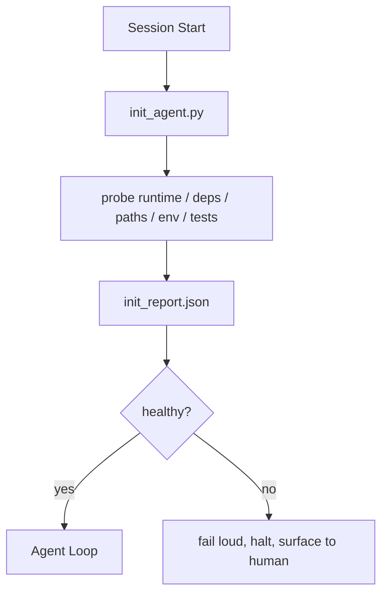

<!-- local-zh-machine-draft: English source is canonical; prose translated automatically, code/math preserved. -->

<a id="initialization-scripts-for-agents"></a>

# 面向 Agents 的初始化脚本

> 每一个开始冷的课都交税 agent 读取相同的文件, 重试同样的探测器, 并重新发现相同的路径。 信头脚本支付一次税, 并将答案写入状态 。

**类型:** Build
**语言:** Python (stdlib)
**先修要求:** 阶段14 · 32(最低工作时间),阶段14 · 34(记忆记录)
**时间:** ~45分钟

<a id="learning-objectives"></a>

## 学习目标

- 确定工作a agent 不必每次重复。
- 建立一个决定性内衣脚本, 来探测运行时间、依赖性和健康。
- 将探测结果永久保存 agent 而不是重新检查
- 失灵时,声音大,速度快, 并且有一个地方看 当初始化失败。

<a id="the-problem"></a>

## 问题

开始开会。 agent 猜对了 Python 版本。 猜测测试命令。 列出重线根5次以找到切入点。 尝试导入未安装的软件包。 询问用户配置文件的住址。 当它真正编辑时, 万个 tokens 已经着手设计了本该是单剧本的工作。

修正是第一个初始化脚本, 运行于 agent 做其他事情,写一个 `init_report.json` 该 agent 开始时读取。

<a id="the-concept"></a>

## 概念



<a id="what-the-init-script-probes"></a>

### 里面的脚本探测到什么

| Probe | 为何重要 |
|-------|----------------|
| 运行时间版本 | Wrong Python 节点版本表示静态错误转换错误 |
| Dependency availability | 丢失的包裹,后来要花十倍于现在的捕获成本 |
| 测试命令 | 该 agent 必须知道如何校验; 如果命令丢失, 工作台被打破 |
| 返回路径 | 硬码路径漂移; 一次性解析并针 |
| 环境变量 | Missing `OPENAI_API_KEY` 是一个失败表面, 不是运行时间的谜团 |
| 状态+板新鲜度 | 坠毁会话的状态是弹簧 |
| Last-known-good commit | 锁定 handoff 届会结束时的 diff |

<a id="fail-loud-fail-fast-fail-in-one-place"></a>

### 出声,出错快,出错在一个地方

探测器失灵意味着停止并浮向人类 agent 关键是拒绝在工作台坏了时开始

<a id="idempotent"></a>

### Idempotent

连续运行两次,第二步应该是无操作状态,除了新的时间戳。 Idempotency 是什么让你把剧本 连接到线人,钩子,或者一个任务前的剪刀命令。

<a id="init-versus-startup-rules"></a>

### 开机规则

规则( 14 阶段 = 33) 描述行动必须真实的。 指令是确定这些规则可以检查的脚本。 规则不使用它就会变成“ 谨慎 ” 。 规则不使用规则就会变成一个光滑的失败 。

```figure
wb-init-probes
```

<a id="build-it"></a>

## 动手实现

`code/main.py` implements `init_agent.py`:

- 五个探测器: Python 版本, 通过 `importlib.util.find_spec`,测试命令可解性,需要的 env vars,状态文件新鲜度。
- 每个探测器都返回 `(name, status, detail)`.
- 脚本写着 `init_report.json` 与完整探测器组装,如果任何块状探测器失败,则退出非零。

运行：

```
python3 code/main.py
```

脚本打印了探测器的表格,写了 `init_report.json`,然后在快乐的道路上从零处退出,或者在无零处,并列出失败的探测器。

<a id="production-patterns-in-the-wild"></a>

## 野生生物的生产模式

三种模式将一个有用的首字母和一个仪式分开。

**Last-known-good commit anchoring.** 检测当前 commit 反对a `LKG` 上次成功合并时写入的文件。 如果 diff 超过预算( 默认为 50 文件), 拒绝启动并要求 人批准新的基线。 这是云花的 AI 代码审查用于范围 reviewer agents:每次审查会议都以最后已知的好东西为依托,并且从未使会议间漂移。

**以 TTL 锁定文件 。** 写一个 `prereqs.lock` 成功第一个探测器过关后, 将锁定时间( 默认为24小时) 并跳过昂贵的探测器。 信头脚本首先读取锁; 如果它新鲜, 且有依赖性散列匹配, 它会短路 。 这是相同的模式 。 Docker 用于层缓存: 一流探测器+内容散列=跳过。

**没有网络,没有 LLM热门路没有惊喜** 内置探测器是确定性管道 LLM 将失败分类或点击外部服务检查许可不是探测器;它是一个工作流程。如果一个探测器在干运行过程中需要超过3秒钟,则把它当作工作台的气味,然后将其移出内嵌或缓存结果。

<a id="use-it"></a>

## 实际应用

生产:

- **Claude 密码钩** `pre-task` 勾击呼叫内幕脚本 拒绝启动 agent 如果失败了。
- **GitHub Actions.** 一个 `setup-agent` 任务运行 init 脚本; agent 工作取决于它。
- **Docker entrypoint.** 该 agent 容器在执行前运行 init 脚本 agent 运行时间; 日志在失败时会浮现 。

Init 脚本是可移动的, 因为没有给特定框架打电话。 Bash、 Make 或任务文件都可以包住它 。

<a id="ship-it"></a>

## 交付成果

`outputs/skill-init-script.md` 访谈项目,将其设置工作分类为探测,并发布一个具体项目 `init_agent.py` 加上一个运行在任何前的 CI 工作流程 agent step.

<a id="exercises"></a>

## 练习

1. 添加一个调色板 commit 与最后的已知善行对抗 commit 拒绝启动50多个文件更改 。
2. 将脚本线上写入 `prereqs.lock` 如果锁超过七天, 文件则拒绝启动 。
3. 添加a `--fix` 标记自动安装丢失的依赖关系, 但没有经过批准, 则不会改变运行时依赖关系 。
4. 将探测器从硬编码函数移动到 YAML 注册 保护交易
5. 每一个探测器都添加计时预算。 运行时间超过三秒钟的探测器就是工作台的气味 。

<a id="key-terms"></a>

## 关键术语

| 术语 | 人们怎么说 | 它实际上意味着什么 |
|------|----------------|------------------------|
| Probe | 支票 | 一种决定函数返回 `(name, status, detail)` |
| 介绍报告 | "设置输出" | JSON 写入与探测结果相匹配的 |
| Idempotent | "安全重开" | 连续两次生成相同的报告模卢时间戳 |
| 失败的响亮 | "别吞下去" | 停止并表面向人类倾斜,不静静地退缩 |
| 设置税 | 买鞋带的价钱 | 该 tokens 该 agent 每次会议花费 重新发现显而易见的 |

<a id="further-reading"></a>

## 进一步阅读

- [Anthropic有效 harnesses 长长的 agents](https://www.anthropic.com/engineering/effective-harnesses-for-long-running-agents)
- [GitHub 行动、综合行动](https://docs.github.com/en/actions/sharing-automations/creating-actions/creating-a-composite-action)
- [微服务,GenAI Dev平台: guardrails](https://microservices.io/post/architecture/2026/03/09/genai-development-platform-part-1-development-guardrails.html) - 预言commit +CI 检查为内嵌
- [增强代码, 如何构建您的 AGENTS2026年 中](https://www.augmentcode.com/guides/how-to-build-agents-md) ——预期
- [代码博客, 代码 CLI 上下文压缩](https://codex.danielvaughan.com/2026/03/31/codex-cli-context-compaction-architecture/) ——会议开始时为压缩意识
- 阶段14 - 33 - 规则设定此脚本启用
- 阶段14 - 34 - 国家将脚本种子归档
- 阶段14 - 38 - verification gate 输入脚本
- 阶段14 - 40 - handoff 消费了报告的最后一份已知的好
