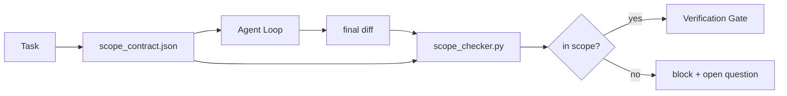

<!-- local-zh-machine-draft: English source is canonical; prose translated automatically, code/math preserved. -->

<a id="scope-contracts-and-task-boundaries"></a>

# Scope Contracts 与任务边界

> 该模型不知道工作结束的地点。 scope contract 是一个每个任务的文件, 它写着工作开始的地方, 结束的地方, 以及如果溢出时如何倒转。 合同将“ 留在范围” 从愿望变为检查 。

**类型:** Build
**语言:** Python (stdlib)
**先修要求:** 阶段14 · 32(最低工作时间),阶段14 · 33(规则作为制约因素)
**时间:** ~50分钟

<a id="learning-objectives"></a>

## 学习目标

- 写一个 scope contract 那样 agent 可在任务开始时读取,而验证员可在任务结束时读取。
- 指定允许的文件、 禁止的文件、 接受标准, rollback 计划,和批准边界。
- 实施比对差异与合同和标记违规情况的范围检查器。
- 使范围变得清晰,自动和可审查。

<a id="the-problem"></a>

## 问题

Agents screep 。 任务就是“ 固定登录错误 ” 。 diff 触及登录路径、 电子邮件助手、 数据库驱动程序、 README 和发布脚本。 每一次触摸都有一个合理的当前原因。 它们加在一起与被审查的改变不同 。

范围爬虫是最不受监测的失败模式 agent 工作是因为 agent 诚实地叙述每一步。 prompt。修正是磁盘上显示承诺内容的合同,以及对比结果与承诺的检查。

<a id="the-concept"></a>

## 概念



<a id="what-goes-in-a-scope-contract"></a>

### 进到一个 scope contract

| Field | 目的 |
|-------|---------|
| `task_id` | 与董事会上的任务链接 |
| `goal` | 复议员可以核实一句话 |
| `allowed_files` | 球状 agent 可以写 |
| `forbidden_files` | 球状 agent 碰也不要碰 |
| `acceptance_criteria` | 测试命令或声明行, 证明完成 |
| `rollback_plan` | 操作员可执行一段,如果需要停止 |
| `approvals_required` | 需要明确签署的人在范围之外采取的行动 |

合同没有 `forbidden_files` 负空间是合同的一半

<a id="globs-not-raw-paths"></a>

### 球,不是生路

实际重置文件移动。 Pin 合同到 Globs ()`app/**/*.py`, `tests/test_signup*.py`因此,两次会话之间的重构因素并不使合同无效。

<a id="rollback-is-part-of-scope"></a>

### Rollback 属于范围的一部分

列出如何倒转迫使合同作者思考出什么问题。 您不能倒转的合同是一份不应被批准的合同。

<a id="scope-check-is-a-diff-check"></a>

### 范围检查是一个 diff 检查

该 agent 写一个 diff 。 检查者读取 diff, 允许的 globs, 禁止的 globs, 以及所有运行的接收命令列表 。 每次违反都是标记的, 查找 verification gate 拒绝

<a id="two-altitudes-of-scope-the-feature-list-and-the-task-contract"></a>

### 范围的两个高度: feature 列表和任务合同

该 scope contract 框。它不约束工程。 agent 可以在登录修正合同中完全保留, 并在下一转弯时仍然决定项目还需要设置页面、 暗色模式切换和路由器的重写。 合同从未被询问工程的范围, 只有哪些文件属于任务范围 。

第二高度需要它自己的原始状态: `feature_list.json` 该 agent 读取会话开始。 这是项目积压, 是一个机器可读、 订购的文件。 the agent 选一个 feature whose `status` 是 `todo`写 `id` 进入活动 scope contract,并且被禁止从开始的第二 feature 同一场比赛 feature 不再成为 prompt 该 agent 它可以把过去合理化,变成一个价值 它读取的磁盘和检查门的强制。

```json
{
  "project": "knowledge-base",
  "active": "import-pdf",
  "features": [
    { "id": "import-pdf",   "status": "in_progress", "goal": "import a PDF into the library",        "done_when": "pytest tests/test_import.py && a sample PDF appears in the library view" },
    { "id": "full-text-search", "status": "todo",     "goal": "search document text and rank hits",   "done_when": "query returns ranked results with snippets" },
    { "id": "cite-answers", "status": "todo",         "goal": "answers carry source citations",        "done_when": "every answer renders at least one clickable citation" }
  ]
}
```

| Field | 目的 |
|-------|---------|
| `active` | 单 feature 当前会话可能触碰; 空意为选择一个并设置它 |
| `features[].id` | 稳定弹打 scope contract的 `task_id` 点数 |
| `features[].status` | `todo`, `in_progress`, `done`, `blocked`;只有一个 `in_progress` 一次中 |
| `features[].goal` | 复议员可以核实一句话 |
| `features[].done_when` | 翻转的接受线 `in_progress` 以 `done` |

有两个规则使列表包含而不是装饰。 首先, 变量“ 大多是 ” `in_progress`" 本身是启动检查(第14阶段第33段):如果清单显示有两个,那么会话就拒绝开始,直到人类解决为止。 feature 列表是一个文件,而不是聊天信件,因为聊天卷轴脱离上下文,文件在会话和跨会话中始终存在 agents. 该 handoff 完成于 feature状态恢复到 `done` 所以下一场会向一个准确的板块打开 而不是重新发送剩下的部分

合同和清单由 least privilege,下文所述合并:任务合同 `allowed_files` 一定要坐在里面,不管什么活动 feature 碰碰,从不离开它。

```figure
wb-scope-bounce
```

<a id="build-it"></a>

## 动手实现

`code/main.py` implements:

- `scope_contract.json` 系统图(子集) JSON 阵列数组)
- diff 解析器, 将被触动的文件列表加上运行命令列表转换为 `RunSummary`.
- 一个 `scope_check` 返回时 `(violations, in_scope, off_scope)` 违反合同。
- 两个演示运行: 一个留在范围, 一个爬行。 检查员用准确的文件和理由标记这个爬行。

运行：

```
python3 code/main.py
```

产出:合同,两场比赛,每场比赛的判决,还有一次被拯救 `scope_report.json`.

<a id="production-patterns-in-the-wild"></a>

## 野生生物的生产模式

操作“ 标本” 的执业者scope contracts 在 YAML 之前的引用 agent)报告兔子洞率在三周内从52%下降到21%,而没有改变 agent合同是完成的,不是模型,三个模式是获得的

**违反预算,不是二元失败。** `agent-guardrails` (开放源码软件合并门户被 Claude 代码, 光标, 温德苏夫, 代码通过 MCP船舶a `violationBudget` 每项任务: 预算内的小范围滑块作为警告出现; 只有在预算超出时, 合并门才会拒绝。 `violationSeverity: "error" | "warning"`。预算是船舶的大门和被讨厌的团队禁用的大门之间的差额。

**严重性 由路径家庭不对称。** 离镜写到 `docs/**` 通常为 `warn`; 外部写到 `scripts/**`, `migrations/**`, `config/prod/**` 总是 `block`。这种不对称必须存在于合同中,而不是运行时,因为它是针对项目和每项任务的变化的。

**时间和网络预算紧靠在提交预算之后。** 一个 `time_budget_minutes` 字段将墙时钟圈圈;运行时间拒绝在不重新批准的情况下继续过。 `network_egress` 主机名上的允许列表防止 agent 静静地打到外表 API 这不是任务的一部分。 这些也是范围尺寸; 文件的格子是必需的, 不够 。

**多合同合并语义(least privilege).** 等两点 scope contracts 合并如下(例如,整个项目合同加上一项具体任务合同): **intersect** `allowed_files` (两份合同必须允许通行) **union** `forbidden_files` (两者皆可禁止) `time_budget_minutes` 限制最强( 最小) , `approvals_required` accumulates. `network_egress` 是 `None` 以不执行, `[]` 至於不信道的, `[...]` 用作允许列表; 正在合并中, `None` 服从对方, 两份列表相互交叉, 拒绝所有保留 仍无法被接受。 在合同计划中说明这一点, 这样合并是机械的, 可以审查的 。

<a id="use-it"></a>

## 实际应用

生产模式:

- **Claude 代码斜线命令。** 一个 `/scope` 命令写入合同,并将其标为会话上下文。 Subagents 行动前先读懂合同。
- **GitHub PRs.** 将合同作为 JSON 身份验证文件或作为已入帐的文物。 CI 运行比对合并 diff 的镜像检查器 。
- **LangGraph interrupts.** 违反范围规定引发中断;处理者询问人合同是否需要增长或是否必须增长。 agent 需要退缩。

合同随任务而进行。 `outputs/scope/closed/`.

<a id="ship-it"></a>

## 交付成果

`outputs/skill-scope-contract.md` 生成 a scope contract 和在CI上运行的球形孔检查器 agent diff.

<a id="exercises"></a>

## 练习

1. 添加a `network_egress` 字段列表允许外部主机。拒绝运行会触动其他主机的功能。
2. 将检查器扩展为软的失败 `docs/**` 和坚硬 `scripts/**`。说明不对称性的理由。
3. 合同要从中产生 `allowed_files` 从 a 中 `goal` 使用静态规则集的字段(无) LLM第一边的案子出了什么问题?
4. 添加a `time_budget_minutes` 并拒绝继续 一旦墙上的钟表超过它。
5. 使用两个对齐的 diff 来运行两个合同。 当两者都适用时, 正确的合并语义是什么 ?

<a id="key-terms"></a>

## 关键术语

| 术语 | 人们怎么说 | 它实际上意味着什么 |
|------|----------------|------------------------|
| Scope contract | 任务简报 | Per-task JSON 列出允许/禁止的文件、接受文件、 rollback |
| 范围爬行 | "它也感动..." | 合同外的文件更改为同一任务 |
| Rollback plan | "我们可以回头" | 单行操作员运行本停止 |
| 批准边界 | 需要签收 | 合同中列明的需要明确人力批准的行动 |
| 切换检查 | "平板审计" | 对照合同格子比较被触摸的文件 |

<a id="further-reading"></a>

## 进一步阅读

- [LangGraph human-in-the-loop interrupts](https://langchain-ai.github.io/langgraph/concepts/human_in_the_loop/)
- [OpenAI Agents SDK 工具批准政策](https://platform.openai.com/docs/guides/agents-sdk)
- [logi-cmd/agent-guardrails 合并大门和范围验证](https://github.com/logi-cmd/agent-guardrails) 违反预算、严重程度
- [Dev|《防止大赦国际》杂志 Agent 配置漂移器 Agent 合同测试](https://earezki.com/ai-news/2026-05-05-i-built-a-tiny-ci-tool-to-keep-ai-agent-configs-from-drifting-in-my-repo/) — `--strict` 模式,无外部调值
- [Agentic 编码不是陷阱(生产日志)](https://dev.to/jtorchia/agentic-coding-is-not-a-trap-i-answered-the-viral-hn-post-with-my-own-production-logs-33d9) 标本收入:52% 21%
- [打开代码允许格](https://opencode.ai/docs/agents/) 细微缩减的每项许可范围
- [Knovistic, 大赦国际 Coding Agent Security: Threat Models 和保护战略](https://www.knostic.ai/blog/ai-coding-agent-security) 范围作为 least privilege
- [增强代码, AI Spec 模板](https://www.augmentcode.com/guides/ai-spec-template) - 三级边界系统(必须/提出/提出/从未提出)
- 阶段14 27 - prompt injection 配有镜像锁的防守
- 阶段14 - 33——本合同规定每项任务均有专门性
- 阶段14 - 38 - verification gate 检查器报告到
