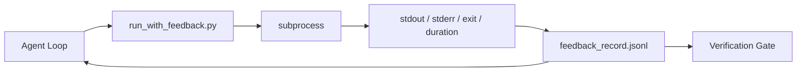

<!-- local-zh-machine-draft: English source is canonical; prose translated automatically, code/math preserved. -->

<a id="runtime-feedback-loops"></a>

# 运行时反馈循环

> Agents , 无法看到真正的命令输出猜测。 反馈运行者会捕捉 stdout、 stderr、 退出代码和时间, 并进入一个结构化的记录, 下一个转弯可以读取 。 agent reacts 而不是它自己对事实的预测

**类型：** 构建
**语言:** Python (stdlib)
**先修要求:** 阶段14 · 32(最低工作时间),阶段14 · 35(入门脚本)
**时间:** ~50分钟

<a id="learning-objectives"></a>

## 学习目标

- 区分运行时间反馈 observability telemetry.
- 建立一个反馈运行器, 以包扎 shell 命令并持续结构化记录 。
- 以决定性的方式将大型输出排出, 使循环保持在内部 token budget.
- 拒绝在反馈缺失时推进循环 。

<a id="the-problem"></a>

## 问题

该 agent 下一个信息是"所有测试都通过" 现实是没有测试运行。 agent 想象输出, 或者它运行命令, 却从未读过结果, 或者它读了结果, 静静地缩短了失败线 。

反馈运行器可以消除这个缺口。 每个命令都通过运行程序。 每个记录都包含命令、 捕获的 stdout 和 stderr 、 退出代码、 墙上时钟的长度, 以及一行 agent 说明。 agent 下个转弯时读到记录 verification gate 阅读任务结束时的记录。

<a id="the-concept"></a>

## 概念



<a id="what-goes-in-a-feedback-record"></a>

### 反馈记录中的内容

| Field | 为何重要 |
|-------|----------------|
| `command` | 精确的argv, 没有Shell扩张惊喜 |
| `stdout_tail` | 最后一行,确定性短跑 |
| `stderr_tail` | 最后一行, 与 stdout 分开 |
| `exit_code` | 明确成功的迹象 |
| `duration_ms` | 表面缓慢探测和逃跑过程 |
| `started_at` | 重播的时间戳 |
| `agent_note` | 一条线 agent 写下它所期望的 |

<a id="truncation-is-deterministic"></a>

### 径流是决定性的

50 MB 日志摧毁了环形。 运行者用一个 `...truncated N lines...` 标记,确定性 所以相同的输出总是产生相同的记录。 sampling; 部分 agent 需要看到(最后错误、最后摘要) 以尾部为主 。

<a id="feedback-versus-telemetry"></a>

### 反馈与遥测

遥测(第14阶段 · 23, OTel GenAI 常规) 用于人类操作者对时间的运行。 反馈是该运行的下一个回合。 他们共享字段, 但生活在不同的文件里, 并保留不同的文件 。

<a id="refuse-to-advance-without-feedback"></a>

### 拒绝提前反馈

如果在获取退出前运行错误, 记录会随身携带 `exit_code: null` 和 `error: <reason>`. 该 agent loop 必须拒绝申请胜诉 `null` 退出,没有出口,没有进展

```figure
wb-feedback-loop
```

<a id="build-it"></a>

## 动手实现

`code/main.py` implements:

- `run_with_feedback(command, agent_note)` 环绕 `subprocess.run`,将捕获 stdout/stderr/exit/dulade,确定截断,附加到 `feedback_record.jsonl`.
- 一条小装载器,它流出 JSONL 变成 Python list.
- 演示可运行三个命令( 成功、 失败、 慢) , 并打印每个命令的最后记录 。

运行：

```
python3 code/main.py
```

产出:3份反馈记录附于 `feedback_record.jsonl`,每个打印的内线中的最后一个。将文件倒在重新运行的正对面,以看到循环的积累。

<a id="production-patterns-in-the-wild"></a>

## 野生生物的生产模式

三个模式使跑者更坚固 足以运送

**重写, 不读 。** 任何接触Stdout或Stderr的记录都可以泄露秘密。 JSONL 附加: 匹配条形线 `^Bearer `, `password=`, `api[_-]?key=`, `AKIA[0-9A-Z]{16}` (AWS), `xox[baprs]-` (Slack) 阅读时的编辑是一把脚枪; 磁盘上的文件是攻击者所达到的。 对照运行时观察到的秘密格式,每季度对编辑模式进行审计 。

**旋转策略,一个文件都没有** Cap `feedback_record.jsonl` 以每文件 1 MB 值计算; 在溢出时旋转到 `.1`, `.2`,放下 `.5`. 该 agent循环只读取当前文件, 运行时间成本就被绑定了。 CI 的手工储存会完全旋转。 没有旋转, 文件就会成为每个装载器呼叫的瓶颈 。

**重试链的父指令 ID 。** 每一张唱片 `command_id`; 重试 `parent_command_id` 评论员的“失败尝试”清单(第14阶段 · 40)和 verification gate审计过程都遵循链条。没有这一链条,重试看起来是独立成功,审计掩盖了失败历史。

<a id="use-it"></a>

## 实际应用

生产模式:

- **Claude 密码Bash工具** 工具已经捕捉 stdout、 stderr、 退出和持续时间。 此课的选手是任意 agent product.
- **LangGraph nodes.** 将任何空壳节点包在运行中,以便记录在图形状态之外保持不变。
- **线人日志** 编织 JSONL 进入你的CI 人工制品商店; 审核员可以重播任何命令, 而无需重运行会话 。

跑者是一个薄包装纸, 生存下来每一个框架迁移 因为它拥有记录形状。

<a id="ship-it"></a>

## 交付成果

`outputs/skill-feedback-runner.md` 生成特定项目 `run_with_feedback.py` 右侧截减预算a JSONL 写作者把工作台和装货机连起来 agent 每次都会读

<a id="exercises"></a>

## 练习

1. 添加a `cwd` 字段中每个记录,因此从不同的目录中运行的相同命令是可区分的。
2. 添加a `redaction` 跳进匹配线条 `^Bearer ` 或 `password=`测试固定记录
3. 上限共计 `feedback_record.jsonl` 旋转到 1 MB 时大小 `.1`, `.2` 文件。 维护旋转策略 。
4. 添加a `parent_command_id` 所以重试链是可见的: 命令生成了下一个命令消耗的输入 。
5. 编织 JSONL 成为一个小的TUI,突出显示最新的非零退出。 features TIU 必须在审查中显示有用。

<a id="key-terms"></a>

## 关键术语

| 术语 | 人们怎么说 | 它实际上意味着什么 |
|------|----------------|------------------------|
| 反馈记录 | "运行日志" | Structured JSONL 带有命令、输出、退出、持续时间的条目 |
| 尾部短跑 | "木头倒塌" | 确定性头+尾部捕捉,以便记录适合 token budget |
| Refuse-on-null | "数据缺失的锁" | 循环不能在 `exit_code` 无效 |
| Agent note | "预期标记" | 单线预测 agent 阅读结果前写下 |
| 遥测分解 | "两个日志文件" | 下一回合的反馈, 操作员的遥测 |

<a id="further-reading"></a>

## 进一步阅读

- [GenAI语义学公约](https://opentelemetry.io/docs/specs/semconv/gen-ai/)
- [Anthropic有效 harnesses 长长的 agents](https://www.anthropic.com/engineering/effective-harnesses-for-long-running-agents)
- [Guardrails AI x ML Flow-确定性安全, PII, 质量验证器](https://guardrailsai.com/blog/guardrails-mlflow) - 编辑模式为 regression tests
- [最佳人工智能,阿波特.io Agent Guardrails 2026: 行动前授权比较](https://aport.io/blog/best-ai-agent-guardrails-2026-pre-action-authorization-compared/) 工具的预选/后选
- [安德里·弗曼内特,大赦国际 Agents 2026年:工具、记忆、 Evals 的实用架构 Guardrails](https://andriifurmanets.com/blogs/ai-agents-2026-practical-architecture-tools-memory-evals-guardrails) — observability surfaces
- 阶段14 - 23 - OTel GenAI遥测方面公约
- 阶段14 24 - agent observability 平台( 蓝风、 凤凰、 Opik)
- 阶段14 - 33——在宣布之前要求反馈的规则
- 阶段14 - 38 - verification gate 读作 JSONL
