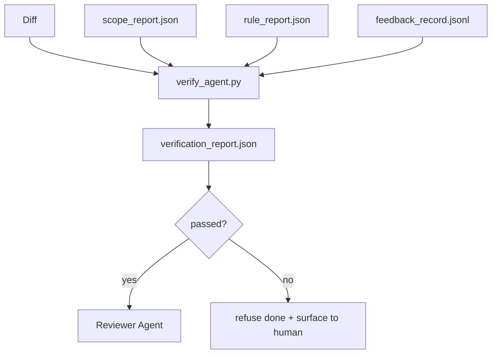

<!-- local-zh-machine-draft: English source is canonical; prose translated automatically, code/math preserved. -->

<a id="verification-gates"></a>

# Verification Gates

> 该 agent 无法像以往那样对自身工作进行标记。 verification gate 读取 scope contract,反馈日志,规则报告, diff, 并回答一个问题:任务是否真的完成?如果大门拒绝,任务就没有完成,不管聊天内容如何。

**类型：** 构建
**语言:** Python (stdlib)
**先修要求:** 阶段14 - 33(规则),阶段14 - 36(范围),阶段14 - 37(退让)
**时间:** ~55分钟

<a id="learning-objectives"></a>

## 学习目标

- 定义 verification gate 一种决定性功能 相对于工作台的人工制品。
- 将规则报告、范围报告、反馈记录和数据合并成一项判决。
- 开始 `verification_report.json` 该 reviewer agent CI都识字
- 拒绝推进任何无尽失败的任务,无一例外。

<a id="the-problem"></a>

## 问题

Agents 宣告成功太容易了。三种失败形式占优势:

- "看起来不错" 模特儿读了自己的Diff,认为是正确的
- "测试通过" 自信地说 没有考试的记录
- 接受标准被粗略地解释为 任何类似的东西

工作台是单 verification gate 读到这些文物 agent 已经制作并发出呼叫。 大门是决定性的。 大门在版本控制中。 大门被连接到 CI 。 agent 无法贿赂它。

<a id="the-concept"></a>

## 概念



<a id="what-the-gate-checks"></a>

### 门怎么检查

| Check | 源码工艺品 | Severity |
|-------|-----------------|----------|
| 全部接受命令已运行 | `feedback_record.jsonl` | block |
| 所有接受命令均退出零 | `feedback_record.jsonl` | block |
| 范围检查没有被禁止写入 | `scope_report.json` | block |
| 范围检查没有非范围写入 | `scope_report.json` | 块或警告 |
| 所有的街区规则都通过 | `rule_report.json` | block |
| 否 `null` 反馈中的退出代码 | `feedback_record.jsonl` | block |
| 触摸到的文件匹配 `scope.allowed_files` | 两者 | warn |

一个 `warn` 查明判决;a `block` 查找防止 `passed: true`.

<a id="deterministic-not-probabilistic"></a>

### 确定性,而非概率

门必须每次对同样的文物做出同样的判决 LLM judges. LLM 法官属于审查者(第14阶段 · 39),目标是质量 evaluation,不是状态。

<a id="one-report-one-path"></a>

### 一份报告,一条路

门发出一个 `verification_report.json` 任务结束时,以 `outputs/verification/<task_id>.json`。 CI 消耗相同的路径。 多扇门, 不同路径, 将真理的源头划入叉口 。

<a id="refuse-without-exception"></a>

### 无一例外地拒绝

块状的发现不能被 agent。它们只能被人类所推翻,并有记录 `override_reason` 和一个 `overridden_by` 用户 ID。 覆盖是一个签名的更改, 不是 agent decision.

```figure
wb-gate-sequence
```

<a id="build-it"></a>

## 动手实现

`code/main.py` implements:

- 每个输入的文物都装上装载器 全部被当地人压扁 所以课是自成一体的
- 一个 `verify(task_id, artifacts) -> VerdictReport` 纯函数。
- 显示每次检查结果和最后出入证/失效的打印机。
- 演示,有三个任务: 干净的通过, 范围爬行,缺少接受。

运行：

```
python3 code/main.py
```

输出: 三份判决报告, 每一个保存在脚本旁边 。

<a id="production-patterns-in-the-wild"></a>

## 野生生物的生产模式

四个模式把大门从"另一件蠢事"提升到"决定边缘"

**防守深度,不是单门** Pre-commit 勾选 CI 状态检查 工具前 验证钩 组合前 门 。 每个层都是决定性的, 所以一个层的故障会被下一个层所捕获。 缩微服务 io 的 2026 年3月的剧本很清楚: 预览 -commit 钩是不可忽略的,因为与模型侧面的技能不同,它并不取决于 agent 遵照指示 verification gate 坐在CI/合并前层

**以决定性检查为辩护 示范法官只为细微的** Anthropic2026年混合规范配对:可核查的回报(单位测试、机率检查、退出代码)回答“代码解决了问题吗?” LLM 标注回答“ 代码可读、 安全、 风格? ” 。 门运行头等舱; 评审器( 14 · 39) 运行第二等舱。 混合它们会折叠信号 。

**签名覆盖日志, 不是黑线 。** 所有的超文本处理都排成一列 `outputs/verification/overrides.jsonl` 与: 时间戳、 查找代码、 理由、 签名用户、 当前 HEAD commit。运行时间拒绝任何没有签名的超文本操作;审计线索是 git这是超人政策与超人剧院之间的界线

**检查一流的楼层** 一个 `coverage_report.json` 种子a `coverage_floor` 检查( 默认 80%) 。 如果测量的覆盖值在下层或上一个合并底层下下方下降超过 1 个百分点, 则门会失效 。 没有此检查, agents 悄悄删除失败的测试, 且核查报告保持绿色 。

**`--strict` 模式将警告推广到阻塞 。** 供释放 branches船舶阻塞公关,或事故后分级, `--strict` 使每个警告都失败。 branch;不是全球默认,因为严格的对齐操作会破坏日常流程。

<a id="use-it"></a>

## 实际应用

生产模式:

- **线人一步。** 一个 `verify_agent` 工作是用门对着 agent合并保护没有 `passed: true`.
- **Pre-handoff hook.** 该 agent 运行时间在生成前呼叫大门 handoff 医生,没有绿色判决,没有 handoff.
- **人工分类** 操作员在 agent 声称成功, 和一个人怀疑它。

门是工作台流的边缘, 每一个表面都是上游。

<a id="ship-it"></a>

## 交付成果

`outputs/skill-verification-gate.md` 将大门连接到特定工程中: 接受命令给它提供, 哪些规则是块块- 严重性, 哪些不在屏幕上写着可以容忍, 如何控制 audit log 被存储。

<a id="exercises"></a>

## 练习

1. 添加a `coverage_floor` 选中 : 测试命令必须生成至少80%的覆盖报告。 决定哪个工艺品随附地面 。
2. 支助a `--strict` 模式,促进每个 `warn` 以 `block`。如果默认为严格模式,则文档中记录该选项。
3. 使大门产生 Markdown 概述 JSON。在摘要中,保护哪些字段。
4. 添加a `time_since_last_human_touch` 选中 : 在人键盘输入后 60 秒内编辑过的任何文件均不受外标限制 。
5. 开着真正的门 agent 有多少是真实的,多少是噪音?大门需要在哪里生长?

<a id="key-terms"></a>

## 关键术语

| 术语 | 人们怎么说 | 它实际上意味着什么 |
|------|----------------|------------------------|
| Verification gate | "停止一切的支票" | 工作台工艺品的确定性功能,产生出入/失职判决 |
| 块宽度 | 失败 | 阻止调查的结果 `passed: true` 需要签名的覆盖 |
| 覆盖日志 | "为什么我们让它通过" | 经审查审计的签有理由和用户id的条目 |
| 接受命令 | 证据 | 空降命令 `done` means |
| 一条报告路径 | "真相来源" | `outputs/verification/<task_id>.json`被CI和人类消耗 |

<a id="further-reading"></a>

## 进一步阅读

- [Anthropic, Harness 设计用于长期应用开发](https://www.anthropic.com/engineering/harness-design-long-running-apps)
- [OpenAI Agents SDK guardrails](https://openai.github.io/openai-agents-python/guardrails/)
- [微服务,GenAI Dev平台: guardrails](https://microservices.io/post/architecture/2026/03/09/genai-development-platform-part-1-development-guardrails.html) — defense in depth 之前的... 之间commit 和CI
- [ICMD,2026年的《游戏手册》 Agentic AI 行动](https://icmd.app/article/the-2026-playbook-for-agentic-ai-ops-guardrails-costs-and-reliability-at-scale-1776661990431) 批准-起站梯(门槛值下自动批准草案)
- [检查类型合规性:确定性 Guardrails (arXiv 2604.01483)](https://arxiv.org/pdf/2604.01483) 以4号为确定性滑动的上界
- [logi-cmd/agent-guardrails - 合并门标](https://github.com/logi-cmd/agent-guardrails) - 范围+突变测试门
- [Guardrails AI x ML 流](https://guardrailsai.com/blog/guardrails-mlflow) 确定性鉴定人作为CI的得分者
- 阶段14 27 - prompt injection 防守(门对对)
- 阶段14 - 36 - scope contract 门紧紧地紧紧地紧紧地紧紧地紧紧地紧紧地紧紧地紧紧地紧紧地紧紧地紧紧地紧紧地紧紧地紧地紧地紧紧地紧地紧地紧紧地紧地地紧地地紧地紧地紧地地地拉着
- 阶段14 - 37 - 反馈记录这个门分数
- 阶段14 - 39 - reviewer agent 门手松开
