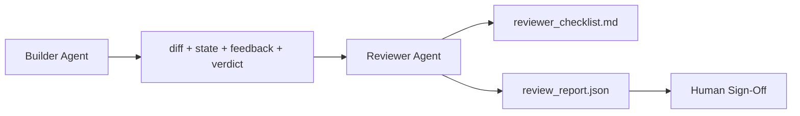

<!-- local-zh-machine-draft: English source is canonical; prose translated automatically, code/math preserved. -->

<a id="reviewer-agent-separate-builder-from-marker"></a>

# Reviewer Agent：将实现者与评分者分开

> 该 agent 无法从代码中分级。 复习者是另一个循环, 与其它循环 system prompt,一个不同的目标,以及只读取的对建筑商所生产的一切的接触。建筑商和审查商之间的差距是最可靠的生命。

**类型：** 构建
**语言:** Python (stdlib)
**先修要求:** 阶段14 - 38(Verification Gate)
**时间:** ~55分钟

<a id="learning-objectives"></a>

## 学习目标

- 说明为什么相同 agent 无法可靠地审查自己的工作。
- 构建 reviewer agent 循环,消费建筑工匠的艺术品 并发布一个结构化的审查报告。
- 作者 评论员 标记 等级 特定尺寸, 而不是感觉。
- 将审查者连接到工作台 这样人类审查的步调就从真正的文物开始

<a id="the-problem"></a>

## 问题

你问 agent 来修正错误。它编辑了四个文件,运行测试并做了报告。 verification gate 14 - 38)确认接受运行并保持范围。 `passed: true`两天后你发现这个方法解决了错误的错误

接受是必要的, 还不够。 评审者无法问: 接受问题解决得了吗? 它是否在不标注的情况下扩大了范围? 它是否记录了应该被质疑的假设? 它是否将工作台留在下届会议可以接收的状态中?

<a id="the-concept"></a>

## 概念



<a id="reviewer-rubric"></a>

### 评论员标注

5个维度,每个度分0比2

| 尺寸 | 问题 |
|-----------|----------|
| 问题合适 | 改变是否解决了上述任务,而不是附近的任务? |
| 范围纪律 | 编辑是否仅限于合同,还是合同是有意增加的? |
| 假设 | 隐藏的假设都写在某个地方可以审查吗? |
| 核查质量 | 接受命令是否实际证明了目标,还是证明是一个较弱的版本? |
| Handoff readiness | 下一场会话能从目前状态中 干净地接过来吗? |

总共10次,低于7次是软故障;低于5次是硬故障。

<a id="the-reviewer-is-a-separate-role-not-a-separate-model"></a>

### 审评员是独立的角色,而不是独立模式

您可以使用与建筑商相同的模式运行审查器。 学科是角色分离: 不同 system prompt,不同的输入,没有写入 diff 。 姿态的变化就是信号的变化。

<a id="the-reviewer-cannot-edit-the-diff"></a>

### 审评者无法编辑 diff

评审者读了 diff, 州, 反馈, 裁决。 它写了一份报告。 它没有 patch 。 如果报告说“ 固定 ” , 下一个建筑商会进行修正; 审评员会回到审查中去。 混合角色可以消除差距。

<a id="reviewer-rubric-versus-verification-gate"></a>

### 评议符号与 verification gate

大门( 14 - 38阶段) 检查决定性的事实: 接受是否运行, 规则是否通过, 范围是否有效。 评审者做出了定性判断: 这是正确的工作吗? 是文件记录下来的吗? handoff 都用得着,两样都要

```figure
wb-builder-marker
```

<a id="build-it"></a>

## 动手实现

`code/main.py` implements:

- 一个 `ReviewerInputs` 数据类捆绑着审查者读到的文物。
- 每个维度有一个函数的卢布计分器。 每个函数对课程具有确定性和根级; 真正的执行要求 LLM.
- 一个 `review_report.json` 写了五分,总分,还有判决`pass`, `soft_fail`, `hard_fail`).
- 两个演示案例: 干净的改变和“正确的测试,错误的问题”的改变。

运行：

```
python3 code/main.py
```

产出:两份审查报告写到磁盘和一张维度分控制台表。

<a id="production-patterns-in-the-wild"></a>

## 野生生物的生产模式

收据:2026年4月的《国际守则审查》系统运行了131 246次审查,共涉及5 169个回复的48 095项合并请求,中度审查在3分钟39秒内完成,最多7名专家审查员(安全、性能、代码质量、文件、发布管理、合规、工程编码)在1名审查协调员的平行运作,该审查协调员将结论和判断的严重程度加以废除。

四个模式使这项工作规模化。

**专家人才库,一个也没有** 一位具有5维调频的评审员为独家接收工作。 一旦代码库有安全临界值、性能临界值和医生表面, 就会分成小于5维的专业人士 prompts协调员确实有重复;专家从来不会全称,模型级分离会消失:廉价专家、昂贵的协调员。

**减轻风险是设计要求,而不是优化。** LLM 法官表现出四种可靠的偏见(Adnan Masood,2026年4月):立场偏见(Adnan Masood,2026年4月):GPT- 4%~40%的顺序不一致(A、B)和(B、A),动词偏差(~15%的通货膨胀比长期产出高)、自我偏好(法官更喜欢同一模式家庭的产出)、权威(法官对已知作者的引用率过高),减轻:评估订单,只计算一致的胜算;使用1-4的尺度明确奖励简明性;在模范家庭之间轮换法官;在评分之前脱色作者姓名。

**Calibration 设定,而不是感觉。** 10 -20任务的历史集,已知正确判决。 prompt 更改。 如果对历史记录的一致低于80%, 则需要修改标签才能进行评审。 这是每个团队最终要重新发现的; 最好从中开始。

**门的混合规范** Verification gate (第14阶段 ~ 38) 处理确定性检查( 接受运行, 测试通过, 范围保持) 。 审查员处理语义检查( 是否正确, 是文件文件上的假设, 是文件上的假设) 。 handoff usable). Anthropic2026年的指南明确了这个分割: 不要要求审查者重做这个大门已经证明的东西。

<a id="use-it"></a>

## 实际应用

生产模式:

- **Claude Code subagents.** 审阅器 subagent 创建者完成一项任务后运行。 它会发布对 PR 的评论, 并标注分数 。
- **OpenAI Agents SDK handoffs.** 构建者在任务完成时将手交给审查者。 评审者可以将结果列表交还给某个人 。
- **双模配对** 构建器运行于更便宜的模型。 评审器运行于一个更强大的模型,其背景较小, 侧重于判断 。

评审者是第二对眼睛 工作台增长 当人类不能做每一个审查自己。

<a id="ship-it"></a>

## 交付成果

`outputs/skill-reviewer-agent.md` 生成一个特定项目审评符号, a reviewer agent 根根连接到建筑商的艺术品 和与 verification gate 所以人类的评议是从书面报告开始 而不是从空白页开始

<a id="exercises"></a>

## 练习

1. 添加产品域特有的第六维。 保护它不被现有五维吸收的原因 。
2. 用两个不同的程序运行审查器 system prompts 人类更可能读到哪一份报告?
3. 添加a `confidence` 当对最低维度的置信度低于0.6时拒绝发送报告。
4. 构建 calibration 设置 : 10 个历史任务结束, 并给出已知的正确判决 。 运行审查者来对它进行检查 。 它与历史记录有什么不同 ?
5. 添加“ 请求更多证据” : 评审者可以在评分前询问构建者进行特定的测试。 什么是正确的后退, 这样它就不会循环 ?

<a id="key-terms"></a>

## 关键术语

| 术语 | 人们怎么说 | 它实际上意味着什么 |
|------|----------------|------------------------|
| 评论员标注 | "Checklist" | 5度分 0-2分,每个维度都有书面问题 |
| 软失败 | "需要修改" | 总数低于7;建筑商得到结果 |
| 困难失败 | "Reject" | 总数低于5或0时的任何维度;停留和表面为人类 |
| 角色分离 | "Different prompt" | 同一模式可以是两个角色;学科是投入和姿态 |
| 信任底线 | "不要发送低信号报告" | 拒绝在标语不确定时发布判决 |

<a id="further-reading"></a>

## 进一步阅读

- [OpenAI Agents SDK handoffs](https://openai.github.io/openai-agents-python/handoffs/)
- [Anthropic Claude Code subagents](https://code.claude.com/docs/en/sub-agents)
- [云花, 按比例操作 AI 代码审查](https://blog.cloudflare.com/ai-code-review/) - 7名专家+协调员架构,131公里运行/30天
- [Agent- 法官:评估 Agents 与 Agents (公开审查/综合法律资料室)](https://openreview.net/forum?id=DeVm3YUnpj) - DevAI基准,366个等级解决方案要求
- [阿德南·马苏德,鲁布里克 Evaluations 和 LLM-as-a-Judge方法、比亚斯、经验验证](https://medium.com/@adnanmasood/rubric-based-evals-llm-as-a-judge-methodologies-and-empirical-validation-in-domain-context-71936b989e80) 4项偏差和减轻影响
- [MLflow, LLM-as-a-Judge Evaluation](https://mlflow.org/llm-as-a-judge) 分离建筑/评价工具的生产工具
- [LangChain,如何校准 LLM-as-a-Judge 惩教署](https://www.langchain.com/articles/llm-as-a-judge) — calibration- 设置工作流程
- [很明显,AI, LLM-as-a-judge:完整的指南](https://www.evidentlyai.com/llm-guide/llm-as-a-judge)
- [Arize, LLM 担任法官——初级和建设前评价员](https://arize.com/llm-as-a-judge/)
- 阶段14 -05——自省 CRITIC (single-agent 自我评估基准)
- 阶段14 30 - 以评价为驱动 agent 发展(次级方案4)calibration 设定生成器)
- 阶段14 - 38 - verification gate 评论员读
- 阶段14 - 40 - handoff 将审评员的报告反馈包
