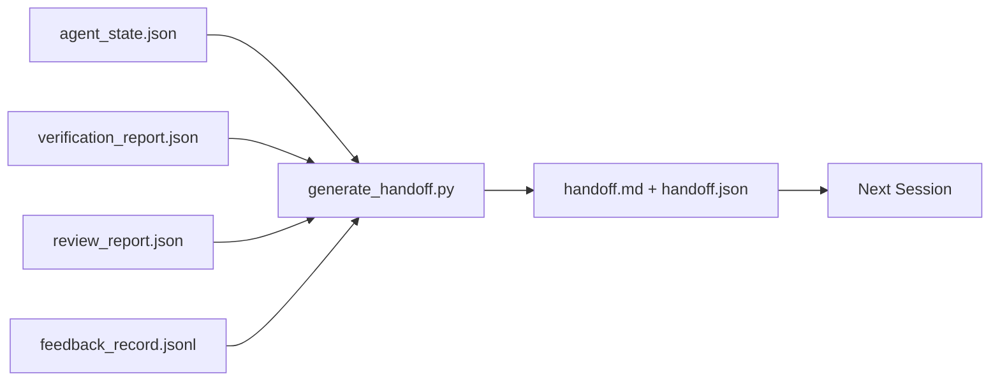

<!-- local-zh-machine-draft: English source is canonical; prose translated automatically, code/math preserved. -->

<a id="multi-session-handoff"></a>

# 跨会话 Handoff

> 会话要结束了,工作没有 handoff 包是把" agent 工作了一个小时",进入"下一场会话在第一分钟是富有成效的。" 建立它的目的,而不是事后的想法。

**类型:** Build
**语言:** Python (stdlib)
**先修要求:** 阶段14 · 34(记忆恢复),阶段14 · 38(核查),阶段14 · 39(审查员)
**时间:** ~50分钟

<a id="learning-objectives"></a>

## 学习目标

- 每隔七个字段指定 handoff 需要包装
- 生成 handoff 工作台的艺术品没有手写
- 将大反馈日志修整为 handoff- 规模的总结。
- 使下次会议的第一个行动决定。

<a id="the-problem"></a>

## 问题

届会结束。 agent 说"太好了,我们取得了进展" 下一场开庭 agent 问"我们离开哪里了?" agent答案已经消失了,下一个 agent 重新发现,重新运行相同的命令, 重新询问同样的问题, 并燃烧30分钟 恢复上一个会话的最后30秒。

坏人的代价 handoff 给每个会话支付任务寿命。 修正是会话结尾处自动生成的包: 是什么变化了, 为什么, 尝试了, 失败了, 剩下的, 下次应该做什么 。

<a id="the-concept"></a>

## 概念



<a id="seven-fields-every-handoff-carries"></a>

### 7个字段 handoff carries

| Field | 问答案 |
|-------|---------------------|
| `summary` | 一段关于所做的事情 |
| `changed_files` | 看着那张小脸 |
| `commands_run` | 实际执行的是什么 |
| `failed_attempts` | 尝试过什么,为什么没有成功 |
| `open_risks` | 下一场会有什么好咬的 严肃点 |
| `next_action` | 下次会议采取的第一个具体步骤 |
| `verdict_pointer` | 核查+审查报告路径 |

该 `next_action` 字段是包含载荷的。 handoff 与所有东西,除了 `next_action` 是状况报告,不是 handoff.

<a id="handoffs-are-generated-not-written"></a>

### Handoffs 生成, 不写入

手写 handoff 是一个 handoff 发电机读了工作台的艺术品,并释放了包。 agent工作是把工作台留在一个 发电机可以总结的状态,而不是写摘要。

<a id="two-forms-human-readable-and-machine-readable"></a>

### 两种形式:人能读和机器可读

`handoff.md` 人类的读物 `handoff.json` 下一个 agent 负载。 两者都来自同一来源的文物。 如果它们出现差异, JSON wins.

<a id="feedback-log-trimming"></a>

### 反馈对齐

满 `feedback_record.jsonl` 可能是数百个条目。 handoff 仅带有最后一个 K 加上每个有非零退出的条目。 下次会话将按需要装入完整的日志, 但包小一些 。

<a id="leave-a-clean-state"></a>

### 保持干净状态

一个 handoff 描述工作。 干净的状态可以使工作恢复。 它们不是一回事。 一个完美的事物 `handoff.md` 如果下一个会话打开半应用 diff, 临时文件 agent 忘了,流浪汉 branch,然后在他们运行之前测试错误。 agent 然后花头十分钟清理 而不是建筑, 成本会把每期的 工作。

所以,会议不会在 feature 工作。 当工作台处于生成器可以总结和下次会话可以信任的状态时, 它就会结束。 清理是它自己的阶段, 运行在 handoff,这是一个支票,而不是习惯, 因为习惯是事情 被跳过一个艰难的一天。

| Check | 干净的 | 肮脏的街区,因为 |
|-------|-------------|----------------------|
| 工作树 | 任何已承诺或明确隐藏在纸条上的变更 | 半调的diff看起来像是故意的 agent |
| 临时工艺品 | 否 `*.tmp`,抓取细微的、调试指纹或注释的后面的块 | 拼图文件污染 diff 和下一个 agent心理模型 |
| Tests | 绿色,或红色,与失败命名 `open_risks` | 静默的红色测试是下一个会话步骤的陷阱 |
| Feature board | `feature_list.json` 状态反映现实(第14阶段 ・ 36) | 废版板将下个会话发送到已经完成的工作 |
| Branch | 预定 branch,没有独立的头部,没有孤儿 branches | Wrong branch 表示下一届会话的首届 commit 土地位于错误的地方 |

清理阶段 `clean_state.json` 排除问题;空列表是 handoff 发电机在写一个包之前就声称。 handoff 建在肮脏的树上不是 handoff清理证明工作台安全离开 handoff 证明下一场会话知道从何开始

```figure
wb-handoff-packet
```

<a id="build-it"></a>

## 动手实现

`code/main.py` implements:

- 收集州、判决、复审和反馈的装载器 `WorkbenchSnapshot`.
- 一个 `generate_handoff(snapshot) -> (markdown, payload)` function.
- 选择最后 K 反馈条目加上所有非零退出的过滤器 。
- 写作的演示运行 `handoff.md` 和 `handoff.json` 脚本旁边

运行：

```
python3 code/main.py
```

输出: 打印 handoff 体,加上磁盘上的两个文件。

<a id="production-patterns-in-the-wild"></a>

## 野生生物的生产模式

代码化的CLI, Claude 代码,和开放代码 每艘船 一个不同的压缩故事; handoff 包放在所有三个上面

**压缩战略各不相同;包的图案不同。** 代码化 CLI 的 POST /V1/ 响应/ 协议是服务器边上不透明的 AES 布线( 用于 OpenAI 模型; 后退是本地的 "handoff 附录 `_summary` 用户功能信息 。 Claude 代码运行五阶段的递增压缩, 时间范围为上下文的95%。 OpenCode 使用时间戳信息隐藏, 外加5个标题 LLM 三种不同的机制,同样需要:将活下来的东西按顺序压缩成便携式的文物。包就是那个文物。

**Fresh-session handoff 并非压缩。** 压缩延长会议时间; handoff 关闭一个干净, 开始下一个。 Hermes 问题# 20372 设置 ( 2026 年4月) 是正确的: 当现场压缩开始降低时, agent 写一个契约 handoff,结束会话,然后在新的上下文中恢复。这个包使这种过渡变得便宜。错误在于继续压缩直到质量崩溃;固定的办法是为早期清洁的过渡编制预算。 handoff.

**一个活动 handoff 每 branch 和主题。** Multi-agent 协调中断 handoffs 多于错误的模型输出。 总是包含 `branch`, `last_known_good_commit`, 和一个 `status` 的 `active | superseded | archived`. 变形 handoffs 被存档;只有活动驱动者驱动下一个会话。这是两个不同的 handoff- 记事本和 handoff-as-state.

**超过50-75%的上下文,不是在墙上** 手写式剧本(CLAUDE.md + HANDOVER.md) 报告了当会话以50-75%的上下文预算而不是95%结束时的最佳结果。 包生成器在压缩文物之前运行干净, 污染源状态。 上下文时写得低廉; 当模型已经失去位置时成本昂贵 。

<a id="use-it"></a>

## 实际应用

生产模式:

- **会话结束钩。** 当用户关闭聊天时运行时间会点燃生成器。 数据包会进入 `outputs/handoff/<session_id>/`.
- **公关模板。** 发电机 markdown 也是公关机构。 评论者阅读它时没有打开另外五个文件。
- **Cross-agent handoff.** 以一种产品(Claude 代码) 继续使用另一个( codex) 。 包是 legua franca 。

包装小,固定,生产成本低,每期成本节省的化合物。

<a id="ship-it"></a>

## 交付成果

`outputs/skill-handoff-generator.md` 产生一个发电机, 以项目工艺品路径为方向, 并产生一个会场末钩, `handoff.json` 下个计划 agent 启动时读取。

<a id="exercises"></a>

## 练习

1. 添加一个 `assumptions_to_validate` 字段,显示每个建筑者登录的假设,但审查者没有超过1分。
2. 以失败运行和过往运行的方式对反馈摘要进行不同的调整。 维护不对称性 。
3. 包含“ 人类的问题” 列表。 问题要将其输入包中还是进入聊天信息, 门槛是多少 ?
4. 让发电机成为一流的: 运行它两次产生相同的包。 要保持稳定, 需要什么 ?
5. 添加“ 下一个会话前 ” 部分, 列出下个会话在动作前必须装入的精密文物 。

<a id="key-terms"></a>

## 关键术语

| 术语 | 人们怎么说 | 它实际上意味着什么 |
|------|----------------|------------------------|
| Handoff packet | "会议摘要" | 产生有七个田地的文物 markdown 和 JSON |
| 下一个行动 | "先做点什么" | 开始下次会议的一个具体步骤 |
| 反馈修补 | "记录摘要" | 最后一个 K 记录加上每个非零退出 |
| 现况报告 | "我们所做的" | 缺少文档 `next_action`; 有用,但非 handoff |
| 判决指示器 | "Receipt" | 核查+审评报告的可追踪性路径 |

<a id="further-reading"></a>

## 进一步阅读

- [Anthropic有效 harnesses 长长的 agents](https://www.anthropic.com/engineering/effective-harnesses-for-long-running-agents)
- [OpenAI Agents SDK handoffs](https://openai.github.io/openai-agents-python/handoffs/)
- [代码博客, 代码化 CLI 背景压缩: 架构、 配置、 管理长会话](https://codex.danielvaughan.com/2026/03/31/codex-cli-context-compaction-architecture/) - POST /V1/ 反应/协议和当地退缩
- [贾斯汀3go,《失恋回忆:法典中的背景压缩》, Claude 代码, 打开代码](https://justin3go.com/en/posts/2026/04/09-context-compaction-in-codex-claude-code-and-opencode) - 三品压缩比较
- [军医霍奇斯 Claude Handoff Prompt:如何在整个会议期间保持背景(2026年)](https://www.jdhodges.com/blog/ai-session-handoffs-keep-context-across-conversations/) — CLAUDE+ HANDOVER.MD, 环境预算50-75%
- [梅尔文·普赖森,经理 Handoffs 以多功能-Agent 编码会话:没有连续性的新环境](https://mer.vin/2026/04/managing-handoffs-in-multi-agent-coding-sessions-fresh-context-without-losing-continuity/) 分布式系统框架
- [赫米斯问题20372——自动清空 handoff 当压缩变得危险](https://github.com/NousResearch/hermes-agent/issues/20372)
- [Hermes问题#499——背景压缩质量整顿](https://github.com/NousResearch/hermes-agent/issues/499) — handoff-oriented prompts 在代码化 CLI 中
- [Microsoft Agent 框架、 压缩](https://learn.microsoft.com/en-us/agent-framework/agents/conversations/compaction)
- [OpenCode、背景管理和压缩](https://deepwiki.com/sst/opencode/2.4-context-management-and-compaction)
- [LangChain, Context Engineering 用于 Agents](https://www.langchain.com/blog/context-engineering-for-agents)
- 阶段14 - 34 - 国家文件发电机读取
- 阶段14 - 38——核查结果
- 阶段14 - 39——审查者报告被捆绑在包中
