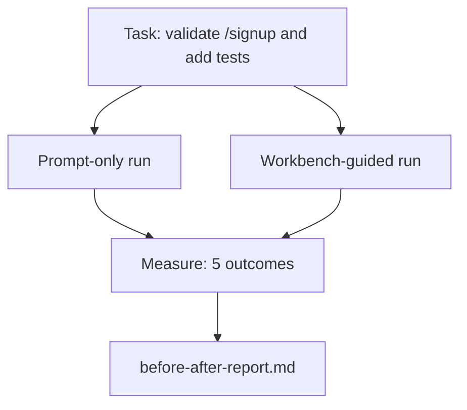

<!-- local-zh-machine-draft: English source is canonical; prose translated automatically, code/math preserved. -->

<a id="the-workbench-on-a-real-repo"></a>

# 在真实代码仓库中使用工作台

> 11个表面的课如果无法与真正的代码库接触,就毫无意义。 prompt- 只能对着工作台指导,数字可以做争论

**类型：** 构建
**语言:** Python (stdlib)
**先修要求:** 阶段14 · 32 至 14 · 40
**时间:** ~60分钟

<a id="learning-objectives"></a>

## 学习目标

- 将七个工作台的表面 放在一个小的应用上
- 运行相同的任务两次( ) (N)prompt- 仅以工作指南为指导)和衡量五项结果。
- 阅读报告前后,决定哪些表面能发挥最大的影响力。
- 保护工作台 防止"但我的模特够好"的倒退

<a id="the-problem"></a>

## 问题

玩具任务演示不会让任何人信服。 当生产中真实的情感回波土地发生真正痛苦的任务,失败较少、回归更少、下个会话可以使用的包包时,工作台就成了一个理由。

课程中包含真实的回波, 并且通过两个管道执行同样的任务。 结果是一个报告之前/之后, 您可以将报告交给怀疑者 。

<a id="the-concept"></a>

## 概念



<a id="the-sample-app"></a>

### 样本应用

一点点 FastAPI- 风格处理器 `sample_app/`:

- `app.py` 与 `/signup` (尚未确认)
- `test_app.py` 做一个快乐的测试
- `README.md` 和 `scripts/release.sh` 做为禁区诱饵

<a id="the-task"></a>

### 任务

> 添加输入验证到 `/signup`:拒绝短于8个字符的密码,返回 422 并输入错误信封。添加一个测试来证明新的行为。

<a id="the-two-pipelines"></a>

### 这两条管道

Prompt-仅:

1. 读读看
2. Read `app.py`.
3. 编辑文件 。
4. 索赔完成。

Workbench-guided:

1. 运行 Init 脚本( 列松 35) 。
2. Read scope contract (Lesson 36)。 参考文件
3. 读状态( Lesson 34) 。
4. 只编辑允许的文件 。
5. 通过反馈运行程序( Lesson 37) 运行接受命令 。
6. Run verification gate (列松38)。
7. 运行审查员( Lesson 39) 。
8. 生成 handoff (Lesson 40)。 电话:

<a id="the-five-outcomes-measured"></a>

### 衡量的五个结果

| Outcome | 为何重要 |
|---------|----------------|
| `tests_actually_run` | 多数“通过测试”的索赔无法核实 |
| `acceptance_met` | 证明目标的测试 一定是运行的测试 |
| `files_outside_scope` | 范围爬行是主要的沉默失败 |
| `handoff_quality` | 下一届大会为此付出代价或受益 |
| `reviewer_total` | 门顶的定性判断 |

```figure
wb-ab-runs
```

<a id="build-it"></a>

## 动手实现

`code/main.py` 将两条管道对准同一样件的装置固定。 LLM ),这样测量就可以复制。脚本将比较写入 `before-after-report.md` 和 `comparison.json`.

运行：

```
python3 code/main.py
```

产出:每个管道的成果控制台 markdown 报表保存在脚本旁边, JSON 给想画图的人

<a id="production-patterns-in-the-wild"></a>

## 野生生物的生产模式

怀疑者的问题是 “工作台能帮到什么?”2026年的数字比解释要多。

**30对5的顶级法官 同一模型** LangChain的 *解剖学 Agent Harness* 2026年4月:a 国家 coding agent 跳出前30名,在2.0号航站楼排第5位,仅更改 harness同样的模型,不同的表面,25级三角洲

**使用删除工具的 Vercel 80% 到 100% 。** Vercel 报告称删除80%的 agent工具将成功率从80%移动到100%。 小工具表面, 更清晰的视野, 更少失败的方法。 负空间获胜 。

**哈维2x精确度通过 harness alone.** Legal agents 超过两倍的精确度 harness 优化,没有模式变化。

**88%的企业独立 agent 项目未能达到生产。** 预印. org *Harness 语文工程 Agents* 论文(2026年3月) traces 失败的时间,而不是推理:状态衰败, 疲惫的回旋, 过度的景象, 从中间错误中恢复的差。

**长通功崩溃** WebAgency 基线40-50%的成功率在长文本条件下下降到10%以下,主要来自无限环和目标损失。 handoff 包是用来吸收的

**假阴性的东西仍然存在。** 单步的事实任务,一行线线, 任何模型的文字, 都逐字记着—— 这些动作更快 prompt基准应该诚实地列出来 这样工作台就不会被设定为超能力

外卖不是"harness 永远赢不了,模特儿会吸收 harness 时间的诡计。外卖是今天, 工程负荷在7个表面, 数字证明了这一点。

<a id="use-it"></a>

## 实际应用

此课是您引用的文档 :

- 有人问为什么每个公关都带着 `agent-rules.md` 和一个 scope contract.
- 一支队伍想放弃 verification gate "只是为这个短跑。"
- 一个新的 agent 产品启动后,您需要使用一个可移植的基准来判断它是否真的节省了时间。

数字比解释还要远

<a id="ship-it"></a>

## 交付成果

`outputs/skill-workbench-benchmark.md` 是一个可移动的 evaluation harness 运行 agent 产品通过两个管道对照项目自己的样本应用,并报告这五个结果。

<a id="exercises"></a>

## 练习

1. 添加第六个结果:即时间到最有意义的编辑。你如何用干净的尺度衡量它?
2. 在您的代码库中运行一个真正的第二天任务的比较。 工作台数字会滑落到哪里 ?
3. 添加“ 假阴性” 通行证: 任务所在 prompt- 工作台的收费是实实在在的
4. 替换脚本 "agent和真正的 LLM 哪个结果更能引起注意?
5. 作者为非工程师撰写了一页的概要。什么能活下来?

<a id="key-terms"></a>

## 关键术语

| 术语 | 人们怎么说 | 它实际上意味着什么 |
|------|----------------|------------------------|
| 样本应用程序 | 玩具回购 | 体积小,但现实到可以锻炼所有七层表面 |
| 管道 | "Workflow" | 表面读取/写法的顺序 agent follows |
| 报告之前/之后 | 收据 | 你手头的文物 是一个怀疑论者 |
| 假阴性 | "工作太过份" | 任务所在地 prompt- 只会更快; 有用于诚实地列举 |
| 工作基准 | 可靠性评分 | Portable harness 运行您的代码库的比较 |

<a id="further-reading"></a>

## 进一步阅读

- [LangChain解剖学 Agent Harness](https://blog.langchain.com/the-anatomy-of-an-agent-harness/) 30至5级顶层法官
- [蒙戈DB, 缩写 Agent Harness:为什么 LLM 是你的最小的一部分 Agent System](https://www.mongodb.com/company/blog/technical/agent-harness-why-llm-is-smallest-part-of-your-agent-system) - Vercel + Harvey 数字
- [preprints.org, Harness 语文工程 Agents](https://www.preprints.org/manuscript/202603.1756) 88%的企业失败率,运行时间根源
- [HN:改进 15 LLMs 在一个下午的编码中。 Harness Changed](https://news.ycombinator.com/item?id=46988596) 15种模式复制
- [云花, 按比例操作 AI 代码审查](https://blog.cloudflare.com/ai-code-review/) - 131公里审查运行/生产30天
- [Anthropic建设有效 Agents](https://www.anthropic.com/research/building-effective-agents)
- 14阶段 32至14 40——这一课的表层进行端到端练习
- 阶段14 - 19——SWE-Bench、GAIA、Bench代理作为宏观基准,补充这一课程
- 阶段14 30 - 由评价驱动 agent 发展 harness 插入
