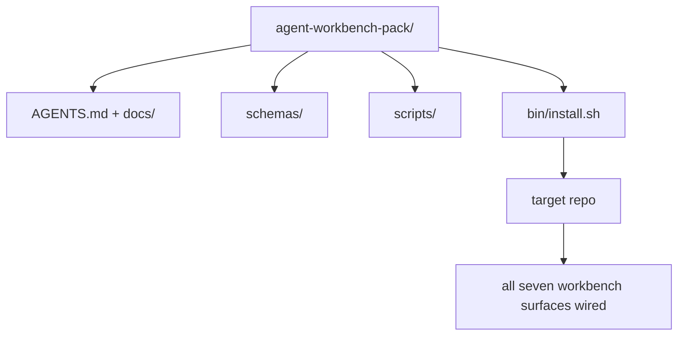

<!-- local-zh-machine-draft: English source is canonical; prose translated automatically, code/math preserved. -->

<a id="capstone-ship-a-reusable-agent-workbench-pack"></a>

# 综合项目：交付可复用的 Agent 工作台包

> 迷你轨道结尾时, 您会将一个包丢入任何重写 。 11个表层的课被压缩到目录中 `cp -r` 并有一个 agent 第二天早上工作可靠 综合项目就是课程的手工艺品

**类型：** 构建
**语言:** Python (stdlib)
**先修要求:** 阶段14 · 31-14 · 41
**时间:** ~75分钟

<a id="learning-objectives"></a>

## 学习目标

- 将七个工作台表面包成一个空位目录。
- 将图案、脚本和模板插入到一个已知的好基线中。
- 添加一个单安装器脚本, 以自动设定包 。
- 选择什么留在包里什么 和什么留在外面, 为每一个的削减。

<a id="the-problem"></a>

## 问题

谷歌 Doc 中包含一个工作平台,一个聊天史,还有三个半记不记的脚本,就是每个季度重建的工板。 解药是一个版本的包:一个有表面、图案、脚本和单指令安装器的折叠或目录。

以这堂课结束 `outputs/agent-workbench-pack/` 以磁盘和A发运 `bin/install.sh` 就会掉进任何目标回收站

<a id="the-concept"></a>

## 概念



<a id="the-pack-layout"></a>

### 包的布局

```
outputs/agent-workbench-pack/
├── AGENTS.md
├── docs/
│   ├── agent-rules.md
│   ├── reliability-policy.md
│   ├── handoff-protocol.md
│   └── reviewer-rubric.md
├── schemas/
│   ├── agent_state.schema.json
│   ├── task_board.schema.json
│   └── scope_contract.schema.json
├── scripts/
│   ├── init_agent.py
│   ├── run_with_feedback.py
│   ├── verify_agent.py
│   └── generate_handoff.py
├── bin/
│   └── install.sh
└── README.md
```

<a id="what-stays-in-what-stays-out"></a>

### 里面有什么,外面什么

在:

- 地表图,这是合同
- 上面四个剧本,它们已经是运行时间了
- 四张医生,他们是规矩和标志

Out:

- 任务属于目标回收站董事会,而不是包里
- Vendor SDK 电话,包是框架不可知性的
- 随军传言,他们住在队伍旁边

<a id="the-installer"></a>

### 安装器

短短的 `bin/install.sh` (或 `bin/install.py`):

1. 拒绝安装在已有的包上 `--force`.
2. 复制包到目标回收站
3. 线人 `.github/workflows/` exists.
4. 打印下一步: 填入棋盘, 设置接受命令, 运行 Init 脚本 。

<a id="versioning"></a>

### Versioning

背包里装着 `VERSION` 文件。 需要迁移的图表突围和脚本修改会撞击主页。 仅使用文档的更改会撞击 patch目标折叠 `agent_state.json` 被初始化的组合版本记录 。

```figure
wb-pack-install
```

<a id="build-it"></a>

## 动手实现

`code/main.py` 将包组成 `outputs/agent-workbench-pack/` 旁边的课, 以先前的课文和剧本 和您已经写的文档 来播种。

运行：

```
python3 code/main.py
```

脚本复制并钉住表面, 写着 README, 打印包树, 并退出零。 重新运行是一流的 。

<a id="production-patterns-in-the-wild"></a>

## 野生生物的生产模式

包只有在叉子、更新和不友好的上游生存下来时才有价值。四种模式使它发挥作用。

**`VERSION` 是合同,不是营销。** 大型撞车需要州级迁移,小型撞车需要重新运行检查器。 Patch 撞击只限 doc 。 安装者写道 `.workbench-version` 进入每个安装装置的目标回收站; `lint_pack.py` 如果目标的锁与包的不吻合 拒绝发货 `VERSION`。这是如何 `npm`, `Cargo`, 和 `pyproject.toml` 活了十年,没什么 agents 改变规则

**跨工具分布的单一源。** 一艘Nx船 `nx ai-setup` 躺着 `AGENTS.md`, `CLAUDE.md`, `.cursor/rules/`, `.github/copilot-instructions.md`, 和一个 MCP 服务器从一个配置中。 包应该同样操作; 安装者会发送符号链接( )`ln -s AGENTS.md CLAUDE.md`所以,一个单一的真理源 粉丝向每一个 coding agent。将组合组合以支撑一个工具超越另一个工具是一个失败模式。

**`uninstall.sh` 拒绝非三重状态。** 卸载包时不能删除用户的 `agent_state.json`, `task_board.json`, 或 `outputs/`。未安装者删除了图案、脚本、文件,以及 `AGENTS.md` (与 `--keep-agents-md` 国家文件的修改没有被强制,因此国家拒绝进行。 国家属于用户;国家并不拥有国家档案。

**技术可推广,技能可推广。** 船群是技术训练技能 `skillkit install agent-workbench-pack` 铺在32AI上 agents 发件人来自单一来源。 背包是真理的来源; 斯基利特是分配渠道。 供应商锁定崩溃; 七个表面保持不变 。

<a id="use-it"></a>

## 实际应用

3个位置的船群:

- **作为目录,你投进回购。** `cp -r outputs/agent-workbench-pack /path/to/repo`.
- **做为公共模板的复制品** 叉子和定制,与 `VERSION` 控制着漂移
- **以技能为本** 已经连接到你的 agent 生产,所以一个命令放下它。

包是配方,每套都是服务

<a id="ship-it"></a>

## 交付成果

`outputs/skill-workbench-pack.md` 生成一个项目调控的包: 规则与团队的历史更加明确, 范围球与回波匹配, 卢布尺寸扩大, 并有一个特定域条目 。

<a id="exercises"></a>

## 练习

1. 决定哪些可选的第五大博士 值得提升为大军团
2. 将安装者重写为 Python 以 a 为单位 `--dry-run` 国旗。比较人文工程学与振荡。
3. 添加a `bin/uninstall.sh` 并拒绝国家档案中存在非三重历史。 什么是非三重历史?
4. 添加a `lint_pack.py` 背包从 `VERSION`把它发给线人 给他们自己收买
5. 作者将手动工作台的迁移运行簿写到此包。 如何排序操作以最小化停机时间 ?

<a id="key-terms"></a>

## 关键术语

| 术语 | 人们怎么说 | 它实际上意味着什么 |
|------|----------------|------------------------|
| 工作台包 | "启动器包" | 包含全部七面的版本目录 |
| Installer | "设置脚本" | `bin/install.sh` 将一无所有地放下 |
| 包装版本 | "VERSION" | 方案/脚本变化的主要撞击, patch 仅用于 doc |
| 投放包 | 来,走 | 包装工作没有在第一天按每个翻新项目定制 |
| 可折叠模板 | "GitHub template" | 公开回购 GitHub的“ 使用此模板” 可以复制到 |

<a id="further-reading"></a>

## 进一步阅读

- 14阶段 31至14阶段 41级——每个表面这些包包
- [SkillKit](https://github.com/rohitg00/skillkit) 在整个32个AI中安装这种技能 agents
- [Nx 博客, 教书 Agent 如何在垄断者中工作](https://nx.dev/blog/nx-ai-agent-skills) 6个工具的单一源生成器
- [agents. md - 开放的规格](https://agents.md/) - 你包里的路由器必须执行的
- [HKUDS/OpenHarness](https://github.com/HKUDS/OpenHarness) 参考执行一个包等量
- [增强代码,很好 AGENTS. md 是模型升级](https://www.augmentcode.com/blog/how-to-write-good-agents-dot-md-files) - 包装文件质量栏
- [Anthropic有效 harnesses 长长的 agents](https://www.anthropic.com/engineering/effective-harnesses-for-long-running-agents)
- [Anthropic, Harness 设计用于长期应用开发](https://www.anthropic.com/engineering/harness-design-long-running-apps)
- 阶段14 30 - 由评价驱动 agent 开发消耗的包 verification gate
- 阶段14 - 41——本套基准前后的改进
