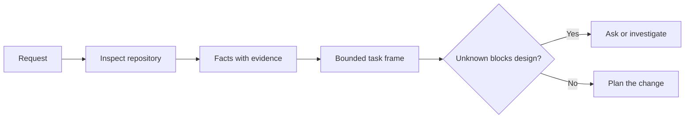

<!-- local-zh-machine-draft: English source is canonical; prose translated automatically, code/math preserved. -->

<a id="frame-the-task-before-the-agent-writes-code"></a>

# 在 Agent 编写代码前界定任务

> 一个 coding agent 能够快速执行明确的任务。 它也可以快速执行一个不明确的任务。 速度相同。 成本不同 。

**类型:** 学习 + 构建
**语言:** Python (stdlib)
**先修要求:** 第14阶段的31和36项经验教训
**时间:** ~60分钟

<a id="learning-objectives"></a>

## 学习目标

- 在编辑前将请求转换成一个封闭的任务框架 。
- 将存储处的事实与假设和开放问题分开。
- 定义允许路径、禁止路径和接受证据。
- 何时进行侦察才能开始工作

<a id="the-expensive-failure"></a>

## 昂贵的失败

“ 添加重复的电子邮件保护” 听起来很具体。 它不是。 独特性是否属于 API、 域服务或数据库? 比较是否对大小写敏感? 哪个错误形状已经公开? 是否允许迁移? 哪种测试可以证明行为?

有能力的 agent 这样做很危险,因为实施过程可以干净、测试,并且仍然与系统不兼容。

首个编码单位agent 因此,工作不是一个编辑。 它是一个任务框架, 由仓库证据支持 。

<a id="the-task-frame"></a>

## 任务框架

一个有用的框架有六个领域:

| Field | 问题 |
|---|---|
| 目标 | 什么样的可见行为必须改变? |
| 仓库事实 | 你验证了什么代码,测试,配置,或历史? |
| 允许路径 | 哪里可以改变土地? |
| 禁止路径 | 还有什么必须保持不动? |
| 接受证据 | 哪些命令或观察证明目标? |
| Unknowns | 哪些决定还需要证据或人类判断? |

事实需要收据。 API 重复使用 409 。 在您能够指向现有的测试或处理器之前, 这并不是事实。 文件路径和行就足够了。 当行为重要时, 命令结果会更好 。



<a id="reconnaissance-is-a-search-for-constraints"></a>

## 侦察是寻找限制

不读取整个仓库。 搜索限制更改的表面 :

1. 目前的行踪和它的来电者
2. 最近的测试
3. 公共合同或序列式的形状。
4. 路径上的项目指示 。
5. 建筑和核查命令
6. 类似的已完成变化, 揭示了本地模式 。

停止任何有计划的决定,或者有证据支持,或者明确授权,或者被列为未知。 之后的阅读往往会避免。

<a id="unknowns-are-not-failures"></a>

## 未知并非失败

未知是控制缺陷,一种假设是对这一差距的无节制的答案。

分类每个未知的 :

- **Discoverable:** 存储器或运行系统可以回答它。
- **Decidable:** 任务合同中给出的 agent 有权选择。
- **Human:** 选择会改变产品的行为、成本、风险或公众兼容性
- **Deferred:** 选择是在这个片子之外,属于非目标。

该 agent 应该在未知的未知中继续。 在选择被隐藏在代码中之前,它应该停留在未知中。

<a id="acceptance-before-implementation"></a>

## 执行前接受

写证据 patch证据可以是:

- 集中单元或集成测试命令;
- 带有命名的视图站和预期状态的浏览器行程;
- 电汇请求和准确答复合同;
- 具有门槛值的业绩计量;
- 检查范围, 确认没有更改过不相关的文件 。

“考试通行证”不是一项证明计划,请指明权威检验及其支持的主张。

<a id="build-it"></a>

## 动手实现

实验室创造了一个 `TaskFrame`,确认其边界和证据,并写 `outputs/task-frame.md`.

从此课程目录运行 :

```bash
python3 code/main.py
python3 -m unittest discover code/tests -v
```

以四种方式打破这个示例:删除目标,删除事实接收,重叠允许和禁止路径,并删除接受命令。验证人应该以不同的理由拒绝每个框架。

<a id="use-it-in-a-real-repository"></a>

## 在真正的仓库中使用它

问之前 agent 要编辑的 :

1. 将目标写成行为,而不是文件变更。
2. 记录两三个事实 并附上确切的证据
3. 列出最小允许路径集 。
4. 明确列出负空格 。
5. 写入结束任务的命令或观察 。
6. 列出您尚未获得的决定 。

框架应适合一个屏幕。 如果它不能, 任务可能包含多个可独立核实的更改 。

<a id="exercises"></a>

## 练习

1. 在您的仓库中设置一个真正的错误, 而不提出解决方案 。
2. 在假设的框架内找到一项索赔,代之以证据。
3. 加上一个未知的人 答案会改变公约
4. 将一条宽宽的通道分割成最小的安全区
5. 在验收证据中添加范围收据。

<a id="further-reading"></a>

## 进一步阅读

- [Nuseibeh和复活节布鲁克,《需求工程:路线图》](https://www.cs.toronto.edu/~sme/papers/2000/ICSE2000.pdf),使执行工作与现实世界的目标和不断变化的制约因素挂钩。
- [Yang等人,瑞典环境与能源署agent: Agent- 计算机接口启用自动软件工程](https://arxiv.org/abs/2405.15793),以证明 coding agent 改变其效力。

<a id="what-you-keep"></a>

## 你留着什么

Keep `outputs/task-frame.md`。这是对下一个课程的投入,在这个课程中,框架成为证据支持的执行计划。
