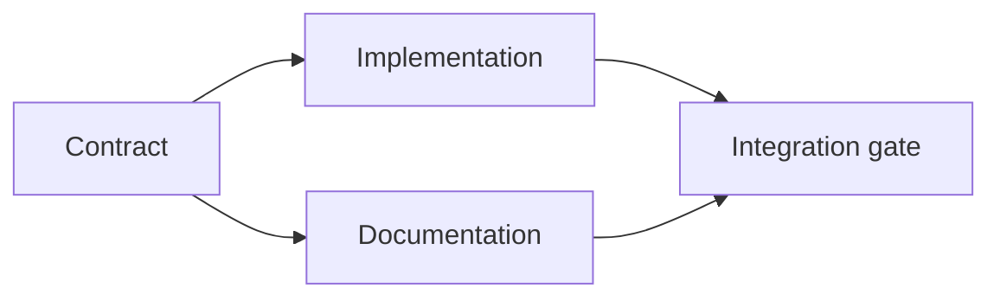

<!-- local-zh-machine-draft: English source is canonical; prose translated automatically, code/math preserved. -->

<a id="build-an-evidence-backed-execution-plan"></a>

# 制定有证据支撑的执行计划

> 计划不是一个更漂亮的待办列表。 它是一个依赖性图表, 每一个变化都有其原因, 每个终端节点都有证据 。

**类型:** 学习 + 构建
**语言:** Python (stdlib)
**先修要求:** 第14阶段课程 43
**时间:** ~65分钟

<a id="learning-objectives"></a>

## 学习目标

- 将任务框架转换成有证据和证据的工作项目。
- 模型按依赖性排序,而不是按分导顺序排列。
- 发现缺失的事实、不明的依存关系和编辑前的周期。
- 分开的步骤可以一起运行 从必须等待的步骤。

<a id="why-agent-plans-fail"></a>

## Why Agent 计划失败

未来时局下,

1. 更新 API.
2. 添加测试。
3. 更新文件。

清单中没有任何内容说明发现什么,为什么这些文件是正确的,哪些合同首先更改,或者同时发生什么。 agent 它可以跟随每一步 并且仍然创造的重新工作。

一项强有力的计划为每个工作项目作出五项承诺:

| Commitment | 目的 |
|---|---|
| Identifier | 依赖性和 handoff |
| 改变 | 最小的行为或合同变化 |
| 证据 | 说明更改理由的仓库事实 |
| Dependencies | 工作必须先真实 |
| Proof | 关闭此项的确切检查 |

<a id="plan-the-contract-before-its-implementations"></a>

## 合同实施前的计划

当多个表面依赖于相同的行为时, 请先定义行为 。 然后测试、 执行、 文件及整合可以共享一个合同, 而不是发明四个版本 。



图表显示安全同价货币,合同完成后,可以同时执行和编制文件。

<a id="evidence-changes-the-plan"></a>

## 证据 改变计划

仓库证据不是装饰品,它应该能够改变工作:

- 现有的助手删除了计划的新抽象。
- 兼容性测试迫使人们迁移一步。
- 部署限制将一个方案改变为另一个任务。
- 公共响应类型改变执行和文件的顺序。

如果证据不能改变计划,则可能不是作出这一决定的证据。

<a id="design-for-interruption"></a>

## 中断设计

Coding-agent 工作项目小到足以让另一届会议确定:

- 哪些项目是完整的;
- 证明是哪一种;
- 哪些文物已经改变;
- 其附属关系现已解除;
- 下一个安全物品是什么?

不要只在聊天中的复选框中编码状态。 将计划保存在工作旁 。

<a id="plan-validation"></a>

## 计划验证

执行前拒绝计划,如果:

- 标识符被复制;
- 工作物品没有证据;
- 工作项目没有证据;
- 附属名称:未知项;
- 图表包含一个周期;
- 有关不确定性得到解决之前,首先采取不可逆转的行动。

头五项检查是机械性的,最后一项需要判断,应该明确提出。

<a id="build-it"></a>

## 动手实现

`code/main.py` 模拟工作项目, 验证其收据, 用一种地形学的排序计算执行波, 并写入 `outputs/evidence-plan.json`.

Run:

```bash
python3 code/main.py
python3 -m unittest discover code/tests -v
```

示例产生三波。 合同定义先运行, 执行和文档一起运行。 整合大门最后运行 。

<a id="use-it-with-a-coding-agent"></a>

## 用它来 Coding Agent

问 agent 来在修改文件之前先提出计划。

1. 每一个路径和行为要求都有存库收据
2. 每个项目都有一份明确的完成证明。
3. 图表推迟了昂贵或不可逆转的工作,直到它所依赖的不确定性得到解决。

批准计划,不要含糊承诺要小心。

<a id="exercises"></a>

## 练习

1. 添加需要明确人类批准的移民项目。
2. 创建循环,解释隐藏的产品差异。
3. 拆分一个有两个验证命令的项目 。
4. 添加一个可以在第二波运行而不会触动任何现有工作项目 branch.
5. 计划是 Markdown 保留 JSON 成为真相的源泉

<a id="further-reading"></a>

## 进一步阅读

- [Nuseibeh和复活节布鲁克,《需求工程:路线图》](https://www.cs.toronto.edu/~sme/papers/2000/ICSE2000.pdf),指目标、规格、协议和演变之间的迭接关系。
- [Barry Boehm,软件开发和增强螺旋模型](https://dl.acm.org/doi/10.1145/12944.12948),用于围绕风险解决而不是固定线性序列来命令发展。

<a id="what-you-keep"></a>

## 你留着什么

Keep `outputs/evidence-plan.json`。它成为 delegation 合同在下一个课程。
