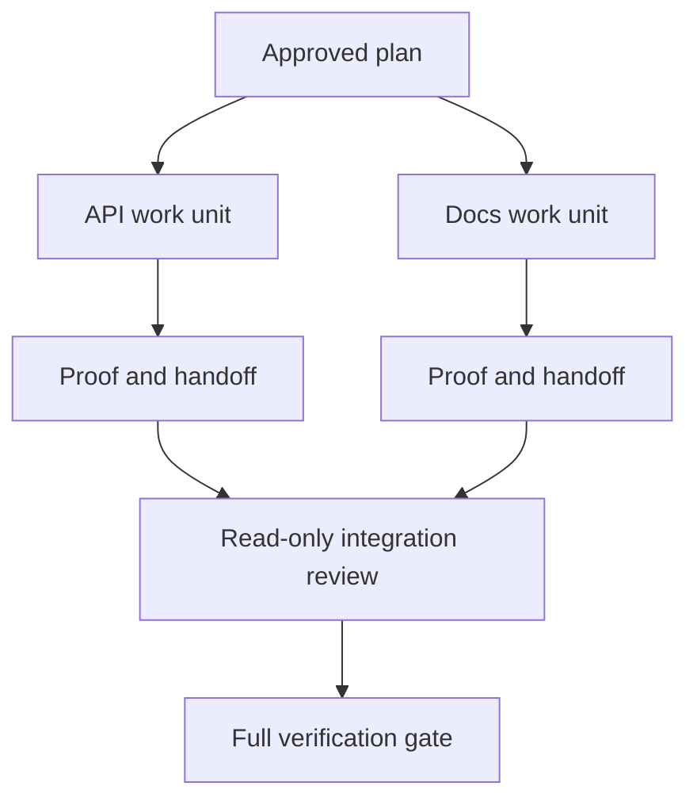

<!-- local-zh-machine-draft: English source is canonical; prose translated automatically, code/math preserved. -->

<a id="delegate-agent-work-with-isolation-and-merge-contracts"></a>

# 通过隔离与合并契约委派 Agent 任务

> Parallel agents 仅在工作独立时保存墙上的时间。 否则, 他们将一个明确的任务转换成协调问题, 失败率会更快 。

**类型:** 学习 + 构建
**语言:** Python (stdlib)
**先修要求:** 第14阶段课程39和44
**时间:** ~70分钟

<a id="learning-objectives"></a>

## 学习目标

- 决定 delegation 真正的独立是正当的。
- 给每个工人独家文件所有权和明确证据。
- 计算从依赖方处发出的执行波。
- 设计合并合同 agent 安全地工作,我们不会有事的

<a id="the-parallelism-test"></a>

## 平行主义试验

不授权, 因为更多 agents 代表至少当其中之一属实时:

- 两项调查可独立地回答不同的未知问题;
- 两个执行机构拥有不连的档案和合同;
- 检查者可以检查已完成的文物,而不更改;
- 本地工程继续时, 缓慢的外部检查可以运行 。

保持连续工作 agents 需要相同的文件, 相同的未解决的决定, 或者相同的变异环境 。

<a id="a-work-unit-is-a-contract"></a>

## 工作单位是合同

每个授权单位需要:

| Field | 含义 |
|---|---|
| 目标 | 一项可观测结果 |
| Owner | 一个负责任的工人 |
| Paths | 独家写作所有权 |
| Dependencies | 启动前需要完成的单位 |
| Proof | 确切的证据已退还给集成者 |
| Handoff | 更改文件、作出决定、保留风险 |

“控制后端”不是一个工作单位。 `app/accounts.py` 并用重点账户测试来证明它。”

<a id="isolation-has-three-layers"></a>

## 隔离有三个层

1. **文件系统孤立 :** separate worktrees 或 sandboxes 防止意外共享编辑 。
2. **所有权孤立:** 合同禁止两名工人故意编辑同一路线。
3. **国家隔离:** 单项的日志和产出防止一名工人背信另一名工人的证据。

文件系统隔离无法解决所有者问题。 2 个干净 worktrees 合并合同必须在工作开始前解决共享界面问题。



<a id="the-integrator-does-not-rebuild-the-work"></a>

## 集成器不重建工程

集成者应:

1. 确认每个 handoff 符合其规定的范围;
2. 阅读证明输出,而不仅仅是工人摘要;
3. 合并了抚养权单的变动;
4. 运行全套跨单元大门;
5. 拒绝隐藏的扩展范围;
6. 将冲突记录为新决定,而不是静悄悄的编辑。

如果融合需要重新写下工人的大部分结果,那么原来的分解是错误的。

<a id="human-and-agent-roles"></a>

## 人类和 Agent Roles

Delegation 人类仍然拥有改变公共行为、风险、权威或不可逆转成本的选择。 Agents 能够拥有有约束性的调查、执行、核查和审查。

这是经过校准的自主性:当证据和证据被证明时,该系统就给予自由。 rollback 强大,需要 checkpoint 其后果是重大的。

<a id="build-it"></a>

## 动手实现

实验室检查路径重叠, 验证依赖关系, 计算安全执行波, 并写入 `outputs/delegation-plan.json`.

Run:

```bash
python3 code/main.py
python3 -m unittest discover code/tests -v
```

更改文件单位为所有 `app/`。计划应该屏蔽,因为母路径重叠 API unit.

<a id="exercises"></a>

## 练习

1. 将真正的变化分解成两个独立的工作单位和一个集成器。
2. 找到一个只看似独立的平行分割。 声明共同决定 。
3. 添加只读的研究人员,其产出为事实表格。
4. 添加一个合并门,检查所有单位合同的最后修改文件。
5. 界定对依赖关系失效的工人的取消规则。

<a id="further-reading"></a>

## 进一步阅读

- [Reid Smith,合同净额协议](https://doi.org/10.1109/TC.1980.1675516),以便及早正式处理分配的任务分配和成果报告。
- [Eric Horvitz, 混合倡议用户界面原则](https://dl.acm.org/doi/10.1145/302979.303030),决定自动化何时应采取行动,何时应把控制权交还给一个人。

<a id="what-you-keep"></a>

## 你留着什么

Keep `outputs/delegation-plan.json`。它记录了为什么分裂是安全的,谁拥有每一个路径,以及必须获得什么证据。
