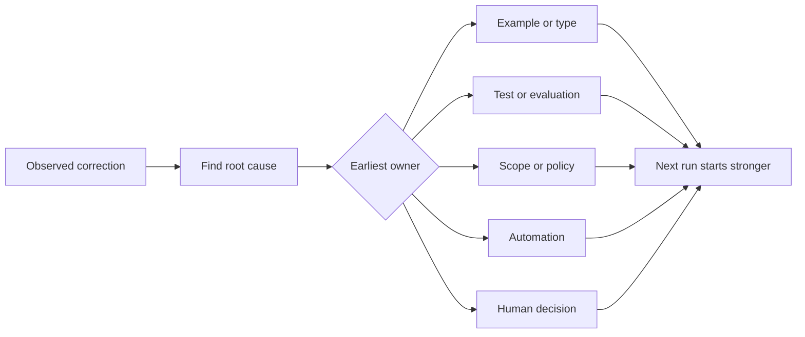

<!-- local-zh-machine-draft: English source is canonical; prose translated automatically, code/math preserved. -->

<a id="turn-every-agent-correction-into-a-system-improvement"></a>

# 把每一次对 Agent 的纠正转化为系统改进

> 仅以聊天方式保存的校正会修正一个运行。 校正会促进到测试、 边界、 示例或工具中, 以后都会改进 。

**类型:** 学习 + 构建
**语言:** Python (stdlib)
**先修要求:** 第14阶段的教训 37至41
**时间:** ~65分钟

<a id="learning-objectives"></a>

## 学习目标

- Convert agent 改为耐久控制。
- 将每种控制置于可以防止重现的最早层。
- 重复使用稳定的指纹进行重复教学。
- 退休者控制不再能保护真正的风险

<a id="corrections-are-evidence"></a>

## 惩戒就是证据

当你告诉 agent “ 不编辑该文件 , ” 您已经知道范围边界无法执行。 当你说“ 这个输出形状是错误的 ” 时, 您已经知道缺少了一个示例或测试。 当设置再次失败时, 您已经知道环境知识属于自动化 。

将更正视为对工作系统的观察,而不是作为 prompt-写作失败

<a id="promote-to-the-earliest-effective-layer"></a>

## 提升至最强烈的有效层

使用此顺序 :

| 重复性故障 | 持久目的地 |
|---|---|
| 错误的结果或回归 | 测试或 evaluation |
| 非大规模或不安全行动 | 范围或许可政策 |
| 重复设置或命令错误 | 自动或工具 |
| 重复输出格式错误 | 罐头示例加验证符 |
| 模糊的地方公约 | 带有情景检查的指示 |
| 产品分歧 | 人类决策记录 |

早期控制比较便宜。 防止无效状态的类型比评论稍后再捕捉它更强。 集中测试比段落询问更强 agent 记住。



<a id="the-ratchet-record"></a>

## 利刃记录

Capture:

- symptom;
- 根源;
- consequence;
- 重现计数;
- 选定的控制;
- 控制核查;
- owner;
- 日期审查或退休。

不要促进每一种一次性的偏好。当重复或后果证明永久性复杂时,促进纠正。

<a id="separate-cause-from-symptom"></a>

## 由症状分开的原因

“The agent 经编辑的README是一种症状。

- 任务允许仓库根;
- 医生被隐含地视为安全;
- 计划捆绑的执行和文件;
- 两名工人的所有权重叠。

每种原因都属于不同的控制。 仅仅重复症状的规则在下一个略有不同的情况下将失败。

<a id="controls-also-decay"></a>

## 控件也衰变

旧的控制程序可以对上下文进行冲突, 并编码一个不再存在的系统。 每个被推广的规则都需要检查退休情况。 当以下情况下删除或重写它:

- 基本结构发生了变化;
- 更强大的可执行控制取代了它;
- 失败没有在有意义的窗口中重复发生;
- 控制制造的摩擦比它防止的风险还多

目标不是最长的指令文件,而是保留来之不易判断的最小系统。

<a id="build-it"></a>

## 动手实现

实验室将更正分类,将其推广到控制系统,指纹重复,并写 `outputs/feedback-ratchet.json`.

Run:

```bash
python3 code/main.py
python3 -m unittest discover code/tests -v
```

添加两个措辞不同的更正, 其原因相同。 normalization 直到他们崩溃 进入一个控制区 而不崩溃无关的失败。

<a id="exercises"></a>

## 练习

1. 将最近一个编码会话的5项更正进行分类。
2. 用可执行测试取代一个发音规则 。
3. 加上后果加权,这样就可以立即促进严重初次发生。
4. 给实验室输出添加一个所有者和退休日期 。
5. 审查现有的1个 agent 指令,只有在证明存在更强的控制后,才删除。

<a id="further-reading"></a>

## 进一步阅读

- [巴西利、卡尔迪埃拉和隆巴赫,目标问题计量方法](https://www.cs.toronto.edu/~sme/CSC444F/handouts/GQM-paper.pdf)将目标变成问题和操作测量
- [Shinn等人,反省](https://arxiv.org/abs/2303.11366),用于使用反馈 traces 改进以后的决定,不改变模式 weights.
- [Madaan等人,自译自审](https://arxiv.org/abs/2303.17651),用于在任务循环中进行迭代反馈和修改。

<a id="what-you-keep"></a>

## 你留着什么

Keep `outputs/feedback-ratchet.json`。它是持久结束 Agent- 协助工程路径和对未来工作平台变化的投入。
