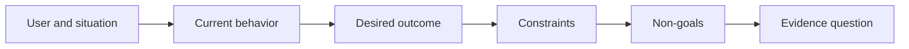

<!-- local-zh-machine-draft: English source is canonical; prose translated automatically, code/math preserved. -->

<a id="define-the-outcome-before-you-choose-the-output"></a>

# 先定义预期成效，再选择交付形式

> 快速执行会加重选择错误问题的处罚。 将结果先摆放, 以便速度指向正确的方向 。

**类型:** 学习 + 构建
**语言:** Python (stdlib)
**先修要求:** 无
**时间:** ~60分钟

<a id="learning-objectives"></a>

## 学习目标

- 写一个结果框架,不指定解决方案。
- 识别用户、状况、当前行为和预期变化。
- 明确限制和非目标。
- 在溶液变硬前先检测出渗漏

<a id="output-is-not-outcome"></a>

## 输出不是结果

“造事件助理”指出一个输出,它没有说明谁需要,什么变得更好,或者什么必须保持安全。

成果框架说:

> 当生产警报到达时,待命工程师在两分钟内确定服务失败和下一个安全行动,而诊断仍然只供阅读和审计。

这句话可以用软件、运行簿、数据修理或小界面的改变来满足。 它让团队能够连接结果而不是第一个被想象出来的人工制品。

<a id="the-six-part-frame"></a>

## 六部分框架

| 部分 | 问题 |
|---|---|
| User | 谁直接经历这个问题? |
| 情况 | 何时何地发生? |
| 当前的行为 | 今天发生了什么,包括工作变通? |
| 预期成果 | 哪些可观察到的状况应当改善? |
| Constraints | 哪些安全、政策、成本或兼容性限制是固定的? |
| Non-goals | 排除了哪些邻近的诱人工作? |



<a id="find-solution-leakage"></a>

## 查找解决方案渗漏

成果说明中如果含有一种产品形式、界面、模型选择、框架或建筑,而没有证据,就会泄漏解决方案。

- “用户收到一份每周AI摘要”泄露了摘要和内容。
- “用户在批准前了解账户变动” 表示结果。
- “部署a vector database”基础设施漏水。
- “审查期间可获得相关的政策证据”,这表明了一种能力。

当兼容性真正修正它时, 限制可以命名技术。 记录它为什么被固定 。

<a id="constraints-protect-the-outcome"></a>

## 保护结果的制约因素

制约因素不是执行的细节,而是现实世界目标的一部分:

- 诊断期间没有制作作品;
- 在事故时间预算内作出反应;
- 现有的审计活动仍然具有权威性;
- 没有新的运行时间依赖性;
- 无障碍行为仍然完整。

违反限制而取得结果的建筑没有取得结果。

<a id="non-goals-create-a-boundary"></a>

## 建立边界的非目标

非目标阻止了有用的片段变成一个平台。

- 没有自动补救;
- 没有新的警报路径系统;
- 事件指挥官没有替换;
- 切片中没有任何历史分析。

<a id="build-it"></a>

## 动手实现

实验室确认 `OutcomeFrame` 并写 `outputs/outcome-frame.json`.

```bash
python3 code/main.py
python3 -m unittest discover code/tests -v
```

将预期结果改为“使用事件助理”。 验证人应表明拟议产出渗入结果。

<a id="exercises"></a>

## 练习

1. 重写 feature 将积压请求作为结果框架。
2. 增加一个限制,即仍然可以改变解决办法。
3. 加上两个非目标,使第一个片子小。
4. 尽早查明哪些意见会否定预期结果。
5. 写出三种不同的产出,以达到同样的结果。

<a id="further-reading"></a>

## 进一步阅读

- [Nuseibeh和复活节布鲁克,《需求工程:路线图》](https://www.cs.toronto.edu/~sme/papers/2000/ICSE2000.pdf),将现实世界的目标作为软件工作的支柱。
- [达登、范兰斯韦德和菲卡斯,目标开发需求](https://doi.org/10.1016/0167-6423(93)90021-G),使高级别目标更精确地成为制约因素和业务要求。

<a id="what-you-keep"></a>

## 你留着什么

Keep `outputs/outcome-frame.json`。下一个课程测试它与实际运行的工作流程。
