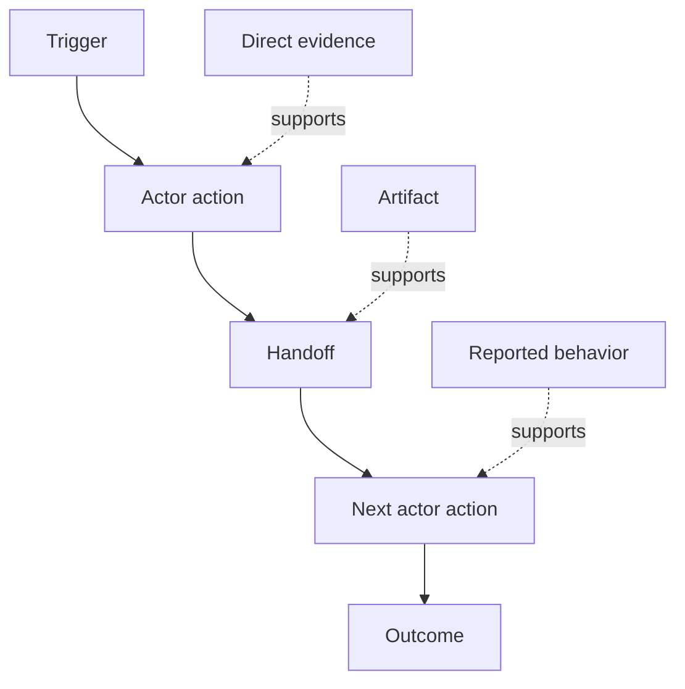

<!-- local-zh-machine-draft: English source is canonical; prose translated automatically, code/math preserved. -->

<a id="discover-the-workflow-people-actually-perform"></a>

# 发现人们实际执行的工作流

> 要求不等待会议收集,而是分散在行动、变通办法、记录和分歧之间。

**类型:** 学习 + 构建
**语言:** Python (stdlib)
**先修要求:** 第14阶段课程 47
**时间:** ~70分钟

<a id="learning-objectives"></a>

## 学习目标

- 将当前工作流程建为有证据的定购动作。
- 与报告或推断的行为分开直接观察。
- 定位摩擦, handoffs权威和隐蔽状态
- 保持不确定的索赔要求的可见度,而不是将其变成要求。

<a id="start-with-the-current-system"></a>

## 以当前系统开始

ぃ璶秨_拜ぐ或 features 开始重建现在发生的事情

每一步记录:

| Field | 示例 |
|---|---|
| Actor | 待命工程师 |
| Trigger | 生产警报到 |
| 动作 | 打开警报,然后搜索仪表板 |
| 输入 | 警报有效载荷和部署记录 |
| 输出 | 候选人服务和所有人 |
| Friction | 三个工具的背景切换 |
| Authority | 事件指挥官批准一个文件 |
| 证据 | 屏幕记录、事件日志、运行簿 |

工作流程比屏幕大。 它包括等待、 复制版、 侧通道、 批准、 错误回收, 以及人们停止注意的步骤 。

<a id="evidence-has-strength"></a>

## 证据有力量

使用简单的证据梯子 :

1. **直接行为:** observation, trace,或系统事件。
2. **Artifact:** 票、运算本、日志、表格或完成输出。
3. **举报行为:** 一个人描述他们的工作
4. **Inference:** 团队总结了可能发生的事情

四个都有用 只有前两个能直接证明当前的行为 rest 所以信心不会无声地膨胀



<a id="search-for-four-things"></a>

## 寻找四样东西

- **Friction:** 重复努力、拖延、重返或恢复。
- **隐藏状态:** 事实记录,聊天或私人笔记。
- **Authority:** 允许作出相应改变的人或系统。
- **Exceptions:** 正常工作流程不再正常的情况。

AI features 经常失败 handoffs 和例外 因为快乐的道路是唯一的 形状路径。

<a id="do-not-average-away-disagreement"></a>

## 平均离别不和

两个用户可以出于良好原因执行不同的工作流程。 保存变量, 直到您了解它们是否代表 :

- 不同角色;
- 不同风险水平;
- 遗产和当前进程;
- 专门知识差异;
- 真正的政策分歧

平均工作流程无法描述任何人。

<a id="build-it"></a>

## 动手实现

实验室保存每个工作流程步骤的证据,验证订单和信心,计算直接证据比率,并撰写 `outputs/workflow-evidence.json`.

```bash
python3 code/main.py
python3 -m unittest discover code/tests -v
```

添加一个缺少部署记录的例外路径。 保持主顺序完整, 并记录 branch begins.

<a id="exercises"></a>

## 练习

1. 未经询问就从日志中重建一个工作流程 。
2. 与用户面谈,并标出所有仍然缺乏直接证据的主张。
3. 增加一个权力界限和一个失败回收步骤。
4. 模拟两个工作流程变体,但不合并。
5. 确定拟议 feature 移走一个可见的步子,但隐藏的工作却未动。

<a id="further-reading"></a>

## 进一步阅读

- [Nuseibeh和复活节布鲁克,《需求工程:路线图》](https://www.cs.toronto.edu/~sme/papers/2000/ICSE2000.pdf)特别是其处理 elicitation 而不是简单的捕捉
- [Gotel和Finkelstein,对可追踪性问题的要求的分析](https://doi.org/10.1109/ICRE.1994.292398),因为很难保持要求与其来源之间的关系。

<a id="what-you-keep"></a>

## 你留着什么

Keep `outputs/workflow-evidence.json`。它把观察到的摩擦和不确定性变成下一个教训的假设图。
