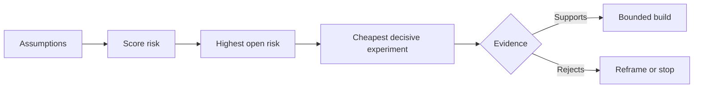

<!-- local-zh-machine-draft: English source is canonical; prose translated automatically, code/math preserved. -->

<a id="map-assumptions-and-resolve-the-riskiest-one-first"></a>

# 梳理假设，优先验证风险最高的一项

> 路线图隐藏了内部的不确定性 features。假设地图揭示了在那些 features 活该

**类型:** 学习 + 构建
**语言:** Python (stdlib)
**先修要求:** 第14阶段课程 48
**时间:** ~65分钟

<a id="learning-objectives"></a>

## 学习目标

- 将拟议工作转变为明确假设。
- 分数影响、不确定性和不可逆转性分开。
- 选择下一个实验 风险,而不是热情。
- 以证据和决定取代经过检验的假设。

<a id="every-build-contains-bets"></a>

## 每个构建包含赌注

事故工具可能取决于所有这些是否属实:

- 警报环境包含足够的信息,可以识别服务;
- 工程师相信他们自己没有得出的建议;
- 所需反应时间在业务上很重要;
- 所需的数据可以在没有不安全授权的情况下获得;
- 工作流程经常发生,足以证明维护是合理的。

这些不是执行任务,而是建设工作的宝贵、可用、可行和安全的条件。

<a id="assumption-classes"></a>

## 假设类

| Class | 问题 |
|---|---|
| 价值 | 结果是否足够重要? |
| Usability | 用户能理解并采取行动吗? |
| Feasibility | 该系统能否利用现有数据和制约因素来编制? |
| Viability | 本组织能否维持成本、所有权和运作? |
| 安全 | 能否在不产生不可接受的后果的情况下失败? |

将假设写成可作假的报表。 feature “10名待命工程师能以只读结果更快地确定正确的服务”。

<a id="risk-is-not-one-number"></a>

## 风险不是一号

实验室使用三个维度 从1到5:

- **Impact:** 如果假设是假的,就会造成损害。
- **Uncertainty:** 现有证据的弱点。
- **Irreversibility:** 承诺后学习的费用。

例子可以分数影响和不确定性的倍数,然后增加不可逆转性。 公式并不是普遍性的。 它的目的是迫使团队说明为什么未知因素应该先解决。



<a id="design-an-experiment-not-a-confirmation-ritual"></a>

## 设计一个实验, 不是确认仪式

一项有用的检验是:

- 可能虚假的主张;
- 人口或实际样本;
- 可见结果;
- 在结果产生之前确定的阈值;
- 下一个决定通过,失败, 和模糊的证据。

避免测试,因为测试只能证明团队能构建这个想法。

<a id="reversibility-changes-order"></a>

## 逆向更改顺序

高后果、不可逆的选择需要更早的证据。 仅读重播可以在生产整合之前进行。 临时调整器可以在数据迁移之前进行。 人类批准的建议可以在自动行动之前进行。

建筑的形状应该遵循不确定的形状。

<a id="build-it"></a>

## 动手实现

实验室排列假设, 与公开索赔区分, 选择最高开放风险, 并写 `outputs/assumption-map.json`.

```bash
python3 code/main.py
python3 -m unittest discover code/tests -v
```

改变风险最高假设的证据 观察下个实验的变化

<a id="exercises"></a>

## 练习

1. 写五个假设 feature 想要建起来
2. 加上一个安全假设 feature 列表中略去。
3. 定义一个可以阻止建筑的门槛
4. 用更便宜的决定性试验取代一个大型试验。
5. 将风险排序与路线图优先级进行比较,并解释不匹配之处。

<a id="further-reading"></a>

## 进一步阅读

- [Barry Boehm,软件开发和增强螺旋模型](https://dl.acm.org/doi/10.1145/12944.12948),一个风险驱动的发展周期,在作出更深入的承诺之前解决不确定性。
- [达登、范兰斯韦德和菲卡斯,目标开发需求](https://doi.org/10.1016/0167-6423(93)90021-G),在改善目标的同时,排除障碍和制约因素。

<a id="what-you-keep"></a>

## 你留着什么

Keep `outputs/assumption-map.json`。下一个课用它来选择能够产生决定性证据的最小片段。
