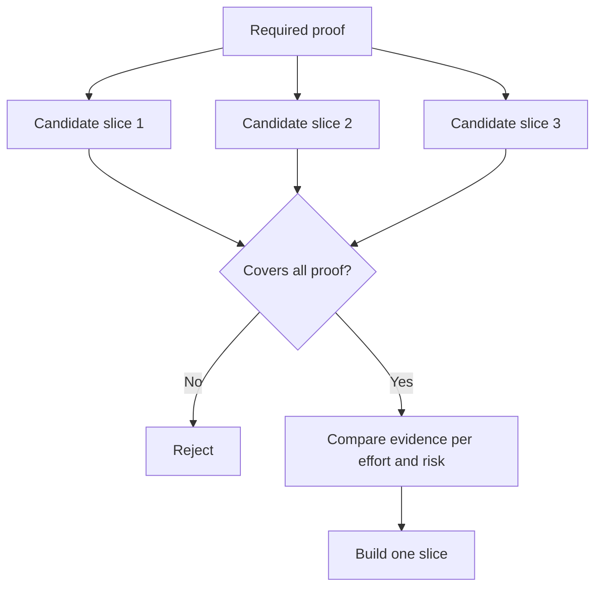

<!-- local-zh-machine-draft: English source is canonical; prose translated automatically, code/math preserved. -->

<a id="choose-the-smallest-slice-that-can-change-the-decision"></a>

# 选择足以改变决策的最小实现范围

> 小的只有在证明重要的时候才有用。 不能改变下个决定的小建筑只是不完整的。

**类型:** 学习 + 构建
**语言:** Python (stdlib)
**先修要求:** 第14阶段课程49
**时间:** ~65分钟

<a id="learning-objectives"></a>

## 学习目标

- 以它证明的假设来定义一个片段。
- 平衡结果价值、减少不确定性、努力和后果。
- 最好有可逆的证据来代替过早的生产承诺。
- 拒绝忽略工作流程中风险部分的切片 。

<a id="vertical-means-evidence-end-to-end"></a>

## 垂直表示证据结束

有用的切片横跨观察结果所需的最低实际工作流程。 它在用户、数据、持续时间和能力方面可能比较狭窄。 它不应该被缩小, 排除需要测试的不确定性 。

示例:

- 一次只读重播 10次真实事件测试服务识别和操作员信任。
- 合成数据光滑仪表板可以测试理解,但不能测试数据的可行性。
- 生产自动补救器立即测试一切,结果令人无法接受。

<a id="define-required-proof-first"></a>

## 先定义所需证明

选择风险最高的开放式假设, 并将其转换为所需的成套证据。 只有覆盖该套假设时, 候选人才有资格使用这一切片 。

然后比较符合条件的切片:

| 尺寸 | 方向 |
|---|---|
| 成果价值 | 还要多,再多就更好了 |
| 不确定性减少 | 还要多,再多就更好了 |
| Effort | 少一点更好 |
| Consequence | 少一点更好 |
| Reversibility | 还要多,再多就更好了 |

实验室的分数是有意的简单。 资格门比算术更重要。



<a id="common-false-minimums"></a>

## 常见的假最小值

- **只使用 UI 的最小值 :** 消除数据和操作不确定性。
- **仅限基础设施的最小值 :** 证明技术可能性没有用户价值。
- **快乐的起码方式:** 省略造成最大风险的例外。
- **演示最小值 :** 产生一种有说服力的工艺品,但无法重复测量。
- **平台的最低值 :** 在一个工作流程获得之前,先建造可再使用的机械。

<a id="add-a-stop-rule"></a>

## 添加停止规则

执行前,请写下如果片段失败会发生什么:

- 放弃结果;
- 改变目标用户或情况;
- 测试一种不同的机制;
- 收集更好的证据;
- 更窄的权势

如果每一个结果都导致“坚固的建筑”,那么切片并不是一个实验。

<a id="build-it"></a>

## 动手实现

实验室通过要求的证明筛选候选人,分数合格切片,并写 `outputs/slice-decision.json`.

```bash
python3 code/main.py
python3 -m unittest discover code/tests -v
```

添加一个更便宜的候选人, 证明只有一个必要的假设。 即使其数字得分很高, 候选人仍不合格 。

<a id="exercises"></a>

## 练习

1. 设计三片,在不同后果水平上为同一结果。
2. 在评分前先说明所需证据。
3. 取消一种能力,同时保留决定性证据。
4. 给失败的飞行员添加停机规则 。
5. 确定可重复使用的平台组件, 等待切片后再使用 。

<a id="further-reading"></a>

## 进一步阅读

- [Barry Boehm,软件开发和增强螺旋模型](https://dl.acm.org/doi/10.1145/12944.12948),使每个发展周期与它必须解决的风险相匹配。
- [伦纳杜兹和塔比,MVP解释:关于最低可耐性产品定义的系统绘图研究](https://arxiv.org/abs/1609.07592),因为软件产品实践中“最低限度”和“可生存性”的模糊不清。

<a id="what-you-keep"></a>

## 你留着什么

Keep `outputs/slice-decision.json`。它记录了为什么这个片子是最小的,可以改变决定。
