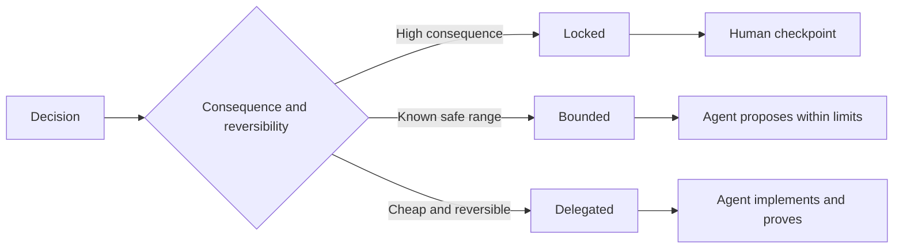

<!-- local-zh-machine-draft: English source is canonical; prose translated automatically, code/math preserved. -->

<a id="write-specifications-that-preserve-judgment"></a>

# 编写保留判断空间的规格说明

> 有用的规格可以修正变量和证据,同时允许可逆执行选择。它是一个决定界限,而不是一个剧本。

**类型:** 学习 + 构建
**语言:** Python (stdlib)
**先修要求:** 第14阶段课程 50
**时间:** ~75分钟

<a id="learning-objectives"></a>

## 学习目标

- 单独的结果、变数、实例、非目标以及证据。
- 将决定标为锁定、约束或授权。
- Preserve agent 判断,选择是廉价的,可逆的。
- 需要人手 checkpoints 后果或公共行为改变

<a id="two-bad-extremes"></a>

## 两个坏极点

未明确的任务要求 agent 来猜一下系统。一个被指定的任务要求它抄写一个可能已经错误的设计。

有用的中间点是可执行的合同:

| Surface | 目的 |
|---|---|
| Outcome | 可见结果 |
| Invariants | 永远必须保持真实的条件 |
| 示例 | 表明意图的具体案件 |
| Non-goals | 故意排斥近邻行为 |
| 决定政策 | 哪些选择被锁定、约束或授权 |
| Proof | 完成前需要的证据 |

<a id="three-decision-modes"></a>

## 三个决定模式

- **Locked:** 该 agent 使用公众兼容性、权威、安全性、不可逆的成本或产品承诺。
- **Bounded:** 该 agent 可以在明确限制内选择。 用于搜索预算、 重试计数、 允许依赖关系或已知界面家族 。
- **Delegated:** 该 agent 拥有该选择, 必须解释它。 本地结构、 名称、 可逆的反向要素以及执行细节 。



<a id="specify-behavior-through-examples"></a>

## 通过示例指定行为

举例来说,压缩意图比形容词好。 “有用 ” 、 “ 粗野 ” 和“生产准备就绪”是无法执行的。 一小组正常、边际、失败和被禁止的例子既能让建设者也能让验证者看到具体的东西。

例子不能取代变数,一个转述案例不能证明是普遍的安全规则。

<a id="proof-must-match-the-claim"></a>

## 证据必须匹配索赔

- 单位测试证明是本地功能合同
- 电线测试证明了序列化和运输行为
- 浏览器行程证明接口路径 。
- 重播组证明了行为 相对于有代表性的案件。
- 一个 audit log 证明权力的界限。

不接受下层作为较高层次索赔的证据。

<a id="preserve-unknowns-deliberately"></a>

## 故意保存未知

规格可以说,“执行可以选择在预算时间内返回的任何只读来源。” 这不是含糊不清,而是带有界限和证据的有意授权的决定。

证据改变时,规格应该不断演变。 保留锁定和约束的选择背后的理由,以便后来的团队可以不考虑考古学而修改这些选择。

<a id="build-it"></a>

## 动手实现

实验室验证了所有合同表面,检查了决策模式,并写了 `outputs/executable-specification.json`.

```bash
python3 code/main.py
python3 -m unittest discover code/tests -v
```

将生产- 写决定从锁定移到授权。 解释为什么该模式接受该值, 但产品风险不高 。

<a id="exercises"></a>

## 练习

1. 将积压的票转换为六种规格表面。
2. 将三项执行指示改为一项不定的和两项例子。
3. 标记每个决定 并证明每一个锁定或约束的选择。
4. 给每个不忠者都加一张证明收据
5. 取消没有证据或风险理由的限制。

<a id="further-reading"></a>

## 进一步阅读

- [Nuseibeh和复活节布鲁克,《需求工程:路线图》](https://www.cs.toronto.edu/~sme/papers/2000/ICSE2000.pdf),关于目标之间的关系,精确的规格、验证、协议和演变。
- [扎维和杰克逊,四个需求黑暗角落工程](https://doi.org/10.1145/237432.237434),用于区分环境假设、要求和规格。
- [Gotel和Finkelstein,对可追踪性问题的要求的分析](https://doi.org/10.1109/ICRE.1994.292398),以保持为什么存在一项要求,以及它来自何处。

<a id="what-you-keep"></a>

## 你留着什么

Keep `outputs/executable-specification.json`合同 coding agents 与人审查员分享。
