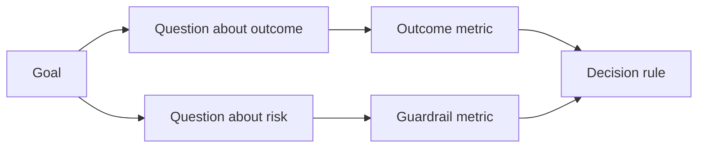

<!-- local-zh-machine-draft: English source is canonical; prose translated automatically, code/math preserved. -->

<a id="design-success-metrics-before-the-result-exists"></a>

# 在结果产生前设计成功指标

> 测量应该回答一个决定,而不是装饰一个仪表板。从目标开始,提出问题,然后选择最小的回答标准。

**类型:** 学习 + 构建
**语言:** Python (stdlib)
**先修要求:** 第14阶段课程47和51
**时间:** ~70分钟

<a id="learning-objectives"></a>

## 学习目标

- 成果目标的衍生问题和衡量标准。
- 在观测结果之前,确定阈值、窗口、源和方向。
- 相对结果衡量标准 guardrails 和反计数。
- Match evaluation 建房必须支持决定的证据。

<a id="goal-question-metric"></a>

## 目标,问题,计量

以目标开始:

> 减少确定受影响服务的时间,而不增加不安全行动。

衍生问题:

- 正确的服务有多快被确定?
- 确定的服务是否正确?
- 诊断是否只读?
- 工作流程是否增加了警示解雇或操作员工作量?

然后选择能解决这些问题的衡量标准。



<a id="a-metric-needs-a-contract"></a>

## 计量系统需要合同

每一项衡量需求:

| Field | 示例 |
|---|---|
| 名称 | `median_identification_seconds` |
| 方向 | 最多 |
| 阈值 | 120 |
| 窗户 | 10次重播事件 |
| 来源 | 重放事件日志 |
| Population | 飞行员的待召工程师 |
| Kind | 或 影响 guardrail |

没有源和窗口, 数字无法复制。 没有门槛值, 它不能驱动决定 。

<a id="outcome-guardrail-and-counter-metric"></a>

## Outcome, Guardrail和反措施

- **成果衡量标准:** 想要的状态有改善吗?
- **Guardrail:** 固定的限制是否依然属实?
- **Counter-metric:** 当地改良换班是否在其他地方造成代价或伤害?

对于事件工作流程来说,速度是不够的。 正确性、 制作写作、 操作员工作量和错过警告都能够防止快速但不安全的结果。

<a id="offline-and-online-evidence"></a>

## 离线和在线证据

离线重播对重复性和边缘覆盖有用。 连接的飞行员对真实行为、 信任和工作流程效果都有用。 两者都无法替代其它功能 。

使用最便宜的证据来回应当前的决定。 不要仅仅因为执行准备就绪而暴露真正的用户 。

<a id="decide-before-you-measure"></a>

## 测量前先决定

写下通行证、 失败和模糊路径后才能看到结果。 否则团队会移动门槛来保护建筑 。

示例：

- 合格时间:至少为0.9, 且平均时间最多为120秒;
- 失败:任何生产量的写法或正确率低于0.75;
- 模糊:小改进,差异很大,需要更大的重播集。

<a id="build-it"></a>

## 动手实现

实验室验证测量计划,评估包容性阈值,记录缺失值并写 `outputs/measurement-report.json`.

```bash
python3 code/main.py
python3 -m unittest discover code/tests -v
```

删除 guardrail 并观察为什么即使成果衡量标准保持不变,计划也变得无效。

<a id="exercises"></a>

## 练习

1. 产生三个问题 从一个结果目标。
2. 加上一个反比 渔获成本转移到另一个角色
3. 定义每种测量的源、群和窗口。
4. 生成数值之前写出通行证、失败和模糊的决定。
5. 确定一个易于收集但无法更改决定的尺度。 删除它 。

<a id="further-reading"></a>

## 进一步阅读

- [Basili,软件建模和计量:目标/问题/矩阵特征](https://drum.lib.umd.edu/items/8119803a-362b-42ec-b6ce-2311713e7236),用于从明确的目标中得出业务计量。
- [巴西利、卡尔迪埃拉和隆巴赫,目标问题计量方法](https://www.cs.toronto.edu/~sme/CSC444F/handouts/GQM-paper.pdf),用于将这种方法作为反馈和改进系统。

<a id="what-you-keep"></a>

## 你留着什么

Keep `outputs/measurement-report.json`。它定义了原型、试验或生产阶段的证据门。
