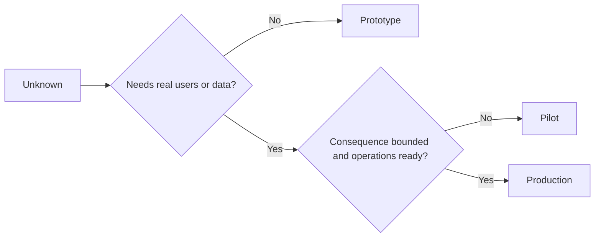

<!-- local-zh-machine-draft: English source is canonical; prose translated automatically, code/math preserved. -->

<a id="choose-prototype-pilot-or-production-deliberately"></a>

# 有意识地选择原型、试点或生产方案

> 这些是不同的学习环境,而不是抛光水平。选择一个应对当前未知后果的阶段,而其后果最小。

**类型:** 学习 + 构建
**语言:** Python (stdlib)
**先修要求:** 第14阶段的教训 50至52
**时间:** ~70分钟

<a id="learning-objectives"></a>

## 学习目标

- 从未知的、观众、数据、后果和准备状态中选择构建阶段。
- 确定针对特定阶段的控制和退出标准。
- 防止原型悄悄地成为生产系统。
- 推迟真正的权威,直到证据和行动证明它合理。

<a id="three-different-questions"></a>

## 三个不同的问题

| 舞台 | 主要问题 |
|---|---|
| Prototype | 这一机制能否提供证据? |
| Pilot | 是否在真正观众和真实条件下安全地运作? |
| Production | 我们能否在所承诺的可靠性和风险水平上持续拥有它? |

原型在技术上可以完成,仍然可以一次性使用,试点可以使用生产数据,同时保持有限的受众和权威,生产始于组织接受持续责任之时。

<a id="prototype"></a>

## Prototype

当未知数据不需要真实用户或真实数据时使用原型。 保留它 :

- discardable;
- isolated;
- 行为狭隘;
- 明确了解学习问题;
- 无需虚假的业务保证。

在机制获得另一个阶段之前,不要优化结构。

<a id="pilot"></a>

## Pilot

当未知因素需要真实行为、现实数据或真正的工作流程时,使用试点,但后果或准备状态与广泛发布内容尚不兼容。

试点需要:

- 指定的听众;
- 拥有人;
- 限定期限和权力;
- 审计和 rollback;
- 成果和成果 guardrail thresholds;
- 扩展、修改或停止的退出标准。

<a id="production"></a>

## Production

生产需要多于部署:

- service level objective;
- 待命和事故所有权;
- 安全和隐私审查;
- 成本和能力控制;
- rollback 和复原;
- 持续监测;
- 退休之路



<a id="stage-drift"></a>

## 阶段漂移

原型代码在获取用户、数据或权威而不获得所有权时会变得危险。 在配置、访问控制、遥测和文档中标出原型和试点边界。 警告横幅是不够的。

阶段应从系统本身看得见。

<a id="build-it"></a>

## 动手实现

实验室从决定上下文中选择一个阶段, 返回所需的控件, 并写入 `outputs/stage-decisions.json`.

```bash
python3 code/main.py
python3 -m unittest discover code/tests -v
```

将试验实例改为低效果,即行动准备状态。

<a id="exercises"></a>

## 练习

1. 按学习阶段而不是部署状态对三个现有项目进行分类。
2. 写入包括停止决定的试点退出标准 。
3. 增加技术控制,防止原型获得生产数据。
4. 确定生产建筑的第一项业务责任。
5. 设计a rollback 被绑的飞行员的收据

<a id="further-reading"></a>

## 进一步阅读

- [Barry Boehm,软件开发和增强螺旋模型](https://dl.acm.org/doi/10.1145/12944.12948),以匹配每个迭代对解决风险的承诺。
- [Fagerholm等人,用于连续实验的建筑块](https://doi.org/10.1145/2601248.2601276),用于持续进行实验所需的组织和技术条件。

<a id="what-you-keep"></a>

## 你留着什么

Keep `outputs/stage-decisions.json`。它记录了为什么每个阶段都是合理的,在下一个阶段之前必须存在哪些控制。
