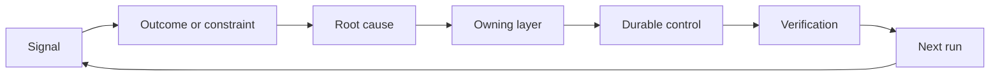

<!-- local-zh-machine-draft: English source is canonical; prose translated automatically, code/math preserved. -->

<a id="build-a-feedback-ratchet-with-ownership-and-retirement"></a>

# 建立持续反馈机制，明确负责人和退役条件

> 航运关闭了一个环形循环,打开了学习循环。 证据必须改变系统,否则它就会成为无人拥有的遥测系统。

**类型:** 学习 + 构建
**语言:** Python (stdlib)
**先修要求:** 第14阶段课程46和53
**时间:** ~75分钟

<a id="learning-objectives"></a>

## 学习目标

- 转身事件, evaluations用户行为,以及被纠正为自有行动
- 每一个信号都经过了上下文 evaluation、政策、运行时间或积压。
- 按严重程度和频率优先处理重犯问题。
- 给所有控制者一个退休条件

<a id="feedback-is-infrastructure"></a>

## 反馈是基础设施

团队可以收集 traces, evaluations,支持票和事故记录,但没有任何人知道。缺少的机制是宣传:从观察到长期变化的一条明确路径,由拥有者和证据者来提供。

循环是:

1. 观察具体信号;
2. 将它与结果、限制或假设联系起来;
3. 确定原因所在的最早系统层;
4. 创建一条条框框的变更;
5. 核实重现的可能性降低;
6. 审查是否应该保持控制。

<a id="route-to-the-owning-layer"></a>

## 通往拥有层的路径

| 信号 | Destination |
|---|---|
| 假正反转,错误结果 | Evaluation 或测试 |
| 缺少上下文、重复工作、陈旧事实 | 上下文源或检索路径 |
| 不安全行动或权力漏洞 | 政策或许可边界 |
| 超时、 重试风暴、 无依赖性 | 运行时间控制 |
| 新产品需求或未解决的权衡 | 剪切的积压项目 |

将原因固定在最早的有效层。 不要添加其它 prompt 当测试或许可可使失败成为不可能时,该段落中将包含“不成功”一词。



<a id="ownership-is-part-of-the-control"></a>

## 所有权是控制的一部分

每一个招手行动都需要:

- 一名业主;
- 基于后果和重复发生的优先权;
- 需要改变的文物;
- 证明变更的核查;
- 审查或过期窗口;
- 退休条件。

一种未加控制的改进是采用更好的格式化的观察。

<a id="retire-stale-controls"></a>

## 退役定额控制

反馈系统积累政策。该政策可能变得矛盾和昂贵。 当以下情况下审查控制:

- 结构或工作流程变化;
- 低级的变数取代高层次的教学;
- 受保护的失败没有出现在选中窗口的交叉处;
- 控制阻碍合法工作的次数多于防止伤害的频率。

退休也需要证据,不要因为感觉老就删除控制。

<a id="connect-build-and-coding-agent-feedback"></a>

## 连接构建和编码 -Agent Feedback

同样的扳机可以双向地使用:

- 产品证据改变了结果框架、假设、切片或测量计划。
- Coding-agent 校正变化测试、上下文、范围、自动化或 handoff.
- 事故既可以改变产品边界,也可以改变产品边界。 agent workbench.

这就是为什么塑造建筑不是在编码之前结束的阶段。 它通过每一个公认的变化而继续。

<a id="build-it"></a>

## 动手实现

实验室对信号进行分类, 创建自有的鼠标动作, 优先排序, 并写作 `outputs/feedback-backlog.json`.

```bash
python3 code/main.py
python3 -m unittest discover code/tests -v
```

添加运行时超时信号,确认它会到达运行时间而不是一般的积压。

<a id="exercises"></a>

## 练习

1. 将一个事件和一个用户投诉 变成告密行动
2. 列出可以防止每次重现的最早层 。
3. 在实验室输出中添加校验命令或观察 。
4. 界定政策规则的退休条件。
5. Trace 一个人接受了对下一个任务框架的校正。

<a id="further-reading"></a>

## 进一步阅读

- [巴西利、卡尔迪埃拉和隆巴赫,目标问题计量方法](https://www.cs.toronto.edu/~sme/CSC444F/handouts/GQM-paper.pdf),通过目标导向的衡量方法进行组织学习。
- [Fagerholm等人,用于连续实验的建筑块](https://doi.org/10.1145/2601248.2601276),用于将证据与持续产品开发联系起来的技术和组织循环。
- [Nuseibeh和复活节布鲁克,《需求工程:路线图》](https://www.cs.toronto.edu/~sme/papers/2000/ICSE2000.pdf),将要求视为在系统生命周期中演变。

<a id="what-you-keep"></a>

## 你留着什么

Keep `outputs/feedback-backlog.json`。它是产品判断和交付路径的终结工艺品,也是对下一个结果框架的投入。
