<!-- local-zh-machine-draft: English source is canonical; prose translated automatically, code/math preserved. -->

<a id="communication-protocols"></a>

# 通信协议

> Agents 无法说同一种语言不是团队 他们都是陌生人

**类型:** Build
**语言:** TypeScript
**先修要求:** 第14阶段(Agent 工程学,16.01课(为什么是多Agent)
**时间:** ~120分钟

<a id="learning-objectives"></a>

## 学习目标

- Implement MCP 工具发现和引用 agents 使用外部服务器曝光的工具
- 构建 A2A agent 允许使用卡片和任务端点 agent 将工作委托给另一个 HTTP
- Compare MCP (工具存取) A2A (agent-以-agent),ACP(企业审计)和ANP(分散信任),并解释哪些协议解决了哪些问题
- 在单一系统中将多个协议连接在一起 agents 通过 MCP 并授权任务通过 A2A

<a id="the-problem"></a>

## 问题

你将你的系统分成多个 agents研究者, 代码员, 评论员 他们的工作很出色, 但现在你需要他们互相交谈。

您的第一次尝试是显而易见的: 传递字符串绕行。 研究人员返回文本的一团, 编码员会尽可能地分析它。 直到编码员误解了研究摘要, 或者两个 agents 僵持在等待对方,否则你们需要 agents 由不同的团队组成 合作。 突然“ 传递线” 瓦解了 。

这是通讯协议的问题,没有关于如何 agents 交流资料,多-agent 系统脆弱,无法判断,不可能超越 agents 你亲自写的

人工智能生态系统以四项协议作出回应,每个协议解决了不同的问题:

- **MCP** 用于工具访问
- **A2A** 用于 agent-以-agent collaboration
- **ACP** 企业可审计性
- **ANP** 分散化身份和信任

这个课很深。你会读到每个插图的真正的线格式, 建立工作执行, 并将所有四个连接到一个统一的系统 。

<a id="the-concept"></a>

## 概念

<a id="the-protocol-landscape"></a>

### 协议的景观

把这四项协议当作一个层次, 每一个都处理一个不同的问题:

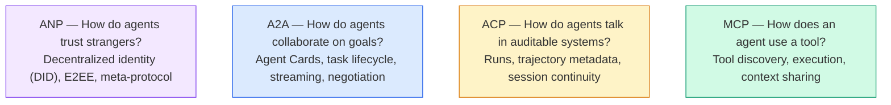

他们不是竞争对手,他们在不同层面上解决不同的问题

<a id="mcp-recap"></a>

### MCP (Recap)

MCP 深度覆盖在13阶段,快速重述: MCP 标准化 LLM 连接到外部工具和数据源。 **client-server** 协议 agent (客户)发现和调用服务器暴露的工具。

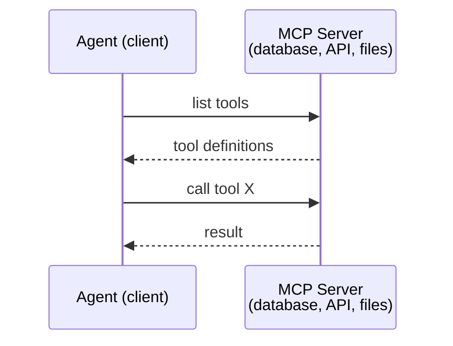

MCP 是 **agent-to-tool** 沟通,这没用 agents 互相谈谈

<a id="a2a-agent2agent-protocol"></a>

### A2A (《代理商议定书》)

**创建者:** 谷歌(现由Linux基金会领导) `lf.a2a.v1`)
**标准版本 :** 1.0.0
**Problem:** 如何自主 agents 合作、谈判和将任务委托给对方?

A2A 是协议 **peer-to-peer agent collaboration**。 MCP 连接 agent 转换为工具 A2A 连接 agent 将其他 agents. 每个 agent 出版 **Agent Card** 的 URL 等 agents 发现,谈判,并授权它。

<a id="how-a2a-works"></a>

#### How A2A Works

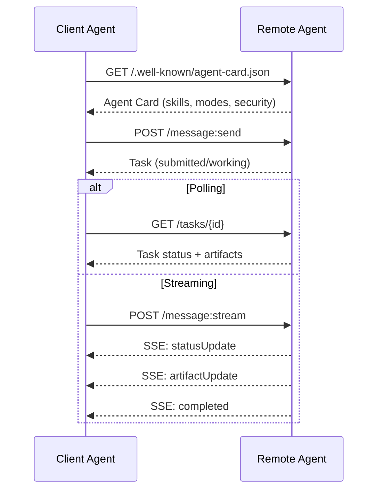

<a id="the-real-agent-card"></a>

#### 真实 Agent Card

这就是 A2A Agent 牌看起来就像野外的一样 `GET /.well-known/agent-card.json`:

```json
{
  "name": "Research Agent",
  "description": "Searches documentation and summarizes findings",
  "version": "1.0.0",
  "supportedInterfaces": [
    {
      "url": "https://research-agent.example.com/a2a/v1",
      "protocolBinding": "JSONRPC",
      "protocolVersion": "1.0"
    },
    {
      "url": "https://research-agent.example.com/a2a/rest",
      "protocolBinding": "HTTP+JSON",
      "protocolVersion": "1.0"
    }
  ],
  "provider": {
    "organization": "Your Company",
    "url": "https://example.com"
  },
  "capabilities": {
    "streaming": true,
    "pushNotifications": false
  },
  "defaultInputModes": ["text/plain", "application/json"],
  "defaultOutputModes": ["text/plain", "application/json"],
  "skills": [
    {
      "id": "web-research",
      "name": "Web Research",
      "description": "Searches the web and synthesizes findings",
      "tags": ["research", "search", "summarization"],
      "examples": ["Research the latest changes in React 19"]
    },
    {
      "id": "doc-analysis",
      "name": "Documentation Analysis",
      "description": "Reads and analyzes technical documentation",
      "tags": ["docs", "analysis"],
      "inputModes": ["text/plain", "application/pdf"],
      "outputModes": ["application/json"]
    }
  ],
  "securitySchemes": {
    "bearer": {
      "httpAuthSecurityScheme": {
        "scheme": "Bearer",
        "bearerFormat": "JWT"
      }
    }
  },
  "security": [{ "bearer": [] }]
}
```

需要注意的关键事项:
- **Skills** 是什么 一个 agent 。 每个用户都有 ID 、 标记和支持的输入/ 输出 MIME 类型。 这是客户端如何使用 。 agent 决定是否要进行远程 agent 能够处理它的请求。
- **supportedInterfaces** 列表中列出多个协议绑定。 agent 能够说话 JSON-RPC, REST和GRPC同时。
- **Security** 客户知道在提出单一请求之前需要什么验证。

<a id="task-lifecycle"></a>

#### 任务生命周期

任务是核心工作单位 A2A。它们通过定义的状态移动:

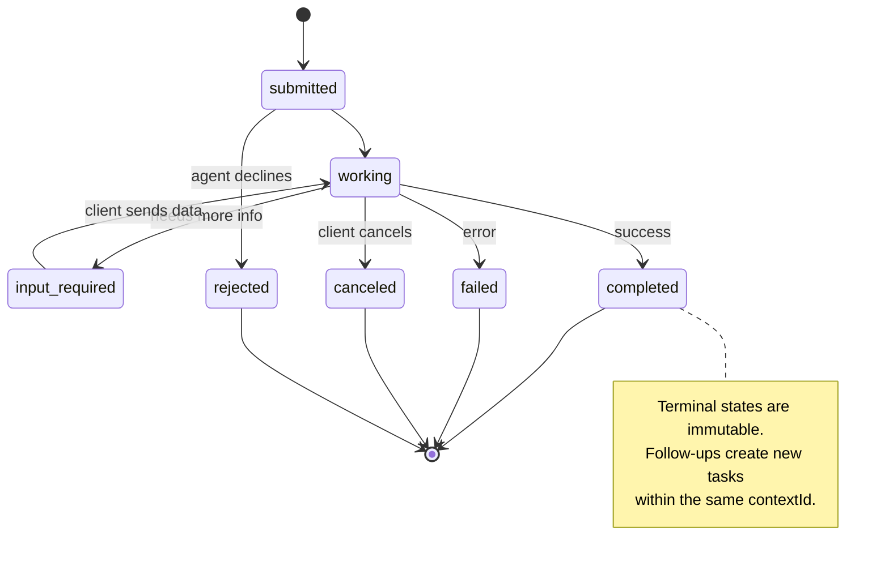

所有8个州(该条例还界定了 `UNSPECIFIED` 以监视器的形式,此处省略:

| 状态 | Terminal? | 含义 |
|---|---|---|
| `TASK_STATE_SUBMITTED` | 否 | 已确认,但尚未处理 |
| `TASK_STATE_WORKING` | 否 | 正在积极处理 |
| `TASK_STATE_INPUT_REQUIRED` | 否 | Agent 需要客户提供更多信息 |
| `TASK_STATE_AUTH_REQUIRED` | 否 | 需要认证 |
| `TASK_STATE_COMPLETED` | 是的 | 成功完成 |
| `TASK_STATE_FAILED` | 是的 | 完成时有错误 |
| `TASK_STATE_CANCELED` | 是的 | 完成前取消 |
| `TASK_STATE_REJECTED` | 是的 | Agent 拒绝任务 |

一旦任务到达终端状态, 任务将不可更改。 没有进一步的消息。 后续在相同状态下创建新任务 `contextId`.

<a id="wire-format"></a>

#### 线条格式

A2A 使用 JSON-RPC 2.0. 下面是真正的信息交换方式:

**客户端发送任务 :**
```json
{
  "jsonrpc": "2.0",
  "id": 1,
  "method": "SendMessage",
  "params": {
    "message": {
      "messageId": "msg-001",
      "role": "ROLE_USER",
      "parts": [{ "text": "Research React 19 compiler features" }]
    },
    "configuration": {
      "acceptedOutputModes": ["text/plain", "application/json"],
      "historyLength": 10
    }
  }
}
```

**Agent 回应一项任务:**
```json
{
  "jsonrpc": "2.0",
  "id": 1,
  "result": {
    "task": {
      "id": "task-abc-123",
      "contextId": "ctx-xyz-789",
      "status": {
        "state": "TASK_STATE_COMPLETED",
        "timestamp": "2026-03-27T10:30:00Z"
      },
      "artifacts": [
        {
          "artifactId": "art-001",
          "name": "research-results",
          "parts": [{
            "data": {
              "findings": [
                "React 19 compiler auto-memoizes components",
                "No more manual useMemo/useCallback needed",
                "Compiler runs at build time, not runtime"
              ]
            },
            "mediaType": "application/json"
          }]
        }
      ]
    }
  }
}
```

**Streaming 通过 SSE :**
```text
POST /message:stream HTTP/1.1
Content-Type: application/json
A2A-Version: 1.0

data: {"task":{"id":"task-123","status":{"state":"TASK_STATE_WORKING"}}}

data: {"statusUpdate":{"taskId":"task-123","status":{"state":"TASK_STATE_WORKING","message":{"role":"ROLE_AGENT","parts":[{"text":"Searching documentation..."}]}}}}

data: {"artifactUpdate":{"taskId":"task-123","artifact":{"artifactId":"art-1","parts":[{"text":"partial findings..."}]},"append":true,"lastChunk":false}}

data: {"statusUpdate":{"taskId":"task-123","status":{"state":"TASK_STATE_COMPLETED"}}}
```

<a id="acp-agent-communication-protocol"></a>

### 非加太国家Agent 来文议定书)

**创建者:** IBM/BeeAI 系统
**标准版本 :** 0.2.0 (开放API 3.1.1)
**Status:** 合并 A2A 林努基金会
**Problem:** 怎么样? agents 与完全可审计性、届会连续性和轨迹跟踪进行沟通?

非加太国家就是 **企业协议**与许多摘要所称不同,非加太国家 **不** 使用 JSON- 直截了当 REST/JSON API 由 OpenAPI 定义。 是什么使得它特别 **TrajectoryMetadata**: 每个 agent 答复可详细记录推理步骤和 tool calls 生产它。

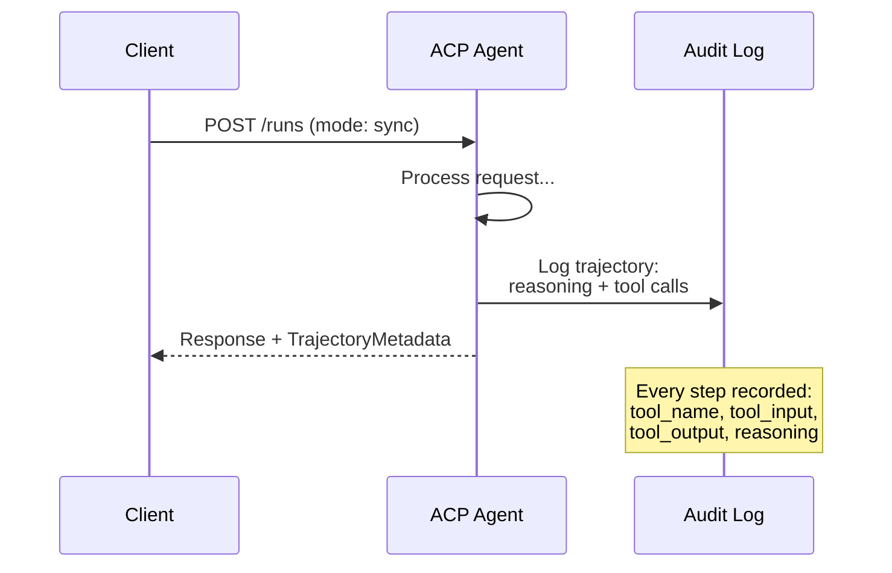

<a id="agent-discovery-in-acp"></a>

#### Agent 非加太国家发现

· 研究、分析和分析

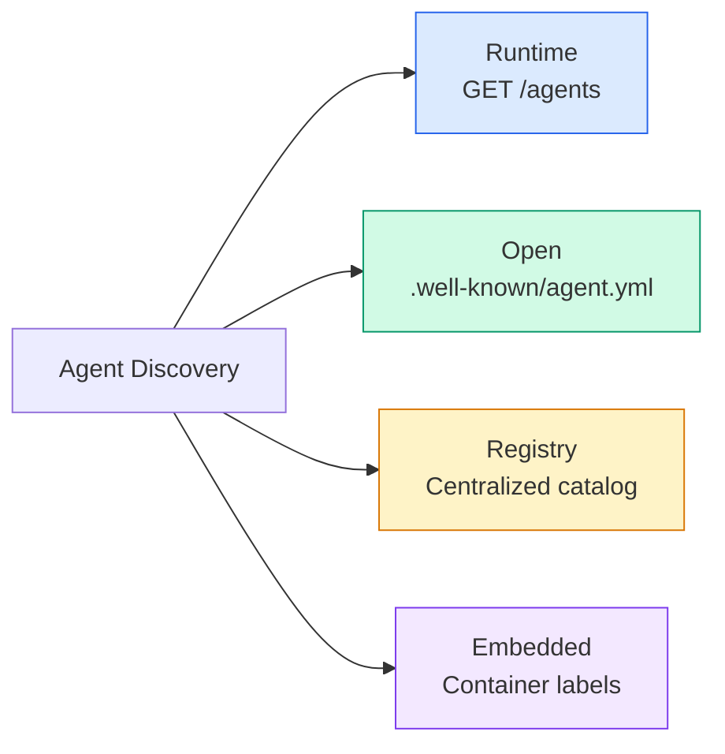

该 **AgentManifest** 简单于 A2A的 Agent Card:

```json
{
  "name": "summarizer",
  "description": "Summarizes documents with source citations",
  "input_content_types": ["text/plain", "application/pdf"],
  "output_content_types": ["text/plain", "application/json"],
  "metadata": {
    "tags": ["summarization", "RAG"],
    "framework": "BeeAI",
    "capabilities": [
      {
        "name": "Document Summarization",
        "description": "Condenses long documents into key points"
      }
    ],
    "recommended_models": ["llama3.3:70b-instruct-fp16"],
    "license": "Apache-2.0",
    "programming_language": "Python"
  }
}
```

<a id="run-lifecycle"></a>

#### 运行生命周期

使用“运行”代替“任务”。 agent 执行时使用三种模式:

| 模式 | 行为 |
|---|---|
| `sync` | 屏蔽。 响应包含完整的结果 。 |
| `async` | 立即返回202号 `GET /runs/{id}` 状态 |
| `stream` | SSE 流。 事件火灾 agent works. |

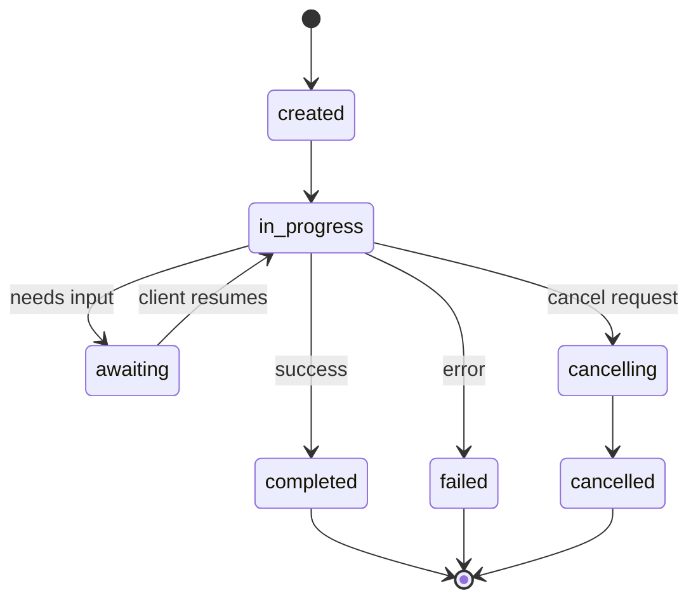

<a id="trajectorymetadata-the-audit-trail"></a>

#### 轨迹Metatadata(审计轨迹)

这是非加太的关键差异器。 每个信息部分都包含元数据, 显示准确的 agent did:

```json
{
  "role": "agent/researcher",
  "parts": [
    {
      "content_type": "text/plain",
      "content": "The weather in San Francisco is 72F and sunny.",
      "metadata": {
        "kind": "trajectory",
        "message": "I need to check the weather for this location",
        "tool_name": "weather_api",
        "tool_input": { "location": "San Francisco, CA" },
        "tool_output": { "temperature": 72, "condition": "sunny" }
      }
    }
  ]
}
```

对于受监管的行业来说,这是黄金。 每一个答案都包含一个可辨别的推理链:什么工具被称作,什么投入被使用,什么产出被接受。 没有黑盒 。

非加太国家也支持 **CitationMetadata** 来源归属:

```json
{
  "kind": "citation",
  "start_index": 0,
  "end_index": 47,
  "url": "https://weather.gov/sf",
  "title": "NWS San Francisco Forecast"
}
```

<a id="anp-agent-network-protocol"></a>

### ANP( 国家警察局)Agent 网络协议)

**创建者:** 开放源码社区(由高伟昌创建)
**Repo:** [github.com/agent-network-protocol/AgentNetworkProtocol](https://github.com/agent-network-protocol/AgentNetworkProtocol)
**Problem:** 怎么样? agents 各组织没有中央当局,彼此信任?

ANP是那个 **分散身份协议**。它使用W3C分散化识别符(DIDs)和端对端加密来建立信任。 A2A 在那里你发现 agents 通过已知的终点, ANP Let agents 以加密方式证明他们的身份

ANP有三个层次:

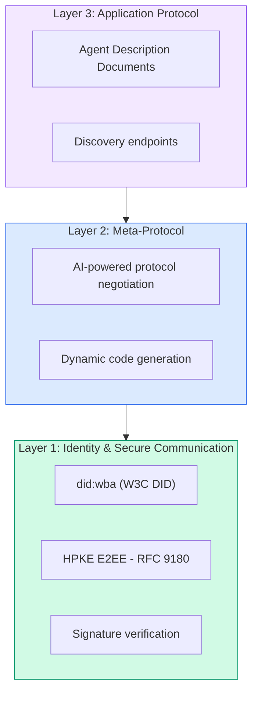

<a id="did-documents-real-structure"></a>

#### 文档(真实结构)

ANP 使用自定义的DED方法 `did:wba` (Web-Based Agent确实如此 `did:wba:example.com:user:alice` 决心 `https://example.com/user/alice/did.json`:

```json
{
  "@context": [
    "https://www.w3.org/ns/did/v1",
    "https://w3id.org/security/suites/jws-2020/v1",
    "https://w3id.org/security/suites/secp256k1-2019/v1"
  ],
  "id": "did:wba:example.com:user:alice",
  "verificationMethod": [
    {
      "id": "did:wba:example.com:user:alice#key-1",
      "type": "EcdsaSecp256k1VerificationKey2019",
      "controller": "did:wba:example.com:user:alice",
      "publicKeyJwk": {
        "crv": "secp256k1",
        "x": "NtngWpJUr-rlNNbs0u-Aa8e16OwSJu6UiFf0Rdo1oJ4",
        "y": "qN1jKupJlFsPFc1UkWinqljv4YE0mq_Ickwnjgasvmo",
        "kty": "EC"
      }
    },
    {
      "id": "did:wba:example.com:user:alice#key-x25519-1",
      "type": "X25519KeyAgreementKey2019",
      "controller": "did:wba:example.com:user:alice",
      "publicKeyMultibase": "z9hFgmPVfmBZwRvFEyniQDBkz9LmV7gDEqytWyGZLmDXE"
    }
  ],
  "authentication": [
    "did:wba:example.com:user:alice#key-1"
  ],
  "keyAgreement": [
    "did:wba:example.com:user:alice#key-x25519-1"
  ],
  "humanAuthorization": [
    "did:wba:example.com:user:alice#key-1"
  ],
  "service": [
    {
      "id": "did:wba:example.com:user:alice#agent-description",
      "type": "AgentDescription",
      "serviceEndpoint": "https://example.com/agents/alice/ad.json"
    }
  ]
}
```

需要注意的关键事项:
- **按键分离** 。签名密钥(secp256k1)与加密密钥(X25519)分开。
- **`humanAuthorization`** 这些密钥在使用前需要明确的人的批准(生物测量、密码、 HSM ) 。 高风险操作, 如资金转移, 可以通过此路径进行 。
- **`keyAgreement`** 键用于 HPKE 端对端加密(RFC 9180)。
- 该 **service** 区域链接到 Agent 说明文件。

<a id="how-trust-works-in-anp"></a>

#### 信托在ANP如何运作

ANP 确实如此 **不** 使用信任或背书图。

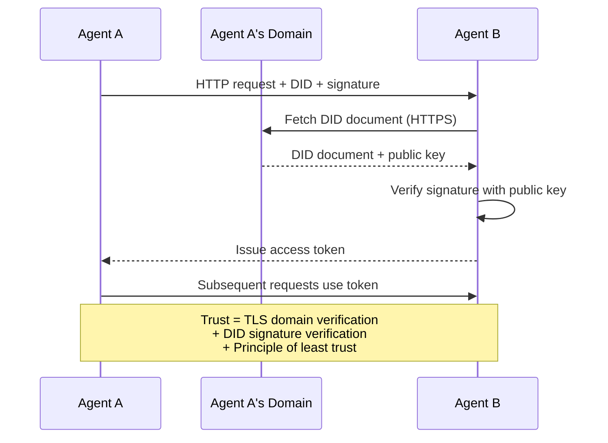

信任来自三个来源:
1. **Domain-level TLS** 校验文件主机
2. **加密签名** 验证 agent身份
3. **信任度最低的原则** 仅给予最低许可

没有任何八卦的传信 也没有PageRank的评分 agent 直接通过它。

<a id="meta-protocol-negotiation"></a>

#### 谈判《元议定书》

这是ANP最小说 feature。当两个 agents 不同的生态系统相遇, 他们不需要事先商定的数据格式。

```json
{
  "action": "protocolNegotiation",
  "sequenceId": 0,
  "candidateProtocols": "I can communicate using:\n1. JSON-RPC with hotel booking schema\n2. REST with OpenAPI 3.1 spec\n3. Natural language over HTTP",
  "modificationSummary": "Initial proposal",
  "status": "negotiating"
}
```

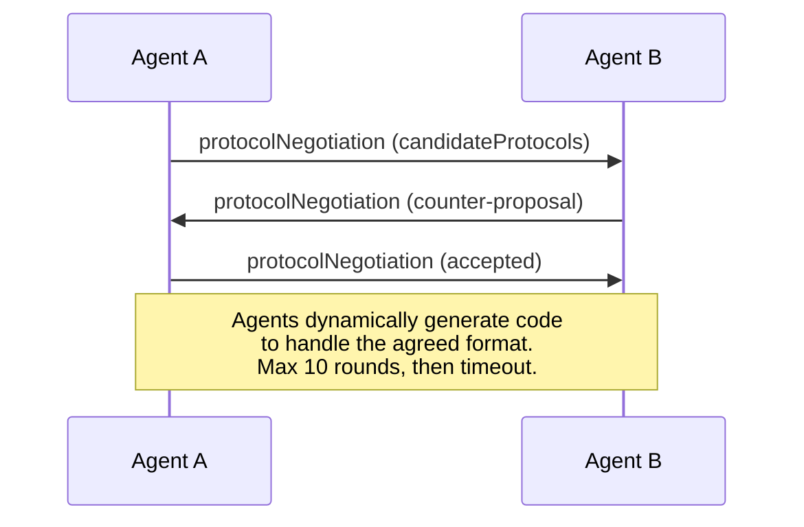

该 agents 前后(最多10轮)直到他们商定格式,然后动态生成处理代码。 `negotiating`, `rejected`, `accepted`, `timeout`.

意思是两件 agents 能够找到如何沟通 而不预先确定共同的策略

<a id="comparison-corrected"></a>

### 比较(经更正)

| | MCP | A2A | ACP | ANP |
|---|---|---|---|---|
| **创建者** | Anthropic | 谷歌/Linux基金会 | IBM/BeeAI 系统 | Community |
| **规格格式** | JSON-RPC | JSON-RPC / REST /菲律宾妇女理事会 | OpenAPI 3.1 ( 开关REST) | JSON-RPC |
| **主要用途** | Agent 工具工具 | Agent 以 Agent | Agent 以 Agent | Agent 以 Agent |
| **Discovery** | 工具列表 | `/.well-known/agent-card.json` | `GET /agents`, `/.well-known/agent.yml` | `/.well-known/agent-descriptions`,是否服务端点 |
| **Identity** | 隐含( 本地) | 安全计划(OAuth, mTLS) 中 | Server-level | W3C 确实(`did:wba`)与 E2EE |
| **审计线索** | 不适用 | 基本(任务历史) | 轨迹Metatadata (% 1)tool calls,推理) | 未正式指定 |
| **国家机器** | 不适用 | 9个任务状态 | 7个运行状态 | 不适用 |
| **Streaming** | 不适用 | SSE | SSE | Transport-agnostic |
| **Unique feature** | 工具图 | Agent 卡片+技能 | 轨迹审计跟踪 | 元协议谈判 |
| **最好买** | 工具数据( D) | 动态协作 | 受管制行业 | 跨网络信托 |
| **Status** | Stable | 稳定(v1.0) | 合并 A2A | 积极发展 |

<a id="how-they-work-together"></a>

### 他们如何合作

这些协议并非相互排斥。

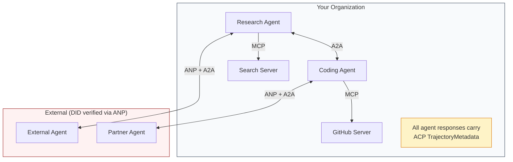

- **MCP** 连接每个 agent 将工具
- **A2A** 处理 agents (内部和外部)
- **ACP** 以轨迹元数据包列答复,供审计
- **ANP** 提供身份验证 agents 无法控制

```figure
swarm-message-bus
```

<a id="build-it"></a>

## 动手实现

<a id="step-1-core-message-types"></a>

### 步骤1:核心信件类型

每一个多 -agent 系统以消息格式开始。 我们定义地图的类型, 以真实协议使用何种类型 :

```typescript
import crypto from "node:crypto";

type MessageRole = "user" | "agent";

type MessagePart =
  | { kind: "text"; text: string }
  | { kind: "data"; data: unknown; mediaType: string }
  | { kind: "file"; name: string; url: string; mediaType: string };

type TrajectoryEntry = {
  reasoning: string;
  toolName?: string;
  toolInput?: unknown;
  toolOutput?: unknown;
  timestamp: number;
};

type AgentMessage = {
  id: string;
  role: MessageRole;
  parts: MessagePart[];
  trajectory?: TrajectoryEntry[];
  replyTo?: string;
  timestamp: number;
};

function createMessage(
  role: MessageRole,
  parts: MessagePart[],
  replyTo?: string
): AgentMessage {
  return {
    id: crypto.randomUUID(),
    role,
    parts,
    replyTo,
    timestamp: Date.now(),
  };
}

function textMessage(role: MessageRole, text: string): AgentMessage {
  return createMessage(role, [{ kind: "text", text }]);
}
```

Notice: `MessagePart` 与真实数据一样,是多式的(文字、结构化数据、文件) A2A 以及非加太国家的情况。 `TrajectoryEntry` 捕捉推理链,匹配 ACP 的轨迹Metatadata。

<a id="step-2-a2a-agent-card-and-registry"></a>

### 步骤2: A2A Agent 贺卡和登记

Build agent 发现与真实的 A2A spec:

```typescript
type Skill = {
  id: string;
  name: string;
  description: string;
  tags: string[];
  inputModes: string[];
  outputModes: string[];
};

type AgentCard = {
  name: string;
  description: string;
  version: string;
  url: string;
  capabilities: {
    streaming: boolean;
    pushNotifications: boolean;
  };
  defaultInputModes: string[];
  defaultOutputModes: string[];
  skills: Skill[];
};

class AgentRegistry {
  private cards: Map<string, AgentCard> = new Map();

  register(card: AgentCard) {
    this.cards.set(card.name, card);
  }

  discoverBySkillTag(tag: string): AgentCard[] {
    return [...this.cards.values()].filter((card) =>
      card.skills.some((skill) => skill.tags.includes(tag))
    );
  }

  discoverByInputMode(mimeType: string): AgentCard[] {
    return [...this.cards.values()].filter(
      (card) =>
        card.defaultInputModes.includes(mimeType) ||
        card.skills.some((skill) => skill.inputModes.includes(mimeType))
    );
  }

  resolve(name: string): AgentCard | undefined {
    return this.cards.get(name);
  }

  listAll(): AgentCard[] {
    return [...this.cards.values()];
  }
}
```

这比简单的名称对能力的地图丰富得多。 您可以发现 agents 使用技术标记,输入 MIME 类型,或名称, 就像真实的一样 A2A 标注支持 。

<a id="step-3-a2a-task-lifecycle"></a>

### 步骤3: A2A 任务生命周期

构建完整的任务状态机器 :

```typescript
type TaskState =
  | "submitted"
  | "working"
  | "input-required"
  | "auth-required"
  | "completed"
  | "failed"
  | "canceled"
  | "rejected";

const TERMINAL_STATES: TaskState[] = [
  "completed",
  "failed",
  "canceled",
  "rejected",
];

type TaskStatus = {
  state: TaskState;
  message?: AgentMessage;
  timestamp: number;
};

type Artifact = {
  id: string;
  name: string;
  parts: MessagePart[];
};

type Task = {
  id: string;
  contextId: string;
  status: TaskStatus;
  artifacts: Artifact[];
  history: AgentMessage[];
};

type TaskEvent =
  | { kind: "statusUpdate"; taskId: string; status: TaskStatus }
  | {
      kind: "artifactUpdate";
      taskId: string;
      artifact: Artifact;
      append: boolean;
      lastChunk: boolean;
    };

type TaskHandler = (
  task: Task,
  message: AgentMessage
) => AsyncGenerator<TaskEvent>;

class TaskManager {
  private tasks: Map<string, Task> = new Map();
  private handlers: Map<string, TaskHandler> = new Map();
  private listeners: Map<string, ((event: TaskEvent) => void)[]> = new Map();

  registerHandler(agentName: string, handler: TaskHandler) {
    this.handlers.set(agentName, handler);
  }

  subscribe(taskId: string, listener: (event: TaskEvent) => void) {
    const existing = this.listeners.get(taskId) ?? [];
    existing.push(listener);
    this.listeners.set(taskId, existing);
  }

  async sendMessage(
    agentName: string,
    message: AgentMessage,
    contextId?: string
  ): Promise<Task> {
    const handler = this.handlers.get(agentName);
    if (!handler) {
      const task = this.createTask(contextId);
      task.status = {
        state: "rejected",
        timestamp: Date.now(),
        message: textMessage("agent", `No handler for ${agentName}`),
      };
      return task;
    }

    const task = this.createTask(contextId);
    task.history.push(message);
    task.status = { state: "submitted", timestamp: Date.now() };

    this.processTask(task, handler, message).catch((err) => {
      task.status = {
        state: "failed",
        timestamp: Date.now(),
        message: textMessage("agent", String(err)),
      };
    });
    return task;
  }

  getTask(taskId: string): Task | undefined {
    return this.tasks.get(taskId);
  }

  cancelTask(taskId: string): boolean {
    const task = this.tasks.get(taskId);
    if (!task || TERMINAL_STATES.includes(task.status.state)) return false;
    task.status = { state: "canceled", timestamp: Date.now() };
    this.emit(taskId, {
      kind: "statusUpdate",
      taskId,
      status: task.status,
    });
    return true;
  }

  private createTask(contextId?: string): Task {
    const task: Task = {
      id: crypto.randomUUID(),
      contextId: contextId ?? crypto.randomUUID(),
      status: { state: "submitted", timestamp: Date.now() },
      artifacts: [],
      history: [],
    };
    this.tasks.set(task.id, task);
    return task;
  }

  private async processTask(
    task: Task,
    handler: TaskHandler,
    message: AgentMessage
  ) {
    task.status = { state: "working", timestamp: Date.now() };
    this.emit(task.id, {
      kind: "statusUpdate",
      taskId: task.id,
      status: task.status,
    });

    try {
      for await (const event of handler(task, message)) {
        if (TERMINAL_STATES.includes(task.status.state)) break;

        if (event.kind === "statusUpdate") {
          task.status = event.status;
        }
        if (event.kind === "artifactUpdate") {
          const existing = task.artifacts.find(
            (a) => a.id === event.artifact.id
          );
          if (existing && event.append) {
            existing.parts.push(...event.artifact.parts);
          } else {
            task.artifacts.push(event.artifact);
          }
        }
        this.emit(task.id, event);
      }
    } catch (err) {
      task.status = {
        state: "failed",
        timestamp: Date.now(),
        message: textMessage("agent", String(err)),
      };
      this.emit(task.id, {
        kind: "statusUpdate",
        taskId: task.id,
        status: task.status,
      });
    }
  }

  private emit(taskId: string, event: TaskEvent) {
    for (const listener of this.listeners.get(taskId) ?? []) {
      listener(event);
    }
  }
}
```

执行真实的 A2A 任务生命周期: 提交、 工作、 输入要求、 终端状态。 手动器是生成与 SSE 匹配的事件( 状态更新和人工块) 的同步生成器 streaming 模型.

<a id="step-4-acp-style-audit-trail"></a>

### 步骤4:非加太国家审计轨迹

以轨迹跟踪方式进行通讯:

```typescript
type AuditEntry = {
  runId: string;
  agentName: string;
  input: AgentMessage[];
  output: AgentMessage[];
  trajectory: TrajectoryEntry[];
  status: "created" | "in-progress" | "completed" | "failed" | "awaiting";
  startedAt: number;
  completedAt?: number;
  sessionId?: string;
};

class AuditableRunner {
  private log: AuditEntry[] = [];
  private handlers: Map<
    string,
    (input: AgentMessage[]) => Promise<{
      output: AgentMessage[];
      trajectory: TrajectoryEntry[];
    }>
  > = new Map();

  registerAgent(
    name: string,
    handler: (input: AgentMessage[]) => Promise<{
      output: AgentMessage[];
      trajectory: TrajectoryEntry[];
    }>
  ) {
    this.handlers.set(name, handler);
  }

  async run(
    agentName: string,
    input: AgentMessage[],
    sessionId?: string
  ): Promise<AuditEntry> {
    const entry: AuditEntry = {
      runId: crypto.randomUUID(),
      agentName,
      input: structuredClone(input),
      output: [],
      trajectory: [],
      status: "created",
      startedAt: Date.now(),
      sessionId,
    };
    this.log.push(entry);

    const handler = this.handlers.get(agentName);
    if (!handler) {
      entry.status = "failed";
      return entry;
    }

    entry.status = "in-progress";
    try {
      const result = await handler(input);
      entry.output = structuredClone(result.output);
      entry.trajectory = structuredClone(result.trajectory);
      entry.status = "completed";
      entry.completedAt = Date.now();
    } catch (err) {
      entry.status = "failed";
      entry.trajectory.push({
        reasoning: `Error: ${String(err)}`,
        timestamp: Date.now(),
      });
      entry.completedAt = Date.now();
    }
    return entry;
  }

  getFullAuditLog(): AuditEntry[] {
    return structuredClone(this.log);
  }

  getAuditLogForAgent(agentName: string): AuditEntry[] {
    return structuredClone(
      this.log.filter((e) => e.agentName === agentName)
    );
  }

  getAuditLogForSession(sessionId: string): AuditEntry[] {
    return structuredClone(
      this.log.filter((e) => e.sessionId === sessionId)
    );
  }

  getTrajectoryForRun(runId: string): TrajectoryEntry[] {
    const entry = this.log.find((e) => e.runId === runId);
    return entry ? structuredClone(entry.trajectory) : [];
  }
}
```

每个 agent 执行后生成一个完整的审计条目: 进入的、 出现的以及 tool calls 和推理步骤。您可以通过 agent,通过会话或单程运行。

<a id="step-5-anp-style-identity-verification"></a>

### 步骤5:ANP-轮式身份核查

建立基于 DAD 的身份和验证 :

```typescript
type VerificationMethod = {
  id: string;
  type: string;
  controller: string;
  publicKeyDer: string;
};

type DIDDocument = {
  id: string;
  verificationMethod: VerificationMethod[];
  authentication: string[];
  keyAgreement: string[];
  humanAuthorization: string[];
  service: { id: string; type: string; serviceEndpoint: string }[];
};

type AgentIdentity = {
  did: string;
  document: DIDDocument;
  privateKey: crypto.KeyObject;
  publicKey: crypto.KeyObject;
};

class IdentityRegistry {
  private documents: Map<string, DIDDocument> = new Map();

  publish(doc: DIDDocument) {
    this.documents.set(doc.id, doc);
  }

  resolve(did: string): DIDDocument | undefined {
    return this.documents.get(did);
  }

  verify(did: string, signature: string, payload: string): boolean {
    const doc = this.documents.get(did);
    if (!doc) return false;

    const authKeyIds = doc.authentication;
    const authKeys = doc.verificationMethod.filter((vm) =>
      authKeyIds.includes(vm.id)
    );

    for (const key of authKeys) {
      const publicKey = crypto.createPublicKey({
        key: Buffer.from(key.publicKeyDer, "base64"),
        format: "der",
        type: "spki",
      });
      const isValid = crypto.verify(
        null,
        Buffer.from(payload),
        publicKey,
        Buffer.from(signature, "hex")
      );
      if (isValid) return true;
    }
    return false;
  }

  requiresHumanAuth(did: string, operationKeyId: string): boolean {
    const doc = this.documents.get(did);
    if (!doc) return false;
    return doc.humanAuthorization.includes(operationKeyId);
  }
}

function createIdentity(domain: string, agentName: string): AgentIdentity {
  const did = `did:wba:${domain}:agent:${agentName}`;
  const { publicKey, privateKey } = crypto.generateKeyPairSync("ed25519");

  const publicKeyDer = publicKey
    .export({ format: "der", type: "spki" })
    .toString("base64");

  const keyId = `${did}#key-1`;
  const encKeyId = `${did}#key-x25519-1`;

  const document: DIDDocument = {
    id: did,
    verificationMethod: [
      {
        id: keyId,
        type: "Ed25519VerificationKey2020",
        controller: did,
        publicKeyDer,
      },
      {
        id: encKeyId,
        type: "X25519KeyAgreementKey2019",
        controller: did,
        publicKeyDer,
      },
    ],
    authentication: [keyId],
    keyAgreement: [encKeyId],
    humanAuthorization: [],
    service: [
      {
        id: `${did}#agent-description`,
        type: "AgentDescription",
        serviceEndpoint: `https://${domain}/agents/${agentName}/ad.json`,
      },
    ],
  };

  return { did, document, privateKey, publicKey };
}

function signPayload(identity: AgentIdentity, payload: string): string {
  return crypto
    .sign(null, Buffer.from(payload), identity.privateKey)
    .toString("hex");
}
```

这反映了真正的ANP身份模型: agents 已经使用过包含独立认证、密钥协议和人授权密钥的文件。 `IdentityRegistry` 模拟DAD分辨率( 正在生成中) HTTP 获取到 agent域)

<a id="step-6-protocol-gateway"></a>

### 步骤6:协议通道

将所有四个协议连接到一个统一的系统 :

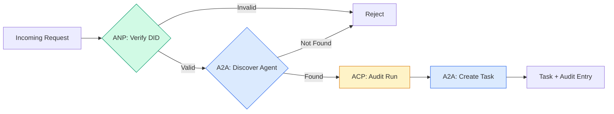

```typescript
class ProtocolGateway {
  private registry: AgentRegistry;
  private taskManager: TaskManager;
  private auditRunner: AuditableRunner;
  private identityRegistry: IdentityRegistry;

  constructor(
    registry: AgentRegistry,
    taskManager: TaskManager,
    auditRunner: AuditableRunner,
    identityRegistry: IdentityRegistry
  ) {
    this.registry = registry;
    this.taskManager = taskManager;
    this.auditRunner = auditRunner;
    this.identityRegistry = identityRegistry;
  }

  async delegateTask(
    fromDid: string,
    signature: string,
    targetAgent: string,
    message: AgentMessage,
    sessionId?: string
  ): Promise<{ task: Task; audit: AuditEntry } | { error: string }> {
    if (!this.identityRegistry.verify(fromDid, signature, message.id)) {
      return { error: "Identity verification failed" };
    }

    const card = this.registry.resolve(targetAgent);
    if (!card) {
      return { error: `Agent ${targetAgent} not found in registry` };
    }

    const audit = await this.auditRunner.run(
      targetAgent,
      [message],
      sessionId
    );
    const task = await this.taskManager.sendMessage(targetAgent, message);

    return { task, audit };
  }

  discoverAndDelegate(
    fromDid: string,
    signature: string,
    skillTag: string,
    message: AgentMessage
  ): Promise<{ task: Task; audit: AuditEntry } | { error: string }> {
    const candidates = this.registry.discoverBySkillTag(skillTag);
    if (candidates.length === 0) {
      return Promise.resolve({
        error: `No agents found with skill tag: ${skillTag}`,
      });
    }
    return this.delegateTask(
      fromDid,
      signature,
      candidates[0].name,
      message
    );
  }
}
```

通道一通有四件事要做
1. **ANP**: 通过 DED 签名验证来电者的身份
2. **A2A**: 发现目标 agent 和检查能力
3. **ACP**:将执行过程以轨迹进行审计
4. **A2A**:创建具有完整生命周期跟踪的任务

<a id="step-7-wire-it-all-together"></a>

### 步骤7: 将所有这一切连接在一起

```typescript
async function protocolDemo() {
  const registry = new AgentRegistry();
  registry.register({
    name: "researcher",
    description: "Searches and summarizes findings",
    version: "1.0.0",
    url: "https://researcher.local/a2a/v1",
    capabilities: { streaming: true, pushNotifications: false },
    defaultInputModes: ["text/plain"],
    defaultOutputModes: ["text/plain", "application/json"],
    skills: [
      {
        id: "web-research",
        name: "Web Research",
        description: "Searches the web",
        tags: ["research", "search", "summarization"],
        inputModes: ["text/plain"],
        outputModes: ["application/json"],
      },
    ],
  });
  registry.register({
    name: "coder",
    description: "Writes code from specs",
    version: "1.0.0",
    url: "https://coder.local/a2a/v1",
    capabilities: { streaming: false, pushNotifications: false },
    defaultInputModes: ["text/plain", "application/json"],
    defaultOutputModes: ["text/plain"],
    skills: [
      {
        id: "code-gen",
        name: "Code Generation",
        description: "Generates code",
        tags: ["coding", "generation"],
        inputModes: ["text/plain", "application/json"],
        outputModes: ["text/plain"],
      },
    ],
  });

  const taskManager = new TaskManager();
  const auditRunner = new AuditableRunner();

  const researchTrajectory: TrajectoryEntry[] = [];

  taskManager.registerHandler(
    "researcher",
    async function* (task, message) {
      yield {
        kind: "statusUpdate" as const,
        taskId: task.id,
        status: { state: "working" as const, timestamp: Date.now() },
      };

      researchTrajectory.push({
        reasoning: "Searching for React 19 documentation",
        toolName: "web_search",
        toolInput: { query: "React 19 compiler features" },
        toolOutput: {
          results: ["react.dev/blog/react-19", "github.com/react/react"],
        },
        timestamp: Date.now(),
      });

      researchTrajectory.push({
        reasoning: "Extracting key findings from search results",
        toolName: "doc_analysis",
        toolInput: { url: "react.dev/blog/react-19" },
        toolOutput: {
          summary:
            "React 19 compiler auto-memoizes, no manual useMemo needed",
        },
        timestamp: Date.now(),
      });

      yield {
        kind: "artifactUpdate" as const,
        taskId: task.id,
        artifact: {
          id: crypto.randomUUID(),
          name: "research-results",
          parts: [
            {
              kind: "data" as const,
              data: {
                findings: [
                  "React 19 compiler auto-memoizes components",
                  "No more manual useMemo/useCallback needed",
                  "Compiler runs at build time, not runtime",
                ],
                sources: ["react.dev/blog/react-19"],
              },
              mediaType: "application/json",
            },
          ],
        },
        append: false,
        lastChunk: true,
      };

      yield {
        kind: "statusUpdate" as const,
        taskId: task.id,
        status: { state: "completed" as const, timestamp: Date.now() },
      };
    }
  );

  auditRunner.registerAgent("researcher", async () => ({
    output: [
      textMessage("agent", "React 19 compiler auto-memoizes components"),
    ],
    trajectory: researchTrajectory,
  }));

  const identityRegistry = new IdentityRegistry();

  const coderIdentity = createIdentity("coder.local", "coder");
  const researcherIdentity = createIdentity("researcher.local", "researcher");

  identityRegistry.publish(coderIdentity.document);
  identityRegistry.publish(researcherIdentity.document);

  const gateway = new ProtocolGateway(
    registry,
    taskManager,
    auditRunner,
    identityRegistry
  );

  console.log("=== Protocol Demo ===\n");

  console.log("1. Agent Discovery (A2A)");
  const researchAgents = registry.discoverBySkillTag("research");
  console.log(
    `   Found ${researchAgents.length} agent(s):`,
    researchAgents.map((a) => a.name)
  );

  console.log("\n2. Identity Verification (ANP)");
  const message = textMessage("user", "Research React 19 compiler features");
  const signature = signPayload(coderIdentity, message.id);
  const verified = identityRegistry.verify(
    coderIdentity.did,
    signature,
    message.id
  );
  console.log(`   Coder DID: ${coderIdentity.did}`);
  console.log(`   Signature verified: ${verified}`);

  console.log("\n3. Task Delegation (A2A + ACP + ANP)");
  const result = await gateway.delegateTask(
    coderIdentity.did,
    signature,
    "researcher",
    message,
    "session-001"
  );

  if ("error" in result) {
    console.log(`   Error: ${result.error}`);
    return;
  }

  console.log(`   Task ID: ${result.task.id}`);
  console.log(`   Task state: ${result.task.status.state}`);
  console.log(`   Artifacts: ${result.task.artifacts.length}`);

  console.log("\n4. Audit Trail (ACP)");
  console.log(`   Run ID: ${result.audit.runId}`);
  console.log(`   Status: ${result.audit.status}`);
  console.log(`   Trajectory steps: ${result.audit.trajectory.length}`);
  for (const step of result.audit.trajectory) {
    console.log(`     - ${step.reasoning}`);
    if (step.toolName) {
      console.log(`       Tool: ${step.toolName}`);
    }
  }

  console.log("\n5. Full Audit Log");
  const fullLog = auditRunner.getFullAuditLog();
  console.log(`   Total runs: ${fullLog.length}`);
  for (const entry of fullLog) {
    const duration = entry.completedAt
      ? `${entry.completedAt - entry.startedAt}ms`
      : "in-progress";
    console.log(`   ${entry.agentName}: ${entry.status} (${duration})`);
  }
}

protocolDemo().catch((err) => {
  console.error("Protocol demo failed:", err);
  process.exitCode = 1;
});
```

<a id="what-goes-wrong"></a>

## 哪里出错了

协议解决了幸福之路。

**气管漂移** Agent 出版 Agent 贺卡广告 `application/json` 输出。但 JSON 版本之间的图案变化 。 Agent B 分析旧格式并获得垃圾。 修正: 版本您的技能和输出方案 。 A2A 标注支持 `version` 在 Agent 这张卡就是这个原因

**国家机器违规** 一个 agent 处理器产生 a `completed` ,然后尝试生成更多的文物。任务不可更改。您的代码静悄悄地丢弃更新或投放。修改:检查终端状态后再投放。 `TaskManager` 上面加了这个 `break` 之后的终点状态。

**信任解决失败。** Agent 尝试校验 Agent B确实有,但是 Agent B 域名已下移。 无法获取文档。 您是否失败打开( 接受未验证) agents是否关闭(拒绝一切)?ANP建议以最不信任原则结束失败。

**轨迹浮肿** 非加太国家轨道的伐木能力很强,但费用昂贵。 agent 也就是200个 tool calls 一次运行都会产生大量的审计条目。 修正: 以可配置动词水平的日志轨迹。 记录工具名称和用于合规的 IO, 跳过无管制工作量的推理步骤 。

**发现雷鸣的群。** 50 agents 全部查询 `GET /agents` 启动时同时进行。 修正: 缓存 Agent 使用TTL卡、断层发现间隔或使用推键登记而不是投票。

<a id="use-it"></a>

## 实际应用

<a id="real-implementations"></a>

### 实际执行情况

**A2A** 是最成熟的,谷歌的 [官方规格](https://github.com/google/A2A) 由Linux基金会提供。 SDKs 用于 Python 和 TypeScript。如果您在 agents 需要动态发现和协作 从这里开始

**ACP** 正在合并为 A2AIBM 的 [BeeAI项目](https://github.com/i-am-bee/acp) 创建非加太国家 REST- 首选选择,但轨迹元数据概念正在被吸收到 A2A 使用非加太模式(轨迹记录、运行生命周期),即使您使用 A2A 做为运输工具

**ANP** 最有实验性的 [社区救济](https://github.com/agent-network-protocol/AgentNetworkProtocol) 已经有一个 Python SDK 元协议谈判的概念确实很新奇。值得注意的是跨组织的谈判 agent deployments.

**MCP** 已经覆盖到第13阶段,如果需要的话 agents 使用工具, MCP 标准。

<a id="picking-the-right-protocol"></a>

### 选择正确的协议

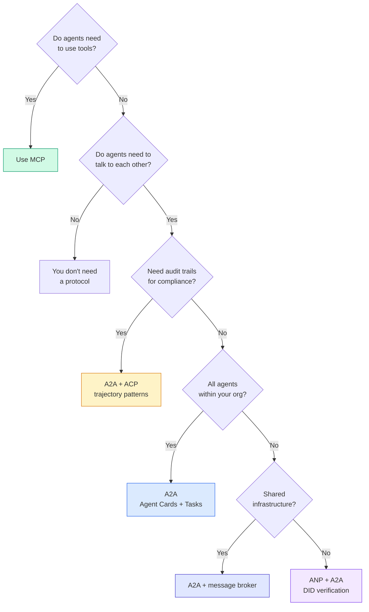

<a id="ship-it"></a>

## 交付成果

本课产生：
- `code/main.ts` - 全面执行所有四项议定书模式
- `outputs/prompt-protocol-selector.md` -- 一个 prompt 帮助您选择系统协议

<a id="exercises"></a>

## 练习

1. **多跳任务 delegation.** 延长 `TaskManager` 这么 agent 操作器可以将子任务委托给其它 agents。研究人员接受一项任务,代表“搜索”和“总结”两个专家的子任务 agents,等待两者完成,然后将结果合并成自己的工艺品。

2. **Streaming 审计线索。** 修改 `AuditableRunner` 支持 streaming 模式。不等待全部结果,而是选择 `AuditEntry` 添加轨迹条目时实时更新。 使用生成审计快照的自动生成器 。

3. **转过身** 添加密钥旋转到 `IdentityRegistry`. 一个 agent 能够发布带有更新密钥的新的 DED 文档,同时保持 `previousDid` 验证人应在宽限期内接受当前和先前的密钥的签名。

4. **协议谈判。** 实施ANP的元议定书概念。 agents exchange `protocolNegotiation` 带有候选格式的信件(例如,“我可以说话”) JSON-RPC"vs"我喜欢 REST" )在最多三轮后,他们商定一种格式或超时。 `TaskManager` 或 `AuditableRunner` 他们用。

5. **限速发现** 添加a `RateLimitedRegistry` 缓存的包装 Agent 使用可配置 TTL 的卡片检查, 限制每次查找查询 agent 每秒。 模拟100型雷电群 agents 开始时发现对方 并测量差异。

<a id="key-terms"></a>

## 关键术语

| 术语 | 人们怎么说 | 它实际上意味着什么 |
|------|----------------|----------------------|
| MCP | "人工智能工具的协议" | 客户端服务器协议 agents 发现和使用工具。 Agent- 换个工具,别 agent-以-agent. |
| A2A | "Google's agent protocol" | 对等协议 agent 林克斯基金会的合作 Agent 贺卡,九州任务生命周期 streaming 通过 SSE 提供支持 JSON-RPC, REST,以及GRPC的绑定。 |
| ACP | "Enterprise agent messaging" | IBM/BeeAI's REST API 用于 agent 由TrajectoryMetatadata 运行: 每一个响应都包含整个推理链 tool calls合并为 A2A. |
| ANP | "Decentralized agent identity" | 使用社区协议 `did:wba` 用于加密身份的HPKE用于E2EE,以及用于AU-HIPCOL的代用元程序谈判 agents 从未见过的彼此。 |
| Agent Card | "一个 agent名片,你记着 | 一个 JSON 文档 `/.well-known/agent-card.json` 描述技能、支持MIME类型、安全计划和协议约束。 |
| DID | 分散身份证 | 以加密方式可核实身份的 W3C 标准 agent属于自己的域。 `did:wba` 方法. |
| TrajectoryMetadata | (审计收据) | 非加太国家附加推理步骤的机制, tool calls,以及它们向每个 agent response. |
| Meta-protocol | "Agents 谈判如何说话。 | ANP的方法 agents 使用自然语言动态地商定数据格式,然后生成处理数据的代码。 |
| 任务 | "一个单位" | A2A显示从提交到完成的物体跟踪工作。 无法被移动到终端 。 |

<a id="further-reading"></a>

## 进一步阅读

- [Google A2A specification](https://github.com/google/A2A) - 正式规格和 SDKs (V1.0.0,Linux基金会)
- [IBM/ BeeAI 非加太国家技术规格](https://github.com/i-am-bee/acp) - OpenAPI 3.1 规格 agent 运行和轨迹元数据
- [Agent 网络协议](https://github.com/agent-network-protocol/AgentNetworkProtocol) - 以DA为基础的身份,E2EE,元协议谈判
- [Model Context Protocol docs](https://modelcontextprotocol.io/) -- Anthropic的 MCP 规格(在第13阶段涵盖)
- [W3C 分散标识符](https://www.w3.org/TR/did-core/) - 支撑阿富汗国家警察的身份标准
- [RFC 9180(氢氯氟烃)](https://www.rfc-editor.org/rfc/rfc9180) - 加密方案ANP用于 E2EE
- [FIPA Agent 交流语言](http://www.fipa.org/specs/fipa00061/SC00061G.html) - 现代学前 agent protocols
