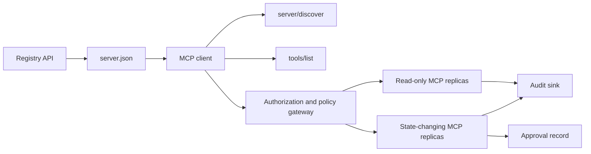

<!-- local-zh-machine-draft: English source is canonical; prose translated automatically, code/math preserved. -->

<a id="capstone-13-stateless-mcp-server-with-registry-and-governance"></a>

# 综合项目 13：带注册表与治理机制的 Stateless MCP 服务端

> Production MCP 它是一个合同链:可公布元数据、现场发现、无国籍请求信封、授权、政策、审计和部署证据。

**类型:** Capstone
**语言:** Python 和 TypeScript 参考模型; 任何生产语言
**先修要求:** 阶段11、阶段13、阶段14、阶段17和阶段18
**必需 MCP 深潜 :** [28课: Tool Contracts](../../../13-tools-and-protocols/28-mcp-tool-contracts-and-content/docs/zh.md), [课程29:可靠性](../../../13-tools-and-protocols/29-mcp-reliability-cancellation-and-flow-control/docs/zh.md), [课程30:登记供应链](../../../13-tools-and-protocols/30-mcp-registry-supply-chain-and-drift/docs/zh.md), 和 [课程31:合规操作](../../../13-tools-and-protocols/31-mcp-conformance-versioning-and-operations/docs/zh.md)
**议定书目标:** MCP `2026-07-28`
**时间:** ~25小时

<a id="learning-objectives"></a>

## 学习目标

- 执行 stateless MCP 请求和结果信封。
- 将登记册元数据与实时协议发现分开。
- 建立确定性、缓存意识工具发现程序。
- 执行每个实体的发行人、受众、范围和批准政策 tool call.
- 部署可移动 HTTP 无需会议亲和。
- 证明在电线上的行为,授权,政策,注册和审计界限。

<a id="required-mcp-prerequisite-path"></a>

## 必需 MCP 预设路径

完成四个相互关联的第13阶段的课程,然后将这一综合项目作为可生产的基础处理:

1. [课程28](../../../13-tools-and-protocols/28-mcp-tool-contracts-and-content/docs/zh.md) 定义工具、 方案、 内容、 页码、 完成、 路由和错误合同, 此服务器必须曝光 。
2. [课程29](../../../13-tools-and-protocols/29-mcp-reliability-cancellation-and-flow-control/docs/zh.md) 定义取消比赛、 截止时间, idempotency, backpressure重试,重新连接行为
3. [课程30](../../../13-tools-and-protocols/30-mcp-registry-supply-chain-and-drift/docs/zh.md) 定义名称空间、来源、入场针、登记状况、漂移、分类账和 rollback evidence.
4. [课程31](../../../13-tools-and-protocols/31-mcp-conformance-versioning-and-operations/docs/zh.md) 定义黄金和负的笔录, 严格的版本时代, SDK 区别检查,代理证据,编辑,健康和释放格丁。

综合项目把那些文物融合在一起, 它不会用一个快乐的路径来取代它们 SDK test.

<a id="the-problem"></a>

## 问题

内部平台需要只读数据工具和一小套状态变化工具。 开发者必须能够发现服务器,了解如何连接,检查其实时能力,并只呼叫他们授权使用的操作。

困难部分不是注册函数。 困难部分是保持六个不同的真理一致 :

1. `server.json` 中指定服务器安装或连接的位置。
2. `server/discover` 说现在的活过程支持什么。
3. 每个请求都说明它使用什么协议修订和客户能力。
4. 授权将调用者与正确的发行者、资源和范围挂钩。
5. 政策决定这一具体行动是否可行。
6. 审计证据记录了哪些东西越过边界,没有泄露秘密或敏感有效载荷。

如果有任何这种漂移,平台可以列出无法到达的服务器, 选择不兼容的客户端, 接受 token 或暴露破坏行动,而不经过预期的审查。

<a id="the-two-discovery-layers"></a>

## 发现层

书记官处和现场直播 MCP 服务器回答不同的问题。

| 图层 | Contract | 问答案 |
|---|---|---|
| Publication | `server.json` 书记官处 API | 这个服务器是什么, 它的软件包在哪里, 或者远程端点在哪里, 以及如何配置 ? |
| 运行时 | `server/discover` | 此进程支持哪些协议版本、 能力、 扩展和服务器身份 ? |

正式书记官处使用版本 `server.json` 系统图。远程条目可以命名流 HTTP URL:

```json
{
  "$schema": "https://static.modelcontextprotocol.io/schemas/2025-12-11/server.schema.json",
  "name": "com.example/internal-readonly",
  "title": "Internal Read-Only Tools",
  "description": "Read-only incident and data lookup tools.",
  "version": "1.0.0",
  "remotes": [
    {
      "type": "streamable-http",
      "url": "https://mcp.internal.example.com/readonly"
    }
  ]
}
```

书记官处的系统格式和 MCP 协议修订是独立的。 不要重写一个日期来匹配另一个日期。 对照自己的合同对每个文档进行验证 。

Schema 有效性不证明命名空间的所有权。 经验证的出版商 `example.com` 使用反向 DNS 命名空间 `com.example/*` 或它的子名称空间。 注册处的认证流程证明了该所有权。 将域名标签保留在普通顺序中, 将命名空间改成其它名称空间 。

标准型号 `validate_registry_document` 函数故意成为部分远程配置验证器。它检查需要的公务人员 `name`, `description`, 和 `version` 字段; 可选 `title`; 公布的名称和长度限制; 混凝土转换形状;以及 `streamable-http` 或 `sse` remote's HTTP(S) URL 形状。它另外需要非空白的 `remotes` 列表中,因为这个综合项目总是 实时的显示一个远程。 `validate_publisher_namespace` 单独检查名称与已校验的出版商域的对比,而 `validate_runtime_alignment` 比较出版名称和版本 `serverInfo`。官方方案还支持只使用软件包的记录和较偏远的字段。在发布前,用被钉住的官方文件验证整个文档 JSON 方案或 `mcp-publisher`;不将这个无依赖性的子集作为完整的方案验证。

服务器必须执行 `server/discover`;客户端可在其他方法之前调用。该综合项目客户端在解决终点后这样做,并接收目前的协议修订和实时能力:

```json
{
  "resultType": "complete",
  "supportedVersions": ["2026-07-28"],
  "capabilities": {
    "tools": {
      "listChanged": false
    }
  },
  "_meta": {
    "io.modelcontextprotocol/serverInfo": {
      "name": "com.example/internal-readonly",
      "version": "1.0.0"
    }
  },
  "ttlMs": 3600000,
  "cacheScope": "public"
}
```

私人目录可以将额外的所有权、审查或生命周期数据索引化,但不能将这些数据编成 MCP 线字段或根 `server.json` 字段。在已公布记录旁储存组织政策。当需要公共自定义元数据时,请使用登记处的 `_meta.io.modelcontextprotocol.registry/publisher-provided` 扩展并保持在4 KB 限制之内。

<a id="stateless-mcp-core"></a>

## Stateless MCP Core

MCP revision `2026-07-28` 删除协议会话和 `initialize` / `notifications/initialized` 握手,它也会去除 `Mcp-Session-Id`.

每项请求都包含协议内容 `params._meta`:

```json
{
  "io.modelcontextprotocol/protocolVersion": "2026-07-28",
  "io.modelcontextprotocol/clientCapabilities": {},
  "io.modelcontextprotocol/clientInfo": {
    "name": "internal-platform-client",
    "version": "1.0.0"
  }
}
```

版本和能力是请求事实,而不是连接事实。 负载平衡器可以向不同的健康复制者发送连续请求, 因为任何复制都能够验证电文本身的请求 。

普通结果包括 `resultType: "complete"`服务器应将其身份设置为 `_meta.io.modelcontextprotocol/serverInfo` 缺失或非字符串协议版本为无效参数 `-32602`. 错误 `-32022` 仅用于不支持的提供字符串,且精确 `{"supported": ["2026-07-28"], "requested": "..."}` 作为其数据。

<a id="cacheable-discovery"></a>

### 可缓存发现

`tools/list` 必须是同一有效工具组的决定因素。 结果包括:

- `ttlMs`客户端的新鲜提示;
- `cacheScope`, 任一 `public` 或 `private`;
- 稳定工具顺序,使相同的列表可以再使用 prompt caches;
- `resultType: "complete"` 和服务器身份元数据。

通常应出示用户授权书 `cacheScope: "private"`。不要将用户专用工具的可见度置于共享的公共缓存背后。

<a id="streamable-http"></a>

## Streamable HTTP

网络服务器曝光 MCP 接受 PST 的终点。 JSON-RPC 申请或通知可自行获得POST。

请求时, 服务器返回其中之一 JSON 对象或为此请求所覆盖的 SSE 流。 `subscriptions/listen` 请求包含选择的更改通知。 没有独立的 Get groll、 会话 DELETE、 会话页眉, 或者 `Last-Event-ID` 在当前传输中重播 。

每项请求包括:

- `MCP-Protocol-Version`,匹配机体元数据;
- `Mcp-Method`,匹配 JSON-RPC 方法;
- `Mcp-Name` 用于 `tools/call`, `resources/read`, 和 `prompts/get`;
- `Accept: application/json, text/event-stream`.

拒绝与指定对象不匹配的镜像信头 `-32020` 错误。 验证 `Origin`,将本地开发服务器与回路连接,验证远程客户端,并将封闭式请求范围 SSE 响应视为取消。



```figure
cf-mcp-gate
```

<a id="authorization-and-policy"></a>

## 授权和政策

传输元数据不是授权, 验证每次通话的授权 。

远程服务器 :

1. 发现保护资源元数据 。
2. 选择该资源的授权服务器 。
3. 优先使用客户身份元数据文件进行客户登记。 将动态客户登记视为兼容性支持 。
4. 在授权期间发送资源指标 。
5. 校验返回的 `iss` 相对于为流程记录的授权服务器的值。
6. 由发行人提供的关键客户证书。 永远不要在发行人之间重复使用登记数据。
7. Validate token 发行者、受众或资源、过期失效和范围 MCP server.
8. 对具体工具和论点适用第二个政策决定。

工具注释, 如 `readOnlyHint` 和 `destructiveHint` 帮助客户存在风险。 他们不可信授权控制 。

<a id="approval-is-a-record-not-a-magic-scope"></a>

### 批准是记录,不是神奇的范围

州变化的电话需要 一定有批准记录 actor工具、正统参数或摘要、目标环境、过期和一次性或重复使用政策。仅聊天信息并不能证明认可。

该 Python 型号哈希斯卡尼 JSON 与排序键结合,然后将消化键与 token 主题、工具名称、服务器 URL 和过期。 在处理器运行前即使更改一个参数也失败后重放记录。 批准是单独的证据, 而不是访问中添加的范围 token.

当高危险工具在物质上减少爆炸半径时,将它放在可单独审查的表面。 只有将证书、政策、部署身份和审计控制分开,隔离才有用。

<a id="build-it"></a>

## 动手实现

<a id="1-model-publication-metadata"></a>

### 1. 出版物元数据模型

创建和计划化校验 `server.json`。在为出版商认证的名称空间内包含一个稳定的名称,加上版本、描述、正式名称 `repository` 或 `packages` 时, 元数据, 以及远程或标准传输。 保存秘密作为已申报的环境变量输入, 永远不要有字面价值 。

<a id="2-implement-live-discovery"></a>

### 2. 实施现场发现

Implement `server/discover` 之前的任意 feature RPC. 发布支持的协议版本、能力、扩展和服务器身份。使用版本拒绝选项添加 `-32022`.

<a id="3-implement-the-stateless-envelope"></a>

### 3. 落实无国籍者方案

要求每次请求都具备协议版本和客户端能力。 返回 `resultType` 和每个结果中的服务器身份。删除初始化状态、连接范围能力缓存和会话标识符。

<a id="4-build-the-tool-surface"></a>

### 4. 构建工具表面

以两个只读工具和一个状态改变工具开始。 给每个工具一个绑定 JSON 方案、 精确描述、 确定性结果形状和诚实的注释。 当客户依赖于结构化结果时, 添加输出计划 。

<a id="5-add-cache-aware-listing"></a>

### 5. 添加缓存识别列表

返回工具稳定顺序 `ttlMs` 和 `cacheScope`。将缓存过期和更改列表通知行为分开。

<a id="6-add-authorization-and-policy"></a>

### 6. 增加授权和政策

校验发行人、受众、过期和范围。运行对每个 tool call。在使用操作器前,必须保存确认文件以准确进行高风险行动。

<a id="7-separate-registry-and-runtime-validation"></a>

### 7. 单独登记和运行时间的审定

校验静态 `server.json` 记录,然后用 `server/discover`。当已公布的远程、身份、版本或所需能力与现场程序不一致时,报告流。

<a id="8-add-audit-evidence"></a>

### 8. 增加审计证据

Record actor,发行者,资源,工具,政策决定,请求标识符, trace 编辑或消化敏感论点和结果,然后才能坚持。将审计置于模型外。

<a id="9-exercise-horizontal-scaling"></a>

### 9. 进行横向缩放

将两个无国籍的复制品放在负载平衡器后面。 发送至少100个同时的请求。 证明正确与否并不取决于亲近性。 如果工具需要交叉调用状态, 将一个清晰的不透明控件刻入共享的耐久系统 。

<a id="10-cross-the-real-wire"></a>

### 10. 跨越真正的铁丝网

与实际服务器二进制运行符合性检查。 抓取请求信头和 JSON 不仅包括身体 SDK 对象。 使用错误的版本、 信头不匹配、 缺少范围、 受众错误、 参数错误、 处理器失败、 取消和缓存过期 。

<a id="required-evidence-pack"></a>

## 需要的证据包

提交书在包含所有五个证据类别之前不完整:

| 证据 | 最低限度证明 | 源代码课 |
|---|---|---|
| Wire | 修改原始页眉 JSON-RPC 用于黄金和负子案例的正文,包括元数据类型失败、标题不匹配、未支持版本、丢失或未知 `resultType`,通知不回复,响应ID匹配 | [课程31](../../../13-tools-and-protocols/31-mcp-conformance-versioning-and-operations/docs/zh.md) |
| Proxy | 同一稳定案件直接或通过部署的中间人处理,有侵犯、起源和出入境状况和体文摘要;证明协议错误没有被破解成通用的500个答复和 streaming 不缓冲 | [教训 29](../../../13-tools-and-protocols/29-mcp-reliability-cancellation-and-flow-control/docs/zh.md) 和 [31](../../../13-tools-and-protocols/31-mcp-conformance-versioning-and-operations/docs/zh.md) |
| Admission | 经核实的出版商名称空间、不可更改的登记处记录摘要、文物或远程来源,现场 `server/discover` 身份和能力观察、说明、登记册现状和入门领头活动 | [课程30](../../../13-tools-and-protocols/30-mcp-registry-supply-chain-and-drift/docs/zh.md) |
| Retry | 取消- 反完成比赛, 明确超时, 安全重读, 突变 idempotency 键,重新连接再扩展,证明取消请求不能无声地成为持久任务取消 | [课程29](../../../13-tools-and-protocols/29-mcp-reliability-cancellation-and-flow-control/docs/zh.md) |
| Rollback | 精确的上一个版本、 接收和人工制品摘要、 描述符针、 活动登记状态、 当前的健康窗口、 路线恢复结果 以及修改的决定证据 | [教训 30](../../../13-tools-and-protocols/30-mcp-registry-supply-chain-and-drift/docs/zh.md) 和 [31](../../../13-tools-and-protocols/31-mcp-conformance-versioning-and-operations/docs/zh.md) |

保存一个与释放有关的编辑包的文摘。 如果缺少任何类, 请保持释放。 不要从处理中的调度器中推断代理行为, 注册处的接收, 重新尝试新版本的安全性 。 JSON-RPC id, 或 编号 rollback 准备“上次部署”。

<a id="local-reference-models"></a>

## 本地参考模型

该 Python 模型显示登记册元数据、反向DNS出版商命名空间验证、发布到运行的时间身份检查、实时发现、确定性工具列表、每个请求的元数据、可信任的发行人、受众、过期和范围检查、有行动约束的批准、记录下来的登记册部分验证器、政策和审计,而不打开网络套接字:

```bash
cd phases/19-capstone-projects/13-mcp-server-with-registry
python3 code/main.py
python3 -m unittest discover -s code/tests -v
```

该 TypeScript 暴露无国籍者 JSON-RPC 形状超过平方英寸 MCP SDK. 它的 `tools/call` 路径执行相同的封闭输入图案 `tools/list`; 已知工具的无效参数返回完整结果 `isError: true` 无需援引执行人:

```bash
cd phases/19-capstone-projects/13-mcp-server-with-registry/code/ts
npm install
npm run typecheck
npm test
npm run demo
```

这些模型证明了当地合同的逻辑。 HTTP headers, OAuth 交换、登记册出版物、业务协议合并、负载平衡或收货。

<a id="wire-example"></a>

## 线条示例

```http
POST /mcp HTTP/1.1
Host: mcp.internal.example.com
Content-Type: application/json
Accept: application/json, text/event-stream
MCP-Protocol-Version: 2026-07-28
Mcp-Method: tools/call
Mcp-Name: postgres.readonly
Authorization: Bearer REDACTED

{
  "jsonrpc": "2.0",
  "id": 42,
  "method": "tools/call",
  "params": {
    "name": "postgres.readonly",
    "arguments": {"sql": "SELECT 1"},
    "_meta": {
      "io.modelcontextprotocol/protocolVersion": "2026-07-28",
      "io.modelcontextprotocol/clientCapabilities": {},
      "io.modelcontextprotocol/clientInfo": {
        "name": "internal-platform-client",
        "version": "1.0.0"
      }
    }
  }
}
```

<a id="ship-it"></a>

## 交付成果

装运一个存储库,其中含有:

- 一种预案 `server.json`;
- 仅读和状态变化服务器表面;
- `server/discover`,确定性 `tools/list`和政策性 `tools/call`;
- a 可流动 HTTP 使用两种可互换的复制品;
- 批准和批准合并;
- a 登记处出版商或私营登记处 API adapter;
- 政策定义和有行动约束的核准记录;
- 编辑的审计产出和 trace propagation;
- 电线和代理故障证据;
- 入院、复习、健康及 rollback 证据和经编辑的包

| Weight | 标准 | 证据 |
|---:|---|---|
| 25 | 协议正确性 | 无国籍请求元数据、发现、结果、标题和负数 |
| 20 | Authorization | 发放者、受众、过期、范围和有行动约束的核准案件 |
| 15 | 书记官处的完整性 | 有效 `server.json`,发布记录,现场发现探测器,以及漂流报告 |
| 15 | 政策与安全 | 允许、拒绝、错误的认可和敏感数据案例 |
| 15 | 规模和可靠性 | 两种复制,无亲和依赖性,取消,超时和回收 |
| 10 | Auditability | 重订的接收方审计和 trace evidence |

<a id="exercises"></a>

## 练习

1. 更改已公布的远程 URL, 使服务器的实时保持不变。 请让登记册验证报告准确的漂移 。
2. Send `tools/list` 两次输入相同,并证明字节稳定工具顺序。然后过期 `ttlMs` 和新鲜。
3. 发送一个有不同特性的有效机构 `MCP-Protocol-Version` 页眉。 返回 `-32020` 并且不援引政策或工具。
4. 薄荷a token ,然后将其显示到状态更改服务器。在操作者运行前,验证观众失败。
5. 将批准绑在一个已解析的参数摘要中。 更改一个字段并证明无法重放批准 。
6. 连续呼叫以交替复制。 将隐藏的进程内存替换为明确共享的控件, 只要工作流程需要持久性 。
7. 断开请求范围 SSE 连接并重试 JSON-RPC 请求身份。 验证否 `Last-Event-ID` 使用回收路径。

<a id="key-terms"></a>

## 关键术语

| 术语 | 人们怎么说 | 它实际上意味着什么 |
|---|---|---|
| Stateless MCP | "无处可去" | 没有协议会话; 交叉调用状态明确, 由服务器管理 |
| `server.json` | "工具清单" | 用于命名、包装、配置和运输的登记册元数据 |
| `server/discover` | “握手” | 正常的实时版本和能力强制 RPC, 不是会话初始化器 |
| 缓存范围 | "我能藏起来吗?" | 可缓存结果是否安全用于共享或私人再利用 |
| 政策决定 | "该 token 允许它" | 单独决定 actor工具、目标、参数和上下文 |
| 核准记录 | "一个点击的人是的" | 证据必须由一方提出 actor 以及根据终止政策采取的相应行动 |
| 明确控点 | "会话编号" | 指定服务器管理的状态而非协议连接状态的普通应用程序数据 |

<a id="further-reading"></a>

## 进一步阅读

- [MCP 2026-07-28关键变动](https://modelcontextprotocol.io/specification/2026-07-28/changelog)
- [Streamable HTTP](https://modelcontextprotocol.io/specification/2026-07-28/basic/transports/streamable-http)
- [服务器发现](https://modelcontextprotocol.io/specification/2026-07-28/server/discover)
- [MCP authorization](https://modelcontextprotocol.io/specification/2026-07-28/basic/authorization)
- [官方登记服务器。json requirements](https://github.com/modelcontextprotocol/registry/blob/main/docs/reference/server-json/official-registry-requirements.md)
- [正式登记处](https://registry.modelcontextprotocol.io/openapi.yaml)
