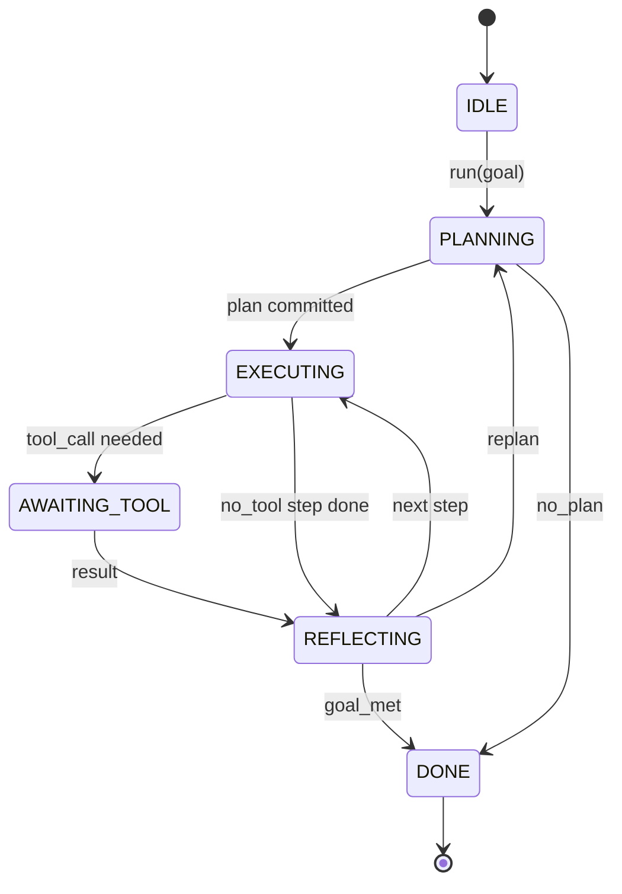

<!-- local-zh-machine-draft: English source is canonical; prose translated automatically, code/math preserved. -->

<a id="agent-harness-loop-contract"></a>

# Agent Harness 的循环契约

> 该 harness 是该 agent。模型是一个共同处理器。这个课程冻结了循环合同,可以将任何模型连接到其中。

**类型：** 构建
**语言:** Python
**先修要求:** 第13阶段课程01-07,第14阶段课程01
**时间：** ~90 分钟

<a id="learning-objectives"></a>

## 学习目标
- 指定 agent harness 循环作为确定性国家机器 有着明确的转变。
- 实施十个生命周期钩题 操作员通过电传政策,遥测, guardrails 进入.
- 定义循环让控制回调器并恢复输入的两个拉点。
- 执行每届会议预算(第2005/30号决定) tool calls,墙上时钟),不泄漏部分状态超过。
- 释放11种事件类型的打印流, 这样下游的 UIs 和 跟踪器可以不直接检查循环而订阅 。

```figure
cf-loop-contract
```

<a id="the-frame"></a>

## 框架

一个 coding agent 运行40个转折时无人看管的状态机器不是聊天圈。 它是一个国家机器, 操作员可以拦截它, 操作员可以检查它的边缘。 一旦您写下合同, 交换模型、 工具或策略就不再是一个重构器。 它变成了注册电话 。

这个课程就是合同的基础。我们列出六个州,十个钩子主题,两个拉点,11个事件类型,和一个预算包。 harness (工具登记册, JSON-RPC 将电路、调度器、平板机插入到这个形状中。

<a id="the-states"></a>

## 各州

循环有六个州,五个在活动,一个是终端



`IDLE` 是唯一合法的入境点 `DONE` 是唯一合法出口 `AWAITING_TOOL` 是唯一能产生拉点的状态。 每一个其他的过渡都是内部的。

国家机器是决定性的,根据同样的事件日志 harness 重新进入同一状态。 该属性可以让您在不重命名模型的情况下重放调试会话 。

<a id="the-hook-topics"></a>

## 钩子话题

钩子是接线员的接缝 harness 点燃十个主题。 每个主题都接受任何数目的订户。 订阅者可以按登记顺序点火。 用户可以改变有效载荷, 提高到中止转弯, 或者返回一个哨兵以跳过下一步 。

```text
before_plan         after_plan
before_tool_call    after_tool_call
before_step         after_step
on_error
on_pause
on_budget_exceeded
on_complete
```

形状反映了什么 Claude 代码、 光标和 OpenCode 到 2025 年中时全部会聚。 名称是功能性的, 不是品牌的。 勾可击块 `rm -rf` 生活在 `before_tool_call`。一个挂钩, 开关遥测仪可以覆盖生命 `after_step`。一个在暂停的会话上继续的钩子, 活在 `on_pause`.

<a id="the-pull-points"></a>

## 引力点

循环产生控制两次。 `AWAITING_TOOL` 无法在工具结果下取得进展时。 `on_pause` 当预算用完或钩子明确要求进行人力审查时。

扣点不是一个例外,它是回。 harness 状态, 获取任何 harness 问,电话 `resume(payload)`. 该 harness 取出它停止的位置。 这是和 A 相同的形状 Python 发电机,通过拉点的运输由你选择。在拖拉机中,它是按键。 MCP 就是这样 `tools/call`。在排队之后,这是一个工作民意测验。

<a id="the-event-stream"></a>

## 事件流

循环将事件附加到合同中特定点的打印流。 流只附加, 用户可以从任何偏移处重播。 11个已执行的事件类型是:

- `session.start` ——当 `run(goal)` 被称作
- `plan.draft` 计划者返回计划草案时发布
- `plan.commit` ——在草案作为现行计划被承诺后发放
- `step.start` 在每个执行步骤开始时排放
- `step.end` 在每个执行步骤结束时排放
- `tool.call` 需要工具的步数让呼叫者控制时释放
- `tool.result` 恢复时发布工具结果
- `tool.error` 恢复时发布错误或钩子中止呼叫
- `budget.warn` 达到预算限额时排放量
- `session.pause` 循环在暂停时(预算或钩)产生时释放
- `session.complete` - 当循环到达时,一次释放 `DONE`

事件不会重复钩子有效载荷。 钩子是绝对必要的( 平衡、 中止) 。 事件是观察性的( 记录、 船舶 ) , 将其视为正弦 。

<a id="the-budget-envelope"></a>

## 预算封套

会话有三条限制 计数 tool call 数, 墙上时钟秒。 每个旋转递增一个旋转。 每一个 tool call increments tool calls 。 每州过渡都要检查墙上时钟。 当达到任何限制时, 循环着火 `on_budget_exceeded`, 发射 `budget.warn`,然后转换为 `IDLE` 下一个拉点是预算超支的原因

预算不是杀机,而是收益。打电话者决定是延长预算,还是继续开会,还是结束会议。

<a id="what-this-lesson-does-not-do"></a>

## 课程没有效果的

它不叫模型, 它不注册真正的工具。 它不执行运输。 这是接下来的四节课。 此课钉上了合同, 以便下四节课可以不重写而插入它 。

确定性计划者 `main.py` 是一个备用。它返回一个由三步组成的硬编码计划,其中两步需要工具结果。关键是循环,而不是计划。

<a id="how-to-read-the-code"></a>

## 如何阅读代码

`HarnessLoop` 主要是在主课上,它有状态,有火钩,有活动 `Budget` 轨道限制 。 `Event` 是流上打过的信封。 `HookRegistry` 是调度表。 `_transition` 是唯一改变状态的函数, 所以国家机器的变异性 生活在一个地方。

Read `main.py` 上到下。 然后读取 `code/tests/test_loop.py`测试将每个转折和所有钩子射击命令都钉住

<a id="going-further"></a>

## 继续

最难的建筑 harness 生产中不是国家机器, 它使合同生效。 合同必须经过热重重装填。 它必须经受一个返回错误的工具 JSON。它必须生存 钩,在 `before_tool_call` 翻转四十四回合的三分之二。 本课中的测试会练习失败模式。 运行它们, 打破它们, 添加例数 。

下一个课程添加工具注册。 JSON-RPC 之后, 调度员。 根据第24课, 此文件中的循环将会运行一个真实的计划, 与实际工具相对应, 并强制执行真正的预算 。
