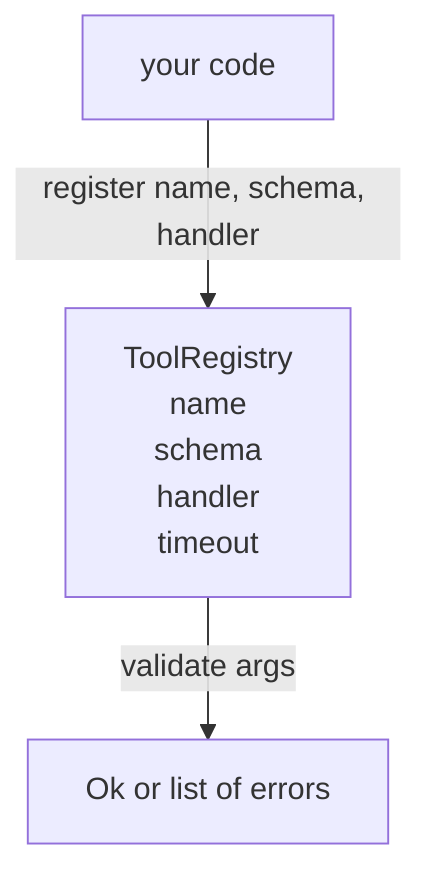

<!-- local-zh-machine-draft: English source is canonical; prose translated automatically, code/math preserved. -->

<a id="tool-registry-with-schema-validation"></a>

# 带 Schema 校验的工具注册表

> 一个工具 agent 无法验证是一个工具 agent 无法调用。 在您创建工具之前先构建注册和系统检查器 。

**类型：** 构建
**语言：** Python
**先修要求:** 第13阶段课程01-07,第14阶段课程01
**时间:** ~90分钟

<a id="learning-objectives"></a>

## 学习目标
- 持有一个工具名“ schema ” 的打印注册簿, 调度员可以询问一次, 并在事后信任 。
- 执行a JSON 涵盖关键词的Schema 2020-12子集 tool calls 确实使用。
- 准确的返回 json- 点形错误路径,这样模型可以一次回程自我校正。
- 拒绝重新登记,但没有明确的超文本,因为静默的重叠是生产工具目录如何漂移的。
- 保持验证器纯度( 没有 I/ O, 没有时间, 没有全局) , 这样它就可以在重播日志上重新运行 。

```figure
cf-registry-validate
```

<a id="why-the-registry-comes-before-the-tool"></a>

## 为什么注册处会先于工具

一个 coding agent 2026年的注册工具比模型适合的要多 context window。非三重 harness 将记录200个工具, 并显示在任何一转。 注册是“ 存在哪些工具” 、 “ 他们的论点会是什么形状” 和“ 我该叫什么处理器 ” 的真理来源。 一旦这三个答案被锁定, 便会被钉住。 rest 的 harness 别再猜了

我们避免的错误是没有计划航运操作者,或者没有验证的运输系统。两者都是常见的。 两者都把下一个层( 课程23中的调度员) 变成一个猜谜游戏, 其中唯一的失败模式是堆叠 trace 由处理器。

<a id="what-a-tool-record-looks-like"></a>

## 工具记录看起来像什么

```text
ToolRecord
  name        : str          (unique, lowercase alphanumeric and underscore segments separated by dots, e.g., snake_case.segment.case)
  description : str          (one line, shown to the model)
  schema      : dict         (JSON Schema 2020-12 subset)
  handler     : Callable     (async or sync, returns Any)
  idempotent  : bool         (dispatcher uses this for retry decisions)
  timeout_ms  : int          (override per-tool dispatcher default)
```

预案是验证者接触的唯一字段。 处理者对此不透明。 我们故意将其分离。 预图是数据。 处理者是代码。 混合它们会诱惑你将验证逻辑输入到处理者中, 而我们正在停止的错误就是 。

<a id="the-json-schema-2020-12-subset"></a>

## 该 JSON 2020-12子集

2020-12年全图是一份论文,我们需要八个关键词。

```text
type           string / number / integer / boolean / object / array / null
properties     map of property name -> schema
required       list of property names
enum           list of allowed primitive values
minLength      integer, applies to strings
maxLength      integer, applies to strings
pattern        ECMA-262-compatible regex, applies to strings
items          schema applied to every array element
```

足够覆盖什么工具 API 实际上需要。 我们没有添加的关键词( 包括任何、 全部、 $ref、 有条件) 在生产图案中有效, 但是将验证符转换成带循环的树漫步器 。 我们正在建立一个注册簿, 不是一个 JSON 气管发动机

<a id="json-pointer-error-paths"></a>

## Json 指针错误路径

验证失败时, 验证者返回一个错误列表。 每个错误都包含 json- 输入的指针路径。一个指针是属性名称和数组索引的斜线前置序列。

```text
{"a": {"b": [1, 2, "x"]}}
                    ^
                    /a/b/2
```

模型读错误路径比读句子更好。 如果计划需要 `args.user.email` 和模型通过一个整数,错误应该是 `/user/email` 与 `expected_type: string`模式在下一次呼叫时对它进行修正,没有使用一回合自然语言。

<a id="registration-and-override"></a>

## 登记和撤销

`register(name, schema, handler, **opts)` 默认情况下拒绝重新注册。 呼叫者必须经过 `override=True` 替换。 这是操作卫生。 代号库中有两个部分 静悄悄地注册了同一个工具名称, 这是一种在生产过程中需要一周才能找到的错误 。

登记册披露了三种阅读方法。 `get(name)` 返回记录或升起。 `validate(name, args)` 返回“ `Ok` 或一个错误列表。 `names()` 返回注册顺序中的工具名称。

<a id="what-the-validator-is-and-is-not"></a>

## 验证者是还是不是

它是在树上的一条通道,它具有递归性。它是纯洁的,不呼叫操作者。它不强制类型(字符串)。 `"42"` 不会通过数字图案。它不会静静地跳过。

这不是安全边界。 恶意的操作者在验证通过后仍然可以行为不当。 课程23中的调度员增加了超时, 并且 sandbox 层。 登记册添加形状 。

<a id="shape"></a>

## 形状



<a id="how-to-read-the-code"></a>

## 如何阅读代码

`code/main.py` defines `ToolRegistry`, `ToolRecord`, `ValidationError`,和八个验证符。 `schema["type"]` (或用一种方法处理一种假想) `enum` 键。 每一个类型验证符返回空列表或列表 `ValidationError`。顶层行走器会将错误相联,并随着路径的下降而预设路径段。

`code/tests/test_registry.py` 包括登记、覆盖、验证成功、验证失败和路径,以及子集中的所有关键词。

<a id="going-further"></a>

## 继续

课一结束,你就要两个扩展 `$ref` 对照当地定义块, `additionalProperties: false` 用于严格的形状。 两者都是小的。 工具目录在50个工具之后, 添加起来是常见的。 我们把它们从课中漏掉了, 以便让文件在一个文件下读取 。

下一个课程(22)是: JSON-RPC 将注册处显示为模型客户端的平面传输。 课后( 23) 的课将调度器后面加短和重试。
