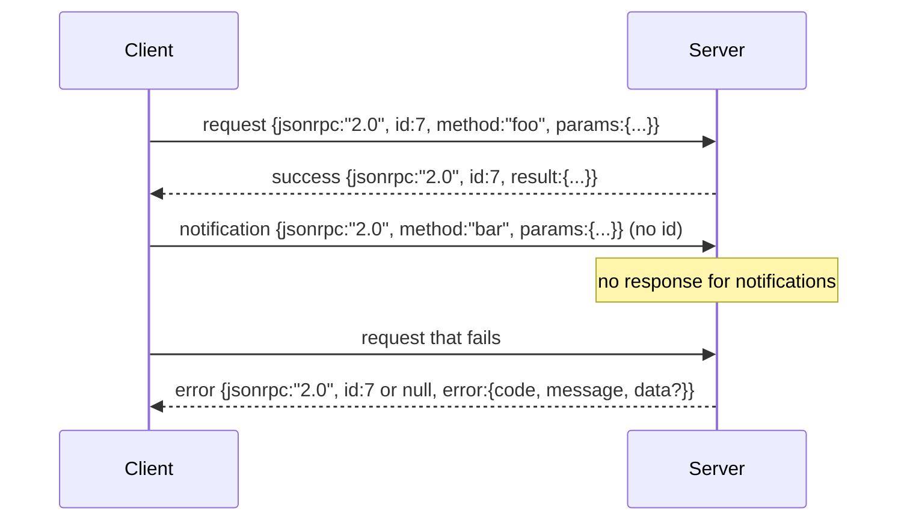

<!-- local-zh-machine-draft: English source is canonical; prose translated automatically, code/math preserved. -->

<a id="json-rpc-20-over-newline-delimited-stdio"></a>

# 通过换行分隔的 stdio 传输 JSON-RPC 2.0

> 模型客户端与工具服务器之间的传输 JSON-RPC 手卷曾经教你每个框架层的付出是什么

**类型：** 构建
**语言:** Python
**先修要求:** 第13阶段课程01-07,第14阶段课程01
**时间:** ~90分钟

<a id="learning-objectives"></a>

## 学习目标
- Speak JSON-RPC 2.0 以新线限定格式 JSON 过史丹和史丹特。
- 绘制五个标准的错误代码(-32700、-3260、-32601、-32602、-32603),并用正确的语义标出。
- 区分请求、答复、通知和批次,不发明新的信封键。
- 处理每行一个分析错误而不中毒 rest 溪流的
- 使用 io. ByteseIO 构建自终结演示, 这样课程就可以在不生成孩子程序的情况下运行 。

```figure
cf-jsonrpc-frames
```

<a id="why-json-rpc-stays-the-lingua-franca"></a>

## Why JSON-RPC 保留语法

一个 coding agent 2026年, 在一个会话中与12个工具服务器进行交谈。 每个服务器是一个单独的进程或远程端点。 自2013年以来, 电线格式一直相同 。 JSON-RPC 2.0是两页的规格。它之所以能够生存,是因为其他选择(菲律宾竞争委员会, HTTP 每个调用, 自定义二进制) 全部进行权衡 JSON-RPC 他们没有: 他们选择了 streaming 或分批或运输相交。 JSON-RPC 横跨平方,插座,网套, HTTP客户可以驾驶一个服务器, 它从来没有见过,如果两者都遵守了规格。

此课构建了标准变体。 Newline- delimit JSON。每个请求是一条线。每个响应是一条线。运输边界是 `\n`.

<a id="the-wire-shape"></a>

## 线形

四个信封形状存在,两个由客户方说,两个由服务器说。



通知没有 `id`。服务器不能对此做出回应。如果服务器返回对通知的答复,客户无法将其附加到呼叫站点。该单一规则使设置的数学简单。

批量是 JSON 请求或通知的数项。服务器在答复中按顺序排列,每个非通知条目都有一个。如果批次中的每一个条目都是通知,服务器将不发送任何回信。

<a id="the-five-error-codes"></a>

## 五个错误代码

```text
-32700  Parse error      JSON could not be parsed
-32600  Invalid Request  Envelope shape is wrong
-32601  Method not found
-32602  Invalid params
-32603  Internal error
```

-32000 和 -32099 之间的代码为服务器定义的错误保留。其他所有代码都由应用程序定义。课程将坚持到五个。如果您的处理器提出,则传送方式将它以 - 32603 结尾,但类名除外 `data.exception`.

分析错误有特殊规则。 `id` 回应是 `null`,因为请求从未解析 足以提取一个ID。

<a id="newline-framing-and-the-bytesio-demo"></a>

## 新线框和 BytesIO 演示

运输时读取一条线。 `\n`。如果一条线无法解析,运输工具会写上 `id: null` 继续,流水没有中毒,下一行是新线

给大家一个教训 `io.BytesIO` 将您输入到 STDUT 和 stdout 。 服务器读取请求直到 EOF, 撰写对每个请求的答复并返回。 客户端读取回响应。 没有进程生成。 没有超时。 传送行为与真正的子进程管道完全相同, 因为 Python的 `io` 界面显示相同 `.readline()` 和 `.write()` contract.

<a id="method-dispatch"></a>

## 方法发送

运输工具不知道有什么方法, 它会转到可调用的方法 `handler(method, params)` 中文本不需修改 harness 设置。处理器返回结果或提高。三个例外类别显示特定的代码。

```text
MethodNotFound -> -32601
InvalidParams  -> -32602
Anything else  -> -32603 with exception name in data
```

运输工具从未看到过 。 注册程序位于操作器后面, 这是我们想要的分层。 运输工具会说话 。 JSON-RPC。注册处会说工具形状,调度员(第23页)把它们缝在一起。

<a id="stream-behavior-on-errors"></a>

## 错误时流行为

```text
client writes              server reads             server writes
---------------            -----------              -------------
{...valid request...}      parses ok                {...response, id matches...}
{...broken json...         parse fails              {id:null, error: -32700}
{...valid request...}      parses ok                {...response, id matches...}
{...missing method...}     invalid envelope         {id:X, error: -32600}
```

断了 JSON 行不能阻止循环。 缺少 `method` 字段不会停止循环。处理器的例外不会停止循环。传送一直读到 EOF 。

<a id="notifications-and-asymmetric-flows"></a>

## 通知和不对称流动

通知是火速闪烁 harness 使用进度事件通知、 取消信号和日志行。 通知是指一个长运行的工具如何可以流动状态更新而无需对每个工具进行回转跟踪 。

教义里用一个外向通知员 `write_notification`。服务器在请求在飞行时使用它来发布进度。演示显示模式:请求被输入,处理者发出两个进度通知,然后写出最后答复。

<a id="how-to-read-the-code"></a>

## 如何阅读代码

`code/main.py` defines `StdioTransport`,分析助手(`parse_request`),三个写作助手(`write_response`, `write_error`, `write_notification`),以及发送环 `serve`。错误代码常数在模块范围中运行。

`code/tests/test_transport.py` 包括五个错误代码、通知(没有写入回复)、批次(数组、阵列、通知跳过)、折叠 JSON 以及处理者在中调时写通知的不对称流动。

<a id="going-further"></a>

## 继续

生产运输增加了三样东西。 `id` 已经是这样了,但是在网格里你需要一个外表 trace id 。 取消频道( 通知如 `$/cancelRequest` 和内容类型的谈判握手,让同一个插座能够说话 JSON-RPC 和可移动 HTTP。这些都无法改变电线,它们会添加元数据。
