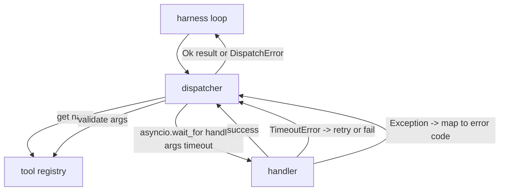
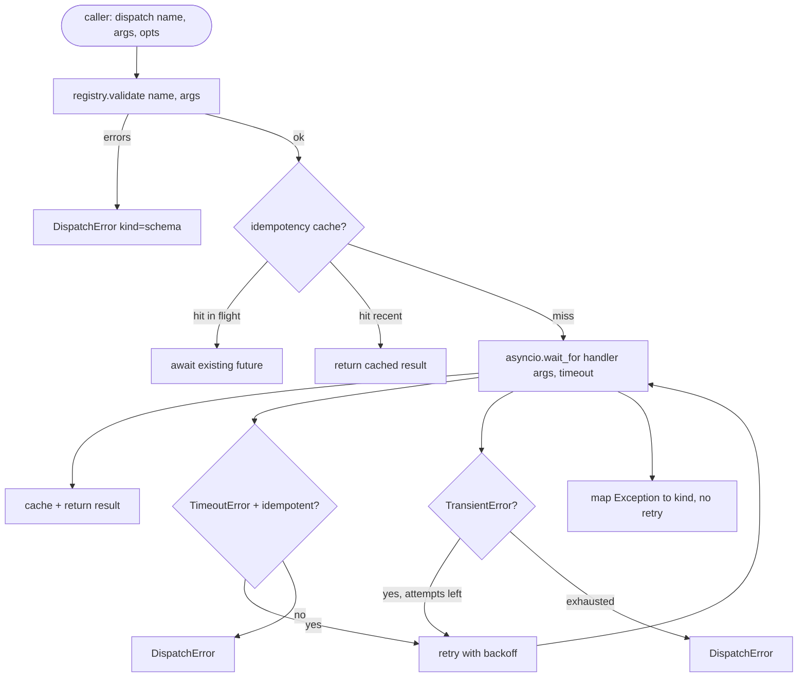

<!-- local-zh-machine-draft: English source is canonical; prose translated automatically, code/math preserved. -->

<a id="function-call-dispatcher"></a>

# 函数调用分派器

> 调度员在那边 harness 支付所有的承诺, 时间过长, 时间过长, 时间过短, 错误绘图。

**类型:** Build
**语言:** Python
**先修要求:** 第13阶段课程01-07,第14阶段课程01
**时间:** ~90分钟

<a id="learning-objectives"></a>

## 学习目标
- 将工具处理器包在每次调用超时中, 返回输入错误而不是挂挂环 。
- 使用 Qit 和最大尝试数来进行指数反转重试 。
- 重复重写 idempotency 键,这样重试,与慢速原体的赛跑不会运行两次。
- 地图处理器例外和运输故障 harness 循环已经理解了。
- 平行发送并带有货币限额,因此有40个粉丝 tool calls 活动循环不耗尽。

```figure
cf-dispatch-retry
```

<a id="where-the-dispatcher-sits"></a>

## 调度员坐的地方

中间 harness 环( 20 号) 和 工具登记册( 21 号) 。 传送( 22 号) 向环( 22 号) 提供环。 环手 a tool call 发送者呼叫登记,运行处理器,然后返回结果或 JSON-RPC- 形错信封



调度员是唯一知道计时器、重试和 idempotency。循环不。登记处不。处理者不。隔离是关键。

<a id="timeouts"></a>

## Timeouts

每个工具都有默认超时。 `timeout_ms`。当您在命令中被自动替换时,调度员将自动替换。 harness 过一号,我们用 `asyncio.wait_for`。超时时,处理任务被取消,调度员返回 `DispatchError(kind="timeout")`.

对于非全能工具来说,超时不是一个可重试的错误。 A `db.write` 超时与否 。 重试重复了文字 。 调度员尊重 `idempotent` 重试无能力工具。

<a id="retries-with-exponential-backoff"></a>

## 以指数反向重试

重试政策是最多三次尝试。 后退是随音速加速的 。

```text
attempt 1  -> delay 0
attempt 2  -> delay 0.1s * (1 + random[0..0.5])
attempt 3  -> delay 0.4s * (1 + random[0..0.5])
```

仅 `timeout` 和 `transient` 重试错误。 A `schema` 错误, a `not_found`,或 `internal` 错误不重试。 方案错误是决定性的。 重新尝试不会改变结果, 并烧坏预算 。

重试循环尊重预算 harness。如果呼叫者的预算为零 tool calls,调度器在第一次尝试时迅速失败并返回 `kind="budget_exceeded"`.

<a id="idempotency-key-dedupe"></a>

## Idempotency 键的下调

重试在原始在飞行时点火的操作是一个真正的生产错误。 第一个呼叫挂在四点九秒( 仅停放时) 。 重新尝试在五秒内。 现在两个请求对同一后端进行比赛 。 如果该工具是 , 那么它会自动运行 。 `payments.charge`,你收费两次。

调度员接受可选 `idempotency_key`。如果同一键在飞行中,在呼叫到达时,调度员会等待飞行中的将来并返回其结果。缓存在完成后保持了60秒,以吸收延迟的重试。

关键是电话人的责任 harness 是从计划者那里得来的 `f"{step_id}:{tool_name}:{hash(args)}"`。调度员不会发明密钥,因为单凭争论就能得出一个密钥,使得两个语义上不同的调用看起来是一样的。

<a id="error-envelope"></a>

## 错误信封

发送失败返回单一形状 。

```text
DispatchError
  kind        : "timeout" | "transient" | "schema" | "not_found" | "internal" | "budget_exceeded"
  message     : str
  attempts    : int
  jsonrpc_code: int   (one of -32601, -32602, -32603)
```

该 harness 环形地图 `kind` 转到下一个状态。 `schema` 和 `not_found` 转到 `on_error` 并启动一个重新规划。 `timeout` 和 `transient` 转到 `on_error` 并且可能或可能不会根据尝试重新规划。 `budget_exceeded` triggers `on_budget_exceeded`.

<a id="concurrency-limit-on-fan-out"></a>

## 扇形外币货币限额

`gather(*calls)` 同步运行全部 共程。 tool calls,就是40个打开的插座或40个子处理管道。大多数后端不喜欢一个客户端的40个平行连接。

调度员进行折叠 `gather` 默认的同值货币限值为 8。 每一个电话在发送和发还前都会获得同值货币限值。 调用者会看到 `gather`- 形状输出,但实际的时间安排是被捆绑的。

<a id="flow-for-one-call"></a>

## 一次通话



<a id="how-to-read-the-code"></a>

## 如何阅读代码

`code/main.py` defines `Dispatcher`, `DispatchError`, 和 `TransientError`。调度员在施工时进行注册。 `dispatch(name, args, ...)` 是唯一的切入点。 每一个尝试时间间隔都应用在内部 `_run_with_retries` 使用 `asyncio.wait_for`. `gather_bounded(calls)` 使用多种货币货币限制的发送方式。

`code/tests/test_dispatcher.py` 覆盖超时射击, 在瞬时重试, 不重试于计划错误, idempotency 调用(两个同时通话,同一钥匙倒塌,一个操作员援引)和计算货币限制(行动中出现血肿)。

测试使用 `asyncio.sleep(0)` 和确定性 `Counter`- 基地的操作员,所以他们用毫秒完成, 并且不取决于 墙时钟的时间。

<a id="going-further"></a>

## 继续

有两个扩展生产调度器添加。 首先, 在每次转换时都进行结构化记录( 循环事件流已经给了您), 但调度器也应该发布 `dispatch.attempt` 和 `dispatch.retry` 第二, circuit breakers:在窗口中 N 失败后,工具会有一个冷却期, 即发送立即返回 `kind="circuit_open"` 而不是尝试操作器。 两者都适合在这个调度器之上, 而不更改合同 。

二十四课把调度员粘到一个计划与执行的 agent 所以你看到所有四个片子都在动
