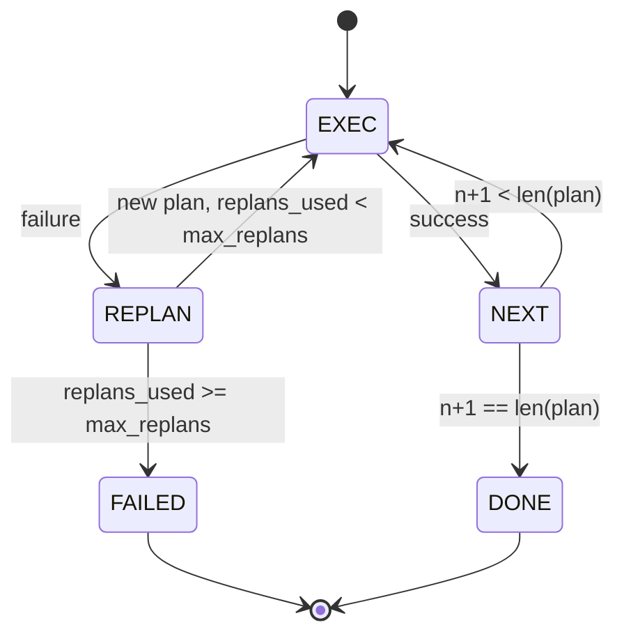

<!-- local-zh-machine-draft: English source is canonical; prose translated automatically, code/math preserved. -->

<a id="plan-execute-control-flow"></a>

# 计划—执行控制流程

> 无法幸存的失败计划是一个脚本。 agent。先构建重规划器。

**类型:** Build
**语言:** Python
**先修要求:** 第13阶段课程01-07,第14阶段课程01
**时间:** ~90分钟

<a id="learning-objectives"></a>

## 学习目标
- 将计划作为打印步骤的有条不紊的清单,以便执行人能够说明进展和结果。
- 以控制失败的方式相继执行步骤 handoff 回到计划者那里
- 从当前光标重规划上下文中的前一个错误, 以便通知下一个计划 。
- 发布每版版本的计划,让下游追踪器或UI能够显示计划为何改变。
- 实施两项预算:硬性一步上限和硬性重计划上限。

```figure
cg-plan-replan
```

<a id="plan-and-execute-not-chain-of-thought"></a>

## 计划和执行,而不是 chain-of-thought

一个 chain-of-thought agent emits tokens 并让环形猜想 tool call 结束。 计划与执行 agent 首先是发布结构化的计划,然后以决定性的方式执行每个步骤。 harness 执行 harness 通过调度器运行数据。

两块。 计划制定者, 计划执行者。 有趣的是, 当执行者遇到失败时会发生什么。 三个选项 :

```text
1. Abort         (return failed, surface the error)
2. Skip          (mark step failed, continue with the rest)
3. Replan        (hand the error to the planner, get a new plan from the cursor)
```

重计划是把剧本变成 agent.

<a id="the-step-shape"></a>

## 步态

```text
Step
  id              : int           (monotonic within a plan revision)
  tool_name       : str
  args            : dict
  expected_outcome: str           (planner's stated success condition)
  result          : Any | None
  error           : str | None
```

`expected_outcome` 是一个短句,计划者随着这个步骤发出。它不是由执行者强制执行的。它有两个方面:重新规划者在修改计划时读到它;事件流释放它,以便追踪器能够显示“这一步骤应该做X”。

<a id="the-planner-shape"></a>

## 规划器形状

```python
def planner(goal: str, history: list[Step], last_error: str | None) -> list[Step]:
    ...
```

纯净的功能 `goal` 是用户目标。 `history` 表示已经执行的步骤(结果和错误已填入)。 `last_error` 是在第一个调用时没有,在以后每次调用时也都会有最近的失败信息。规划员从光标返回下一个计划。

计划者不知道执行者。 它不知道重试。 它不知道超时。 它会提出一个计划。 仅此而已 。

<a id="the-executor"></a>

## 执行器

执行器是一个小的州级机器。 每一步都通过调度器运行。 结果有三点之一:成功、可重排失败、可倒计时失败。 可重排失败可以交给计划者。 致命失败( 预算超过预算, 重排上限) 返回一个 `FAILED` 届会结果。



<a id="plan-diffs-on-revision"></a>

## 修改计划

当计划者在失败后返回新计划时,执行者会发出 `plan.diff` 3个字段的事件。

```text
removed: list of step ids that were in the old plan and are not in the new
added  : list of step ids in the new plan that were not in the old
revised: list of step ids whose tool_name or args changed
```

跟踪器或 UI 可以将此作为删除的步数的删除和加插的跳点。 点不是 diff 格式。 关键是修改是一个可见的事件, 不是静音重写 。

<a id="two-budgets-both-hard"></a>

## 两次预算,都很难

`max_steps` 在整个过程中,包括重计划在内,总步骤处决上限。默认为12。一个线性五步计划,每重计划两次,每次增加三步,达到16次,超过预算。执行者将拒绝重计划并返回FAILED。

`max_replans` 限制第一个计划之后计划者被调用的次数。 默认为 5。 这是更重要的限度。 如果一个连续返回同一个破碎的计划, 则会循环到一步预算抓住它为止。 挂起的重排使失败更快, 并且理由更清楚 。

<a id="the-deterministic-planner-in-this-lesson"></a>

## 课程中的决定性计划者

我们不称这个课为模式。 课程中包含一个决定性的计划者,根据 `last_error`.

```text
last_error is None    -> emit a four-step plan
last_error matches X  -> emit a three-step plan that routes around X
last_error matches Y  -> emit a two-step plan that gives up gracefully
otherwise             -> return [] (signals nothing to replan)
```

这足以检验执行者在每个过渡过程中的行为:成功、重新规划、两次规划、再规划、累赘和逐步预算耗竭。

<a id="result-shape"></a>

## 结果形状

```text
SessionResult
  status      : "completed" | "failed"
  reason      : str     ("goal_met" | "step_budget" | "replan_budget" | "no_plan")
  history     : list[Step]
  revisions   : list[PlanDiff]
  events      : list[Event]
```

该 harness 从第20课中循环可以直接读取。 第23课中的调度员执行每个步骤。 从第21课中注册的每步参数都得到验证。 从第22课中传输的信号将显示整个流经 JSON-RPC 给一个模范客户端

<a id="how-to-read-the-code"></a>

## 如何阅读代码

`code/main.py` defines `PlanExecuteAgent`, `Step`, `PlanDiff`, `SessionResult`,以及确定性规划者。 `run(goal)` 返回 `SessionResult`。计划 diff 是通过比较步骤代号来计算的, `(tool_name, args)` tuples.

`code/tests/test_agent.py` 包括一个线性的成功, 一个中计划失败 重新规划一次, 重新规划用尽,返回 `failed:replan_budget`, 递增预算耗竭, 以及计划- 时间事件格式 。

<a id="going-further"></a>

## 继续

将它连接到一个真实的模型后, 您想要两个扩展。 首先, 部分计划缓冲: 当计划成功后, 六步中的前三步失败了, 您不想重新运行前三步。 执行者已经保存历史; 计划者只需要读取它。 其次, 平行的 。 branches:当前执行程序严格按顺序排列。一个发放独立文件的策划者 branch (`gather_step` 而非 `next_step`) 可以运行二 tool calls 由调度员同时负责

两者都增加了真正的复杂性。 一旦线性执行器被钉住, 两者就更容易添加。 这就是这个课程的作用 。
