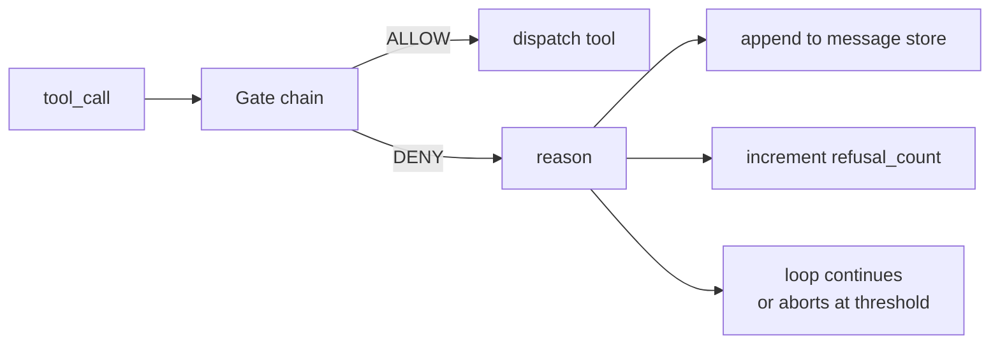
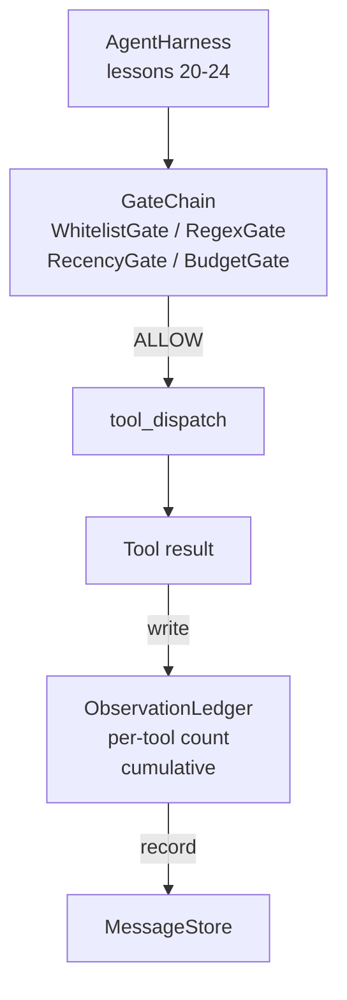

<!-- local-zh-machine-draft: English source is canonical; prose translated automatically, code/math preserved. -->

<a id="capstone-lesson-25-verification-gates-and-the-observation-budget"></a>

# 综合项目第 25 课：Verification Gates 与观察预算

> 一个 agent harness 无需验证层是海沟服中的愿望。 这个教训构建了决定是否 tool call 允许射击, 有多少输出 agent 允许看到, 当循环必须停止, 因为 agent 已经读得太多。 链条是由小的、 命名的大门和观察分类账组成的, 并跟踪每个 token 模型已经显示。

**类型：** 构建
**语言:** Python (stdlib)
**先修要求:** 阶段19 20-24(轨道A1: agent loop工具注册、信息存储 prompt builder, model router阶段14 · 33(作为制约因素的指示),阶段14 · 36 (scope contracts阶段14 - 38(第1段)verification gates)
**时间:** ~90分钟

<a id="learning-objectives"></a>

## 学习目标

- 构建 `VerificationGate` 带有确定性的协议 `evaluate(call)` 方法.
- 将预算、静脉、白名单和正统门 混入一个有短路语义的链条
- 跟踪每个观测 `ObservationLedger` 由工具键入,然后转弯。
- 拒绝a tool call 累计观察预算将超出时。
- 表面结构 `GateDecision` 记录下游 observability 能够吃。

<a id="the-problem"></a>

## 问题

当 agent harness 让模型调用工具自由, 三个类错误在真正使用的第一个小时出现。

第一个是无约束观测。 超过200K线的回波倾弃50万个 tokens 将输出转换为下一转。模型看到每千字节匹配一个, rest 被浪费的语境。 token 账单很大, agent 现在任务更糟糕,而不是更好。

第二个是僵硬的耐性 长期的任务累积了50个 tool calls。模型将第一个读取_从第3转到文件, 仿佛它是实时状态。 编辑在第47转上从不出现, 因为 prompt 建筑商首先将最早的观测结果连成系列。

第三是特权怪癖 研究任务从呼叫 `web_search`,然后不知怎么的 运行 `shell` 因为模型发明了一个工具名 harness 默认为允许。 当有人读取 trace,一个垃圾文件在/tmp中,一个卷子在对着一个私人 API.

一个 verification gate 是该 harness 说不的成分。它不是一个模型。它不是法官。它是一个决定性的功能 `(call, history, ledger)` 返回 ALLOW 或 DENY 。 原因被登录。 模型被告诉。 循环会继续或中止 。

<a id="the-concept"></a>

## 概念



门是任何有 `evaluate(call, ctx) -> GateDecision` 方法。链是一个有顺序的清单。 Evaluation 第一次否认时的短路。 秩序很重要: 廉价的结构门在昂贵之前运行 token- 计数门

这堂课载了四道门:

- `WhitelistGate`。允许的工具名称是明确的。任何外部的都被拒绝。这是最便宜的大门,先运行。
- `RegexGate`。工具参数与正则对齐。拒绝 shell 调用可用 `rm -rf` 或, HTTP 呼叫内部IP,完全在呼叫有效载荷上
- `RecencyGate`。该模型只看到上次N回合的观测结果。老的观测结果被遮蔽。 tool call 其结果将扩展一个已经衰减的观察窗口。
- `BudgetGate`。 tokens 模型在整场会议中读到的有一个上限。 当分类账上说上限已经达到时, 还会有 tool call 被否决。

观察分类账就是簿记,每个成功者 tool call 写一行:工具名,转身 tokens 分类账回答了两个问题:模型的总和值,以及工具X的值。预算门读取第一个。每个工具的预算门,你将把它写成练习,第二个。

```figure
cg-gate-chain
```

<a id="architecture"></a>

## 建筑



该 harness 询问链条。 链条要么点头, 要么拒绝。 如果它点头, 工具会运行, 分类账会勾选, 结果会被附加到信件存储处。 如果它拒绝, 模式会被作为拒绝 system message 循环决定是重试还是中止。

<a id="what-you-will-build"></a>

## 做你该做的

执行是单一的 `main.py` 加上测试

1. `Observation` 和 `ToolCall` 数据类定义线条形状。
2. `ObservationLedger` records `(turn, tool, tokens)` 行和答案 `cumulative()` 和 `per_tool(name)`.
3. `GateDecision` carries `(allow, reason, gate_name)`.
4. `VerificationGate` 程序。 每个门都执行 `evaluate(call, ctx)`.
5. `GateChain` 包扎一个有命令的清单。 它会呼叫每个大门, 返回第一个拒绝, 或者如果每个大门通过, 返回允许 。
6. 演示会运行一个小合成 agent loop第三个转弯,第三个转弯会经过预算大门,循环报告拒绝情况干净,拒绝次数不为零。

该 token 反制是故意的 `len(text) // 4` 重力学,这课的要点是门管,而不是 tokenizer。 tokenizer 正在生产。

<a id="why-the-chain-order-matters"></a>

## 连锁订单为什么重要

拒绝比允许便宜 `WhitelistGate` 以 O(1) 散列查询方式运行。 `RegexGate` 在 O( 模式) 运行 * argv). `RecencyGate` 读了几小片信息商店 `BudgetGate` 读完整个账簿。你通过提高成本来订购它们,所以在完成昂贵的工作之前,就有一个被否决的短路电话。

您还按爆炸半径订购。 白色列表是最强烈的主张: 此工具不在合同中。 正则门在下一个: 此论点不在合同中 。 常识在后方: harness 预算是最后的,因为根据定义,它只有在其他一切通过时才会起火。

<a id="how-this-composes-with-the-rest-of-track-a"></a>

## 如何组成 rest A轨

之前的课程给了您循环, 工具注册, 信件存储, prompt 建筑师, model router。这个课增加了模型和工具之间的层。 sandbox 送货员要将 tool call 285)\fsp1}到门链上说: harness 记录拒绝是一个质量信号。 28课将门的决定连接到 OpenTelephy 范围。 29课将这里缝合成一个工作 coding agent.

<a id="running-it"></a>

## 运行

```bash
cd phases/19-capstone-projects/25-verification-gates-observation-budget
python3 code/main.py
python3 -m pytest code/tests/ -v
```

演示显示转弯 trace 包括每个门的选题和出口零。测试覆盖了分类账、每个单开的门、链条短路以及合成环端到终端。
