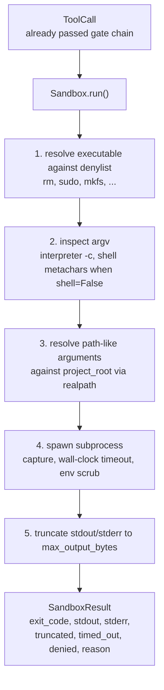
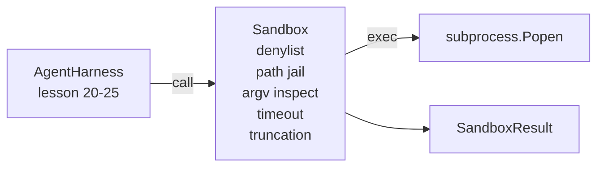

<!-- local-zh-machine-draft: English source is canonical; prose translated automatically, code/math preserved. -->

<a id="capstone-lesson-26-sandbox-runner-with-denylist-and-path-jail"></a>

# 综合项目第 26 课：带拒绝列表与路径隔离的 Sandbox 执行器

> 该 verification gate 决定 tool call 应该是跑。 sandbox 选择它发生时会发生什么。 此课将一个子进程运行者, 拒绝危险的可执行文件, 拒绝危险的 Argv 形状, 将每个文件路径都关到工程根上, 截断输出的大小, 并杀死在墙上超时的离线进程。 这是模型和操作系统之间两层中的第二层 。

**类型：** 构建
**语言:** Python (stdlib)
**先修要求:** 阶段19 25(verification gates 阶段14 · 33(作为制约因素的指示),阶段14 · 38 (verification gates)
**时间：** ~90 分钟

<a id="learning-objectives"></a>

## 学习目标

- 构建 `Sandbox` 类包扎 `subprocess.run` 与超时,捕捉,和短跑。
- 拒绝对拒绝名单和对Argv检查员的组织结构下达名称命令。
- 拒绝在申报的项目根外解决路径参数 。
- 关闭 shell 模式时拒绝 shell 元字符 。
- 返回结构化 `SandboxResult` 下游的 observability 和反演 harness 能够吃。

<a id="the-problem"></a>

## 问题

一个 coding agent Shell可以安装后门、排出键、制成笔记本电脑,并一次将云帐单架起来。 最便宜的防御就是不给Shell。 第二代价最低的是 sandbox 也就是说,没有精确的规律列表。

三次失败会发生在 agent traces.

第一个是危险的可执行文件。 一种在压力下修复路径问题的模型将尝试 `sudo`, `chmod -R 777`, `rm -rf`, `mkfs`, `dd`。这些都不属于 agent 拒绝名单按名字和别名来抓

第二个是"变速器"的把戏。一个没有被告诉贝壳的模型 将会通过翻译来控制攻击: `python3 -c "import os; os.system('rm -rf /')"`, `bash -c '...'`, `node -e '...'`, `perl -e '...'`. 该 sandbox 需要知道任何翻译用 `-c`- 旗子只是外加的贝壳呼叫

第三是逃跑,让模特儿读 `./src/main.py` 转而读取 `../../etc/passwd`. 该 sandbox 将每一条路的争论都通过解决 `os.path.realpath` 并坚持前缀。

该 sandbox 不是一个操作系统感知的安全边界。 确定执行代码的攻击者仍然可以破灭。 sandbox 是一个开发时间 guardrail:它让常见的失败模式响亮,并停止 agent 完全的无能

<a id="the-concept"></a>

## 概念



该 sandbox 具有四个拒绝轴:名称、 argv、 路径、 结构。 每个轴都是调用的一个纯函数, 没有子进程 。 子进程只在每个轴过后才会产生 。

该 `SandboxResult` 退出代码是常规代码:0成功,非零失败,加上3个被否决的监控代码(- 100),时间_退出 (-101) 并短短( 退出代码是真实的, 带有一个标记) 。 下游课程读取了这个结构化的结果, 而不是解析标准 。

```figure
cg-path-jail
```

<a id="architecture"></a>

## 建筑



拒绝列表是可执行的基号集。 Aliases ()`/bin/rm`, `/usr/bin/rm`) 全部确定同一基号。Argv 检查员知道口译的形状:[0] 是翻译,以后的参数以 `-c` 或 `-e` 。 壳体元字符 (C)`;`, `|`, `&`, `>`, `<`背对背 `$()`当电话没有明确要求发射炮弹时,就拒绝。

路边的监狱是最微妙的 sandbox 接受a/ `project_root` 任何看起来像路径的争论( 包含 `/` 或匹配已有文件)通过 `os.path.realpath`,然后对照项目根的真路径检查。如果已解决的目标不在根底之下,则拒绝。Symlink 解密尝试(项目根部中指点外的符号链接)通过检查真实路径而不是字面路径被阻断。

<a id="what-you-will-build"></a>

## 做你该做的

执行 `main.py` 加上测试目录

1. `SandboxResult` 数据类: 退出_代码、 stdout、 stderr、 短跑、 计时_退出,拒绝,理由,持续时间_ms.
2. `SandboxConfig` 数据类:工程_根,最大_输出_字节, 超时_秒、拒绝列表、解释器_block.
3. `Sandbox` class: `run(argv, *, shell=False, cwd=None)` 返回“a” `SandboxResult`.
4. 内部拒绝帮助者: `_check_executable_denylist`, `_check_argv_interpreter`, `_check_shell_metachars`, `_check_path_jail`.
5. 输出短写, 清晰 `truncated` 标记和标记线 在捕获的溪流。
6. 底部演示: 一系列合法和对抗性电话, 每个都以结果显示 。

该 sandbox 使用 `subprocess.run` 与 `shell=False` 默认 `capture_output=True`。墙上的时间超时使用 `timeout` 参数; 开 `TimeoutExpired`, 该 sandbox 杀死处理组,合成沙箱Result。

<a id="why-this-is-not-a-real-sandbox"></a>

## 为什么这不是真的 sandbox

教训 sandbox 不使用命名空间、 组、 secomp、 gvisor、 火花夹或任何内核隔离。 子进程可以做的任何工作, sandbox 保护是结构性的: agent 拒绝最常用的 危险引用, 和响亮的拒绝进入 observability 而不是静静地运行。

用于生产 agents 顶部的一层: 在没有特权的地方运行 Docker 容器,在微VM内运行,投放功能,只读挂项目根和抓取 dir 读写,对内存设置缩放 CPU,将环境清理为已知安全的白列表。29课会做一些。操作系统隔离是无法进行这一课程的。

<a id="running-it"></a>

## 运行

```bash
cd phases/19-capstone-projects/26-sandbox-runner-denylist
python3 code/main.py
python3 -m pytest code/tests/ -v
```

演示创建临时目录, 向它下一个干净的文件, 然后运行一个电话电池。 法律电话成功 。 拒绝调回 SandboxResult 使用 `denied=True` 和原因。 超时返回 `timed_out=True`。 `truncated=True`。演示指纹a JSON 结果和输出表为零。

<a id="how-this-composes-with-the-rest-of-track-a"></a>

## 如何组成 rest A轨

25课制作了门链。26课是执行者,在Alow门后运行。 harness 比较 sandbox 相对于每任务预期退出代码的结果。 `gen_ai.tool.execution` 绕着每个 `Sandbox.run` 29课的端到端导线 coding agent 穿过两层
