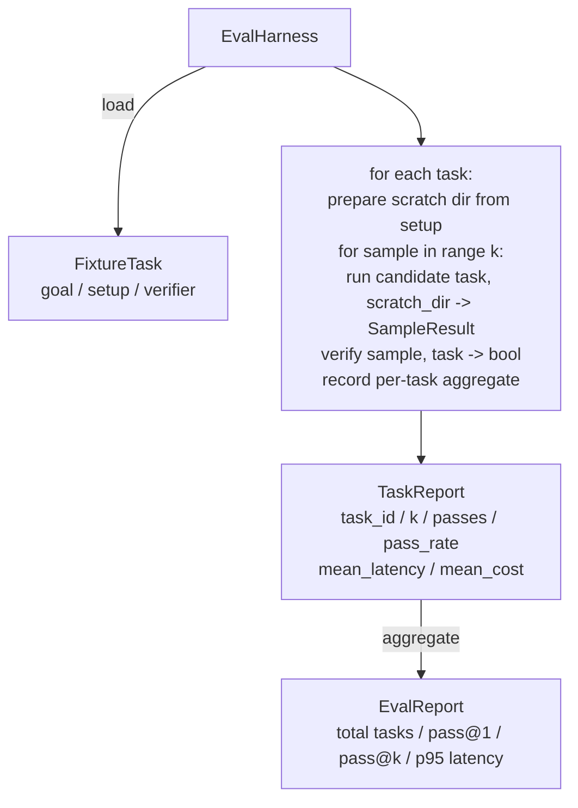

<!-- local-zh-machine-draft: English source is canonical; prose translated automatically, code/math preserved. -->

<a id="capstone-lesson-27-eval-harness-with-fixture-tasks"></a>

# 综合项目第 27 课：使用固定测试任务的评估 Harness

> 一个 coding agent 只能像您测量的一样好。 evaluation harness 使用固定任务文件夹, 运行每个候选人 agent,通过确定性验证器分数或失败,然后将结果汇总到考量@ 1 中。 pass@k,意味着潜伏,和平均成本。 harness 是一个真理的来源,它让你从一个反因中 说出一个倒退。

**类型：** 构建
**语言:** Python (stdlib)
**先修要求:** 阶段19 25(verification gates阶段19 26(a)sandbox 14级 30级(由电子动力驱动) agent 阶段14 · 19 (SWE-Bench和GAIA基准)
**时间：** ~90 分钟

<a id="learning-objectives"></a>

## 学习目标

- 将固定任务定义为三重目标、设置和验证程序。
- 计分多个样本运行每个任务, 计算 pass@ 1 and pass@k.
- 总体潜伏和成本为平均值和95%的度量。
- 电线确定性验证器( 文件 diff, 退出代码, regex 匹配) 变为可重复使用的函数 。
- 开始结构化 JSON 报告回归跟踪脚本可以摄入最多。

<a id="the-problem"></a>

## 问题

三种失败模式 agent 没有评估而建立的基准 harness.

第一个是未经核实的通行证。 agent 说它修好了虫子,人类对Diff的目光, 套房被标为绿色, 三周后 regression test 显示相同的错误。 agent 说得有道理,但实际上没有修补

第二个是未检测到的回归。 prompt 模板 agent 4 % 的音响比14 % 的音响要好, 14 % 的音响比更安静。 没有金牌和每个任务分, 回归只有在客户抱怨时才进入主位和表面。

第三是每个任务流。 逆差在星期一运行, 任务有100个, 在星期五有95个, 因为有人重新命名了五个固定装置。 通行率看起来比这提高了5%。 它不是 。

该 harness 是一个程序,将这些失败变成事实。它运行着每一个固定的, 每次,在复制的顺序中, 与一个验证者对立, 在一个确定性检查中返回真实或虚假。

<a id="the-concept"></a>

## 概念

```mermaid
flowchart LR
  F1[fixtures/task_001/<br/>task.json + expected/] --> Harness
  F2[fixtures/task_002/<br/>...] --> Harness
  Harness[Harness<br/>for each task:<br/>setup / run agent k samples /<br/>verify each sample /<br/>record latency, cost]
  Harness --> Report[EvalReport<br/>pass@1 / pass@k<br/>mean ms / p95 ms<br/>mean cost]
```

一个 `FixtureTask` 是一个小 JSON 文件加上可选 `expected/` 目录。 JSON 声明 `id`, 一个 `goal` (该 prompt 向 agent), 一个 `setup` 区域(要投向抓取目录的文件)和 `verifier` 复选框中。 harness核查员的注册并提供了其论点。

三个核查器形状覆盖大多数有用的任务。

第一条是 `file_equals`。 agent 运行, 比较一个命名的文件与预期内容。 此选项会捕获“ 精确地修正此错误” 任务 。

第二是... . . `regex_match`。名称文件的内容与正则匹配。该功能包含“函数必须存在,返回 X”任务,因为那里有许多可以接受的解决方案。

第三,我说 `shell_exit_zero`. 该 harness 运行 shell 命令( 通过 sandbox 而不是从课程 26 中选择, 只有在命令退出零时才通过任务。 此选项包含“ 测试必须通过” 的任务 。

该 harness 运行每个任务 `k` times. Pass@k 是 `1 - (1 - p)^k` P是经验性通过率; harness 并报告原始计数, 以便发现差异。 时间间隔是每个样本的墙上时钟。 成本是任意 agent 自我报告(token 计数,美元或两者兼有); harness 将之通过样本加以计算,并列出每个任务和总数字。

```figure
pass-at-k
```

<a id="architecture"></a>

## 建筑



候选人是一位可呼者: `Callable[[FixtureTask, str], SampleResult]`. 该 harness 通过 `tempfile.mkdtemp()` 顺着平坦的绳子通过 harness 候选人可能是一个决定性的 patch 可用( 用于 harness 自我测试,真实的 LLM agent合同是样品回收器

<a id="what-you-will-build"></a>

## 做你该做的

`main.py` ships:

1. `FixtureTask` dataclass.
2. `SampleResult` 数据类:成功_self_报告的延迟_百万兆瓦,费用_单位,编辑。
3. `TaskReport`, `EvalReport` 数据类 `to_dict()`.
4. `VerifierRegistry` 映射验证器名称可运行。 内建验证器: 文件_等值, 正则_匹配, shell_exit_zero.
5. `EvalHarness` 类。运行一个任务目录,以对待候选人。返回 Eval Report 。
6. 包装了五个固定任务 `tasks/`:
   - 关闭一个英寸 `fizzbuzz`
   - 失踪返回 `factorial`
   - 错误信件中的打印
   - 空函数正文
   - 连接列表中的脱机
7. 确定性参照候选人(`apply_known_fixes`) 该 harness 用于演示1.0的纯度
8. 模拟指纹 JSON 和出口零。

固定任务被捆绑为 JSON 文件中 `tasks/` 加上配对的源文件 `tasks/<id>/buggy/` 和 `tasks/<id>/expected/`. 该 harness 复制buggy到一个擦伤的目录, 把它交给候选人, 并核实预期。

<a id="why-passk-and-not-just-pass1"></a>

## Why pass@k 不只是通过@ 1

Real LLM agents 0.6的通行证@1看起来像一个失败。0.95的通行证@5表示 agent 大部分时间都得到正确的答案, 但选择错误的早期样本。 修正是 sampling 和排名, 并不总是更多的培训。 Pass@k 使那个能看出来

Pass@k 被报告在通行证@ 1 旁边, 因为 pass@k 以失败为例:如果模型在20个尝试中 得到正确的答案,你没有有用的 agent. 该 harness 显示两个。

<a id="how-this-composes-with-the-rest-of-track-a"></a>

## 如何组成 rest A轨

25课制作了门链,26课制作了 sandbox. 该 harness 使用 sandbox 用于任何 `shell_exit_zero` 核查员。 harness 在OTel 运行 trace。第29课对一个捆绑的固定装置进行端到端演示,并声称为参考候选人提供#1=1.0通行证。

<a id="running-it"></a>

## 运行

```bash
cd phases/19-capstone-projects/27-eval-harness-fixture-tasks
python3 code/main.py
python3 -m pytest code/tests/ -v
```

演示打印 Eval Report 在 JSON,包括 pass@1, pass@5, 表示延迟度, 以及每个任务解密。退出代码为零。测试覆盖了校验功能, pass@k 数学,固定装货, harness 最终到最后对齐捆绑的推荐人。
