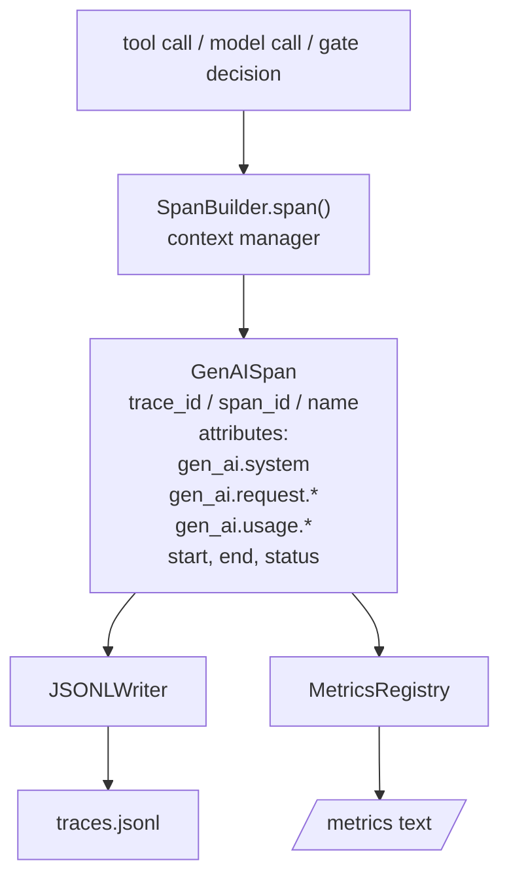
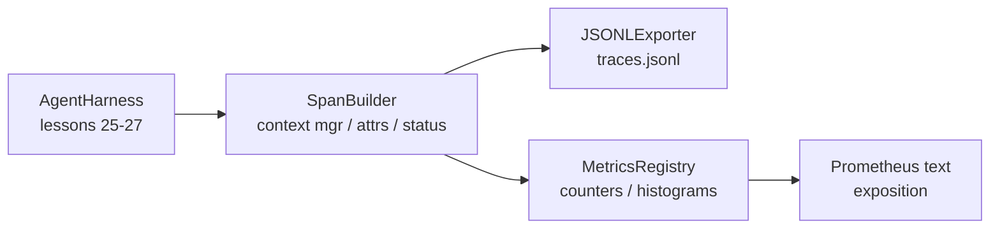

<!-- local-zh-machine-draft: English source is canonical; prose translated automatically, code/math preserved. -->

<a id="capstone-lesson-28-observability-with-otel-genai-spans-and-prometheus-metrics"></a>

# 综合项目第 28 课：通过 OTel GenAI Spans 与 Prometheus Metrics 实现 Observability

> 一个 agent harness 不使用 observability 是一个需要钱的黑盒。 这个课程将一个 发射符合 GenAI 语义学 的 超频建构器, 并写到 JSON- 以每行一行为单位, 并用 Prometheus 文本格式显示反向和直方图。 整个事情都是 stdlib Python 跑离了线

**类型：** 构建
**语言:** Python (stdlib)
**先修要求:** 阶段19 25(verification gates阶段19 26(a)sandbox阶段19 27(平等) harness阶段13 20(开放遥测GenAI),阶段14 23(OTel GenAI公约)
**时间:** ~90分钟

<a id="learning-objectives"></a>

## 学习目标

- 构建一个以 GenAI 语义学学学系为形状的数据类。
- 执行a JSONL 每一行写一个自足的横线的出口商。
- 使用标签和Prometheus文本格式的解析, 构建反射器和直方图 。
- 将任何可调用的内容包在记录时间、状态和例外的跨背景管理器中。
- 验证所排放的环绕 `json.loads` 并且匹配形状。

<a id="the-problem"></a>

## 问题

一个 coding agent 生产过程中,每转转出三种工艺品: 模型呼叫、工具执行和 verification gate 没有结构化的遥测,这些都无济于事。

第一个失败模式是丢失模式 trace。星期二出了点问题,但唯一的记录是500行的聊天日志。没有哪个工具运行的记录,花了多长时间,有多少 tokens 进入了 prompt或门是否拒绝任何东西。 agent 作者必须猜测。

第二个失败模式是不可分离的 trace. 该 harness 写了 spaces , 但使用了它自己的 ad-hoc 字段名称。 在 Grafana、 Honeycomb、 Jaeger 或本地 CLI 中, 没有任何东西可以读取 。 团队的堆叠中存在的任何工具都会被浪费, 因为平面是非标准 。

第三个失败模式是非汇总的度量。 您可以看到一个慢 tool call 在 trace,但您不能回答"什么是p95 letency 读_档案在最后一小时的通话?" 因为没有衡量标准,只有 traces.

开放遥测 GenAI 语义学惯例正是为此而存在的。 它们定义了一套覆盖排放方的小型标准属性 LLM 框架共享。如果您 harness 写下这些属性,每个OTel兼容的后端都可以读取它们。

<a id="the-concept"></a>

## 概念



每一个行动 harness 生成一个波段。 trace ID( 全部) agent 使用该词时,可使用一个横线代号(此操作),一个名称(例如: `gen_ai.chat`, `gen_ai.tool.execution`),根据《全球投资协议》的公约,开始和结束的时间,以及地位。

GENAI 公约将这些属性键标准化: `gen_ai.system` (提供商,例如: `anthropic`, `openai`), `gen_ai.request.model` (模型id), `gen_ai.request.max_tokens`, `gen_ai.usage.input_tokens`, `gen_ai.usage.output_tokens`, `gen_ai.response.model`, `gen_ai.response.id`, `gen_ai.operation.name`,加上工具特定键 `gen_ai.tool.name` 和 `gen_ai.tool.call.id`.

出口者写道: JSONL。 JSON 对象为每行。这是下游工具可以流、 grep 和导入的最简单格式。 真正的 OTel 出口者会说 OTLP GRPC; 课程 JSONL 出口商是离线等同物,每个工作站均无出口。

测量器住旁边 traces。 tool call: `tools_called_total{tool="read_file"}`。直方图记录了观察到的延迟: `tool_latency_ms{tool="read_file"}`。两者都连成普罗米修斯文本展览格式,这是基于拉动的测量标准。

```figure
trace-spans
```

<a id="architecture"></a>

## 建筑



肩膀搭建器是小类,有 `span(name, attrs)` 返回上下文管理器的方法。上下文管理器记录输入开始时间,退出时记录结束时间,如果被提升,附加一个例外,并将最后的间隔推到出口商。

衡量标准登记册是两条单词。 `{(name, frozen_labels): int}`。直方图将原始样品保留在清单中,并在展览时将原始样品序列到Prometheus直方图桶。

<a id="what-you-will-build"></a>

## 做你该做的

`main.py` ships:

1. `GenAISpan` 数据类:跟踪_ID, 横线_ID, 父_span_ID、 名称、 属性、 开始_unix_纳米, 结束_unix_纳米、 状态、 状态_信息,事件。
2. `SpanBuilder` 类 `span(name, attrs, parent=None)` 上下文管理器。
3. `JSONLExporter` 类 `export(span)` 附加一条线。
4. `Counter` 和 `Histogram` 课外加 `MetricsRegistry`.
5. `prometheus_exposition(registry)` 产生文本格式输出。
6. `wrap_tool_call(name)` 设计师,它能发出一个范围并更新测量标准。
7. 演示: 合成完整 agent 援引(gen)_), traces.jsonl,打印普罗米修斯展览,出口零。

横线 ID 和 trace id 是十六字节的十六字节字符串, 由 `os.urandom`。这符合OTel的 W3C trace 出口者从不抛出; 显示IO错误, 但 harness 继续跑

直方图有一个固定的桶(OTel默认的延迟值为毫秒: 5、 10、 25、 50、 100、 250、 500、 1000、 2500、 5000、 10000、 +Inf) 。 样本以列表形式存储; 演示计算每桶需求数 。

<a id="why-hand-rolled-instead-of-opentelemetry-sdk"></a>

## 为什么手推而不是开式遥测sdk

欧泰尔 Python SDK 是一个真正的依赖性。 它也是数千行代码, OTLP 出口商的多个进程, 以及一个运行时间成本, 使得课程预算无法使用。 手动版本教给电线格式。 在制作过程中, 您将相同的属性连接到真实的 。 SDK 免费获得OTLP出口商、批量和资源检测。

常规是稳定的。 课程的电线格式将在2030年继续解析, 因为 OTel 从来不会打破 GenAI 属性名称; 它们只会添加新的名称 。

<a id="how-this-composes-with-the-rest-of-track-a"></a>

## 如何组成 rest A轨

25课制作了门链,26课制作了 sandbox27号课程 harness28课使所有三个都能看到。29课将端到端演示的每一步都打包成横幅,并在结尾处打印普罗米修斯的文字。

<a id="running-it"></a>

## 运行

```bash
cd phases/19-capstone-projects/28-observability-otel-traces
python3 code/main.py
python3 -m pytest code/tests/ -v
```

演示会发出 `traces.jsonl` 测试可以证实连续的圆行、 根基直线属性的存在、 正确对应增量, 直方图解析包含预期的桶数 。
