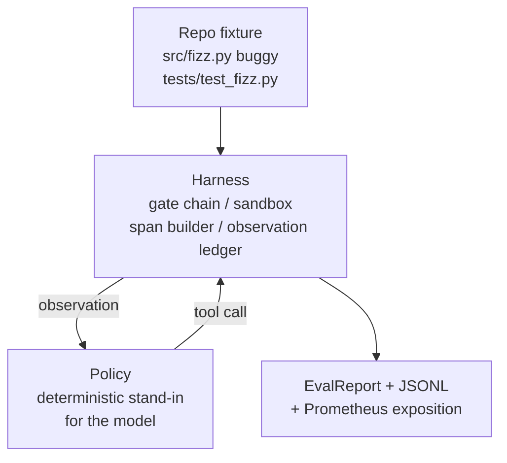
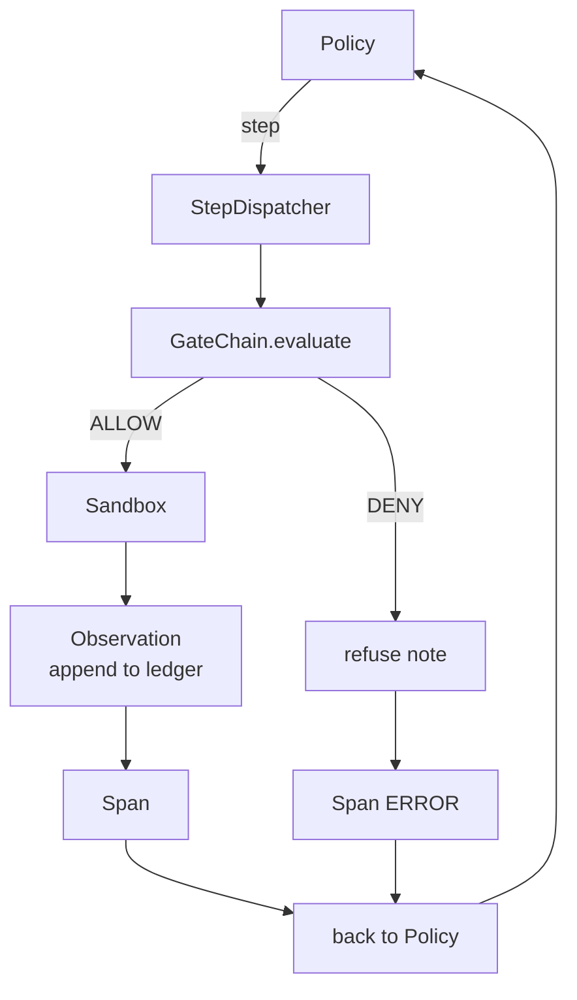

<!-- local-zh-machine-draft: English source is canonical; prose translated automatically, code/math preserved. -->

<a id="capstone-lesson-29-end-to-end-coding-agent-on-the-harness"></a>

# 综合项目第 29 课：基于 Harness 的端到端 Coding Agent

> 轨道A的回报,这堂课缝上了门链 sandbox,反演 harness,OTel 横穿一个工作 coding agent 在一个多文件中修正一个真实的( 小, 固定尺度) 错误 Python 项目。 agent 是一种决定性的政策,而不是一种 LLM;替换使课程可以复制,并显示 harness 合同是相同的:在保单接缝上有一个真正的模型插头。

**类型：** 构建
**语言:** Python (stdlib)
**先修要求:** 阶段19 25(verification gates阶段19 26(a)sandbox阶段19 27(平等) harness阶段19 28(a)observability阶段14 - 38(第1段)verification gates阶段14-41(实际工作),阶段14-42(agent 工作台顶石)
**时间：** ~90 分钟

<a id="learning-objectives"></a>

## 学习目标

- 装上门链 sandbox, 评估 harness,并用一个 agent loop.
- 执行确定性政策,使用读_文件,运行_测试, 并写入_用于修复固定错误的文件 。
- 执行全球级预算,加观察 token budget 穿过终点到终点的运行。
- 全部OTel GenAI traces 和普罗米修斯的全程测试。
- 校验 agent 以法律工具零出门解决不到12个步骤的固定问题。

<a id="the-problem"></a>

## 问题

Most agent 单独演示工作: a sandbox 单凭自己,一个评估 harness 光是一身的射线,看起来不错

门链上说Allow,但 sandbox 拒绝的原因 链没有预料到。 harness 记录了通行证,但OTel的横幅 说大门拒绝一个工具 agent 普罗米修斯计数器在一次加注时两次加薪。 agent 继续前进,因为预算 在链和 sandbox 没想到

这个课是整个轨道的整合测试。 agent 需要做四件事:读取工程,运行测试,从测试失败中识别错误,写好修正,重新运行测试,并停止。每次操作都通过门链。每个工具执行都会通过门链。 sandbox。每个步骤都以一个宽度包裹。 harness 最终得分

<a id="the-concept"></a>

## 概念



该 agent政策是国家机器,五个州

`SURVEY`: 该 agent 读取工程列表。 下一状态是 RUN_TESTS.

`RUN_TESTS`: 该 agent 运行测试命令。 如果测试通过, 国家机器将成功停止。 否则下一个状态是 InSPECT 。

`INSPECT`: 该 agent 读取失败的源文件。 下一个状态是 FIX 。

`FIX`: 该 agent 写正确的文件,下一个州是VERIFY

`VERIFY`: 该 agent 重新运行测试命令。 如果测试通过, 请停止成功 。 否则会以失败停止 。

每个州对应a tool call. 每个 tool call 穿过大门链,如果 tool call 被拒绝, agent 报告说,在 trace 和停止。

固定虫是一对一 `fizz.py`。确定性政策通过正则检测测试失败信息中检测错误,并发布更正文件。用 LLM 不改变 harness contract.

```figure
cg-harness-weave
```

<a id="architecture"></a>

## 建筑



每一个前一流的原始经验 都以最小的规模在 `main.py` (gate, sandbox, 分类账, 横贯),所以课程没有输入兄弟姐妹。名字与25-28课完全吻合,因此概念图是明确的。

<a id="what-you-will-build"></a>

## 做你该做的

`main.py` ships:

1. 最低值 harness 原始人,抄袭与25-28课相同的名字: `GateChain`, `Sandbox`, `ObservationLedger`, `SpanBuilder`, `MetricsRegistry`.
2. `CodingAgentPolicy` 类别:有五个州的州级机器。
3. `Repo` 帮助: 准备一个有捆绑的错误固定线的抓取目录 。
4. `AgentRun` 类:驱动策略,通过 harness,返回 `AgentRunReport`.
5. 捆绑的固定( A)`fixture_repo/`) 使用 rc/fizz.py, 测试/测试_飞碟, 和预想/ 树来进行反校 harness.
6. 演示: 运行策略端到端, 打印逐步 trace显示通行证 指纹

捆绑的固定符与课程 27 的任务结构相同: 一个错误文件和一个测试文件。 测试失败信息包含足够的信息, 以便确定修正策略 。 LLM 将做同样的工作, 慢和更广泛的回忆, 但不会改变 harness期待的希望 和我们一样

<a id="why-the-policy-is-not-an-llm"></a>

## 为什么政策不是 LLM

真实的 LLM 需要 API 键,网络呼叫,和不可核实的随机性。 harness 是一个确定性政策,让任何开发者笔记本电脑上使用该课,而外部依赖度为零,让测试套件进行精确的分级计数。

课程的政策是严格地 LLM agent 政策读取回购,看到失败的测试, 识别线条, 并发布一个修正 。 LLM 同样的循环 harness 合同; 簿记相同。

<a id="what-the-demo-asserts"></a>

## 演示书上说

端到端演示显示有五件东西在出口时使用,测试套件在程序上重复了它们。

政策在不到12个步骤中解决了问题。

观察预算从未超过。

没有任何门声否认法律工具。 agent 从未发明过一个拒绝的工具名。 )

每一步都有相应的宽度 traces.jsonl.

普罗米修斯展览会包含 `tools_called_total{tool="read_file"}` 条目和a `tool_latency_ms` histogram.

<a id="how-this-composes-with-the-rest-of-track-a"></a>

## 如何组成 rest A轨

25课写了门链。 sandbox。 27课写了反省 harness28课写道 observability29课证明他们是一个系统 agent harness 从这里延伸: 将确定性政策换成模型, 将捆绑的固定装置换成真实的回收任务, 将 JSONL OTLP出口国。

<a id="running-it"></a>

## 运行

```bash
cd phases/19-capstone-projects/29-end-to-end-coding-task-demo
python3 code/main.py
python3 -m pytest code/tests/ -v
```

演示每步打印一个 trace,最后的评估报告,和普罗米修斯的展览。退出代码为零。测试涵盖政策状态的过渡,合成产品上拒绝入场 tool calls,端到端运行在捆绑的固定上, 以及递增预算。
