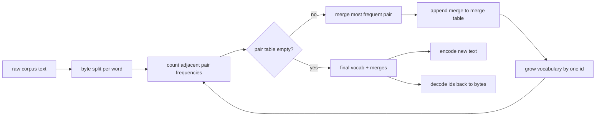
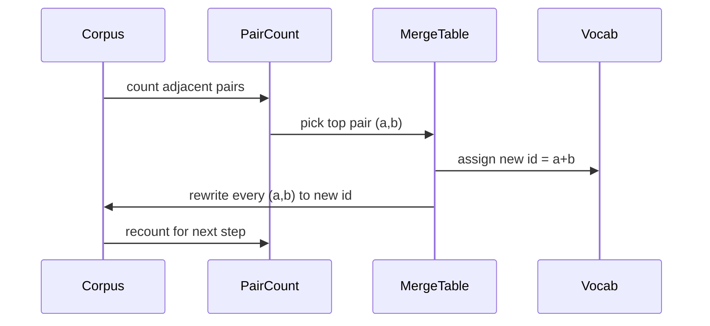

<!-- local-zh-machine-draft: English source is canonical; prose translated automatically, code/math preserved. -->

<a id="bpe-tokenizer-from-scratch"></a>

# 从零实现 BPE Tokenizer

> 字节输入, ID 出来, id 返回到相同的字节。 构建 tokenizer 每一个现代文本模型 仍然从。

**类型:** Build
**语言:** Python
**先修要求:** 04阶段,第07阶段 transformer lessons
**时间:** ~90分钟

<a id="learning-objectives"></a>

## 学习目标
- 训练字节对称编码 vocabulary 由原始文本组成,反复合并最常见的相邻符号。
- 执行一个确定性合并表,并将其应用到新文本中,以产生一系列子词代号。
- 任意向身份识别码输入UTF-8, 并返回时不丢失信息。
- 特别储备和保护 tokens (`<|endoftext|>`, `<|pad|>`让他们在训练和解码中存活下来
- 为何字节字母是普通用途的正确下限 tokenizer.

```figure
cap-bpe-merge
```

<a id="the-frame"></a>

## 框架

语言模型从不看到文字。 它会看到整数。 从字符串到整数列表的地图是 tokenizer。让这个层错,训练过程中的每一个损失曲线都测量错误的东西。

子词的主要家庭 tokenizers 对于普通文本模式来说,它是位元对编码。 概念很小。 从已知的字母开始。 查找在训练文稿中最常出现的相邻符号配对。 将其合并为新的符号。 重复到 vocabulary 达到目标大小。新文本编码将相同的合并列表按同一顺序重复使用。

我们将构建字节变异。 字母表是 256 个原始字节, 不是 Unicode 代码点。 这个选择让 tokenizer 处理任何 UTF-8 输入,不返回未知 token.

<a id="the-pipeline"></a>

## 管道



训练方面和 inference 侧侧共享合并表。共享就是合同。如果您更改合并顺序 inference,您解码了不同的代号。

<a id="the-byte-alphabet"></a>

## 字节字母表

头256 id 保留给 原始字节 0x00 到 0xFF。 保证每个输入字符串都可以在 vocabulary 组合之前,在字节块之后,我们保留一个小范围用于特殊 tokens。训练循环从不建议将这些代号作为合并目标,因为我们完全不让它们进入预定的流体。

启动器在训练前将空白和标点界限的物理体分割开来。 BPE 合并步骤将乐于学习 跨越字词边界和 vocabulary 充满了全部的常用词组。 拆分后, 合并会留在一个单词内, 结果会概括化 。

<a id="the-training-loop"></a>

## 训练循环

每一步训练,循环会做三件事。它会走在柱子上,计算每个相邻的当前符号的出现频率, 以该符号本身的出现频率加权。 它会选择一个最高数的对。 它会将每对相对的发生重写为一个新的符号, 其代号是下一个空格 。 vocabulary。然后它记录合并。



每一步的费用是线性,以符号序列列表的形式表示。 对于百万字和目标 vocabulary 10 000 ids 循环在秒内运行完成, 因为符号序列会随着陆地的合并而缩小。

<a id="encoding-fresh-text"></a>

## 正在编码新文本

Inference 将合并表格按相同顺序应用。对于一个新词, encoder 开始于字节分隔。 它扫描当前最小排序合并的序列( 最早应用的合并) 。 它执行合并。 它再次扫描。 当表格中不合并时循环结束, 适用于当前序列 。

按级别排序是使编码决定性与同一输入的培训行为匹配的属性。 学习过的合并先放在表格顶部,然后应用到第一个。 如果两个合并可以在同一位置适用, 低级者将获胜 。

<a id="special-tokens"></a>

## Special tokens

Special tokens 它们是字节流无法产生的代号,我们用手预留它们。两样足以作为教训。

- `<|endoftext|>` 将文档分隔开来 pretraining。它告诉模型“一个新的文档从这里开始,不要让上一个背景泄漏。”
- `<|pad|>` 填出短序列, 使批量可以是一个矩形 tensor. 训练时隐藏了丢失面具。

该 encoder 接受一个旗帜以允许特殊 tokens 输入。 挂上国旗后, 字符串 `<|endoftext|>` 和 `<|pad|>` 被标记为拼写它们的字节。 挂着国旗, 字串会被映射到保留的身份标识上, 并且不被合并 。

<a id="round-trip-guarantee"></a>

## 往返保证

编码然后解码必须返回输入字节 。 decoder 将每个id 的字节扩展相匹配。 因为每个id 要么是一个原始字节,要么是两个先前已知的id 的组合, 循环扩展总是以原始字节结束。 然后解码返回这些字节拼写的 UTF-8 字符串 。

测试套件在这个课程中检查 属性上 一个看不见的句子, 与一个句子 Unicode 和一句话 包含字面 `<|endoftext|>` token.

<a id="what-this-lesson-does-not-do"></a>

## 课程没有效果的

它不会以最大生产风格 建立正方位驱动的前置输入器 tokenizers。这里的预选器是一个小空白和标点分割。它足以在小型训练材料上产生合理的合并,并与 rest 课程链的顺序不变。 tokenizer 并在上面建立滑动窗口数据集

没有对齐对子柜台平行 Python 在一个有几千字的体积上, 完成在一秒之内。对于较大的公司来说, 显而易见的动作是平行地计算和减少每个单词的对数。

<a id="how-to-read-the-code"></a>

## 如何阅读代码

`main.py` 定义四个对象。 `BPETokenizer` 持有 vocabulary,合并表格,以及特殊-token table. `train` 是一个训练循环。 `encode` 是该 inference path. `decode` 下方的演示 tokenizer 以内置的体形,编码一个被搁置的句子, 解码后, 并打印两个。 `code/tests/test_bpe.py` 给圆程财产定个位置,特别...token 保留,合并顺序。

运行演示,然后改变目标 vocabulary 显示器的大小为 300 到 600, 并观察缓期判决的编码长度如何下降。 此曲线是 BPE 压缩曲线。
