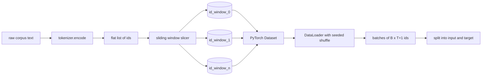
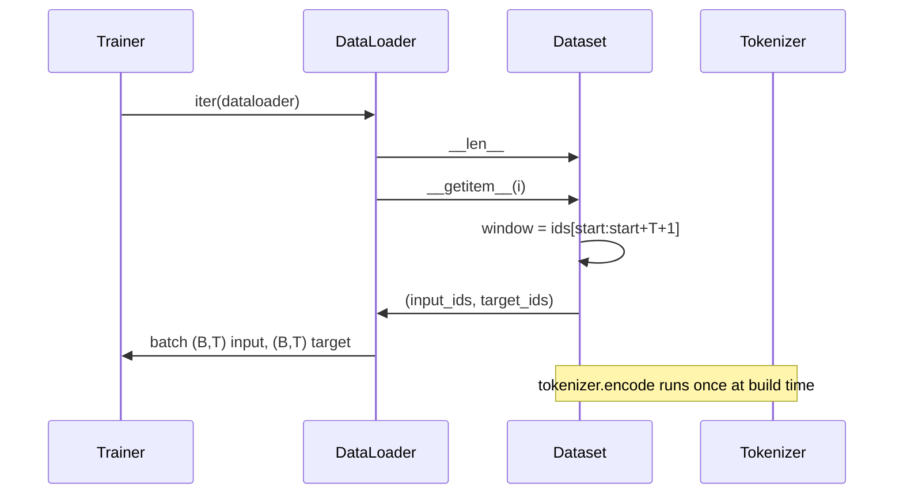

<!-- local-zh-machine-draft: English source is canonical; prose translated automatically, code/math preserved. -->

<a id="tokenized-dataset-with-sliding-window"></a>

# 使用滑动窗口构建分词后的数据集

> 一个 pretraining 运行是一个函数 token ids to ( ID) 密码到 gradients。这个课可以建立传送器, 输入识别码。

**类型：** 构建
**语言:** Python
**先修要求:** 04阶段,第07阶段 transformer 经验教训,本阶段第30课
**时间：** ~90 分钟

<a id="learning-objectives"></a>

## 学习目标
- 将原始体转换成 token 以调用 tokenizer once.
- 将id流切成可配置重叠的固定长度窗口。
- 构建 PyTorch 返回输入和目标的数据集 tensors 下一个...token prediction.
- 将数据集以数据存储器包, 并按每只种子种子进行确定性打乱 epoch.
- 跨步、冗余和有效数据集大小之间的权衡原因。

```figure
cap-sliding-window
```

<a id="the-frame"></a>

## 框架

一个 pretraining 运行读取一整批 token 身份标识,并更新模型。每批的形状由培训合同确定。对于因果语言模式,批次持有 `(B, T)` 输入代号 `(B, T)` 目标代号,目标是输入被一个输入转移。数据管道的任务是根据需要,以决定性和可复制的方式,从可能具有几千兆字节的原始文本中产生该合同。

这个教训造就了输油管 tokenizer 从上一个课程中将文字转换成一个长的单位化的 id。 滑动窗口将列表切分为训练示例。 自定义的数据集将示例作为 tensors。数据滚动器将它们分批,用已知的种子洗涤它们。

<a id="the-shape-contract"></a>

## 形状合同

因果关系LM 消耗形状的代号 `(B, T)` where `B` 是该 batch size 和 `T` 的上下文长度。目标位置 `t` 是在位置上的输入 `t+1`。这意味着每个训练实例都包含 `T+1` 原始 ID。 窗口的步进控制了连续示例之间的重叠程度 。



切片机不会与柱体的边界重叠。 如果最后一个窗口没有足够的代号来填充 `T+1` 切片机会掉下来,尾巴上 `<|pad|>` 这也是一个有效的选择,但它使损失面具复杂化。

<a id="why-a-sliding-window"></a>

## 为什么是滑动窗口

一个 pretraining 体形是一长串的代号。 如果模型只看到不重叠窗口, 每个训练示例都会教它相同的 `T` 调整曲线,使模型看到更多样化的预测token tasks.

一大步的 `T` 产生非重叠窗口。 `T // 2` 产生50%的重叠,并使有效的数据集翻倍。 `1` 产生最大重叠,并增加数据集 `T`。费用是按每平方英尺计算的 epoch好处是更加边界多样性。 pretraining 运行时使用与上下文长度相等的步数,因为该体已经大大大于模型能够完成的一个 epoch,因此边界多样性的论点比较弱。

<a id="the-dataset-class"></a>

## 数据集类

一个 PyTorch 数据集有两个需要的方法。 `__len__` 返回示例数。 `__getitem__` 返回一个示例作为 tensors。我们的数据集存储编码的 ID 流和路径。在它上索引计算苍蝇上的窗口开始,因此内存成本是id 流的复制件,不管该路径生成多少例子。



里面的轮班发生 `__getitem__`。数据集返回 `(input, target)` where `input = window[:-1]` 和 `target = window[1:]`。两者都是 PyTorch long tensors训练圈将之视为地面真相。

<a id="deterministic-shuffle"></a>

## 决定性的洗牌

数据浏览器 `shuffle=True` 读取自 a PyTorch 随机生成器。 通过传递一个明确的 `torch.Generator` 种子数 epoch,每次运行重新开始时,我们都会得到同样的打牌。当您想要比较两个只在一个单行中不同跑步时,该属性很重要 hyperparameter。没有种子,两个运行点将数据按不同的顺序排列,损失曲线因与变化无关的原因而有所不同。

这份课程的种子合同很简单 `epoch_seed = base_seed + epoch_index`。基数种子通过建筑。 epoch 指数由每个顶部的训练员加起来 epoch。用同样的种子重新运行, 总是看到相同的顺序 epoch.

<a id="batch-sampler"></a>

## 批次取样器

默认取样器 PyTorch 随机选择索引, 且替换已禁用。 这就是我们想要的 。 pretraining。为了对一个小数据集进行微调,合同是相同的。数据 Loader 调用 `__getitem__` `B` 时间和堆放结果。 因为每个例子的构造长度相同, 因此不需要粘贴逻辑 。

教训 `num_workers=0` 简单化。在生产过程中,工人将 `__getitem__` 电话,我们管线大部分是没有用的 因为工作只是片记忆 tensor,但数据组相同 API 支持工人的清洁。

<a id="counting-examples"></a>

## 计数实例

用于代号长度 `N`,一个上下文长度 `T`,和一个步 `S`,示例数为 `max(0, 1 + (N - (T + 1)) // S)`。该课中显示,计算是数据集上的静态方法,以便培训师能够计算每台总步数。 epoch 不加反复

<a id="what-this-lesson-does-not-do"></a>

## 课程没有效果的

磁盘不会流出。 文稿已完全编码在记忆中, 并被作为单 tensor。对于几百万个ID的体积来说,它远低于100兆字节,是教学的正确形状。 streaming 是一个单独的关注点,它通过替换存储器而插入,但保留数据集合同。

它不处理多个文档。 文稿被作为连续的 id 流处理。 下一个文档的边框通过插入编码 `<|endoftext|>` 当从多个文档中构建该元素时, 模型会学会在边界周围进行预测 。

<a id="how-to-read-the-code"></a>

## 如何阅读代码

`main.py` 定义两个类别和一个助手。 `SlidingWindowDataset` 是该 PyTorch Dataset. `make_dataloader` 返回带有种子生成器的配置数据 Loader。 `_encode_corpus_to_ids` 是一个镜头 tokenizer 底部的演示组造了一个小 tokenizer 正在处理中,将内置的文体编码,构建数据集和数据装入器,打印一个批次,并标定形状合同。 `code/tests/test_dataset.py` 输入窗口数公式, 移动一个属性, 确定性洗牌, 以及跳跃取舍 。

运行演示。 然后将上下文长度从 16 改为 32 , 并查看每个示例的数量 。 epoch 下降,这个数字是你的阶梯...epoch budget.
