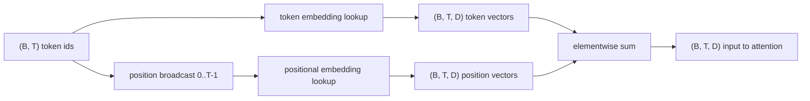
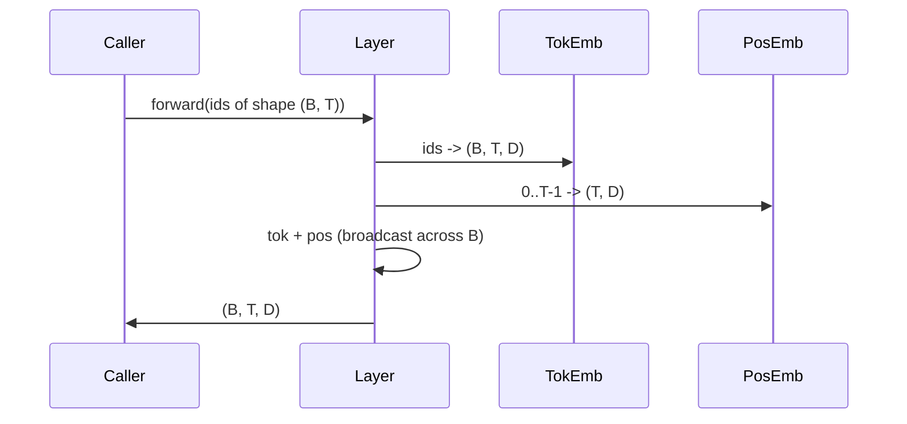

<!-- local-zh-machine-draft: English source is canonical; prose translated automatically, code/math preserved. -->

<a id="token-and-positional-embeddings"></a>

# Token 与位置 Embeddings

> ID是整数。 模型需要矢量。 两个查看桌位于它们之间, 一个位置的选择决定了模型能够学习的内容 。

**类型:** Build
**语言:** Python
**先修要求:** 04阶段,第07阶段 transformer 经验教训、本阶段的经验教训30和31
**时间:** ~90分钟

<a id="learning-objectives"></a>

## 学习目标
- 构建 token-embedding 地图的查找表格 vocabulary 密闭矢量的ID
- 建立学习位置embedding 查找表格按位置索引。
- 构建固定的正弦类位置 embedding 以无位置索引 parameters.
- Compose token 职位 embeddings 输入为 transformer block.
- 学习对比度和鼻弦 embeddings 和关于篇幅的概述 parameter count.

```figure
cc-embedding-lookup
```

<a id="the-frame"></a>

## 框架

模特儿第一次和A token ID 是一排搜索 token-embedding 矩阵。 vocabulary ID 和 每一模型维度的一个列。 查找返回 rest 格式的选项。后方文本更新 forward pass。通过培训这些行的几何学,可以将相似性编码为方向。

Token 光是ID就没有任何顺序。 模型需要第二个信号, 显示它的位置与位置 17 不同。 该信号的两种主要选择是学习定位 embedding (第二张查表,每处一行)和固定的正弦位置 embedding (数学公式没有) parameters选择有后果。 parameter 并且与模型所训练的最大上下文长度相连接。 parameter- 理论上是自由的,公式延伸到任何位置, 但这个课 `SinusoidalPositionalEmbedding` 预估一个固定表格 `max_context_length` 及其 `forward` 将该约束值移过; 因此, 两个模块在此执行最大上下文长度 。 即使表格足够大可以索引, 该模型仍然可能要挣扎超过其训练长度 。

并用这些教训来形成 token embedding 输入到下一课 attention block.

<a id="the-shape-contract"></a>

## 形状合同

输入到 embedding 阶段是一整批 token 形状的代号 `(B, T)`输出为 tensor 形状 `(B, T, D)` where `D` 是一个模型尺寸。每个批量元素的上下文长度相同。 `T`。每个位置的矢量尺寸相同 `D`.



组成是一笔总和,不是一笔共产主义。 `D` 通过网络来固定, 让模型决定每 -feature 是否基于 token 意思或位置在每一层都占主导地位。

<a id="the-token-embedding-matrix"></a>

## 该 token embedding matrix

该 token embedding 是一个 parameter tensor 形状 `(V, D)` where `V` 是该 vocabulary size. PyTorch 暴露为 `nn.Embedding(V, D)`。在输入时,条目取自一个小高斯语,传统上平均零差和标准差围绕 `0.02` 用于 transformer准确的内涵比它保持连续运行要重要

该 forward pass 是一个单一的索引操作。 PyTorch maps `(B, T)` 内特64 id 到 `(B, T, D)` 通过收集行来浮动。 backward pass accumulates gradients 仅进入在 forward pass。两行从未出现在批次中,则接收零 gradient 在那一步上,我看见你

细微的细节 token embedding 模型末的产出预测往往共享 weights (weight 等事情发生,每个 backward pass 触摸每列 embedding 。 这里的教训显示, 两者都是不同的模块, 但相同的矩阵可以在完整的模型中扮演两个角色 。

<a id="the-learned-positional-embedding"></a>

## 学着的姿势 embedding

学着的姿势 embedding 仅次于秒 `nn.Embedding` 形状 `(max_context_length, D)`。查找由位置 ID 键入 `0, 1, 2, ..., T-1`. 该 forward pass 将矢量置于批量维中。

学习表的缺点是不能在位置上查询 `T` 如果模型只是经过训练才被安排到 `T-1`。该行不存在。 decoder- 只有使用这个计划的模式才能将最大环境长度植入建筑,拒绝处理较长的投入。

<a id="the-sinusoidal-positional-embedding"></a>

## 类固醇位置 embedding

类固醇位置 embedding 是一个函数,从位置到矢量。 `p` 和 feature `i` produce

```python
angle = p / (10000 ** (2 * (i // 2) / D))
emb[p, 2k]     = sin(angle)
emb[p, 2k + 1] = cos(angle)
```

函数没有 parameters。每个位置都有独特的矢量。波长在几何上各不相同。 feature 维度,所以低维度编码粗体位置 高维度编码精细位置。

选择财产 `sin` 和 `cos` 共是矢量处于位置 `p + k` 是矢量在位置上的线性函数 `p`。这给了 attention 平面图中有一个学习相对位置偏移的简单路径。此模型不需要单独设置 parameter 表示"看五号" tokens back."

课目在构造时计算整个正弦表,并在前方将索引输入。

<a id="the-composition"></a>

## 组成

输入管道按顺序做了三件事。读取 token 身份识别码,查查 token 向量。添加位置向量。返回总和。



和步骤的广播复制了 `(T, D)` positional tensor 沿着批量维度 PyTorch 自动处理,因为位置 tensor 形状 `(1, T, D)` 解冻后

<a id="contrastive-analysis"></a>

## 反向分析

课程在相同的输入上同时使用两种变量,并打印了两种诊断。

第一条是 parameter 计数。 学习的变量添加 `max_context_length * D` parameters 上方的 token embedding。正弦变体增加了零。

第二是 cosine similarity 之间 embeddings 类比变体在相邻位置。 类比变体由于函数是连续的, 具有平稳和可预测的衰变。 初始化时的学得变异体由于行是独立绘制的, 具有近乎随机的相似性。 受过训练后, 学习变异体通常会形成类似的结构, 但必须从数据中发现这种结构 。

<a id="what-this-lesson-does-not-do"></a>

## 课程没有效果的

它不构建旋转位置编码( Q)RoPE或阿里比,这些是现代生产选择 transformers。它们都遵循与 embeddings 在此( 对形状矢量应用基于位置的转换) `(B, T, D)`)但适用于 attention- 预测步骤而不是输入。 attention 键,并且一个可选的扩展就是将旋转键折叠到那里的查询键投影中。

训练不了 embedding培训需要损失,这需要模型输出,这就需要 attention 和LM头,这是下一个课,然后一个课

<a id="how-to-read-the-code"></a>

## 如何阅读代码

`main.py` 定义了三个模块。 `TokenEmbedding` wraps `nn.Embedding(V, D)`. `LearnedPositionalEmbedding` wraps `nn.Embedding(L, D)`. `SinusoidalPositionalEmbedding` 预估表格,并将其作为缓冲。 `EmbeddingComposer` 链接 a token embedding 和职位 embedding 一起。 底部的演示 打印形状, parameter 和相邻位置相似性诊断。 `code/tests/test_embeddings.py` 针形,广播行为, parameter 数,和弦形公式。

运行演示。 然后改变模型的尺寸 `D` 注意脊髓波长带的变化
