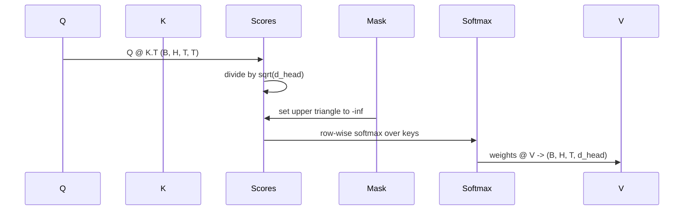

<!-- local-zh-machine-draft: English source is canonical; prose translated automatically, code/math preserved. -->

<a id="multi-head-self-attention"></a>

# 多头 Self-Attention

> 一条线性投影,三个视图, H 平行头,一个面具。 attention 块,作为模型实际上使用它。

**类型:** Build
**语言:** Python
**先修要求:** 04阶段,第07阶段 transformer 经验教训,本阶段第30至32段
**时间:** ~90分钟

<a id="learning-objectives"></a>

## 学习目标
- 执行分批的查询/钥匙/价值投影,将单线层分成H头。
- 计算缩放的点产品 attention 与正确 normalization 和dtype 处理。
- 使用因果面具,防止职位进入未来职位。
- 检查每个头部 attention weights 以固定输入和解释每个头部的目光
- 训练一下 attention 挡住玩具任务 看着损失随着头部的专业化而下降

```figure
cap-multihead-attention
```

<a id="the-frame"></a>

## 框架

Attention 函数 token代表从其他 tokens 同样的顺序。 Self-attention 表示查询、键和值都来自相同的输入。多头表示投影被拆分为 H attention 产出被集中和预测回来的问题。

高效实施模式是一个线性层,从 `D` 以 `3 * D` 被切成三个视图,然后被重塑为H型头 `D // H` 每个人,马图尔, softmax,并按批次计算加权总和 tensor 操作,所以头在加速器上平行运行。

这个课构建了这个块。 它也添加了因果掩码, 所以相同的代码可以和 attention 层 decoder- 仅用语言模型。 下一个课程将街区堆叠成一个完整的 transformer 和训练后的课程。

<a id="the-shape-contract"></a>

## 形状合同

输入 `(B, T, D)`输出为 `(B, T, D)`。面具是 `(T, T)` 或可以广播到它。 tensors 形状 `(B, H, T, d_head)` where `d_head = D // H`。限制是 `D % H == 0`.

```mermaid
flowchart LR
    A["(B, T, D) input"] --> B[Linear D -> 3D]
    B --> C["split into Q, K, V"]
    C --> D["reshape to (B, H, T, d_head)"]
    D --> E["scores = Q @ K.T / sqrt(d_head)"]
    E --> F[apply causal mask]
    F --> G[softmax over keys]
    G --> H["context = weights @ V"]
    H --> I["reshape to (B, T, D)"]
    I --> J[output Linear D -> D]
    J --> K["(B, T, D) output"]
```



唯一的线性层(QKV预测和输出预测) parameters 面具,那个 softmax,交配,和重塑都是 parameter-free.

<a id="the-qkv-split"></a>

## QKV 分割

幼稚的落实有三个不同的线性层,Q、K和V各一个。 高效的一层有一个输出层 `3 * D` features 并分割结果。 两者在数学上等同, 因为三个不同的矩阵乘法 `(D, D)` weights 完全是一个矩阵乘法 `(3D, D)` weight 堆积如山

高效版本更快, 因为加速器发射一个而非三个马图尔。 启动也更容易, 因为三个子矩阵都生活在同一个区域 。 parameter tensor 并且可以一起初始化

<a id="the-head-reshape"></a>

## 头部重塑

分开后,每个Q,K,V是 `(B, T, D)`将它平行化为 H attention 问题,我们重新组织 `(B, T, H, d_head)` 转至 `(B, H, T, d_head)`。正弦尺寸现在与批量尺寸相邻,所以 PyTorch 处理每个头部 attention 分批操作 `B * H` 独立诉讼。

时间_头部维度保持不变, 以让分数 matmul `Q @ K.transpose(-2, -1)` 合同,结果就是 `(B, H, T, T)` per-head attention scores.

<a id="scaling"></a>

## 缩放

分数除以 `sqrt(d_head)` 之前 softmax不进行这种规模的调整,点产品将增长为 `d_head` 成长和推动 softmax 进入一个几乎全部质量都存在的制度 而其他的则消失得很少 gradients 和学习的摊位。 `sqrt(d_head)` 保持分数的差数在头大小上大致不变。

<a id="the-causal-mask"></a>

## 因果关系面具

一个 decoder- 只有语言模型才能在预测下一个时以过去为条件 token面具是用这个来涂的 具体来说 在 softmax,每个条目的对角 `(T, T)` 得分矩阵被负无限替换。 稍后 softmax 位置 weight zero.



我们把面具登记为建筑的缓冲器 所以它和模型一样 都生活在同一个装置上 gradient 图形。掩码覆盖了块将看到的最大上下文长度。在前方,我们切除左上角 `(T, T)` corner.

<a id="the-output-projection"></a>

## 产出预测

之后的每个头部环境矢量 `(B, H, T, d_head)`,我们转换到 `(B, T, H, d_head)`重塑为 `(B, T, D)`,并应用最终 `(D, D)` 线性投影。输出投影让模型混合头部。没有它, H头只能重新在后层进行重新检测,块会受到人为限制。

<a id="attention-weight-inspection"></a>

## Attention weight inspection

课上讲到 `return_weights=True` 图标 forward pass。设置后,块返回每个页头 attention weights 形状 `(B, H, T, T)` 演示打印出一个头的热图 weights 在一个简短的输入中,您可以看到因果三角结构和每个位置的焦点。

在一个经过培训的模式中,不同的人头学习不同的模式。 token。有些头会注意序列的开始。有些头会分散 attention 检查钩是解释性工作的切入点

<a id="the-training-demo"></a>

## 培训演示

底部的演示 `main.py` 电线 attention 块块,以一个小 LM 头,并用重复任务来训练整个内容。输入的每一行都是在上下文中复制的单个随机代号。目标是输入被一个输入转换,所以模型必须知道下一个 token 与上一个相同 token损失 cross-entropy。 H=4, D=32, T=12, a 具有 H=4, D=32, T=12, vocabulary 损失额为64, 随机(约合 `log(64) ~ 4.16`下到井底 `1.0` 超过三世纪 CPU.

演示的要点不是训练一个有用的模型。 gradients 穿过街区的每一块 头部会学到一些答案显而易见的问题

<a id="what-this-lesson-does-not-do"></a>

## 课程没有效果的

它没有添加进料前方块。 transformer 在一个真实模型中的层 attention 之后是双层 MLP, 并围绕每个端点有一个剩余连接和分层规范。 下一个课添加了这些 。

它不执行旋转或 AliBi 位置编码。 两者都适用于同一街区的QKV投影步骤, 但都是单独的教学单元。 这里构建的块与此块兼容, 在 matmul 前转换 Q 和 K 。

计划没有执行 KV cache 用于 inference键和数值 forward passes 优化 autoregressive 快速解码。 它改变了 K 和 V 的形状合同 tensors 但不在Q上。 它属于 inference lesson.

<a id="how-to-read-the-code"></a>

## 如何阅读代码

`main.py` defines `MultiHeadSelfAttention`。该类包含两个线性层和一个已注册的遮罩缓冲。 forward pass 计划,重塑,分数,面具, softmaxes, weights,重塑,再进行工程。 attention 与 token 职位 embeddings 和一个LM头,训练它 复制任务的三个时代, 并打印丢失曲线和每个头 attention 热图。 `code/tests/test_attention.py` 标注形状合同, 因果关系属性, softmax 属性、头分割的属性和 gradient flow.

运行演示,然后增加 `n_heads` 4至8岁(保留) `d_model=32`那样 `d_head=4`看着热图的改变
