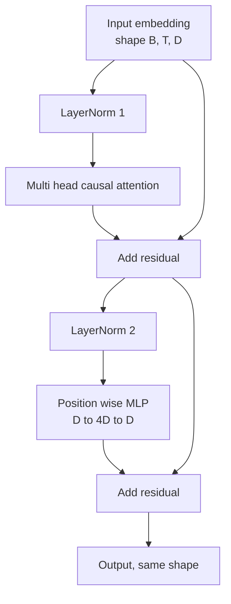
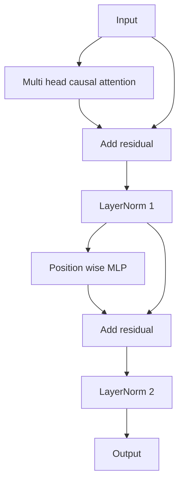

<!-- local-zh-machine-draft: English source is canonical; prose translated automatically, code/math preserved. -->

<a id="transformer-block-from-scratch"></a>

# 从零实现 Transformer 模块

> 每一个现代的单位 decoder LLM。图层规范,多头 attention,剩余, MLP,剩余。 warmup。LN后变体是原纸运到的。这个课程同时构建,并显示哪个在12层堆积物中幸存 learning rates.

**类型：** 构建
**语言:** Python
**先修要求:** 第19阶段 30-33项经验教训(tokenizer, embeddings, attention 数学,分批数据装载器)
**时间:** ~90分钟

<a id="learning-objectives"></a>

## 学习目标

- 构建 transformer 块英寸 PyTorch 由四块移动的碎片中产生: LayerNorm,多头因果 attention剩余连接,位置明智的MLP。
- 移动 LayerNorms 并解释为什么一列火车没有 warmup.
- 执行多头内部的因果掩码 attention so token `i` 无法看到 tokens `j > i`.
- Track gradient 在一个12层堆叠上通过两个变体流,然后不挥手地读取结果。
- 下次课一亿二千四百万分之一的时候 重新使用这个街区作为空投单位 parameter GPT.

<a id="the-problem"></a>

## 问题

一个 transformer 重复一个街区。 错误一个街区, 重复12次, 然后您发送一个模型, 在第一个 epoch 或需要的 warmup 黑客输入 rest 。 您在此课中看到的两种失败模式并不奇特。 它们第一次出现时, 学习者天真地堆叠了块块。 一个是 attention 另一层是 LayerNorm 将残留信号放在深处 无法调节

修理是机械的,一看到它,就有两个残径 normalization 位置。正确选择位置和 rest 堆叠的只是簿记

<a id="the-concept"></a>

## 概念

每个 decoder 仅 transformer 区块是一个函数,需要 tensor 形状 `(batch, sequence, embedding)` 返回 a tensor 内部两个子层负责工作



这是LN前的变体 LayerNorm 坐在残骸里 branch,在子层之前。剩余连接将未正常信号向前传送。

后 LN 变量移动 LayerNorm 后加。



形状相同。 训练行为不相同。 在LN后, gradient 流回残骸的路径 必须经过 LayerNorm。 learning rate `3e-4`, 该 gradient 速度足够快,需要 warmup 计划。 LN 前置剩余路径未正常, 所以 gradients 向大眾宣傳 embedding 图层。 LN 前是配置 GPT-2艘船继续航行,原因就在这里

<a id="causal-multi-head-attention"></a>

### 导致多头 attention

该 attention 子层工程输入 3 种方式进入查询、密钥、值 tensors。每个修改 `(B, T, D)` 以 `(B, H, T, D/H)` where `H` 是头部数。 缩放点产品 attention computes `softmax(Q K^T / sqrt(d_k))` 将顶端三角形遮盖为负无穷,通过 softmax,然后乘以 `V`。头部被重新组合成一个 `(B, T, D)` tensor 并再次投射。 面具是唯一的一块 使模型因果。 忘了面具,你训练一个模型作弊。

<a id="the-mlp"></a>

### 多边采购方案

位置明智 MLP 将相同的两层网络应用到每个 token 独立。隐藏宽度是 embedding 宽度, 激活为 GELU, 和一个 dropout 顺着第二线。 tokens 都在MLP内部聊天 token 混合发生于 attention.

<a id="residual-connections-do-two-things"></a>

### 剩余连接有两件事要做

他们造了 gradient 路径添加到深度, 保持 gradient 标准,通过十二层。它们还让每个区块学习一个与运行中的表示值相适应的添加值,而不是完全替换。这两个效果都是块比例的原因。

```figure
cc-transformer-block
```

<a id="build-it"></a>

## 动手实现

`code/main.py` implements:

- `class LayerNorm` 应用于可学习规模和变化、偏差的 Eps token vector.
- `class MultiHeadAttention` 与 `num_heads`, `head_dim = d_model // num_heads`,连接的QKV投影, 注册因果掩码, attention 剩余 dropout.
- `class FeedForward` 以两层线性金属为单位, GELU activation, dropout.
- `class TransformerBlock` 以 a 为单位 `pre_ln` 标记两个变体之间的角。
- 构建一个6层LN前堆和6层LN后堆的演示文稿,其输入和打印相同 (a) 输出形状,(b) gradient 规范的 embedding 过了一个 backward pass.

运行：

```bash
python3 code/main.py
```

输出: 检查两个堆叠的形状, gradient 规范并列。 embedding gradient 是比后 LN 堆栈大小的星级 learning rate,这是实验信号 之前的LN列车没有 warmup.

<a id="stack"></a>

## 堆栈

- `torch` 用于 tensor math, autograd, 和 `nn.Module` plumbing.
- 否 `transformers`,没有预科 weights。该区块由原始人执行。

<a id="production-patterns-in-the-wild"></a>

## 野生生物的生产模式

三种模式把教科书块变成你可以载的东西

**虚幻的QKV投影** 三个单独的线性层需要三个内核发射和三个垫层。 `3 * d_model` 在一个发射中做同样的工作, 然后沿着最后一个轴分割输出。 每一个加速器的导出路径都更快, 并且匹配什么引用执行 GPT-2, LLaMA, 和 Mistral 所有的船。

**注册的因果掩码缓冲器** 掩码仅取决于最大上下文长度。 `register_buffer`,按每张 forward pass,并跳过每次呼叫的分配。忘记了这个,面具就变成了长的分布点。

**Dropout 有两个地方,不是三个** Dropout 属于 attention softmax (attention dropout)和第二线(后半部) dropout). 一个 dropout 剩余部分本身打破了添加特性,使 gradient 有些早期的实验错误了 并且用微弱的训练来支付

<a id="use-it"></a>

## 实际应用

- 课中的块插在 GPT 装配,第35课,不作修改。
- 液态前变异物是现代的 weights LLM 使用。 LN 后变量是2017年的原值 attention 使用纸张。知道两者足以读取任何 decoder 建筑会遇到你
- 交换 GELU 用于 SiLU 并且你拥有 LLaMA 家庭激活。 LayerNorm 用于 RMSNorm 并且你拥有 LLaMA family normalization同样的骨骼

<a id="exercises"></a>

## 练习

1. 添加a `bias=False` 向区块中每个线性点点点。 现代打开 weights LLMs 测量有多少 parameters 您保存在 12 层 768 暗型号中。
2. Replace `nn.LayerNorm` 手滚动 RMSNorm 并验证输出形状没有变化。
3. 添加返回 attention weights 头头像一个 `(B, T, T)` tensor。绘制上三角形以确认它为零 softmax.
4. 构建一个能给a进料的理智检查 `(2, 16, 384)` tensor 与 `H=6` 使用两种变式,并声称前方产出不同(例如, `not torch.allclose`) 当 weights 初始化相同, dropout 设置为零。

<a id="key-terms"></a>

## 关键术语

| 术语 | 人们怎么说 | 它实际上意味着什么 |
|------|-----------------|------------------------|
| 预LN | "先行规范" | LayerNorm 剩余 branch,每个子层之前;剩余部分带有未正常的信号 |
| Post-LN | "后标准" | LayerNorm 后加;2017年的纸张运出什么,需要什么 warmup |
| 因果面具 | 三角面罩 | 上三角形 attention logits 设置为负无限 token 我读不懂 token j 大于i时 |
| 引信QKV | "组合投影" | 一条宽度为3D线,而不是三条宽度为D;一条内核,一条马图尔 |
| 残余流 | “跳过连接” | 未经规范的 tensor 在每个街区上到下流动;每个街区增加什么 |

<a id="further-reading"></a>

## 进一步阅读

- 第7阶段第02课(本身) attention 以备 attention 数学在这个街区下面
- 第7阶段第05课(全部) transformer) 用于 encoder decoder 同样的骨骼
- 第10阶段第04课(培训前微型) GPT) 用于该块插入的培训程序。
- 第19阶段第35课(这道) 将12个区块堆积成 GPT 模型.
